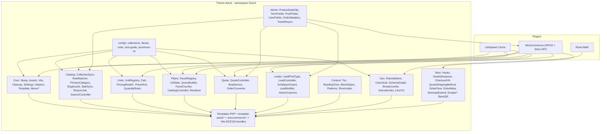

# 02. Kiến trúc kỹ thuật & Quy ước code

> Tham chiếu ADR: `D-01`..`D-30` trong [00_Project_Brief_Decisions.md](00_Project_Brief_Decisions.md), [14_Data_Dictionary_And_Settings.md](14_Data_Dictionary_And_Settings.md), [15_REST_API_And_JS_Contract.md](15_REST_API_And_JS_Contract.md), [16_Template_Component_Porting_Guide.md](16_Template_Component_Porting_Guide.md).
> Skill: `wordpress-theme-development`, `php-pro`, `wp-rest-api`, `wp-interactivity-api` (tham khảo), `backend-security-coder`, `frontend-security-coder`, `clean-code`, `javascript-pro`.

## 1. Stack

| Lớp | Công nghệ | Ghi chú |
|---|---|---|
| CMS | WordPress 7.1.x | Theme classic + `theme.json` cho editor (`D-01`) |
| Commerce | WooCommerce 11.2.x | HPOS bật 100%, classic cart/checkout shortcode (`D-15`, `D-22`, `D-30`) |
| SEO | Rank Math free 1.0.28x | Meta, sitemap, breadcrumb, primary term, schema, llms.txt, robots.txt |
| Cache | LiteSpeed Cache (production AZDIGI) | Xem [08_Performance_Hosting.md](08_Performance_Hosting.md) |
| PHP | ≥ 8.1 (local 8.2) | `declare(strict_types=1)`, typed properties, enums khi phù hợp |
| Build | Vite 6+, Lightning CSS, Node 22 | Chỉ build ở máy dev/CI, server chỉ nhận `assets/dist/` |
| JS | Vanilla ES2022 modules | Tách entry theo template + `import()` động; cấm jQuery mới, React/Vue/Alpine, classic IIFE |
| CSS | Vanilla CSS: `@layer`, nesting, custom properties, container queries, `:has()` | Không framework, không `!important`, không hard-code HEX |
| Lint | PHPCS (WordPress-Extra) · ESLint · Stylelint · Prettier | Chạy trước commit |

## 2. Kiến trúc tổng thể



**Nguyên tắc module (`D-07`, `D-23`):**
- Mỗi module chỉ đảm nhận 1 miền trách nhiệm và tự đăng ký hook qua `register(): void`, không gọi chéo module khác ngoài interface/public method.
- Dữ liệu lưu trữ hoàn toàn trên cấu trúc chuẩn của WP/WC: `product_cat`, `pa_*`, post meta (qua WC CRUD), term meta, user meta, CPT private `drv_lead` (cho báo giá công trình BOQ và toàn bộ form thu lead), option `drv_settings`. **Không tạo bảng DB riêng** ở Phase 1.
- Các module `Catalog`, `Units`, `Filters`, `Quote`, `Leads`, `Seo`, `Woo` phải tách được sang plugin riêng ở các phase sau chỉ bằng cách đổi file bootstrap, không sửa logic nghiệp vụ.

## 3. Cấu trúc thư mục

```text
wp-content/themes/dravit/
├── style.css                    # Theme header (Text Domain: dravit, Requires PHP: 8.1)
├── functions.php                # define hằng số, PSR-4 autoloader, Dravit\Theme::boot()
├── theme.json                   # sinh tự động từ tokens.json (version 3)
├── screenshot.png
├── config/
│   ├── collections.php          # 28 Smart Collections + trọng số priority (03 §3, D-27)
│   ├── facets.php               # 14 facet + nhóm robots seo/tech (05 §2, D-21)
│   ├── units.php                # pricing models + đơn vị mua m²/thùng/viên (04 §1, D-24)
│   ├── size-guide.php           # cấu hình sơ đồ tỷ lệ khổ gạch & bề mặt trên Home
│   └── provinces-vn.php         # 34 Tỉnh/Thành phố Việt Nam sau sắp xếp (D-16)
├── inc/
│   ├── Theme.php                # boot: khởi tạo các module theo thứ tự chuẩn
│   ├── Core/
│   │   ├── Setup.php, Assets.php, Vite.php, Cleanup.php, Settings.php, Helpers.php, Template.php
│   │   └── Menu/                # MegaMenuRenderer.php (cache drv_mega_html), NavWalkers.php (19)
│   ├── Catalog/                 # CollectionSync.php, RuleMatcher.php, PrimaryCategory.php, SlugGuard.php, SaleSync.php, ResyncJob.php, SearchController.php
│   ├── Units/                   # UnitRegistry.php, Calc.php (lõi tính duy nhất), PricingModel/{AreaPack,Piece,Set,Pack}.php, PriceHtml.php, QuantityRules.php
│   ├── Filters/                 # FacetRegistry.php, UrlState.php, QueryBuilder.php, FacetCounter.php, CatalogController.php, Renderer.php
│   ├── Quote/                   # QuoteController.php, BoqService.php, OrderConverter.php (17)
│   ├── Leads/                   # LeadPostType.php (drv_lead), LeadController.php (/nonce, /lead), AntiSpamGuard.php, LeadNotifier.php, AdminColumns.php
│   ├── Content/                 # Toc.php, ReadingTime.php, BlockStyles.php, Patterns.php, Shortcodes.php (20)
│   ├── Seo/                     # RobotsMatrix.php, Canonical.php, SchemaGraph.php, Breadcrumbs.php, InternalLinks.php, LlmsTxt.php
│   ├── Woo/                     # Hooks.php, AssetsDequeue.php, CheckoutVN.php, QuoteShippingMethod.php, OrderFlow.php, OrderMeta.php, StoreApiExtend.php, Emails/*, BankQR.php
│   └── Admin/                   # ProductDataTab.php, TermFields.php, PostFields.php, UserFields.php, OrderMetabox.php, ToolsResync.php
├── header.php · footer.php · index.php · front-page.php · home.php · category.php
├── page.php · single.php · archive.php · search.php · 404.php · searchform.php
├── page-templates/
│   ├── template-contact.php     # /lien-he (Showroom, Kho & Form liên hệ hợp nhất)
│   ├── template-quote.php       # /danh-sach-bao-gia (Dự toán BOQ theo phòng)
│   ├── template-policy.php      # 5 trang chính sách (layout 2 cột có mục lục)
│   └── template-ai-finder.php   # /tro-ly-ai-tim-gach (Phase 3, noindex ở Phase 1 - D-25)
├── template-parts/
│   ├── ui/        (btn, badge, r-badge, product-card, unit-calc, stepper, sub-silo-tile, section-head, spec-table, geo-table, callout, copy-inline, steps, summary-box, shop-the-look)
│   ├── header/    (topbar, nav-desktop, nav-mobile, mega-menu, search, mini-cart)
│   ├── footer/    (dock, columns, bottom-bar, mobile-action-bar)
│   ├── home/      (hero, trust-strip, spaces, explorer, size-guide, deals, showroom, guides)
│   ├── catalog/   (hero, pills, sub-silo-tiles, toolbar, filters, active-chips, grid, load-more, geo-specs, seo-footer, faq, empty)
│   ├── product/   (gallery, price, series-swatches, buy-box, specs, faces-grid, notes, sticky-bar, related, viewed)
│   ├── cart/      (ledger-item, loose-warning, vehicle-hint, empty-silos)
│   ├── checkout/  (topbar, vat-fields, delivery-notes, order-summary)
│   ├── order/     (timeline, state-awaiting, state-transfer-qr, state-cod)
│   ├── quote/     (room-group, item-row, volume-tiers, lead-form, print-sheet)
│   ├── blog/      (subnav, bento-hero, card, key-takeaways, toc, product-embed, price-table, author-box, inline-lead)
│   └── common/    (breadcrumb, pagination, cta-quote, usp)
├── woocommerce/                 # override tối thiểu (§7)
├── patterns/                    # Gutenberg block patterns cho trang nội dung & cẩm nang
├── assets/
│   ├── src/tokens/tokens.json   # Nguồn khai báo design tokens duy nhất
│   ├── src/css/
│   │   ├── layers/              # reset.css, tokens.css, base.css, layout.css, components.css, woo.css, utilities.css
│   │   ├── critical/            # critical-{home,catalog,product,blog,commerce,page}.css (≤ 14KB)
│   │   └── {global,home,catalog,product,cart,checkout,quote,blog}.css
│   ├── src/js/
│   │   ├── {core,home,catalog,product,cart,checkout-vn,order,blog}.js
│   │   ├── chunks/              # search.js, quote.js, motion.js, ai-finder.js (Phase 3)
│   │   ├── components/          # unit-calc.js, qty-input.js, filter-form.js, size-guide.js, showroom.js, quote-panel.js, toc.js
│   │   └── utils/               # calc.js, format.js, http.js, dom.js, toast.js, storage.js
│   ├── dist/                    # Vite build output + .vite/manifest.json (đưa lên server)
│   ├── fonts/                   # anton-vi.woff2, quicksand-vf-vi.woff2, phosphor-subset.woff2
│   ├── images/                  # logo-navy@1x.webp, logo-navy@2x.webp, logo-ivory@*.webp, logo-navy.png
│   └── data/wards/              # {province-code}.json (Phường/Xã theo mã tỉnh, lazy load)
├── tools/                       # build-tokens.mjs, subset-fonts.mjs, build-icons.mjs, optimize-logo.mjs
├── package.json · vite.config.js · .eslintrc · .stylelintrc · phpcs.xml
└── README.md
```

## 4. Thư viện & dịch vụ được phép (Whitelist — `D-19`, `D-28`, `D-30`)

| Nhu cầu | Giải pháp | Nguồn nạp | Kích thước & Phạm vi |
|---|---|---|---|
| Hover & UI Transitions | **Pure CSS GPU** (`transform`, `opacity`) | Nội bộ CSS `@layer` | 0KB JS |
| Staggered Reveal, Section Reveal, Odometer & Cart Bounce | **Anime.js v3.2.2** | **Tự host qua Vite chunk**, `import()` động trong `chunks/motion.js` | ~6.5KB gzip, chỉ tải khi trang có phần tử kích hoạt |
| Carousel / Thanh cuộn ngang | CSS `scroll-snap` + nút điều hướng JS tự viết | Nội bộ ES Module | ~1KB |
| Lightbox / Phóng to ảnh vân | **PhotoSwipe 5** (ESM) | **Tự host qua Vite chunk**, `import()` động khi click ảnh | ~20KB gzip, **1 module dùng chung cho cả PDP và Blog** |
| Modal / Drawer / Bottom sheet | Native `<dialog>`, Popover API | Web Platform API | 0KB |
| Bộ biểu tượng (Icons) | **Phosphor Icons Subset** (`<i class="ph ph-..."></i>`, cấm Unicode/emoji) | **Tự host** `assets/fonts/phosphor-subset.woff2` (~140 icon) | ~15–20KB woff2, không gọi CDN ngoài |
| Ảnh mã QR thanh toán | **VietQR Image Service** (`DRV{order_id}`) | Dịch vụ ngoài duy nhất: `https://img.vietqr.io` | Chỉ render thẻ `` khi đơn BACS ở trạng thái `on-hold` |
| Build & Tối ưu tài nguyên | Vite, Lightning CSS, `subset-font`/`glyphhanger`, `sharp` | Dev / CI only | 0KB trên server |

Mọi thư viện hoặc dịch vụ bên ngoài không nằm trong bảng trên đều bị cấm trừ khi được phê duyệt bổ sung bằng ADR trong [00_Project_Brief_Decisions.md](00_Project_Brief_Decisions.md).

## 5. Bootstrap & autoload

```php
// functions.php
declare(strict_types=1);
defined('ABSPATH') || exit;

define('DRV_VERSION', '1.0.0');
define('DRV_DIR', get_template_directory());
define('DRV_URI', get_template_directory_uri());

spl_autoload_register(static function (string $class): void {
    if (!str_starts_with($class, 'Dravit\\')) return;
    $file = DRV_DIR . '/inc/' . str_replace('\\', '/', substr($class, 7)) . '.php';
    if (is_readable($file)) require $file;
});

Dravit\Theme::boot(); // Core -> Units -> Catalog -> Filters -> Quote -> Leads -> Content -> Seo -> Woo -> Admin (is_admin)
```

Không dùng Composer runtime trên hosting (server không cần thư mục `vendor/`).

## 6. Quy ước đặt tên

| Thành phần | Quy ước | Ví dụ |
|---|---|---|
| Namespace/Class | `Dravit\Module\ClassName` (PascalCase) | `Dravit\Catalog\CollectionSync`, `Dravit\Units\Calc` |
| Method/biến | `snake_case` (theo chuẩn WP) | `sync_product_categories()` |
| Hằng số | `DRV_*` | `DRV_VERSION` |
| Hook custom | `drv/{module}/{event}` | `drv/catalog/synced`, `drv/units/models` |
| Hàm template tag | `drv_*()` | `drv_ui()`, `drv_price_html()`, `drv_breadcrumb()` |
| Meta key (product/term/post/user) | `drv_*` (public/REST) · `_drv_*` (private order/lead meta) | `drv_price_m2`, `_drv_lot_code`, `_drv_vat_tax_id` |
| Option | `drv_settings` (1 mảng hợp nhất), `drv_db_version` | |
| Transient/cache group | `drv_*` / group `dravit` | `drv_mega_html`, `drv_facets_{hash}` |
| REST | namespace `dravit/v1` | `/catalog`, `/search`, `/products`, `/quote/submit`, `/lead`, `/nonce` |
| CSS class | Layout `.l-*`, Component BEM `.drv-*`, biến nội bộ `--_*` | `.l-grout-grid`, `.drv-btn--teal`, `.drv-card--quote` |
| JS | ES module, Custom Element `<drv-*>`, action `data-drv-action` | `<drv-unit-calc>`, `data-drv-action="quote-add"` |
| Text domain | `dravit` | `esc_html('Thêm vào giỏ')` |

## 7. WooCommerce integration (`D-15`, `D-22`, `D-30`)

- `add_theme_support('woocommerce', ['thumbnail_image_width' => 480, 'single_image_width' => 1000, 'gallery_thumbnail_image_width' => 160, 'product_grid' => ['default_columns' => 4, 'default_rows' => 6]])`.
- **Không** khai báo `wc-product-gallery-zoom/lightbox/slider` (theme dùng gallery kiến trúc riêng + chunk PhotoSwipe 5) để WooCommerce không nạp flexslider/zoom/photoswipe cũ.
- Ưu tiên xử lý qua **hook** và Store API `ExtendSchema` (`Woo\StoreApiExtend`); chỉ override các file template thật sự cần thiết:

| File override | Lý do |
|---|---|
| `woocommerce/archive-product.php` | Layout danh mục + sticky toolbar + `<drv-filter-form>` dùng chung + load more + bảng GEO |
| `woocommerce/content-product.php` | Card sản phẩm chuẩn (gọi `drv_ui('product-card', ...)` hỗ trợ `--priced` / `--quote`) |
| `woocommerce/single-product.php` + `content-single-product.php` | Layout PDP 7/5, gallery 6 vai trò, swatches SSR, `<drv-unit-calc>`, bảng spec 2 tầng |
| `woocommerce/global/quantity-input.php` | Stepper số lượng nhận biết quy tắc đơn vị sản phẩm (`viên` / `m²` / `thùng`) |
| `woocommerce/cart/cart.php`, `cart/mini-cart.php` | Hiển thị giá kép, quy đổi `thùng · m² · kg`, cảnh báo lẻ thùng, gợi ý xe vận chuyển |
| `woocommerce/checkout/form-checkout.php`, `checkout/review-order.php`, `checkout/thankyou.php` | **Layout checkout 2 cột desktop / 1 cột mobile** kèm distraction-free topbar, khối VAT, override `review-order.php` giữ quy đổi `m²/thùng/kg` & thông báo phí ship khi AJAX refresh, và 3 trạng thái trang nhận đơn (`dat-hang-thanh-cong`) + VietQR |
| `woocommerce/emails/*` (tối thiểu) | Hiển thị quy cách thùng/`m²`, mã lô `_drv_lot_code` và khối VietQR khi đơn BACS `on-hold` |

- Mỗi file override giữ nguyên header `@version` của WC; sau mỗi lần nâng cấp WC kiểm tra **WooCommerce → Status → Templates**.
- **HPOS bắt buộc 100% & Giới hạn độ dài Slug trạng thái (`D-22`):**
  - Mọi thao tác đọc/ghi đơn hàng bắt buộc đi qua `wc_get_order()`, `wc_get_orders()`, `$order->get_meta()`, `$order->update_meta_data()`, `$order->save()`. **Cấm tuyệt đối** gọi `get_post_meta()` / `update_post_meta()` trên đơn hàng.
  - Mọi custom order status / `post_status` đăng ký thêm **bắt buộc có tổng độ dài ≤ 20 ký tự tính cả tiền tố `wc-`** (ví dụ `wc-cho-xac-nhan` dài 15 ký tự; nghiêm cấm đặt tên dài kiểu `wc-drv-awaiting-transfer` vượt cột `varchar(20)` của DB).
- Product meta đọc/ghi qua `$product->get_meta()` / `update_meta_data()` (WC CRUD) để object cache và hook đồng bộ `CollectionSync` chạy nhất quán.

## 8. Asset pipeline (Vite — `D-28`)

- **CSS Entries (`@layer reset, tokens, base, layout, components, woo, utilities`):**
  - **Critical CSS inline (`≤ 14KB` trong `<head>`):** `critical-home.css`, `critical-catalog.css`, `critical-product.css`, `critical-blog.css`, `critical-commerce.css`, `critical-page.css`.
  - **Stylesheet theo loại trang** (nạp bất đồng bộ `rel="preload" as="style"` + `<noscript>`): `global.css` (dùng chung toàn site) kết hợp 1 file chuyên biệt theo trang: `home.css`, `catalog.css`, `product.css`, `cart.css` & `checkout.css` (**toàn bộ style giỏ hàng/thanh toán đặt trong `@layer woo`**), `quote.css` (`/danh-sach-bao-gia`), `blog.css` (`/cam-nang`, bài chi tiết, trang chính sách).
- **JS Entries (100% ES2022 Modules qua `wp_enqueue_script_module`):**
  - **Entry tĩnh theo template:** `core.js` (**≤ 8KB gzip**, nạp mọi trang: action registry, sticky header, mobile drawer, cập nhật badge giỏ/BOQ, toast), `home.js`, `catalog.js`, `product.js`, `cart.js`, `checkout-vn.js`, `order.js` (trang nhận đơn), `blog.js`.
  - **Dynamic `import()` Chunks (tải lười khi cần):**
    - `chunks/search.js`: tải ngay khi người dùng focus hoặc gõ vào ô tìm kiếm.
    - `chunks/quote.js`: nạp sẵn trên `/danh-sach-bao-gia` hoặc `import()` động khi mở `<drv-quote-panel>`.
    - `chunks/motion.js` (+ `animejs` tự host): `import()` động khi trang có `[data-drv-stagger]`, `[data-drv-reveal]` hoặc `<drv-unit-calc>`.
    - `photoswipe`: `import()` động khi người dùng click vào ảnh sản phẩm trên PDP hoặc ảnh trong bài viết Cẩm nang.
    - `chunks/ai-finder.js` (Phase 3): chỉ nạp động trên `/tro-ly-ai-tim-gach` khi `drv_settings.features.ai_enabled = true`.
- **Cơ chế nạp Vite (`Core\Vite`):** Build ra `assets/dist/` có hash tên file + `.vite/manifest.json`, tự động in `<link rel="modulepreload">` cho shared chunks (`utils/calc.js`, `utils/format.js`). Ở môi trường local, khi có file `assets/dist/hot` sẽ nối thẳng tới Vite HMR server.
- **Nghiêm cấm tuyệt đối:** viết classic script IIFE gắn biến toàn cục rải rác, nhúng khối `<script>` inline xử lý logic trong template PHP (ngoài thẻ `<script type="application/json">` cấu hình nhỏ), hoặc để `core.js` tự động chèn (`auto-inject`) script nặng vào mọi trang. Ma trận nạp chi tiết xem [08_Performance_Hosting.md](08_Performance_Hosting.md) §3.

## 8B. Kiến trúc Component 4 lớp & Hợp đồng JS (`D-17`, `D-28`)

> Đặc tả chi tiết payload REST, Custom Elements, data attributes và events: xem [15_REST_API_And_JS_Contract.md](15_REST_API_And_JS_Contract.md). Bản đồ chuyển đổi từ bản mẫu HTML sang PHP: xem [16_Template_Component_Porting_Guide.md](16_Template_Component_Porting_Guide.md).

1. **Lớp HTML/PHP (`drv_ui()`):**
   - Mọi thành phần UI dùng lại (`btn`, `badge`, `r-badge`, `product-card`, `unit-calc`, `stepper`, `sub-silo-tile`, `section-head`, `spec-table`, `geo-table`, `callout`, `copy-inline`, `steps`, `summary-box`, `shop-the-look`) chỉ có **1 file duy nhất** tại `template-parts/ui/{name}.php` và gọi qua `drv_ui(string $name, array $props = []): void`.
   - Cấm viết lặp HTML của cùng 1 component ở nhiều template hoặc ghép chuỗi HTML thủ công trong REST controller.
2. **Lớp CSS (Layout Primitives `.l-*` + Scoped Variables `--_*`):**
   - `@layer layout` cung cấp 5 primitive dùng chung: `.l-container` (`1380px`), `.l-stack`, `.l-cluster`, `.l-grid`, `.l-grout-grid` (tự tạo lưới đường ron `1px` bằng `background: var(--c-navy-200); gap: 1px; border: var(--bw)`).
   - `@layer components`: khai báo thuộc tính 1 lần trên class gốc qua biến cục bộ `--_bg`, `--_fg`, `--_bd`, `--_h`, `--_pad`; các biến thể (`.drv-btn--teal`, `.drv-btn--sm`) chỉ gán lại biến `--_*`.
3. **Lớp JS (Action Registry + Light DOM Custom Elements + Canonical Events):**
   - **Action Registry (`Dravit.registerAction(name, handler)`):** `core.js` gắn 1 listener duy nhất cấp `document` bắt `[data-drv-action]` và điều phối tới handler đã đăng ký (`open-dialog`, `close-dialog`, `copy-text`, `add-to-cart`, `quote-add`). HTML mới chèn qua AJAX/Load More tự hoạt động tức thì mà không cần bind lại.
   - **Light DOM Custom Elements:** Các thành phần có state (`<drv-unit-calc>`, `<drv-qty-input>`, `<drv-filter-form>`, `<drv-size-guide>`, `<drv-showroom>`, `<drv-quote-panel>`, `<drv-toc>`, và Phase 3 `<drv-ai-finder>`) dùng `customElements.define()` ở chế độ **Light DOM** (không dùng Shadow DOM để kế thừa trực tiếp CSS `@layer`). Loại bỏ hoàn toàn custom element giả lập shell (`drv-site-header/footer`) của bản prototype.
   - **Canonical Events (`CustomEvent`, `bubbles: true`):** Giao tiếp liên module chuẩn hóa qua 4 sự kiện: `drv:error`, `drv:calc-change`, `drv:quote-updated`, `drv:cart-updated`.
4. **Lớp Shared Logic & Client Storage (`assets/src/js/utils/`):**
   - **1 Lõi tính toán duy nhất (`D-24`):** `utils/calc.js` (client) và `Dravit\Units\Calc` (server PHP) dùng chung 1 thuật toán quy đổi `m² ⇄ viên ⇄ thùng ⇄ kg` và chạy chung bộ test nghiệm thu. Số lượng gửi lên WooCommerce luôn là **số nguyên viên** (`data-drv-qty-pieces`).
   - **Client Storage Keys (`localStorage`):** Chỉ sử dụng `drv_quote_v2` (danh sách dự toán BOQ nháp, có hàm migrate tự động từ `v1`), `drv_viewed` (tối đa 8 ID sản phẩm vừa xem), và `drv_ai_context_v1` (Phase 3).

## 9. Bảo mật (`D-30`)

- Mọi file PHP: `defined('ABSPATH') || exit;` ngay sau `declare(strict_types=1);`.
- Input: `sanitize_text_field`, `sanitize_key`, `absint`, `wc_clean`; tham số lọc `/catalog` chỉ chấp nhận key nằm trong `config/facets.php` và slug tồn tại, giới hạn cứng `per_page <= 48`.
- Output: `esc_html`, `esc_attr`, `esc_url`, `wp_kses_post`; dữ liệu JSON nhúng HTML dùng `wp_json_encode($data, JSON_HEX_TAG | JSON_UNESCAPED_UNICODE)`.
- DB: chỉ dùng `$wpdb->prepare()` cho truy vấn SQL trực tiếp (như `FacetCounter`); ưu tiên `WP_Query`, `wc_get_products`, `wc_get_orders`.
- Admin action (Resync, Xác nhận đơn, Tạo đơn từ báo giá): kiểm tra `current_user_can('manage_woocommerce')` + `check_admin_referer()`.
- **Bảo vệ Form Public & REST Write dưới LiteSpeed Page Cache (`D-30`):**
  - Áp dụng cho `POST /wp-json/dravit/v1/quote/submit` và `POST /wp-json/dravit/v1/lead`:
  - **Nonce tươi không cache:** Không in cứng nonce vào HTML trang được cache dài ngày; client gọi `GET /wp-json/dravit/v1/nonce` (`Cache-Control: no-store, no-cache, must-revalidate`) khi tương tác form hoặc ngay trước khi gửi, xác thực bằng `wp_verify_nonce()` kèm kiểm tra header `Origin`.
  - **Chống spam đa lớp (`Leads\AntiSpamGuard`):** Kết hợp trường bẫy **honeypot** ẩn (`drv_website` phải rỗng) + **time-trap** (thời gian từ lúc mở form đến lúc gửi `≥ 3 giây`) + **rate-limit theo IP** (băm IP lưu transient, trả `429` nếu vượt ngưỡng) + giới hạn tối đa `30` dòng BOQ mỗi lần gửi.
  - **Server-side Recompute:** Server bắt buộc tự truy xuất dữ liệu sản phẩm gốc và tính lại 100% số viên, số thùng, diện tích `m²`, khối lượng `kg` và thành tiền qua `Dravit\Units\Calc`; bỏ qua mọi con số thành tiền hay chuỗi định dạng sẵn từ client gửi lên.
- JS: không dùng `innerHTML` với dữ liệu thô từ người dùng; fragment HTML từ `/catalog` được escape hoàn toàn từ server.
- Ẩn dấu vết phiên bản: gỡ `wp_generator`, bật `wc_remove_generator` của Rank Math.

## 10. Ngôn ngữ & Định dạng Việt Nam (Đơn ngôn ngữ)

- Website chỉ sử dụng **1 ngôn ngữ duy nhất là Tiếng Việt (`lang="vi"`)**. Nghiêm cấm cài Polylang/WPML, không tạo prefix `/vi/` hay `/en/`, không tạo file `.pot/.po/.mo`.
- Viết chuỗi Tiếng Việt trực tiếp kèm hàm escape (`esc_html()`, `esc_attr()`).
- Số và tiền tệ: PHP dùng `wc_price()` / `number_format_i18n()`; JS dùng `Intl.NumberFormat('vi-VN')` thông qua `utils/format.js`.

## 11. Cài đặt hệ thống (`drv_settings` — không dùng ACF)

Trang quản trị **Giao diện → Cài đặt Dravit** (WordPress Settings API, lưu chung trong 1 option `drv_settings`). Schema chi tiết từng trường, kiểu dữ liệu, giá trị mặc định và hàm sanitize được quy định đầy đủ tại [14_Data_Dictionary_And_Settings.md](14_Data_Dictionary_And_Settings.md):

| Nhóm khóa (`drv_settings.*`) | Nội dung cấu hình chính |
|---|---|
| `contact` | Hotline chính, số Zalo / link Zalo OA, email CSKH, khung giờ làm việc hiển thị |
| `company` | Tên pháp nhân đầy đủ, Mã số thuế, địa chỉ trụ sở, email pháp lý (chân trang & schema) |
| `social` | Liên kết mạng xã hội chính thức (Facebook, YouTube, TikTok, Pinterest) và link Bộ Công Thương |
| `showrooms` | Danh sách Showroom & Tổng kho (`type`, địa chỉ 2 cấp mới, giờ mở cửa có cấu trúc theo ngày để tính badge mở cửa, tọa độ `lat/lng`, link Google Maps, chỗ đậu xe, các khu trưng bày, cặp ảnh thực tế) |
| `bank` | Cấu hình tài khoản nhận chuyển khoản VietQR (mã BIN ngân hàng, số TK, tên chủ TK, template QR) |
| `order` | Tỷ lệ hao hụt mặc định & các mức chọn (`0/5/10%`), thời hạn giữ đơn chờ CK (`transfer_due_days`), ngưỡng gợi ý xe vận chuyển theo `kg` (`vehicle_thresholds`), gợi ý tuyến giao theo tỉnh, chuỗi SLA thống nhất toàn site (`sla_text`) |
| `quote` | Email nhận thông báo báo giá/lead, giới hạn số dòng BOQ (`max_items`), bảng bậc chiết khấu khối lượng dự kiến (`volume_tiers`: `≥ 30 m²`, `≥ 100 m²`) |
| `home` | Nội dung & cấu hình bật/tắt cho các khối Hero, 8 Không gian, Explorer 4 tab, Deals, Cẩm nang trang chủ |
| `catalog` | Số sản phẩm mỗi trang (`per_page = 24`), số ngày gắn nhãn Mới, ngưỡng Bán chạy, 4 danh mục gợi ý trên trang `404` |
| `pdp` | 4 cam kết ngắn dưới nút mua (`perks`), mẫu nội dung 3 hộp lưu ý trách nhiệm có biến `{shade}` / `{grout}` |
| `blog` | Danh sách ID bài viết tra cứu nhiều (`popular_ids`), cấu hình CTA cuối bài Cẩm nang |
| `search` | Danh sách từ khóa tìm kiếm phổ biến mặc định (`popular_keywords`) khi mở ô tìm kiếm |
| `features` | Các cờ tính năng hệ thống, bao gồm `ai_enabled` (mặc định `false` ở Phase 1 — `D-25`) |
| `seo` | Đoạn giới thiệu thương hiệu đầu file `llms.txt`, mảng `sameAs` cho Schema `Organization` |

## 12. Môi trường & deploy

| Môi trường | Ghi chú |
|---|---|
| Local | Local by Flywheel, `WP_ENVIRONMENT_TYPE=local`, `WP_DEBUG` + `WP_DEBUG_LOG` bật khi dev |
| Staging | Subdomain AZDIGI, `noindex` toàn site (Settings → Reading), password protect |
| Production | AZDIGI LiteSpeed, `DISALLOW_FILE_EDIT`, `WP_DEBUG=false` |

- Git: repo chứa `wp-content/themes/dravit` (+ `docs/`). Nhánh `main` (production), `develop`, `feature/*`.
- Deploy: `npm ci && npm run build` ở máy dev/CI → đóng gói theme **không gồm** `node_modules`, `assets/src`, `tools` → upload/rsync. Sau deploy: LiteSpeed Purge All.
- Commit message: `type(scope): mô tả` (feat, fix, perf, seo, style, refactor, docs).

## 13. Rules cho AI Agent (`.agents/rules/`)

Bộ rules chuẩn của dự án trong `.agents/rules/`:
- `dravit-architecture.md` — Kiến trúc theme, cấu trúc thư mục, HPOS slug ≤ 20 ký tự, đơn ngôn ngữ.
- `dravit-coding-standards.md` — Quy ước đặt tên, PHP 8.1+, định dạng số/đơn vị, bảng ánh xạ tài liệu `docs/`.
- `dravit-frontend-ui.md` — Lưới đường ron 1px (`1380px`), design tokens, Vite entries, whitelist thư viện, tốc độ & Brand Voice.
- `dravit-catalog-commerce.md` — 28 Smart Collections, tự gán danh mục, công thức giá `m²`/`viên` (`D-24`), BOQ, checkout VN & VietQR.
- `dravit-filter-seo-geo.md` — 14 bộ lọc AJAX + load more, ma trận robots/canonical (`D-21`), Schema JSON-LD, IL-01..06 & GEO.
- `dravit-security-testing.md` — Quy tắc bảo mật (`/nonce`, `/lead`, `/quote/submit`) và checklist nghiệm thu bắt buộc từng Phase.
