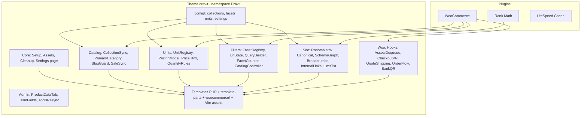

# 02. Kiến trúc kỹ thuật & Quy ước code

> Skill: `wordpress-theme-development`, `php-pro`, `wp-rest-api`, `wp-interactivity-api` (tham khảo), `backend-security-coder`, `frontend-security-coder`, `clean-code`, `javascript-pro`.

## 1. Stack

| Lớp | Công nghệ | Ghi chú |
|---|---|---|
| CMS | WordPress 7.1.x | Theme classic (D-01) |
| Commerce | WooCommerce 11.2.x | HPOS bật (mặc định), classic cart/checkout shortcode (D-15) |
| SEO | Rank Math free 1.0.28x | Meta, sitemap, breadcrumb, primary term, schema, llms.txt, robots.txt |
| Cache | LiteSpeed Cache (production AZDIGI) | Xem `08` |
| PHP | ≥ 8.1 (local 8.2) | `declare(strict_types=1)`, typed properties, enums khi phù hợp |
| Build | Vite 6+, Lightning CSS, Node 22 | Chỉ build ở máy dev/CI, server chỉ nhận `dist/` |
| JS | Vanilla ES2022 modules | Không jQuery mới, không React/Vue/Alpine |
| CSS | Vanilla CSS: `@layer`, nesting, custom properties, container queries, `:has()` | Không framework, không `!important` |
| Lint | PHPCS (WordPress-Extra) · ESLint · Stylelint · Prettier | Chạy trước commit |

## 2. Kiến trúc tổng thể



**Nguyên tắc module (D-07):**
- Mỗi module tự đăng ký hook qua `register()`, không gọi chéo module khác ngoài interface/public method.
- Dữ liệu chỉ lưu ở cấu trúc chuẩn: `product_cat`, `pa_*`, post meta (qua WC CRUD), term meta, option `drv_settings`. **Không tạo bảng DB riêng** ở Phase 1.
- Module `Catalog`, `Units`, `Filters`, `Seo`, `Woo` phải chuyển được sang plugin bằng cách đổi bootstrap, không sửa logic.

## 3. Cấu trúc thư mục

```text
wp-content/themes/dravit/
├── style.css                    # Theme header (Text Domain: dravit, Requires PHP: 8.1)
├── functions.php                # define hằng số, autoloader, Dravit\Theme::boot()
├── theme.json                   # sinh từ tokens.json (version 3)
├── screenshot.png
├── config/
│   ├── collections.php          # 28 collection (03 §3)
│   ├── facets.php               # 14 facet (05 §2)
│   ├── units.php                # pricing model + đơn vị (04 §1)
│   └── provinces-vn.php         # 34 tỉnh/thành (04 §6)
├── inc/
│   ├── Theme.php                # boot: nạp module theo thứ tự
│   ├── Core/       Setup.php, Assets.php, Vite.php, Cleanup.php, Settings.php, Helpers.php, Template.php
│   ├── Catalog/    CollectionSync.php, RuleMatcher.php, PrimaryCategory.php, SlugGuard.php, SaleSync.php, ResyncJob.php
│   ├── Units/      UnitRegistry.php, PricingModel/{AreaPack,Piece,Set,Pack}.php, PriceHtml.php, QuantityRules.php
│   ├── Filters/    FacetRegistry.php, UrlState.php, QueryBuilder.php, FacetCounter.php, CatalogController.php, Renderer.php
│   ├── Seo/        RobotsMatrix.php, Canonical.php, SchemaGraph.php, Breadcrumbs.php, InternalLinks.php, LlmsTxt.php
│   ├── Woo/        Hooks.php, AssetsDequeue.php, CheckoutVN.php, QuoteShippingMethod.php, OrderFlow.php, Emails/*, BankQR.php
│   └── Admin/      ProductDataTab.php, TermFields.php, ToolsResync.php
├── header.php · footer.php · index.php · front-page.php · page.php · single.php
├── archive.php · search.php · 404.php · searchform.php
├── page-templates/              # template-showroom.php, template-policy.php
├── template-parts/
│   ├── ui/      (btn, badge, product-card, unit-calc, sub-silo-tile, section-head, spec-table, shop-the-look)
│   ├── header/  (topbar, nav-desktop, nav-mobile, mega-menu, search, mini-cart)
│   ├── footer/  (columns, bottom-bar, mobile-action-bar)
│   ├── catalog/ (hero, pills, filters, active-chips, grid, load-more, seo-footer, faq, empty)
│   ├── product/ (gallery, price, series-swatches, related)
│   ├── blog/    (card, toc, product-embed, author)
│   └── common/  (breadcrumb, pagination, cta-quote, usp)
├── woocommerce/                 # override tối thiểu (§7)
├── patterns/                    # block patterns cho trang nội dung
├── assets/
│   ├── src/tokens/tokens.json
│   ├── src/css/   main.css (@layer order) + layers/{reset,tokens,base,layout,components,woo,utilities}/*
│   ├── src/js/    core.js, catalog.js, product.js, checkout-vn.js + components/{unit-calc,qty-input,filter-form}.js + utils/{http,format,dom,toast}.js
│   ├── dist/      (build output, commit vào repo deploy)
│   ├── fonts/     anton-vi.woff2, quicksand-vf-vi.woff2
│   ├── images/    logo-navy@1x.webp, logo-navy@2x.webp, logo-ivory@*.webp, logo-navy.png
│   └── data/      wards/{province-code}.json (Phường/Xã theo tỉnh, lazy load)
├── tools/        build-tokens.mjs, subset-fonts.mjs, optimize-logo.mjs
├── package.json · vite.config.js · .eslintrc · .stylelintrc · phpcs.xml
└── README.md
```

## 4. Thư viện được phép (whitelist)

| Nhu cầu | Giải pháp | Kích thước |
|---|---|---|
| Hover & UI Transitions | **Pure CSS GPU (`transform`, `opacity`)** (Option A) | 0KB JS |
| Staggered Grid Reveal, Number Odometer & Spring Cart | **Anime.js v3.2.2** (`defer` CDN/ESM trong `Dravit.motion`, Option B) | ~6.5KB gzip |
| Carousel | CSS `scroll-snap` + JS nút prev/next tự viết | ~1KB |
| Lightbox/zoom | **PhotoSwipe 5** (ESM), `import()` khi click ảnh | ~20KB gzip, chỉ trang sản phẩm |
| Modal/drawer/menu | `<dialog>`, Popover API | 0 |
| Icon | **Phosphor Icons CDN** (`@phosphor-icons/web@2.1.2` qua jsDelivr CDN, `<i class="ph ph-..."></i>`, cấm dùng icon ký tự Unicode/emoji) | CDN cached |
| Build | Vite, Lightning CSS, `subset-font`/`glyphhanger`, `sharp` (logo/ảnh tĩnh) | dev only |

Thêm thư viện ngoài danh sách phải ghi ADR trong `00`.

## 5. Bootstrap & autoload

```php
// functions.php
declare(strict_types=1);
defined('ABSPATH') || exit;

define('DRV_VERSION', '1.0.0');
define('DRV_DIR', get_template_directory());
define('DRV_URI', get_template_directory_uri());

spl_autoload_register(static function (string $class): void {
    if (!str_starts_with($class, 'Dravit\\')) return;
    $file = DRV_DIR . '/inc/' . str_replace('\\', '/', substr($class, 7)) . '.php';
    if (is_readable($file)) require $file;
});

Dravit\Theme::boot();   // Core → Units → Catalog → Filters → Seo → Woo → Admin (is_admin)
```

Không dùng Composer runtime (server không cần `vendor/`).

## 6. Quy ước đặt tên

| Thành phần | Quy ước | Ví dụ |
|---|---|---|
| Namespace/Class | `Dravit\Module\ClassName` (PascalCase) | `Dravit\Catalog\CollectionSync` |
| Method/biến | `snake_case` (theo WP) | `sync_product_categories()` |
| Hằng số | `DRV_*` | `DRV_VERSION` |
| Hook custom | `drv/{module}/{event}` | `drv/catalog/synced`, `drv/units/models` |
| Hàm template tag | `drv_*()` | `drv_price_html()`, `drv_breadcrumb()` |
| Meta key (product/term) | `drv_*` (không gạch dưới đầu khi cần hiện ở REST) | `drv_price_m2` |
| Option | `drv_settings` (1 mảng), `drv_db_version` | |
| Transient/cache group | `drv_*` / group `dravit` | `drv_facets_{hash}` |
| REST | namespace `dravit/v1` | `/catalog`, `/search` |
| CSS class | Layout `.l-*`, Component BEM `.drv-*`, biến nội bộ `--_*` | `.l-grout-grid`, `.drv-btn--moss` |
| JS | ES module, Custom Element `<drv-*>`, action `data-drv-action` | `<drv-unit-calc>`, `data-drv-action="open-dialog"` |
| Text domain | `dravit` | `__('Thêm vào giỏ', 'dravit')` |

## 7. WooCommerce integration

- `add_theme_support('woocommerce', ['thumbnail_image_width' => 480, 'single_image_width' => 1000, 'gallery_thumbnail_image_width' => 160, 'product_grid' => ['default_columns' => 4, 'default_rows' => 6]])`.
- **Không** khai báo `wc-product-gallery-zoom/lightbox/slider` (dùng gallery riêng + PhotoSwipe) → WC không nạp flexslider/zoom/photoswipe cũ.
- Ưu tiên **hook** thay vì override template. Override tối thiểu:

| File override | Lý do |
|---|---|
| `woocommerce/archive-product.php` | Layout danh mục + filter + load more |
| `woocommerce/content-product.php` | Card sản phẩm (gọi `template-parts/product/card.php`) |
| `woocommerce/single-product.php` + `content-single-product.php` | Layout trang sản phẩm |
| `woocommerce/global/quantity-input.php` | Input số lượng theo đơn vị (viên/m²/thùng) |
| `woocommerce/cart/cart.php`, `cart/mini-cart.php` | Hiển thị quy đổi m²/thùng |
| `woocommerce/checkout/form-checkout.php`, `thankyou.php` | Layout checkout 1 cột, thông báo báo phí ship, VietQR |
| `woocommerce/emails/*` (tối thiểu) | Hiển thị đơn vị + VietQR |

- Mỗi file override giữ nguyên header `@version` của WC; sau mỗi lần nâng cấp WC kiểm tra **WooCommerce → Status → Templates** (outdated).
- **HPOS:** chỉ dùng `wc_get_order()`, `$order->get_meta()/update_meta_data()/save()`, `wc_get_orders()`. Cấm `get_post_meta` cho đơn hàng. Khai báo tương thích: theme không cần, nhưng code phải tuân thủ.
- Product meta đọc/ghi qua `$product->get_meta()/update_meta_data()` (WC CRUD) để cache và hook chạy đúng.

## 8. Asset pipeline (Vite)

- Entry: `css/main.css`, `css/catalog.css`, `css/product.css`, `css/checkout.css`, `js/core.js`, `js/catalog.js`, `js/product.js`, `js/checkout-vn.js`.
- Build: `vite build` → `assets/dist/` có hash + `.vite/manifest.json`.
- `Core\Vite`: đọc manifest, `wp_enqueue_style/script` với `strategy => 'defer'` hoặc `wp_enqueue_script_module` cho ES module; tự thêm `modulepreload` cho chunk import.
- Dev: nếu tồn tại file `assets/dist/hot` → nạp từ Vite dev server (HMR). Production không có file này.
- Critical CSS: mỗi template có `critical-{template}.css` (viết tay, ≤ 14KB) inline trong `<head>`; CSS đầy đủ nạp không chặn render (`media="print" onload` thay bằng `rel=preload as=style` + fallback `<noscript>`).
- Ma trận nạp asset theo template: xem `08` §3.

## 8B. Kiến trúc Component 4 lớp (Chống trùng lặp HTML/CSS/JS — D-17)

1. **Lớp HTML/PHP (`drv_ui()`):**
   - Mọi thành phần UI dùng lại (`btn`, `badge`, `product-card`, `unit-calc`, `sub-silo-tile`, `section-head`, `spec-table`, `shop-the-look`) chỉ có **1 file duy nhất** trong `template-parts/ui/{name}.php` và gọi qua `drv_ui(string $name, array $props = []): void`.
   - Cấm viết lặp HTML của cùng 1 component ở nhiều template hoặc trong REST controller.
2. **Lớp CSS (Layout Primitives `.l-*` + Scoped Variables `--_*`):**
   - `@layer layout` cung cấp 5 primitive dùng chung toàn trang: `.l-container`, `.l-stack`, `.l-cluster`, `.l-grid`, `.l-grout-grid` (tự tạo lưới đường ron `1px` bằng `background: var(--c-navy-200); gap: 1px; border: var(--bw)`).
   - `@layer components`: khai báo thuộc tính 1 lần trên class gốc qua biến cục bộ `--_bg`, `--_fg`, `--_bd`, `--_h`, `--_pad`; các class biến thể (`.drv-btn--moss`, `.drv-btn--sm`) chỉ gán lại biến `--_*`, không lặp lại `display`, `padding`, `border-radius`, `transition`.
3. **Lớp JS (Global Event Delegation + Light DOM Custom Elements):**
   - **Tương tác đơn (mở dialog, copy SKU, toggle, đóng thông báo):** Đăng ký 1 listener duy nhất trên `document` trong `core.js` bắt `[data-drv-action]`. HTML mới chèn qua AJAX/Load More tự hoạt động ngay, không cần gán lại sự kiện.
   - **Component có state (`<drv-unit-calc>`, `<drv-qty-input>`, `<drv-filter-form>`):** Dùng chuẩn Web Components `customElements.define()` ở chế độ **Light DOM** (không dùng Shadow DOM để thừa hưởng trực tiếp CSS `@layer`). Trình duyệt tự gọi `connectedCallback()` bất cứ khi nào thẻ xuất hiện trong DOM.
4. **Lớp Shared Utilities (`assets/src/js/utils/`):**
   - Các hàm `formatVnd`, `formatDecimalVn`, `httpGet`, `debounce`, `toast` đặt tại `utils/`; Vite tự gom vào shared chunk, Lightning CSS tự gộp selector trùng khi build.

## 9. Bảo mật

- Mọi file PHP: `defined('ABSPATH') || exit;`.
- Input: `sanitize_text_field`, `sanitize_key`, `absint`, `wc_clean`; whitelist giá trị param lọc theo `facets.php` (05 §3).
- Output: `esc_html`, `esc_attr`, `esc_url`, `wp_kses_post`; JSON trong HTML dùng `wp_json_encode` + `JSON_HEX_TAG`.
- DB: chỉ `$wpdb->prepare()`; ưu tiên `WP_Query`/`wc_get_products`.
- Admin action: `current_user_can('manage_woocommerce')` + nonce (`check_admin_referer`, `check_ajax_referer`).
- REST public (`/catalog`, `/search`): `permission_callback => '__return_true'` nhưng `args` có `sanitize_callback` + `validate_callback`, giới hạn `per_page ≤ 48`, rate-limit nhẹ bằng transient theo IP cho `/search`.
- JS: không chèn HTML từ input người dùng; HTML từ REST là do server render đã escape.
- Không lộ phiên bản: tắt `wp_generator`, Rank Math `wc_remove_generator`.

## 10. Ngôn ngữ & Định dạng Việt Nam (Đơn ngôn ngữ)

- Website chỉ sử dụng **1 ngôn ngữ duy nhất là Tiếng Việt (`lang="vi"`)**. Không sử dụng Polylang/WPML, không tạo file `.pot/.po/.mo`.
- Viết chuỗi Tiếng Việt trực tiếp kèm hàm escape (`esc_html()`, `esc_attr()`).
- Số và tiền: PHP `wc_price()`/`number_format_i18n()`; JS `Intl.NumberFormat('vi-VN')`.

## 11. Settings page (không dùng ACF)

**Giao diện → Cài đặt Dravit** (Settings API, option `drv_settings`):

| Nhóm | Trường |
|---|---|
| Liên hệ | Hotline, số Zalo/Zalo OA link, email, giờ mở cửa |
| Showroom | Danh sách (tên, địa chỉ, phường/xã, tỉnh, giờ, Google Maps URL, toạ độ) |
| Ngân hàng (VietQR) | Mã BIN ngân hàng, số tài khoản, tên chủ TK, template QR |
| Đơn hàng | Tỉ lệ hao hụt mặc định (%), nội dung thông báo báo phí ship |
| SEO/GEO | Đoạn giới thiệu cho llms.txt, mạng xã hội (sameAs) |

## 12. Môi trường & deploy

| Môi trường | Ghi chú |
|---|---|
| Local | Local by Flywheel, `WP_ENVIRONMENT_TYPE=local`, `WP_DEBUG` + `WP_DEBUG_LOG` bật khi dev |
| Staging | Subdomain AZDIGI, `noindex` toàn site (Settings → Reading), password protect |
| Production | AZDIGI LiteSpeed, `DISALLOW_FILE_EDIT`, `WP_DEBUG=false` |

- Git: repo chỉ chứa `wp-content/themes/dravit` (+ `docs/`). Nhánh `main` (production), `develop`, `feature/*`.
- Deploy: `npm ci && npm run build` ở máy dev/CI → đóng gói theme **không gồm** `node_modules`, `assets/src`, `tools` → upload/rsync. Sau deploy: LiteSpeed Purge All.
- Commit message: `type(scope): mô tả` (feat, fix, perf, seo, style, refactor, docs).

## 13. Rules cho AI Agent (`.agents/rules/`)

Bộ rules chuẩn của dự án trong `.agents/rules/`:
- `dravit-architecture.md` — Kiến trúc theme, cấu trúc thư mục, HPOS, đơn ngôn ngữ.
- `dravit-coding-standards.md` — Quy ước đặt tên, PHP 8.1+, định dạng số/đơn vị, bảng ánh xạ tài liệu `docs/`.
- `dravit-frontend-ui.md` — Lưới đường ron 1px, design tokens, Vite, whitelist thư viện, tốc độ & Brand Voice.
- `dravit-catalog-commerce.md` — 28 Smart Collections, tự gán danh mục, công thức giá `m²`/`viên`, checkout VN & VietQR.
- `dravit-filter-seo-geo.md` — 14 bộ lọc AJAX + load more, ma trận robots/canonical, Schema JSON-LD, IL-01..06 & GEO.
- `dravit-security-testing.md` — Quy tắc bảo mật và checklist nghiệm thu bắt buộc từng Phase.

