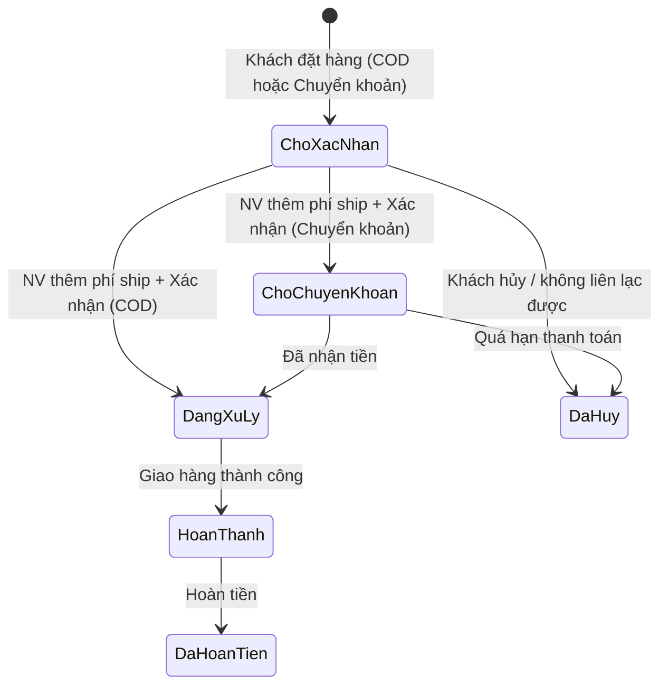

# 04. Đơn vị bán, Giá & Luồng thương mại

> Quyết định: D-05 (giá/m² chính, giá/viên phụ, giao dịch theo viên), D-06 (đơn vị mở rộng), D-09 (COD + chuyển khoản), D-10 (báo phí ship sau), D-15, D-16.
> Skill: `wordpress`, `form-cro`, `page-cro`, `backend-security-coder`.

## 1. Hệ đơn vị mở rộng (`Units`)

### 1.1 Pricing model

| Model | Áp dụng | Giá nhập (admin) | Giá chính hiển thị | Giá phụ | Đơn vị giao dịch (qty WC) | Đơn vị đóng gói | Máy tính |
|---|---|---|---|---|---|---|---|
| `area_pack` | Gạch ốp lát (Phase 1) | đ/m² | **đ/m²** | đ/viên | **viên** | thùng | ✓ |
| `piece` | Thiết bị, phụ kiện | đ/chiếc | đ/chiếc | | chiếc | | |
| `set` | Bộ sen vòi, combo | đ/bộ | đ/bộ | | bộ | | |
| `pack` | Keo chà ron, vữa | đ/tuýp, đ/bao | đ/tuýp | đ/kg (nếu có khối lượng) | tuýp/bao | thùng | tùy chọn |

### 1.2 `config/units.php`

```php
return [
    'units' => [
        'm2'    => ['label' => 'm²',    'schema' => 'MTK'],
        'vien'  => ['label' => 'viên',  'schema' => 'C62'],
        'thung' => ['label' => 'thùng', 'schema' => 'BX'],
        'chiec' => ['label' => 'chiếc', 'schema' => 'C62'],
        'bo'    => ['label' => 'bộ',    'schema' => 'SET'],
        'tuyp'  => ['label' => 'tuýp',  'schema' => 'C62'],
        'bao'   => ['label' => 'bao',   'schema' => 'C62'],
        'kg'    => ['label' => 'kg',    'schema' => 'KGM'],
    ],
    'models' => [
        'area_pack' => ['class' => \Dravit\Units\PricingModel\AreaPack::class, 'price_unit' => 'm2',    'sale_unit' => 'vien',  'pack_unit' => 'thung'],
        'piece'     => ['class' => \Dravit\Units\PricingModel\Piece::class,    'price_unit' => 'chiec', 'sale_unit' => 'chiec'],
        'set'       => ['class' => \Dravit\Units\PricingModel\Set::class,      'price_unit' => 'bo',    'sale_unit' => 'bo'],
        'pack'      => ['class' => \Dravit\Units\PricingModel\Pack::class,     'price_unit' => 'tuyp',  'sale_unit' => 'tuyp', 'secondary_unit' => 'kg'],
    ],
];
// Mở rộng: add_filter('drv/units/models', fn($m) => $m + ['roll' => [...]]);
// Ghi đè đơn vị từng SP: meta drv_unit (vd model pack nhưng đơn vị 'bao').
```

### 1.3 Interface

```php
namespace Dravit\Units;
interface PricingModelInterface {
    public function sync_wc_prices(\WC_Product $p): void;          // tính _regular_price/_sale_price từ giá nhập
    public function primary_price(\WC_Product $p): PriceView;      // amount, regular, unit
    public function secondary_price(\WC_Product $p): ?PriceView;
    public function qty_summary(\WC_Product $p, int $qty): string; // "48 viên · 30,72 m² · 12 thùng"
    public function quantity_args(\WC_Product $p): array;          // min, step, max
    public function has_calculator(): bool;
    public function schema_price_spec(\WC_Product $p): array;      // cho Offer (06 §4)
}
```

Mọi template chỉ gọi **template tag chung**: `drv_price_html($product, 'card'|'single'|'cart'|'mini'|'email')`, `drv_qty_summary($product, $qty)`. Không tự tính giá trong template.

## 2. Công thức gạch (`area_pack`)

```text
area_piece (m²)   = w_mm × h_mm / 1.000.000
m2_per_box        = area_piece × pieces_per_box                     (4 chữ số thập phân)
price_piece (đ)   = round(price_m2 × area_piece)                    (làm tròn đến đồng)
sale_piece (đ)    = round(sale_price_m2 × area_piece)
WC _regular_price = price_piece ; WC _sale_price = sale_piece        (ghi khi lưu SP)
line_total        = price_piece × qty_vien                          (WC tính native)
m2_equivalent     = qty_vien × area_piece
boxes             = floor(qty_vien / pieces_per_box) thùng + (qty_vien mod pieces_per_box) viên lẻ
```

- Trường giá native của WC trong tab "Chung" bị khóa (chỉ đọc, ghi chú "Tự tính từ giá/m²") với model `area_pack`.
- Lịch khuyến mãi dùng trường ngày native của WC.
- WC cài đặt: tiền tệ VND, 0 chữ số thập phân, phân cách nghìn `.`, ký hiệu hiển thị `đ` sát số (`woocommerce_currency_symbol`).

### 2.1 Ví dụ

| SKU | Kích thước | Viên/thùng | m²/thùng | Giá/m² | Giá/viên (WC) |
|---|---|---|---|---|---|
| DRV-8801M | 800×800 | 3 | 1,92 | 385.000 | 246.400 |
| DRV-TRZ60 | 600×600 | 4 | 1,44 | 320.000 | 115.200 |
| DRV-61209 | 600×1200 | 2 | 1,44 | 520.000 | 374.400 |
| DRV-TH7530 | 75×300 | 44 | 0,99 | 450.000 | 10.125 |

> Giá trong ví dụ chỉ để minh họa công thức, không phải giá thật.

## 3. Máy tính số lượng (trang sản phẩm)

| Input | Mặc định |
|---|---|
| Diện tích cần lát/ốp (m²), hoặc nhập Dài × Rộng (m) | trống |
| Hao hụt | 5% (chọn 0 / 5 / 10%, mặc định lấy từ Cài đặt Dravit) |
| Làm tròn chẵn thùng | Bật |

```text
need_m2    = area × (1 + waste)
pieces     = ceil(need_m2 / area_piece)
if round_box: pieces = ceil(pieces / pieces_per_box) × pieces_per_box
pieces     = max(pieces, qty_min), làm tròn lên bội số qty_step
```

**Kết quả:** `Cần 48 viên = 16 thùng · 30,72 m² · Thành tiền 11.827.200đ` + nút **"Thêm 48 viên vào giỏ"**.
Ô số lượng có bộ chuyển **Viên | m² | Thùng**; giá trị gửi lên server luôn là **số viên** (số nguyên). Tính toán chạy client-side (JS ~2KB), server validate lại.

## 4. Giỏ hàng & đơn hàng

| Vị trí | Hiển thị |
|---|---|
| Card sản phẩm | **385.000đ/m²** · ≈ 246.400đ/viên |
| Trang sản phẩm | Giá/m² lớn; giá/viên; quy cách "1 thùng = 3 viên = 1,92 m²"; tồn kho "Còn hàng" / "Sắp hết" (ngưỡng WC) |
| Dòng giỏ hàng | Tên · `48 viên` · dòng phụ `≈ 30,72 m² · 16 thùng` · đơn giá `246.400đ/viên (385.000đ/m²)` · thành tiền |
| Tổng giỏ | Tạm tính · **Tổng diện tích gạch: 30,72 m²** · Phí vận chuyển: *Báo sau khi xác nhận đơn* · Tổng tạm tính |
| Mini-cart | Tên, `48 viên (30,72 m²)`, thành tiền |
| Email / admin order | Như dòng giỏ hàng (từ order item meta snapshot) |

**Snapshot order item meta** (`woocommerce_checkout_create_order_line_item`), để đơn cũ không đổi khi sửa sản phẩm:
`_drv_model`, `_drv_unit`, `_drv_price_m2`, `_drv_area_piece`, `_drv_pieces_per_box`, `_drv_m2_qty`. Hiển thị nhãn tiếng Việt qua `woocommerce_order_item_get_formatted_meta_data`.

**Validate số lượng** (server): số nguyên, ≥ `drv_qty_min`, bội số `drv_qty_step`, ≤ tồn kho. Hook: `woocommerce_quantity_input_args`, `woocommerce_add_to_cart_validation`, `woocommerce_update_cart_validation`, `woocommerce_store_api_product_quantity_{minimum|multiple_of}` (cho mini-cart dùng Store API).

**Tồn kho:** quản lý theo **viên**.

## 5. Checkout (classic shortcode, D-15)

### 5.1 Trường thông tin

| Trường | Key WC | Bắt buộc | Ghi chú |
|---|---|---|---|
| Họ và tên | `billing_first_name` | ✓ | Ẩn `billing_last_name` |
| Số điện thoại | `billing_phone` | ✓ | Regex VN `^(0|\+84)(3|5|7|8|9)\d{8}$`, `inputmode="tel"`, `autocomplete="tel"` |
| Email | `billing_email` | ✗ | Khuyến khích để nhận email xác nhận |
| Tỉnh/Thành phố | `billing_state` | ✓ | Select 34 tỉnh/thành (`woocommerce_states['VN']`) |
| Phường/Xã | `billing_city` | ✓ | Select phụ thuộc tỉnh, dữ liệu `assets/data/wards/{code}.json` nạp lazy |
| Địa chỉ cụ thể | `billing_address_1` | ✓ | Số nhà, tên đường, thôn/ấp |
| Ghi chú | `order_comments` | ✗ | Placeholder: "Thời gian nhận hàng, ghi chú công trình..." |
| Ẩn | `billing_company`, `billing_country` (cố định VN), `billing_address_2`, `billing_postcode` | | |

- Bán cho **Việt Nam** duy nhất. Cho phép đặt hàng không cần tài khoản.
- Định dạng địa chỉ VN: `{name}\n{address_1}\n{city}, {state}` (`woocommerce_localisation_address_formats`).
- Checkbox điều khoản: trỏ tới trang "Điều khoản & Chính sách".
- Bố cục: 1 cột mobile; desktop 2 cột (thông tin | tóm tắt đơn sticky).

### 5.2 34 tỉnh/thành (từ 01/07/2025) · `config/provinces-vn.php`

Hà Nội, Huế, Lai Châu, Điện Biên, Sơn La, Lạng Sơn, Quảng Ninh, Thanh Hóa, Nghệ An, Hà Tĩnh, Cao Bằng, Tuyên Quang, Lào Cai, Thái Nguyên, Phú Thọ, Bắc Ninh, Hưng Yên, Hải Phòng, Ninh Bình, Quảng Trị, Đà Nẵng, Quảng Ngãi, Gia Lai, Khánh Hòa, Lâm Đồng, Đắk Lắk, TP. Hồ Chí Minh, Đồng Nai, Tây Ninh, Cần Thơ, Vĩnh Long, Đồng Tháp, Cà Mau, An Giang.

> Mã tỉnh và danh sách Phường/Xã phải lấy từ **nguồn dữ liệu chính thức** (O-06), không tự soạn. Script `tools/build-wards.mjs` chuyển dữ liệu nguồn → JSON theo tỉnh.

## 6. Vận chuyển: báo phí sau khi xác nhận (D-10)

- 1 shipping zone **"Việt Nam"**, 1 phương thức custom `drv_quote_later` (`Woo\QuoteShippingMethod extends WC_Shipping_Method`), phí 0.
- Nhãn hiển thị thay cho "0đ": **"Phí vận chuyển: báo sau khi xác nhận đơn"** (`woocommerce_cart_shipping_method_full_label`).
- Tổng tiền ở giỏ/checkout ghi **"Tổng tạm tính (chưa gồm phí vận chuyển)"**.
- Thông báo dưới nút đặt hàng: "Nhân viên Dravit sẽ gọi xác nhận và báo phí vận chuyển trước khi giao."
- Phase sau: thay bằng phương thức tính phí theo khu vực/khối lượng mà không đổi luồng đơn.

## 7. Trạng thái đơn & luồng xử lý



| Trạng thái | Slug | Ghi chú |
|---|---|---|
| Chờ xác nhận | `wc-cho-xac-nhan` (custom) | Trạng thái đầu cho mọi đơn: filter `woocommerce_cod_process_payment_order_status` và `woocommerce_bacs_process_payment_order_status` |
| Chờ chuyển khoản | `wc-on-hold` (native, đổi nhãn) | Chỉ đơn BACS sau khi xác nhận |
| Đang xử lý | `wc-processing` (native) | Đã xác nhận (COD) / đã nhận tiền (BACS) |
| Hoàn thành / Đã hủy / Đã hoàn tiền | native | |

- **Giữ tồn kho** khi vào `cho-xac-nhan`: gọi `wc_maybe_reduce_stock_levels` trên `woocommerce_order_status_cho-xac-nhan`; hủy đơn → WC tự hoàn kho.
- **Thao tác nhân viên (admin đơn hàng):**
  1. Gọi khách, chốt phí → **Thêm phí vận chuyển** (dòng shipping "Phí vận chuyển", số tiền) → **Tính lại**.
  2. Chọn Order action **"Xác nhận đơn & gửi email cho khách"** (`woocommerce_order_actions`) → đổi trạng thái theo phương thức thanh toán + gửi email xác nhận.
- Hiển thị trạng thái trong danh sách đơn (HPOS) với màu riêng.

### 7.1 Email

| Email | Gửi tới | Khi | Nội dung chính |
|---|---|---|---|
| Đơn hàng mới (native, thêm trigger) | Admin | → `cho-xac-nhan` | Thông tin đơn, SĐT, tổng diện tích |
| **Đã nhận đơn hàng** (custom) | Khách | → `cho-xac-nhan` | Tóm tắt đơn; "Chúng tôi sẽ gọi xác nhận và báo phí vận chuyển trong giờ làm việc" |
| **Xác nhận đơn & phí vận chuyển** (custom) | Khách | Order action | Tổng cuối gồm phí ship. BACS: thông tin TK + **VietQR**. COD: số tiền chuẩn bị khi nhận hàng |
| Đang xử lý / Hoàn thành / Đã hủy / Ghi chú (native) | Khách | Theo trạng thái | Tùy biến giao diện email theo brand |

Tắt hướng dẫn BACS mặc định trên trang cảm ơn và trong email đầu (vì chưa có phí ship): gỡ action `thankyou_bacs` và `email_instructions` của `WC_Gateway_BACS`.

## 8. Chuyển khoản & VietQR (`Woo\BankQR`)

- Ảnh QR: `https://img.vietqr.io/image/{BIN}-{ACCOUNT}-compact2.png?amount={total}&addInfo=DRV{order_number}&accountName={NAME}` (BIN, số TK, tên lấy từ Cài đặt Dravit, O-02).
- Nội dung chuyển khoản: `DRV{mã đơn}` (không dấu, không khoảng trắng).
- Hiển thị khi đơn **BACS + `on-hold`**: email xác nhận, trang "Xem đơn hàng" (Tài khoản), trang order-received (link trong email).
- `` + bảng thông tin TK dạng text (dự phòng khi ảnh lỗi) + nút sao chép số TK/nội dung.

## 9. Trang cảm ơn

"Đặt hàng thành công · Mã đơn #1234" → "Nhân viên Dravit sẽ gọi **09xx xxx xxx** để xác nhận và báo phí vận chuyển." → tóm tắt đơn (đơn vị quy đổi) → CTA **Chat Zalo** / **Gọi hotline** → link về `/gach`.

## 10. Form "Nhận báo giá công trình"

- Trường: Họ tên, SĐT (bắt buộc), Tỉnh/TP, Diện tích dự kiến (m²), Sản phẩm quan tâm (tự điền khi mở từ trang sản phẩm), Ghi chú.
- Xử lý: `admin-post.php` + nonce + honeypot + giới hạn tần suất theo IP → lưu CPT private `drv_lead` (không public, không REST) + gửi email admin.
- Đặt ở: trang sản phẩm (dialog), trang danh mục (CTA cuối), trang Showroom/Liên hệ.
- Sau gửi: thông báo `role="status"` tại chỗ, không reload.

## 11. Trang chính sách bắt buộc (nội dung O-04)

Chính sách vận chuyển (giải thích báo phí sau, khu vực, thời gian), Đổi trả & bảo hành (lưu ý lô màu/shade, hàng đã cắt), Thanh toán (COD, chuyển khoản), Bảo mật thông tin, Điều khoản sử dụng. Link ở footer + checkout + schema `hasMerchantReturnPolicy` khi có nội dung.

