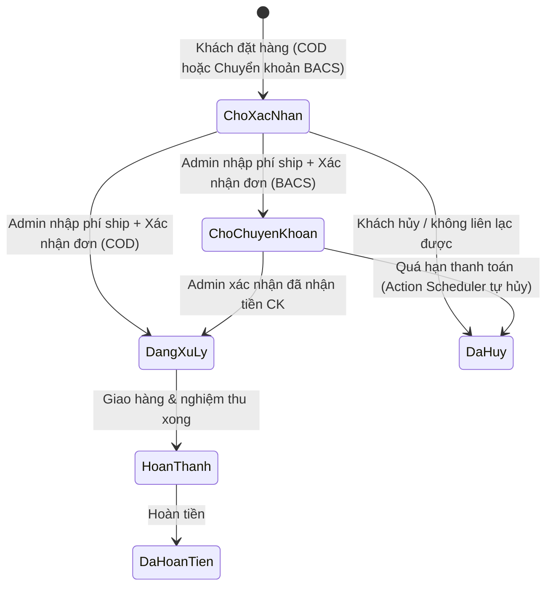

# 04. Đơn vị bán, Giá & Luồng thương mại

> Quyết định: D-05, D-06, D-09, D-10, D-15, D-16, D-20, D-22, D-23, D-24, D-30.
> Tài liệu liên quan: [14_Data_Dictionary_And_Settings.md](14_Data_Dictionary_And_Settings.md) (meta & settings), [15_REST_API_And_JS_Contract.md](15_REST_API_And_JS_Contract.md) (Store API & DOM contract), [17_Quote_BOQ_And_Lead_Spec.md](17_Quote_BOQ_And_Lead_Spec.md) (BOQ & `drv_lead`), [18_Order_Ops_And_Email_Spec.md](18_Order_Ops_And_Email_Spec.md) (vận hành đơn & email).
> Skill: `wordpress`, `form-cro`, `page-cro`, `backend-security-coder`.

## 1. Hệ đơn vị mở rộng (`Units`)

### 1.1 Pricing model

| Model | Áp dụng | Giá nhập (admin) | Giá chính hiển thị | Giá phụ | Đơn vị giao dịch (qty WC) | Đơn vị đóng gói | Máy tính |
|---|---|---|---|---|---|---|---|
| `area_pack` | Gạch ốp lát (Phase 1) | đ/m² | **đ/m²** | đ/viên | **viên** | thùng | ✓ |
| `piece` | Thiết bị, phụ kiện | đ/chiếc | đ/chiếc | | chiếc | | |
| `set` | Bộ sen vòi, combo | đ/bộ | đ/bộ | | bộ | | |
| `pack` | Keo chà ron, vữa (ẩn UI ở Phase 1 theo `D-26`) | đ/tuýp, đ/bao | đ/tuýp | đ/kg (nếu có khối lượng) | tuýp/bao | thùng | tùy chọn |

### 1.2 `config/units.php`

```php
return [
    'units' => [
        'm2'    => ['label' => 'm²',    'schema' => 'MTK'],
        'vien'  => ['label' => 'viên',  'schema' => 'C62'],
        'thung' => ['label' => 'thùng', 'schema' => 'BX'],
        'chiec' => ['label' => 'chiếc', 'schema' => 'C62'],
        'bo'    => ['label' => 'bộ',    'schema' => 'SET'],
        'tuyp'  => ['label' => 'tuýp',  'schema' => 'C62'],
        'bao'   => ['label' => 'bao',   'schema' => 'C62'],
        'kg'    => ['label' => 'kg',    'schema' => 'KGM'],
    ],
    'models' => [
        'area_pack' => ['class' => \Dravit\Units\PricingModel\AreaPack::class, 'price_unit' => 'm2',    'sale_unit' => 'vien',  'pack_unit' => 'thung'],
        'piece'     => ['class' => \Dravit\Units\PricingModel\Piece::class,    'price_unit' => 'chiec', 'sale_unit' => 'chiec'],
        'set'       => ['class' => \Dravit\Units\PricingModel\Set::class,      'price_unit' => 'bo',    'sale_unit' => 'bo'],
        'pack'      => ['class' => \Dravit\Units\PricingModel\Pack::class,     'price_unit' => 'tuyp',  'sale_unit' => 'tuyp', 'secondary_unit' => 'kg'],
    ],
];
// Mở rộng: add_filter('drv/units/models', fn($m) => $m + ['roll' => [...]]);
// Ghi đè nhãn đơn vị từng SP: meta drv_unit_label ('viên' | 'tấm' cho Big Slab) hoặc drv_unit (model pack).
```

### 1.3 Interface

```php
namespace Dravit\Units;
interface PricingModelInterface {
    public function sync_wc_prices(\WC_Product $p): void;          // tính _regular_price/_sale_price từ giá nhập
    public function primary_price(\WC_Product $p): PriceView;      // amount, regular, unit, discount_pct
    public function secondary_price(\WC_Product $p): ?PriceView;
    public function qty_summary(\WC_Product $p, int $qty): string; // "16 thùng · 30,72 m² · 672 kg"
    public function quantity_args(\WC_Product $p): array;          // min, step, max, buy_units, default_unit, round_mode
    public function has_calculator(): bool;
    public function schema_price_spec(\WC_Product $p): array;      // cho Offer (06 §4)
}
```

Mọi template bắt buộc gọi **template tag chung**: `drv_price_html($product, 'card'|'single'|'cart'|'mini'|'email')`, `drv_qty_summary($product, $qty)`. Nghiêm cấm tự viết công thức tính giá rải rác trong template.

## 2. Công thức gạch (`area_pack`)

```text
area_piece (m²)   = w_mm × h_mm / 1.000.000
m2_per_box        = round(area_piece × pieces_per_box, 4)
price_piece (đ)   = round(price_m2 × area_piece)                    (làm tròn đến đồng)
sale_piece (đ)    = round(sale_price_m2 × area_piece)
discount_pct (%)  = round((1 - sale_price_m2 / price_m2) × 100)     (chỉ khi price_m2 > 0 và sale_price_m2 > 0)
WC _regular_price = price_piece ; WC _sale_price = sale_piece       (ghi khi lưu SP)
line_total        = _price × qty_vien                               (WC tính native từ _price)
m2_equivalent     = round(qty_vien × area_piece, 4)
boxes             = floor(qty_vien / pieces_per_box) thùng + (qty_vien mod pieces_per_box) viên lẻ
weight_kg         = round(qty_vien × (kg_per_box / pieces_per_box), 1)
```

- Trường giá native của WC trong tab "Chung" bị khóa (chỉ đọc, ghi chú "Tự tính từ giá/m²") với model `area_pack`.
- Lịch khuyến mãi dùng trường ngày native của WC.
- WC cài đặt: tiền tệ VND, 0 chữ số thập phân, phân cách nghìn `.`, phân cách thập phân hiển thị diện tích `,`, ký hiệu tiền `đ` sát số (`woocommerce_currency_symbol`).

### 2.1 Ví dụ

| SKU | Kích thước | Viên/thùng | m²/thùng | Giá/m² | Giá/viên (WC) | Trạng thái (`drv_price_state`) |
|---|---|---|---|---|---|---|
| DRV-8801M | 800×800 | 3 | 1,92 | 385.000 | 246.400 | Có giá (`priced`) |
| DRV-TRZ60 | 600×600 | 4 | 1,44 | 320.000 | 115.200 | Có giá (`priced`) |
| DRV-61209 | 600×1200 | 2 | 1,44 | 520.000 | 374.400 | Có giá (`priced`) |
| DRV-TH7530 | 75×300 | 44 | 0,99 | 450.000 | 10.125 | Có giá (`priced`) |
| DRV-3612T | 300×600 | 8 | 1,44 | *(trống / 0)* | *(rỗng)* | Không giá (`quote_only` - Liên hệ báo giá) |

> Giá trong ví dụ chỉ để minh họa công thức, không phải giá thương mại thực tế.

### 2.2 Chế độ Sản phẩm Có Giá (`priced`) vs. Không Có Giá (`quote` - `D-20`)

Hệ thống suy dẫn trạng thái `drv_price_state` (`priced` / `sale` / `quote_only` / `out_of_stock`) từ `drv_price_m2`, lịch khuyến mãi và tồn kho:

| Hạng mục | Sản phẩm Có Giá (`drv_price_m2 > 0` - `priced` / `sale`) | Sản phẩm Không Có Giá (`drv_price_m2` trống hoặc `≤ 0` - `quote`) |
|---|---|---|
| **Bản chất nghiệp vụ** | Gạch bán lẻ tiêu chuẩn có giá niêm yết công khai. | Gạch dự án, đá nung kết khổ lớn, mẫu đặt riêng hoặc lô hàng báo giá theo khối lượng. |
| **Lưu trữ WooCommerce** | `_regular_price = round(price_m2 * area_piece)`; `is_purchasable = true`. | `_regular_price = ''`, `_sale_price = ''`, `_price = ''`; filter `woocommerce_is_purchasable` trả về `false` (chặn thêm trực tiếp vào giỏ WC). |
| **Taxonomy `drv_price_band`** | Tự gán `duoi-200k`, `200k-350k`, `350k-600k` hoặc `tren-600k`. | Tự gán term `gia-du-an` (*Liên hệ báo giá*). |
| **Khuyến mãi & Giá gốc** | Khi đang KM (`sale`): hiển thị giá KM `đ/m²` nổi bật, **giá gốc gạch ngang bắt buộc ghi kèm `/m²`** (vd `<del>420.000đ/m²</del>`) và chip `-{discount_pct}%` (`discount_pct = round((1 - sale_m2 / price_m2) * 100)`). | **Tuyệt đối không** gắn chip `% giảm` và không hiển thị giá gốc gạch ngang. |
| **Dòng phụ & Tồn kho trên Card** | Hiển thị `≈ {price_piece}đ/viên`. Nếu sản phẩm bật quản lý kho (`_manage_stock = yes`): quy đổi tồn kho sang thùng `boxes_stock = floor(_stock / drv_pieces_per_box)` -> nối thêm ` · Còn {boxes_stock} thùng`; dưới ngưỡng `low_stock_amount` hiện ` · Sắp hết`; hết kho hiện badge `Tạm hết`. Nếu **không** quản lý kho thì ẩn phần số thùng tồn. | Hiển thị quy cách đóng gói chuẩn: `1 thùng = {m2_per_box} m² ({pieces_per_box} {unit_label})` (kèm trạng thái kho nếu bật quản lý kho). |
| **Giá chính & CTA trên Card** | Dòng chính: `385.000đ/m²`. Nút: **`Thêm vào giỏ`** (`data-drv-action="add-to-cart"`, hành vi số lượng theo §3.4). | Dòng chính: `<span class="drv-card__price-contact"><i class="ph ph-tag"></i><span>Liên hệ báo giá</span></span>`. Nút: **`Báo giá`** (`data-drv-action="quote-add"`). |
| **Trang chi tiết SP (PDP)** | Hiển thị khối `[data-pdp-only="priced"]`: giá `đ/m²` + `≈ đ/viên`, dòng `Tổng tiền` trong `<drv-unit-calc>`, nút **`Mua ngay`** + **`Thêm vào giỏ`** + nút phụ `+ Thêm vào DS báo giá`. | Hiển thị khối `[data-pdp-only="quote"]`: nhãn **`Liên hệ báo giá`** + ghi chú SLA phản hồi từ `drv_settings.order.sla_text`; `<drv-unit-calc>` **vẫn tính đủ số viên, số thùng, diện tích thực nhận `m²` và khối lượng `kg`**, chỉ ẩn dòng `Tổng tiền`; cụm CTA đổi thành **`Nhận báo giá ngay`** và **`Thêm vào DS báo giá`** (`data-drv-action="quote-add"`). |
| **Bảng Báo Giá BOQ (`04.1`)** | Tính thành tiền trực tiếp (`pieces × price_piece`) và cộng vào tổng tạm tính. | Cho phép gộp chung với SP có giá trong cùng phòng; tính đủ thùng/viên/`m²`/`kg` để cộng tổng diện tích (xét bậc chiết khấu dự kiến) và tổng tải trọng xe; cột đơn giá ghi `Liên hệ báo giá`, cột thành tiền ghi `Báo giá sau`. |

## 3. Máy tính số lượng & Cấu hình Đơn vị Mua theo Sản phẩm (`m² / thùng / viên` - `D-24`)

### 3.1 Cấu hình đơn vị mua trên từng sản phẩm

Mặc dù đơn vị tồn kho và `quantity` giao dịch dưới lõi WooCommerce luôn là **số nguyên `viên`** (`D-05`), mỗi loại gạch có tập quán đặt mua khác nhau (gạch nền/tường mua theo `m²` hoặc chẵn `thùng`; gạch bông điểm, gạch thẻ trang trí hoặc tấm khổ lớn có thể cho mua lẻ `viên`/`tấm`). Admin cấu hình trực tiếp trên từng SKU tại tab *Đơn vị & Thông số* (`03 §5.1`):

| Meta key | Kiểu & Mặc định | Tác động tới UI & Logic |
|---|---|---|
| `drv_buy_units` | `array`, mặc định `['m2', 'thung']` | Quyết định các tab đơn vị hiển thị trong thanh chuyển đổi (segmented tabs) của `<drv-unit-calc>` (PDP) và `<drv-qty-input>` (Giỏ hàng). Chỉ render các đơn vị được tích chọn; nếu chỉ có 1 đơn vị thì ẩn thanh chuyển tab. |
| `drv_default_buy_unit` | `'m2' \| 'thung' \| 'vien'`, mặc định `'m2'` | Đơn vị đang mở sẵn khi tải PDP và quy định lượng đặt của nút **Thêm vào giỏ** nhanh trên Card (§3.4). |
| `drv_round_mode` | `'box' \| 'piece'`, mặc định `'box'` | **`box` (bắt buộc chẵn thùng):** `drv_qty_step = drv_pieces_per_box`; mọi phép quy đổi đều làm tròn lên bội số thùng; khóa cố định trạng thái chẵn thùng (tự ép về `box` nếu `drv_buy_units` không chứa `'vien'`).<br>**`piece` (cho phép mua lẻ viên):** `drv_qty_step = 1`; cho phép khách bỏ tick *"Làm tròn chẵn thùng"* khi nhập `m²` hoặc nhập trực tiếp số viên lẻ ở tab `Viên`. |
| `drv_qty_min` | `int` (viên) | Ngưỡng số viên tối thiểu cho 1 lần mua (mặc định `= drv_pieces_per_box` khi `box`, `= 1` khi `piece`; Admin có thể nâng mức tối thiểu riêng cho từng mẫu). |

### 3.2 Giao diện `<drv-unit-calc>` trên PDP & Tùy chọn hao hụt

- **Bố cục gọn 1 dòng:** Thanh segmented tabs **`m²` | `Thùng` | `Viên`** (nhãn tab thứ 3 lấy theo `drv_unit_label`: `Viên` hoặc `Tấm`), ô nhập giá trị theo tab đang chọn kèm nút giảm/tăng `- / +`, và nút **"Tùy chọn"** mở ngăn cài đặt phụ.
- **Tùy chọn hao hụt & làm tròn:**
  - Select **Hao hụt thi công**: chọn `0%` / `5%` / `10%` (`drv_settings.order.waste_options`). Giá trị mặc định ưu tiên lấy từ `drv_waste_rate` của SKU; nếu trống lấy từ `drv_settings.order.waste_default` (mặc định `5%`). Hao hụt chỉ cộng thêm khi người dùng nhập từ tab **`m²`** (khi khách nhập trực tiếp số `Thùng` hoặc số `Viên` cụ thể thì giữ đúng số lượng khách nhập).
  - Checkbox **"Làm tròn chẵn thùng"**: mặc định bật (`checked`). Ở chế độ `drv_round_mode === 'box'`, checkbox này bị khóa (`disabled`) kèm chú thích `"Sản phẩm bán nguyên thùng ({pieces_per_box} viên/thùng)"`. Ở chế độ `drv_round_mode === 'piece'`, khách có thể tắt để lấy đúng số viên sát diện tích.
- **Hiển thị đầu ra bắt buộc:** Luôn hiển thị đồng thời quy đổi **`{boxes_text}`**, **`{actual_m2} m²`**, **`≈ {total_kg} kg`** (`[data-calc-kg]`) và **`{total_vnd}`** (ẩn dòng tiền nếu là SP `quote`).

### 3.3 Thuật toán quy đổi chuẩn & Chống sai số dấu phẩy động

```text
EPSILON      = 1e-9
area_piece   = (piece_w_mm * piece_h_mm) / 1_000_000
weight_piece = kg_per_box / pieces_per_box

# Trường hợp 1 - Nhập theo tab 'm2' (area_m2 > 0):
need_m2      = area_m2 * (1 + waste_pct / 100)
pieces       = max(1, ceil(need_m2 / area_piece - EPSILON))
if (round_mode === 'box' || round_to_box_checked):
    pieces   = ceil((pieces - EPSILON) / pieces_per_box) * pieces_per_box

# Trường hợp 2 - Nhập theo tab 'thung' (boxes_in >= 1):
pieces       = ceil(boxes_in - EPSILON) * pieces_per_box

# Trường hợp 3 - Nhập theo tab 'vien' ('vien' thuộc drv_buy_units):
pieces       = max(1, round(pieces_in))
if (round_mode === 'box'):
    pieces   = ceil((pieces - EPSILON) / pieces_per_box) * pieces_per_box

# Áp ràng buộc tối thiểu & bội số bước nhảy của SKU:
pieces       = max(pieces, drv_qty_min)
if (pieces % drv_qty_step !== 0):
    pieces   = ceil((pieces - EPSILON) / drv_qty_step) * drv_qty_step

# Đầu ra hiển thị:
full_boxes   = floor(pieces / pieces_per_box)
loose_pieces = pieces % pieces_per_box
actual_m2    = round(pieces * area_piece, 4)
total_kg     = round(pieces * weight_piece, 1)
total_vnd    = pieces * price_piece
```

- Hằng số `EPSILON = 1e-9` khử nhiễu số thực dấu phẩy động IEEE-754 để các bội số chẵn không bị nhảy dư 1 đơn vị (ví dụ `1.92 / 0.64 = 3.0000000000000004` được làm tròn đúng `3` viên thay vì `4`).

### 3.4 Hành vi nút Thêm nhanh trên Card danh mục

- Khi `drv_default_buy_unit` là `'m2'` hoặc `'thung'`: bấm nút **Thêm vào giỏ** trên Card gửi `quantity = max(drv_pieces_per_box, drv_qty_min)` viên (tương đương tối thiểu **1 thùng chẵn**).
- Khi `drv_default_buy_unit` là `'vien'`: bấm nút **Thêm vào giỏ** gửi `quantity = max(1, drv_qty_min)` viên (nếu `drv_round_mode === 'box'` vẫn đảm bảo bội số `drv_pieces_per_box`).

### 3.5 Một lõi tính toán duy nhất & Hợp đồng dữ liệu DOM

- **Đồng bộ tuyệt đối PHP <-> JS:** Module client `assets/src/js/utils/calc.js` và class server `Dravit\Units\Calc` cài đặt cùng một công thức tại §3.3 và chạy chung bộ test nghiệm thu (`09 §3.2`).
- **`price_piece` đọc từ `_price` của Server:** Client bắt buộc đọc đơn giá viên từ thuộc tính `data-price-piece` (xuất từ `$product->get_price()` của WC), không tự tính lại `round(price_m2 * area_piece)` ở JS để tránh lệch làm tròn với tổng giỏ hàng WooCommerce.
- **Cấm hoàn toàn fallback SKU cứng trong JS:** Nếu phần tử `<drv-unit-calc>` hoặc `<drv-qty-input>` thiếu các `data-*` bắt buộc (`data-piece-w`, `data-piece-h`, `data-pieces-per-box`), JS dừng khởi tạo tính toán và bắn sự kiện `drv:error`, tuyệt đối không gán ngầm thông số của mẫu khác (như `385000` hay `800×800`).
- Danh sách đầy đủ thuộc tính `data-*`, method và custom event `drv:calc-change` quy định tại [15_REST_API_And_JS_Contract.md](15_REST_API_And_JS_Contract.md).

## 4. Giỏ hàng, Mini-cart & Snapshot Đơn hàng

| Vị trí | Quy chuẩn hiển thị |
|---|---|
| Card sản phẩm | Giá chính `385.000đ/m²` (kèm `<del>giá gốc/m²</del>` + chip `-%` nếu KM) · Dòng phụ `≈ 246.400đ/viên · Còn 15 thùng` |
| Trang sản phẩm | Giá/m² lớn; giá/viên phụ; quy cách `"1 thùng = 3 viên = 1,92 m² · 42 kg"`; kệ showroom (nếu có); tồn kho |
| Dòng giỏ hàng (`/gio-hang`) & Mini-cart Drawer | **Luôn hiển thị đầy đủ trên cả 2 nơi** (không ẩn trong drawer): Tên SP + kích thước · Đơn giá `385.000đ/m²` + `246.400đ/viên` · Bộ chỉnh số lượng `<drv-qty-input>` · Dòng quy đổi `{boxes} thùng · {m2} m² · {kg} kg` · Thành tiền |
| Cảnh báo lẻ viên trong giỏ | Khi `drv_round_mode === 'piece'` và dòng giỏ có `loose_pieces > 0`: hiện cảnh báo nhẹ `"{full_boxes} thùng + {loose_pieces} viên lẻ: nên lấy chẵn thùng để đồng màu lô và dự phòng cắt gạch"` kèm 2 nút thao tác nhanh **"Làm tròn chẵn thùng"** và **"+1 thùng"** |
| Khối tổng giỏ hàng | Tổng diện tích (`m²`) · Tổng số thùng · Tổng khối lượng (`kg`) · **Gợi ý xe vận chuyển** (tra từ `drv_settings.order.vehicle_thresholds`, vd xe ba gác/bán tải, xe tải 1,5 tấn, xe tải lớn) · Phí vận chuyển: *Báo sau khi xác nhận đơn* · Tổng tạm tính (chưa gồm phí vận chuyển) · Nút phụ *"Chuyển giỏ hàng sang DS báo giá công trình"* |
| Email & Admin Order | Hiển thị đầy đủ đơn giá `/m²`, số viên, số thùng, diện tích `m²` và khối lượng `kg` đọc từ order item snapshot |

- **Hành vi `<drv-qty-input>` trong Giỏ & Mini-cart:**
  - Hiển thị segmented tabs theo `drv_buy_units` của từng dòng SP.
  - Khi `drv_round_mode === 'box'`: nút `- / +` tăng giảm theo từng thùng (`± drv_pieces_per_box` viên).
  - Khi `drv_round_mode === 'piece'`: ở tab `Viên` nút `- / +` tăng giảm `± 1` viên; ở tab `Thùng` tăng giảm `± drv_pieces_per_box` viên. Giá trị gửi cập nhật giỏ luôn là **số nguyên viên**.
- **Tắt Coupon & Ẩn Phụ kiện mua kèm (Phase 1):**
  - Trả `false` tại filter `woocommerce_coupons_enabled` để tắt hẳn ô nhập mã giảm giá trên Giỏ hàng và Checkout.
  - Ẩn hoàn toàn khối gợi ý vật tư phụ mua kèm (keo chà ron, ke cân bằng - FBT / `pack`) trên UI Phase 1 (`D-26`).
- **Cart item data (`woocommerce_add_cart_item_data`):**
  - Lưu kèm `drv_m2_input` (diện tích `m²` khách nhập trên máy tính PDP, `float`) và `drv_waste_pct` (`%` hao hụt đã chọn, `int`: `0 | 5 | 10`) để giữ ngữ cảnh tính toán xuyên suốt tới đơn hàng.
- **Snapshot Order Item Meta (`woocommerce_checkout_create_order_line_item`):**
  - Ghi cứng tại thời điểm đặt đơn để đơn cũ không bị sai lệch khi sửa thông số sản phẩm về sau:
    `_drv_model`, `_drv_unit`, `_drv_price_m2`, `_drv_area_piece`, `_drv_pieces_per_box`, `_drv_kg_per_box`, `_drv_m2_qty`, `_drv_boxes`, `_drv_loose_pieces`, `_drv_kg`, `_drv_m2_input`, `_drv_waste_pct`, và `_drv_lot_code` (mã lô xuất kho do kho điền trong Admin khi soạn hàng, tách biệt với `drv_shade` theo `D-30`).
  - Định dạng nhãn tiếng Việt trong Admin và Email qua `woocommerce_order_item_get_formatted_meta_data`.
- **Validate số lượng (Server):** Số nguyên dương, `>= drv_qty_min`, chia hết cho `drv_qty_step`, `<= tồn kho` (nếu quản lý kho). Áp dụng đồng bộ trên `woocommerce_quantity_input_args`, `woocommerce_add_to_cart_validation`, `woocommerce_update_cart_validation` và `woocommerce_store_api_product_quantity_{minimum|multiple_of}`.

### 4.1 Thêm vào giỏ, Mua ngay (`drv_buy_now`) & Store API `ExtendSchema`

- **Thêm vào giỏ (AJAX Store API):** Card và PDP gọi `POST /wp-json/wc/store/v1/cart/add-item` gửi `id`, `quantity` (số nguyên viên) và `extensions.drv` (`m2_input`, `waste_pct`), sau đó mở Mini-cart Drawer và phát sự kiện `drv:cart-updated`. Tuyệt đối không enqueue `wc-cart-fragments` của WC. Khi trình duyệt tắt JS, form POST chuẩn vẫn thêm vào giỏ bình thường.
- **Nút "Mua ngay" trên PDP (`D-30`):** Submit trực tiếp `<form class="cart" method="post">` chuẩn kèm tham số `drv_buy_now=1` và `quantity` (số nguyên viên). Hook `woocommerce_add_to_cart_redirect` bắt `$_POST['drv_buy_now'] === '1'` để chuyển hướng thẳng sang `wc_get_checkout_url()` (chạy ổn định cả khi tắt JS và không phụ thuộc phiên AJAX).
- **Store API `ExtendSchema` (`Woo\StoreApiExtend`):** Mở rộng `CartItemSchema` và `CartSchema` dưới namespace `drv` để mỗi response giỏ hàng của Store API luôn kèm sẵn `price_m2`, `regular_price_m2`, `unit_label`, `buy_units`, `default_buy_unit`, `round_mode`, `pieces_per_box`, `qty_min`, `qty_step`, `m2_qty`, `boxes`, `loose_pieces`, `kg` trên từng item và `total_m2`, `total_boxes`, `total_kg`, `vehicle_hint` ở cấp giỏ hàng ([15_REST_API_And_JS_Contract.md](15_REST_API_And_JS_Contract.md)).

## 5. Checkout (Classic Shortcode `[woocommerce_checkout]` - `D-15`, `D-16`, `D-30`)

- **Bố cục & Chống xao nhãng:**
  - Sử dụng **distraction-free topbar** tối giản (chỉ hiển thị Logo về trang chủ, thanh bước `Giỏ hàng -> Thanh toán -> Hoàn tất`, và SĐT Hotline hỗ trợ; ẩn Mega Menu và thanh tìm kiếm).
  - Giao diện **2 cột trên desktop** (cột trái: biểu mẫu 4 khối; cột phải: tóm tắt đơn hàng sticky) và **1 cột trên mobile** (kèm thanh tóm tắt thu gọn + nút đặt hàng dính đáy).
  - Mọi thông tin tùy biến trong khung tóm tắt đơn (dòng quy đổi `thùng · m² · kg`, tổng diện tích, tổng khối lượng, gợi ý xe giao hàng, nhãn phí vận chuyển báo sau) **bắt buộc đặt trực tiếp trong template override `woocommerce/checkout/review-order.php`** để khi WooCommerce chạy AJAX `update_order_review` (lúc khách đổi Tỉnh/Phường hoặc phương thức thanh toán) không bị ghi đè mất.

### 5.1 Trường thông tin thanh toán & giao nhận

| Trường | Key WC / Input | Bắt buộc | Quy tắc xử lý |
|---|---|---|---|
| Họ và tên người nhận | `billing_first_name` | ✓ | Ẩn `billing_last_name` |
| Số điện thoại | `billing_phone` | ✓ | Regex VN `^(0\|\+84)(3\|5\|7\|8\|9)\d{8}$`, `inputmode="tel"`, `autocomplete="tel"` |
| Email | `billing_email` | ✗ | Tùy chọn; ghi chú khuyến khích nhập để nhận thông báo đơn và mã VietQR |
| Tỉnh / Thành phố | `billing_state` | ✓ | Select 34 tỉnh/thành (`config/provinces-vn.php`); hiển thị gợi ý tuyến giao hàng theo tỉnh từ `drv_settings.order.shipping_zone_hints` |
| Phường / Xã | `billing_city` + `drv_ward_code` | ✓ | Select nạp lazy từ `assets/data/wards/{province-code}.json`. Lưu **tên Phường/Xã có dấu** vào `billing_city` và lưu **mã Phường/Xã** vào order meta `_drv_ward_code` (HPOS CRUD). **Cấm tự động chọn sẵn phường đầu tiên**; mặc định hiển thị placeholder `"Chọn Phường / Xã"` |
| Địa chỉ cụ thể | `billing_address_1` | ✓ | Số nhà, tên đường, khu dân cư / tên công trình |
| Ghi chú giao hàng | `order_comments` | ✗ | Kèm dải **chip chọn nhanh** chèn câu mẫu vào ô ghi chú (`"Hẻm nhỏ dưới 2,5m"`, `"Chung cư - giao hầm hàng"`, `"Gọi trước 30 phút"`, `"Giao giờ hành chính"`) |
| Điều khoản | `terms` | ✓ | Link tới `/dieu-khoan`; **cấm tick sẵn (`checked`) khi tải trang** |
| Trường ẩn | `billing_company`, `billing_country` (`VN`), `billing_address_2`, `billing_postcode` | - | Gỡ bỏ khỏi form qua `woocommerce_checkout_fields` |

- **Ghi đè Locale Việt Nam:** Can thiệp `woocommerce_get_country_locale` cho mã `'VN'` để buộc `state` luôn `required = true`, nhãn `"Tỉnh / Thành phố"`, `priority` đứng trước `city` (`"Phường / Xã"`), tránh việc script `country-select` của WC ẩn hoặc đổi thứ tự trường.
- Chỉ bán tại **Việt Nam**, cho phép đặt hàng khách vãng lai (Guest Checkout).
- Định dạng địa chỉ hiển thị (`woocommerce_localisation_address_formats['VN']`): `"{name}\n{address_1}\n{city}, {state}"`.

### 5.2 34 tỉnh/thành (từ 01/07/2025) · `config/provinces-vn.php`

Hà Nội, Huế, Lai Châu, Điện Biên, Sơn La, Lạng Sơn, Quảng Ninh, Thanh Hóa, Nghệ An, Hà Tĩnh, Cao Bằng, Tuyên Quang, Lào Cai, Thái Nguyên, Phú Thọ, Bắc Ninh, Hưng Yên, Hải Phòng, Ninh Bình, Quảng Trị, Đà Nẵng, Quảng Ngãi, Gia Lai, Khánh Hòa, Lâm Đồng, Đắk Lắk, TP. Hồ Chí Minh, Đồng Nai, Tây Ninh, Cần Thơ, Vĩnh Long, Đồng Tháp, Cà Mau, An Giang.

> Mã tỉnh và danh mục Phường/Xã bắt buộc sinh từ **nguồn dữ liệu hành chính chính thức** (`O-06`) qua script `tools/build-wards.mjs`, tuyệt đối không dùng mã tỉnh tự đặt.

### 5.3 Thông tin xuất hóa đơn GTGT / VAT (`D-30`)

Khối tùy chọn đặt ngay dưới địa chỉ giao hàng: checkbox `require_vat_invoice` (*"Yêu cầu xuất hóa đơn GTGT (VAT) công ty"*), mặc định không chọn. Khi khách bật checkbox, mở 4 trường bên dưới và kiểm tra bắt buộc phía server (`woocommerce_after_checkout_validation`), lưu qua HPOS Order CRUD (`$order->update_meta_data()`):

| Input form | Order meta (HPOS) | Bắt buộc khi bật VAT | Quy tắc kiểm tra |
|---|---|---|---|
| `require_vat_invoice` | `_drv_vat_required` | - | Lưu `'yes'` hoặc `'no'` |
| `vat_company` | `_drv_vat_company` | ✓ | Tên đơn vị/pháp nhân không rỗng (`≤ 200` ký tự) |
| `vat_tax_id` | `_drv_vat_tax_id` | ✓ | Mã số thuế Việt Nam khớp regex `^\d{10}(-\d{3})?$` |
| `vat_address` | `_drv_vat_address` | ✓ | Địa chỉ đăng ký kinh doanh trên giấy phép |
| `vat_email` | `_drv_vat_email` | ✓ | Email hợp lệ (`is_email()`) để nhận hóa đơn điện tử |

## 6. Vận chuyển: báo phí sau khi xác nhận (`D-10`)

- Thiết lập 1 shipping zone **"Việt Nam"**, 1 phương thức custom `drv_quote_later` (`Woo\QuoteShippingMethod extends WC_Shipping_Method`), `cost = 0`.
- Thay nhãn `"0đ"` mặc định bằng **"Báo sau khi xác nhận đơn"** (`woocommerce_cart_shipping_method_full_label`).
- Nhãn dòng tổng cộng ở Giỏ hàng và Checkout ghi rõ: **"Tổng tạm tính (chưa gồm phí vận chuyển)"**.
- Dòng cam kết dưới nút Đặt hàng: *"Nhân viên Dravit sẽ gọi xác nhận tồn kho cùng lô màu và báo phí vận chuyển tốt nhất trước khi giao."*

## 7. Trạng thái đơn HPOS & Luồng vận hành (`D-22`)

> **Quy tắc bất biến về độ dài slug (`D-22`):** Cột `status` của bảng HPOS `wc_orders` và `wp_posts.post_status` giới hạn cứng `varchar(20)`. Mọi trạng thái đơn custom bắt buộc có tổng độ dài **tối đa 20 ký tự tính cả tiền tố `wc-`**. Tuyệt đối không đặt tên dài như `wc-drv-awaiting-transfer`.



| Nhãn hiển thị | Slug lưu DB (`≤ 20` ký tự) | Quy tắc chuyển trạng thái |
|---|---|---|
| **Chờ xác nhận** | `wc-cho-xac-nhan` (15 ký tự, custom) | Trạng thái đầu tiên cho **mọi đơn hàng mới** (cả COD và BACS) qua filter `woocommerce_cod_process_payment_order_status` và `woocommerce_bacs_process_payment_order_status`. Giữ tồn kho ngay (`wc_maybe_reduce_stock_levels`). |
| **Chờ chuyển khoản** | `wc-on-hold` (native WC, đổi nhãn TV) | Dành cho đơn BACS sau khi Admin thêm phí vận chuyển và chạy Order Action *"Xác nhận đơn & gửi email cho khách"*. Kích hoạt bộ đếm hạn thanh toán. |
| **Đang xử lý** | `wc-processing` (native WC) | Đơn COD đã xác nhận phí ship, hoặc đơn BACS đã nhận đủ tiền chuyển khoản. |
| **Hoàn thành / Đã hủy / Đã hoàn tiền** | `wc-completed` / `wc-cancelled` / `wc-refunded` | Trạng thái chuẩn WC; khi chuyển về `wc-cancelled` từ `cho-xac-nhan` hoặc `on-hold`, WC tự động hoàn lại tồn kho. |

- **Định dạng Mã đơn hàng vs Mã nội dung chuyển khoản (`D-22`):**
  - **Mã đơn hiển thị** trên UI, Email, trang Tài khoản (qua filter `woocommerce_order_number`): **`DRV-{order_id}`** (có dấu gạch ngang, vd: `DRV-1048`).
  - **Nội dung chuyển khoản** lưu tại `_drv_transfer_ref` và truyền vào VietQR `addInfo`: **`DRV{order_id}`** (chỉ chữ cái ASCII và chữ số viết liền, không dấu gạch ngang, không khoảng trắng, vd: `DRV1048` để không bị ngân hàng cắt bỏ ký tự đặc biệt).
- **Order Meta HPOS chính (`Woo\OrderMeta`):** `_drv_ward_code`, `_drv_vat_required`, `_drv_vat_company`, `_drv_vat_tax_id`, `_drv_vat_address`, `_drv_vat_email`, `_drv_total_m2`, `_drv_total_kg`, `_drv_transfer_ref`, `_drv_ship_vehicle`, `_drv_ship_note`, `_drv_confirmed_at`, `_drv_confirmed_by`, `_drv_paid_at`, `_drv_source_lead_id`.
- **Tự động hủy đơn quá hạn chuyển khoản (`Action Scheduler`):**
  - Khi đơn chuyển sang `wc-on-hold`, hệ thống đặt lịch single action `drv_auto_cancel_unpaid_order` sau `N` ngày (`drv_settings.order.transfer_due_days`).
  - Đến hạn, nếu đơn vẫn ở trạng thái `on-hold`, job tự động chuyển đơn sang `wc-cancelled` (hoàn tồn kho), ghi order note lý do quá hạn thanh toán và gửi email thông báo hủy đơn. Nếu đơn đã được thanh toán hoặc hủy trước hạn, hủy lịch job tương ứng.

### 7.1 Trigger Email & Vận hành đơn

- Đăng ký đầy đủ các hook `woocommerce_order_status_cho-xac-nhan`, `woocommerce_order_status_cho-xac-nhan_to_on-hold`, `woocommerce_order_status_cho-xac-nhan_to_processing`, `woocommerce_order_status_cho-xac-nhan_to_cancelled` vào filter `woocommerce_email_actions` để WooCommerce kích hoạt email chính xác cho trạng thái custom.
- Gỡ bỏ `thankyou_bacs` và `email_instructions` mặc định của `WC_Gateway_BACS` để khách không nhận số tài khoản/tổng tiền chưa có phí vận chuyển ở bước đầu.
- Quy trình thao tác Admin HPOS, phiếu xuất kho và danh sách mẫu email chi tiết quy định tại [18_Order_Ops_And_Email_Spec.md](18_Order_Ops_And_Email_Spec.md).

| Email | Người nhận | Thời điểm gửi | Nội dung cốt lõi |
|---|---|---|---|
| Đơn hàng mới (`WC_Email_New_Order`) | Admin | Đơn vào `cho-xac-nhan` | Thông tin khách, địa chỉ 2 cấp, tổng `m²`/`kg`, thông tin VAT (nếu có) |
| **Đã tiếp nhận đơn hàng** (`Drv_Email_Order_Received`) | Khách | Đơn vào `cho-xac-nhan` | Mã đơn `DRV-{id}`, bảng SP kèm quy đổi thùng/`m²`, thông báo nhân viên sẽ gọi báo phí ship (không kèm QR) |
| **Xác nhận đơn & Phí vận chuyển** (`Drv_Email_Order_Confirmed`) | Khách | Admin bấm Order Action xác nhận | Tổng thanh toán cuối cùng đã gồm phí ship. Đơn BACS (`on-hold`): kèm ảnh **VietQR** + thông tin TK text. Đơn COD (`processing`): số tiền chuẩn bị khi nhận hàng |
| Đang xử lý / Hoàn thành / Đã hủy | Khách | Khi đổi trạng thái tương ứng | Giao diện đồng bộ nhận diện thương hiệu DRAVIT |

## 8. Chuyển khoản & VietQR (`Woo\BankQR` - `D-22`, `D-30`)

- URL sinh ảnh QR (dịch vụ ngoài duy nhất được whitelist theo `D-30`):
  `https://img.vietqr.io/image/{BIN}-{ACCOUNT}-compact2.png?amount={total}&addInfo=DRV{order_id}&accountName={NAME}`
  *(Mã `BIN`, số tài khoản, tên chủ tài khoản lấy từ `drv_settings.bank`, `O-02`)*.
- **Điều kiện hiển thị nghiêm ngặt:**
  - **CHỈ** render ảnh VietQR khi đồng thời thỏa: `payment_method === 'bacs'` **VÀ** `$order->has_status('on-hold')` (đã có phí vận chuyển xác nhận).
  - **CẤM tuyệt đối** hiển thị mã QR ở trạng thái `cho-xac-nhan` (kể cả trên trang cảm ơn ngay sau khi bấm Đặt hàng hay trong email đầu tiên).
- **Quy tắc truyền thông trung thực:**
  - **CẤM** hiển thị câu hứa hẹn đối soát tự động (như *"Hệ thống tự động xác nhận sau 3 phút"*). Phase 1 nhân viên kiểm tra và xác nhận thủ công.
  - Hiển thị hướng dẫn rõ: *"Sau khi chuyển khoản đúng nội dung DRV{order_id}, quý khách có thể gửi ảnh biên lai qua Zalo hoặc chờ nhân viên Dravit xác nhận trong giờ làm việc."*
- Render thẻ `` đi kèm bảng thông tin tài khoản dạng text (Ngân hàng, Số TK, Chủ TK, Số tiền chính xác, Nội dung `DRV{order_id}`) có nút **Sao chép** từng dòng để dự phòng khi mạng chặn ảnh ngoài.

## 9. Trang cảm ơn (`dat-hang-thanh-cong`)

- Endpoint WooCommerce `order-received` đổi slug thành **`dat-hang-thanh-cong`** (`/thanh-toan/dat-hang-thanh-cong/{order_id}?key=wc_order_...`, `noindex, nofollow`).
- Giao diện hiển thị **Timeline 4 bước** (`1. Tiếp nhận đơn -> 2. Xác nhận kho & phí vận chuyển -> 3. Thanh toán / Giao hàng -> 4. Hoàn tất`) tự thích ứng theo trạng thái thực tế khi khách mở trang:
  1. **State A - Vừa đặt hàng xong (`cho-xac-nhan`, áp dụng cho cả BACS và COD):**
     - Bước 1 hoàn tất, Bước 2 đang active.
     - Tiêu đề: `"Đặt hàng thành công - Mã đơn DRV-{id}"`. Thông báo rõ nhân viên Dravit sẽ gọi số `{billing_phone}` trong giờ làm việc để kiểm tra lô gạch và báo phí vận chuyển trước khi thanh toán.
     - **Ẩn hoàn toàn khối VietQR.** Hiển thị bảng tóm tắt đơn (kèm quy đổi thùng/`m²`/`kg`), thông tin VAT (nếu đăng ký) và cụm CTA **Chat Zalo ngay** / **Gọi Hotline**.
  2. **State B - Đơn BACS đã chốt phí vận chuyển (`on-hold` - *Chờ chuyển khoản*):**
     - Khi khách mở lại đường dẫn đơn hàng từ email/Zalo xác nhận: Bước 1 & 2 hoàn tất, Bước 3 (*Chờ chuyển khoản*) đang active.
     - Hiển thị rõ phí vận chuyển đã cập nhật, tổng số tiền thanh toán cuối cùng, hạn thanh toán và **render đầy đủ khối VietQR** kèm các nút sao chép nhanh Số tiền / Số TK / Nội dung `DRV{id}`.
  3. **Biến thể COD đã xác nhận (`processing`) & Đơn hủy (`cancelled`):**
     - Với đơn COD ở `processing` / `completed`: Bước 3 hiển thị trạng thái điều phối xe giao hàng và tổng số tiền mặt cần chuẩn bị khi nhận gạch (không hiển thị QR).
     - Với đơn `cancelled`: hiển thị trạng thái đơn đã hủy kèm lý do (nếu có) và nút liên hệ Zalo hỗ trợ đặt lại.

## 10. Hệ thống Báo giá Công trình (BOQ) & Thu nhận Lead (`D-23`, `D-30`)

- Thay vì tách rời các biểu mẫu lẻ tẻ, toàn bộ luồng thu nhận khách hàng tiềm năng và dự toán công trình Phase 1 được hợp nhất về **1 mô hình dữ liệu duy nhất trên CPT private `drv_lead`** (`show_ui = true`, `public = false`, không tạo bảng DB riêng, không tạo đơn nháp WC):
  1. **Trang Danh sách Báo giá BOQ (`/danh-sach-bao-gia`, template `04.1`):** Khách hàng, thầu thợ hoặc KTS gom nhiều mẫu gạch (cả SP `priced` lẫn `quote`) chia theo từng hạng mục phòng, điều chỉnh diện tích `m²` và tỷ lệ hao hụt, xuất bản in A4 / CSV hoặc gửi yêu cầu báo giá chính thức (`POST /wp-json/dravit/v1/quote/submit`, lưu `_drv_lead_type = boq`). Bản nháp phía trình duyệt lưu tại `localStorage` key `drv_quote_v2`.
  2. **Các biểu mẫu Tư vấn & Báo giá nhanh (`POST /wp-json/dravit/v1/lead`):** Từ hộp thoại báo giá nhanh trên PDP, khối CTA trang danh mục, form nhúng trong bài viết Cẩm nang và trang Liên hệ (`/lien-he`).
- **Bảo mật dưới LiteSpeed Page Cache (`D-30`):** Trước khi gửi, JS lấy token mới qua `GET /wp-json/dravit/v1/nonce` (`Cache-Control: no-store`), kết hợp honeypot ẩn, kiểm tra thời gian điền tối thiểu (`≥ 3s`), đối chiếu header `Origin` và giới hạn tần suất theo IP.
- **Chuyển đổi thành đơn hàng:** Server luôn tính lại 100% khối lượng và thành tiền từ dữ liệu sản phẩm gốc khi nhận phiếu BOQ; trong màn hình Admin của `drv_lead`, nhân viên có nút **"Tạo đơn hàng từ báo giá"** để khởi tạo đơn HPOS `wc-cho-xac-nhan` chỉ với 1 thao tác.
- Đặc tả chi tiết toàn bộ cấu trúc BOQ, REST payload và Admin workflow xem tại [17_Quote_BOQ_And_Lead_Spec.md](17_Quote_BOQ_And_Lead_Spec.md).

## 11. Trang chính sách bắt buộc (nội dung `O-04`, `O-12`)

Các trang chính sách tĩnh chuẩn bị trước khi go-live: Chính sách vận chuyển & bốc xếp, Chính sách đổi trả & bảo hành (nêu rõ quy định giữ lô màu, điều kiện trả thùng nguyên vẹn, hàng cắt lẻ), Chính sách thanh toán (COD, chuyển khoản VietQR, cọc đơn tỉnh), Chính sách bảo mật thông tin cá nhân (tuân thủ Nghị định 13/2023/NĐ-CP) và Điều khoản sử dụng (`/dieu-khoan`). Liên kết đặt cố định tại Footer, trang Checkout và khai báo `hasMerchantReturnPolicy` trong Schema khi có nội dung chính thức.

## 12. Chiết khấu khối lượng dự kiến trên BOQ (`D-23`)

- Cấu hình bậc chiết khấu tham khảo theo tổng diện tích gạch tại `drv_settings.quote.volume_tiers` (mặc định: tổng diện tích `≥ 30 m²` giảm dự kiến `5%`; `≥ 100 m²` giảm dự kiến `8%`).
- **Phạm vi hiển thị nghiêm ngặt:**
  - **Chỉ** hiển thị tại trang Danh sách Báo giá BOQ (`/danh-sach-bao-gia`), ngăn kéo DS Báo giá và bản ghi `drv_lead` dưới nhãn rõ ràng: **"Chiết khấu dự kiến theo khối lượng (nhân viên sẽ xác nhận theo từng mã gạch & khu vực giao)"**, kèm gợi ý diện tích còn thiếu để đạt bậc tiếp theo.
  - Sản phẩm không niêm yết giá (`quote`) **được cộng diện tích `m²`** vào tổng khối lượng công trình để xét bậc, nhưng số tiền chiết khấu dự kiến chỉ tính trên tổng tạm tính của các dòng sản phẩm có giá (`priced`).
  - **CẤM tuyệt đối** tự động áp dụng hoặc trừ chiết khấu khối lượng này vào Giỏ hàng bán lẻ (`/gio-hang`) hay Checkout trực tuyến (`woocommerce_cart_calculate_fees`).
