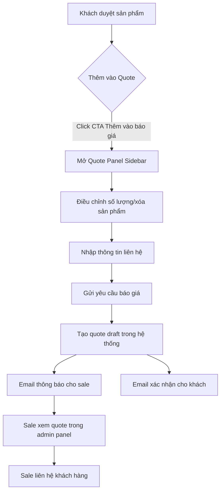
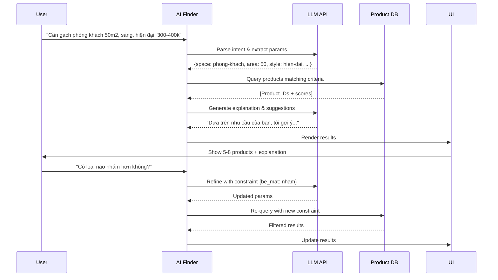

# 11. Hệ thống Báo giá & AI Gợi ý Sản phẩm (Tài liệu Khởi thảo — Đã Thay Thế Một Phần)

> **Quyết định liên quan:** `D-23` (BOQ & CPT `drv_lead` ở Phase 1 — đã chốt), `D-25` (Tắt cờ AI `features.ai_enabled = false` ở Phase 1 — đã chốt), `D-41`..`D-49` (Kiến trúc Trợ lý AI Phase 3 — đề xuất).
> **Skill:** `wordpress`, `wp-rest-api`, `form-cro`, `backend-security-coder`

> [!WARNING]
> **THÔNG BÁO QUAN TRỌNG VỀ TRẠNG THÁI TÀI LIỆU:**
> - **Mục §2 (Quote Builder dùng PHP session/transient, WC Order `drv-quote-draft`, hook non-HPOS và Google reCAPTCHA) ĐÃ DEPRECATED** theo các Quyết định **`D-22`, `D-23`, `D-30`** trong [00_Project_Brief_Decisions.md](00_Project_Brief_Decisions.md). **Tuyệt đối không triển khai code theo §2.**
> - **Đặc tả chuẩn cho Báo giá công trình BOQ & Lead (Phase 1):** Xem **[17_Quote_BOQ_And_Lead_Spec.md](17_Quote_BOQ_And_Lead_Spec.md)** (`localStorage` `drv_quote_v2` + CPT private `drv_lead` + `GET /dravit/v1/nonce` + HPOS `OrderConverter`).
> - **Đặc tả chuẩn cho Trợ lý AI Tìm gạch (Phase 3):** Xem **[12_AI_Advisor_Strategy_Analysis.md](12_AI_Advisor_Strategy_Analysis.md)** và **[13_AI_Advisor_MVP_Spec.md](13_AI_Advisor_MVP_Spec.md)** (hệ thống đóng kín `D-41`..`D-49`; ở Phase 1 mặc định `drv_settings.features.ai_enabled = false` theo `D-25`).

## 1. Tổng quan

### 1.1 Mục tiêu

Nâng cấp trải nghiệm mua hàng từ catalog thụ động sang hệ thống tư vấn chủ động, giúp khách hàng:
- **Tính năng 1 (Quote Builder / BOQ):** Tự tạo bảng báo giá nhiều sản phẩm theo hạng mục phòng, để lại thông tin → lưu vào CPT `drv_lead` cho sale xử lý (xem đặc tả chính thức tại [17_Quote_BOQ_And_Lead_Spec.md](17_Quote_BOQ_And_Lead_Spec.md)).
- **Tính năng 2 (AI Tile Finder):** Nhập nhu cầu bằng ngôn ngữ tự nhiên → AI gợi ý sản phẩm phù hợp dựa trên thuộc tính, ngữ cảnh và ràng buộc an toàn (xem đặc tả chính thức tại [12_AI_Advisor_Strategy_Analysis.md](12_AI_Advisor_Strategy_Analysis.md) & [13_AI_Advisor_MVP_Spec.md](13_AI_Advisor_MVP_Spec.md)).

### 1.2 Vị trí trong roadmap (Đã cập nhật theo `D-23`, `D-25`)

| Phase | Tính năng | Tài liệu chuẩn |
|---|---|---|
| **Phase 1** | Danh sách Báo giá công trình BOQ (`/danh-sach-bao-gia`) & Thu nhận Lead tập trung (`drv_lead`), không dùng AI (`features.ai_enabled = false`) | [17_Quote_BOQ_And_Lead_Spec.md](17_Quote_BOQ_And_Lead_Spec.md) |
| **Phase 3** | Trợ lý AI Tìm gạch (`/tro-ly-ai-tim-gach`) đóng kín trên Catalog Snapshot + bộ tri thức đã duyệt (`D-41`..`D-49`) | [12_AI_Advisor_Strategy_Analysis.md](12_AI_Advisor_Strategy_Analysis.md), [13_AI_Advisor_MVP_Spec.md](13_AI_Advisor_MVP_Spec.md) |
| **Phase 4+** | Nâng cấp: Visual similarity search (Vision), Zalo/Messenger chung endpoint, mở rộng Tier 1/2 | [12_AI_Advisor_Strategy_Analysis.md](12_AI_Advisor_Strategy_Analysis.md) §11 |

### 1.3 Nguyên tắc thiết kế

1. **Progressive Enhancement:** BOQ & Form Lead hoạt động an toàn dưới LiteSpeed Cache nhờ `/dravit/v1/nonce` (`D-30`).
2. **Privacy-first:** Dữ liệu cá nhân khách hàng (tên, SĐT, email) không bao giờ gửi vào LLM prompt (chỉ gửi metadata sản phẩm).
3. **No Vendor Lock-in:** AI model trừu tượng hóa qua `LlmClient` interface + có lớp fallback thuần luật khi LLM lỗi.
4. **Tuân thủ kiến trúc Dravit:**
   - Logic nằm trong theme dưới namespace `Dravit\` (`Dravit\Quote`, `Dravit\Leads`, `Dravit\Advisor`).
   - Không tạo custom DB tables: dùng CPT private `drv_lead` cho báo giá/lead (`D-23`), CPT `drv_ai_query` cho nhật ký AI (`D-43`), và WC Order CRUD chuẩn HPOS 100% cho đơn hàng thật (`D-22`).
   - Vanilla JS ES2022 modules + REST API, icon Phosphor subset tự host (`D-28`, không dùng emoji trong UI).

---

## 2. Tính năng 1: Quote Builder (Báo giá Đa Sản phẩm) — [DEPRECATED]

> [!WARNING]
> **TOÀN BỘ MỤC §2 DƯỚI ĐÂY ĐÃ DEPRECATED THEO `D-22`, `D-23`, `D-30` VÀ CHỈ GIỮ LẠI ĐỂ ĐỐI CHIẾU LỊCH SỬ.**
> - **Không dùng** PHP session/transient `_drv_quote_*` hay endpoint `/quote/add-item` → Đã thay bằng lưu nháp phía client tại `localStorage` (`drv_quote_v2`) kết hợp hydrate qua `GET /wp-json/dravit/v1/products`.
> - **Không tạo** đơn nháp `WC_Order` với trạng thái `drv-quote-draft` (làm nhảy số đơn, sai lệch báo cáo & tồn kho) → Đã thay bằng **CPT private `drv_lead`** (`_drv_lead_type = 'boq'`) và chỉ tạo đơn HPOS `wc-cho-xac-nhan` khi Admin bấm *"Tạo đơn hàng từ báo giá"* (`OrderConverter`).
> - **Không dùng** Google reCAPTCHA v3 (ngoài whitelist `02 §4`) → Đã thay bằng `GET /wp-json/dravit/v1/nonce` (`no-store`) + honeypot + time-trap (`≥ 3s`) + rate-limit IP + kiểm tra `Origin`.
> - **Đọc đặc tả chính thức tại:** **[17_Quote_BOQ_And_Lead_Spec.md](17_Quote_BOQ_And_Lead_Spec.md)**.

### 2.1 User Flow



### 2.2 Components

#### 2.2.1 Frontend (Public)

**A. CTA "Thêm vào báo giá"**
- Vị trí:
  - Trang sản phẩm đơn: bên cạnh nút "Thêm vào giỏ hàng"
  - Card sản phẩm (grid/list): icon trên toolbar
  - Quick view popup
- Action:
  - Click → gọi REST endpoint `POST /wp-json/dravit/v1/quote/add-item`
  - Lưu quote items vào **session PHP** (transient `_drv_quote_{session_id}`) hoặc **localStorage** (guest).
  - User đã đăng nhập → gắn vào `user_meta` `drv_quote_draft`.

**B. Quote Panel (Sidebar Offcanvas)**
```html
<drv-quote-panel data-drv-lazy="quote-panel">
  <header>
    <h2>Bảng báo giá của bạn</h2>
    <button data-action="close"><i class="ph ph-x"></i></button>
  </header>

  <div class="quote-items">
    <!-- Mỗi item -->
    <div class="quote-item" data-product-id="123">
      
      <div class="info">
        <h3>Gạch DRV-8801M</h3>
        <p class="price">246.400đ/viên · 385.000đ/m²</p>
        <drv-qty-input value="12" min="3" step="3"></drv-qty-input>
        <p class="summary">12 viên · 7,68 m² · 4 thùng</p>
      </div>
      <button data-action="remove"><i class="ph ph-trash"></i></button>
    </div>
  </div>

  <div class="quote-summary">
    <dl>
      <dt>Tổng số sản phẩm:</dt><dd>3 loại</dd>
      <dt>Tổng diện tích:</dt><dd>~42,5 m²</dd>
      <dt>Tạm tính:</dt><dd>16.250.000đ</dd>
    </dl>
    <small>* Giá chưa bao gồm vận chuyển & thi công</small>
  </div>

  <form class="quote-contact-form" data-drv-action="submit-quote">
    <input name="customer_name" placeholder="Họ tên *" required>
    <input name="customer_phone" type="tel" placeholder="Số điện thoại *" required>
    <input name="customer_email" type="email" placeholder="Email">
    <textarea name="customer_note" placeholder="Ghi chú (địa chỉ, yêu cầu...)"></textarea>
    <label>
      <input type="checkbox" name="consent" required>
      Tôi đồng ý cho Dravit liên hệ để tư vấn
    </label>
    <button type="submit" class="btn-primary">Gửi yêu cầu báo giá</button>
  </form>
</drv-quote-panel>
```

**C. JavaScript Module (`src/js/quote-panel.js`)**
```javascript
class QuotePanelController extends HTMLElement {
  connectedCallback() {
    this.loadItems();
    this.attachEventListeners();
  }

  async loadItems() {
    const items = await fetch('/wp-json/dravit/v1/quote/items').then(r => r.json());
    this.renderItems(items);
  }

  async addItem(productId, quantity) {
    await fetch('/wp-json/dravit/v1/quote/add-item', {
      method: 'POST',
      headers: {'Content-Type': 'application/json'},
      body: JSON.stringify({product_id: productId, quantity})
    });
    this.loadItems();
    this.open();
  }

  async submitQuote(formData) {
    const response = await fetch('/wp-json/dravit/v1/quote/submit', {
      method: 'POST',
      headers: {'Content-Type': 'application/json'},
      body: JSON.stringify({
        items: this.items,
        customer: formData
      })
    });

    if (response.ok) {
      this.showSuccess('Báo giá đã được gửi! Chúng tôi sẽ liên hệ bạn trong 30 phút.');
      this.clear();
    }
  }
}
customElements.define('drv-quote-panel', QuotePanelController);
```

#### 2.2.2 Backend (PHP) — [DEPRECATED: Đã chuyển sang CPT `drv_lead` tại `17`]

**A. Data Model (Đã thay thế theo `D-22`, `D-23`)**

- **Thiết kế chính thức (Phase 1):** Báo giá công trình BOQ lưu vào **CPT private `drv_lead`** (`_drv_lead_type = 'boq'`, snapshot JSON `_drv_boq` do server tính lại 100%). **CẤM** lưu báo giá nháp vào `shop_order` hay dùng slug `drv-quote-draft`. Khi khách chốt mua, Admin bấm Action *"Tạo đơn hàng từ báo giá"* (`OrderConverter`) để sinh đơn hàng HPOS thật ở trạng thái `wc-cho-xac-nhan` (`≤ 20` ký tự, gắn `_drv_source_lead_id`). Xem đầy đủ tại [17_Quote_BOQ_And_Lead_Spec.md](17_Quote_BOQ_And_Lead_Spec.md).

**B. REST API Endpoints (Đã chuẩn hóa sang `15` & `17`)**

> Lưu ý: Đoạn code phác thảo ban đầu dưới đây đã được chỉnh sửa bỏ đường dẫn non-HPOS `post.php` và đánh dấu thay thế bằng `POST /wp-json/dravit/v1/quote/submit` (lưu `drv_lead`) + `GET /wp-json/dravit/v1/products` (hydrate từ `localStorage` `drv_quote_v2`). Không cài đặt `/quote/items` hay `/quote/add-item` dùng PHP session.

```php
// [DEPRECATED DRAFT — Xem bản chính thức tại docs/17_Quote_BOQ_And_Lead_Spec.md]
// Khi làm việc với WC_Order thật (vd sau khi OrderConverter chuyển từ drv_lead sang đơn HPOS):
// - BẮT BUỘC dùng HPOS CRUD: $order->get_meta(), $order->update_meta_data(), $order->save()
// - URL trang sửa đơn trong Admin: $order->get_edit_order_url() (CẤM dùng admin_url('post.php?post=...'))
// - Slug trạng thái đơn custom bắt buộc có tiền tố 'wc-' và tổng độ dài <= 20 ký tự (vd: 'wc-cho-xac-nhan')
```

**C. Admin Panel Integration (Chuẩn HPOS — Cấm dùng hook `shop_order` cũ)**

> Lưu ý kỹ thuật bắt buộc (`D-22`): Mọi tùy biến danh sách đơn hàng WooCommerce phải dùng hook HPOS `woocommerce_page_wc-orders` (nhận trực tiếp đối tượng `\WC_Order`), **tuyệt đối không copy** `manage_edit-shop_order_columns` hay `manage_shop_order_posts_custom_column`. Xem chi tiết vận hành đơn HPOS tại [18_Order_Ops_And_Email_Spec.md](18_Order_Ops_And_Email_Spec.md).

```php
// Ví dụ chuẩn HPOS khi thêm cột nguồn báo giá trên danh sách đơn hàng thật:
add_filter('manage_woocommerce_page_wc-orders_columns', function (array $columns): array {
    $columns['drv_source_lead'] = 'Nguồn BOQ';
    return $columns;
});

add_action('manage_woocommerce_page_wc-orders_custom_column', function (string $column, \WC_Order $order): void {
    if ($column === 'drv_source_lead') {
        $lead_id = (int) $order->get_meta('_drv_source_lead_id');
        if ($lead_id > 0) {
            echo '<span class="drv-badge">BOQ #' . esc_html((string) $lead_id) . '</span>';
        }
    }
}, 10, 2);
```

### 2.3 UX Enhancements (Cập nhật theo `17`)

1. **Auto-save phía client:** Mọi thay đổi lưu trực tiếp vào `localStorage` (`drv_quote_v2`, hỗ trợ chia theo hạng mục phòng + mức hao hụt `0/5/10%`), không tạo PHP session gây miss LiteSpeed Cache.
2. **Chiết khấu dự kiến (`D-23`):** Bậc khối lượng (`≥ 30 m²: 5%`, `≥ 100 m²: 8%`) chỉ hiển thị tham khảo trên `/danh-sach-bao-gia`, không tự trừ vào giỏ bán lẻ.
3. **Mobile-friendly:** `<drv-quote-panel>` mở dạng drawer/bottom sheet và liên thông với trang `/danh-sach-bao-gia`.

### 2.4 Security & Validation (Chuẩn hóa theo `D-30`)

1. **Fresh Nonce dưới Page Cache:** Lấy token ngay trước khi gửi qua `GET /wp-json/dravit/v1/nonce` (`Cache-Control: no-store`).
2. **Rate limiting:** Giới hạn số lượt gửi theo IP hash (trả HTTP `429` khi vượt ngưỡng).
3. **Honeypot + Time-trap + Origin check:** Từ chối nếu điền trường ẩn, thời gian mở form `< 3s`, hoặc sai `Origin` (**không dùng Google reCAPTCHA v3** do nằm ngoài whitelist `02 §4`).
4. **Server Recompute & Sanitization:** Server tính lại 100% số lượng/thành tiền từ DB qua `Dravit\Units\Calc`, mọi input qua `sanitize_*` + kiểm tra tối đa `max_items` (`drv_settings.quote.max_items`).

---

## 3. Tính năng 2: AI Tile Finder (Gợi ý Thông minh)

### 3.1 User Experience

**A. Conversational Interface**

```
┌─────────────────────────────────────────────────────────────┐
│  🤖 Dravit AI — Trợ lý tìm gạch                            │
├─────────────────────────────────────────────────────────────┤
│  👋 Xin chào! Tôi có thể giúp bạn tìm loại gạch phù hợp.   │
│  Hãy cho tôi biết:                                          │
│                                                             │
│  • Bạn muốn lát/ốp cho không gian nào?                     │
│  • Diện tích khoảng bao nhiêu m²?                          │
│  • Phong cách bạn yêu thích?                               │
│  • Ngân sách dự kiến?                                      │
│                                                             │
│  Hoặc gõ tự do, ví dụ: "Tôi cần gạch lát nền phòng khách  │
│  50m2, màu sáng, phong cách hiện đại, giá tầm 300-400k/m²" │
├─────────────────────────────────────────────────────────────┤
│  [_______________________________________________] [Gửi ➤]  │
└─────────────────────────────────────────────────────────────┘
```

**B. Interaction Flow**



### 3.2 AI Architecture

#### 3.2.1 Tech Stack Options

| Component | Option A (Cloud) | Option B (Hybrid) | Option C (Self-hosted) |
|---|---|---|---|
| LLM | OpenAI GPT-4 Turbo | Anthropic Claude 3 Opus | Llama 3.1 70B on RunPod |
| Embeddings | OpenAI text-embedding-3-small | Cohere Embed v3 | all-MiniLM-L6-v2 local |
| Vector DB | Pinecone free tier | Weaviate Cloud | ChromaDB SQLite |
| Cost (1000 queries) | ~$15-20 | ~$10-15 | ~$5 (GPU rental) |
| Latency | 1-3s | 2-4s | 3-5s |
| Privacy | Data sent to OpenAI | Data sent to Anthropic | 100% on-premise |

**Khuyến nghị Phase 3:** Option B (Anthropic Claude) — balance giữa cost, latency, và privacy.

#### 3.2.2 System Prompt Template

```
Bạn là trợ lý AI của Dravit — chuyên gia tư vấn gạch ốp lát cao cấp tại Việt Nam.

## Nhiệm vụ
Phân tích yêu cầu của khách hàng và gợi ý 5-8 sản phẩm gạch phù hợp nhất từ catalog.

## Thông tin catalog
{PRODUCT_METADATA_JSON}

## Quy tắc gợi ý
1. Ưu tiên sản phẩm phù hợp 100% với ràng buộc bắt buộc (không gian, DCOF nếu có).
2. Cân bằng giữa phong cách, màu sắc, và ngân sách.
3. Nếu ngân sách chặt, gợi ý sản phẩm trong khoảng ±10%.
4. Nếu không đủ sản phẩm khớp 100%, giải thích trade-off (vd: "Gạch này vượt ngân sách 5% nhưng độ bền cao hơn").
5. Luôn trả về danh sách product IDs dạng JSON array.

## Format output
{
  "reasoning": "Giải thích ngắn gọn (1-2 câu) tại sao gợi ý những sản phẩm này",
  "product_ids": [123, 456, 789],
  "clarification": "Câu hỏi làm rõ nếu cần (hoặc null)"
}

## Input khách hàng
{USER_INPUT}
```

#### 3.2.3 Product Metadata Indexing

**Tạo index khi sản phẩm được publish/update:**

```php
namespace Dravit\AiTileFinder;

class ProductIndexer {
  public function index_product(int $product_id): void {
    $product = wc_get_product($product_id);

    // Trích xuất metadata
    $metadata = [
      'id' => $product_id,
      'name' => $product->get_name(),
      'sku' => $product->get_sku(),
      'price_m2' => (int) $product->get_meta('drv_price_m2'),
      'price_band' => $this->get_price_band($product),
      'attributes' => [
        'kich_thuoc' => $this->get_attr_slugs($product, 'pa_kich-thuoc'),
        'mau_sac' => $this->get_attr_slugs($product, 'pa_mau-sac'),
        'be_mat' => $this->get_attr_slugs($product, 'pa_be-mat'),
        'phong_cach' => $this->get_attr_slugs($product, 'pa_phong-cach'),
        'khong_gian' => $this->get_attr_slugs($product, 'pa_khong-gian'),
        'cong_nang' => $this->get_attr_slugs($product, 'pa_cong-nang'),
        'van_gach' => $this->get_attr_slugs($product, 'pa_van-gach'),
        'dcof' => $this->get_attr_slugs($product, 'pa_dcof'),
      ],
      'collections' => wp_get_post_terms($product_id, 'product_cat', ['fields' => 'slugs']),
      'description_short' => wp_strip_all_tags($product->get_short_description()),
    ];

    // Lưu vào option (hoặc custom table nếu > 1000 sản phẩm)
    $index = get_option('drv_ai_product_index', []);
    $index[$product_id] = $metadata;
    update_option('drv_ai_product_index', $index);

    // Tạo embedding (nếu dùng vector search)
    if ($this->should_use_embeddings()) {
      $text = $this->product_to_text($metadata);
      $embedding = $this->get_embedding($text);
      $this->store_embedding($product_id, $embedding);
    }
  }

  private function product_to_text(array $metadata): string {
    return sprintf(
      "%s. Giá %s. Kích thước %s. Màu sắc %s. Bề mặt %s. Phong cách %s. Dùng cho %s.",
      $metadata['name'],
      number_format($metadata['price_m2']) . 'đ/m²',
      implode(', ', $metadata['attributes']['kich_thuoc']),
      implode(', ', $metadata['attributes']['mau_sac']),
      implode(', ', $metadata['attributes']['be_mat']),
      implode(', ', $metadata['attributes']['phong_cach']),
      implode(', ', $metadata['attributes']['khong_gian'])
    );
  }
}
```

#### 3.2.4 Query Pipeline

```php
namespace Dravit\AiTileFinder;

class QueryEngine {
  private LlmClient $llm;
  private ProductIndex $index;

  public function find_products(string $user_input, array $context = []): array {
    // Bước 1: Parse user input bằng LLM
    $parsed = $this->llm->parse_intent($user_input, $context);

    // Bước 2: Build query từ parsed params
    $query = new ProductQuery();

    if (isset($parsed['khong_gian'])) {
      $query->add_filter('pa_khong-gian', $parsed['khong_gian']);
    }

    if (isset($parsed['price_min'], $parsed['price_max'])) {
      $query->add_meta_query([
        'key' => 'drv_price_m2',
        'value' => [$parsed['price_min'], $parsed['price_max']],
        'type' => 'NUMERIC',
        'compare' => 'BETWEEN'
      ]);
    }

    if (isset($parsed['phong_cach'])) {
      $query->add_filter('pa_phong-cach', $parsed['phong_cach']);
    }

    // Bước 3: Query database
    $candidates = $query->get_results(); // WP_Query

    // Bước 4: Rerank bằng LLM hoặc vector similarity
    if ($this->should_use_reranking()) {
      $candidates = $this->rerank_with_llm($candidates, $user_input, $parsed);
    }

    // Bước 5: Limit top N
    $top_products = array_slice($candidates, 0, 8);

    // Bước 6: Generate explanation
    $explanation = $this->llm->explain_recommendations($top_products, $parsed);

    return [
      'products' => $top_products,
      'explanation' => $explanation,
      'parsed_params' => $parsed,
      'total_matches' => count($candidates)
    ];
  }

  private function rerank_with_llm(array $candidates, string $user_input, array $parsed): array {
    // Chuẩn bị prompt
    $candidates_json = json_encode(array_map(function($p) {
      return [
        'id' => $p->get_id(),
        'name' => $p->get_name(),
        'price_m2' => $p->get_meta('drv_price_m2'),
        'attributes' => $this->get_product_attributes($p)
      ];
    }, $candidates));

    $prompt = sprintf(
      "User query: %s\n\nParsed intent: %s\n\nCandidate products:\n%s\n\nRank these products by relevance (return array of product IDs in order).",
      $user_input,
      json_encode($parsed),
      $candidates_json
    );

    $ranked_ids = $this->llm->complete($prompt);

    // Sắp xếp lại candidates theo ranked_ids
    $id_map = [];
    foreach ($candidates as $c) {
      $id_map[$c->get_id()] = $c;
    }

    $ranked = [];
    foreach ($ranked_ids as $id) {
      if (isset($id_map[$id])) {
        $ranked[] = $id_map[$id];
      }
    }

    return $ranked;
  }
}
```

#### 3.2.5 LLM Client Abstraction

```php
namespace Dravit\AiTileFinder;

interface LlmClient {
  public function parse_intent(string $input, array $context): array;
  public function explain_recommendations(array $products, array $params): string;
  public function complete(string $prompt): mixed;
}

class AnthropicClient implements LlmClient {
  private string $api_key;
  private string $model = 'claude-3-5-sonnet-20241022';

  public function parse_intent(string $input, array $context): array {
    $system_prompt = $this->load_system_prompt('parse_intent');

    $response = $this->call_api([
      'model' => $this->model,
      'max_tokens' => 1024,
      'system' => $system_prompt,
      'messages' => [
        ['role' => 'user', 'content' => $input]
      ]
    ]);

    $content = $response['content'][0]['text'];
    return json_decode($content, true);
  }

  private function call_api(array $payload): array {
    $response = wp_remote_post('https://api.anthropic.com/v1/messages', [
      'headers' => [
        'x-api-key' => $this->api_key,
        'anthropic-version' => '2023-06-01',
        'content-type' => 'application/json'
      ],
      'body' => json_encode($payload),
      'timeout' => 15
    ]);

    if (is_wp_error($response)) {
      throw new \Exception('LLM API error: ' . $response->get_error_message());
    }

    return json_decode(wp_remote_retrieve_body($response), true);
  }
}
```

### 3.3 UI Components

**A. Chat Widget**

```html
<drv-ai-finder data-drv-lazy="ai-finder">
  <div class="chat-messages" id="ai-messages">
    <!-- AI messages append here -->
  </div>

  <form class="chat-input-form" data-drv-action="ai-query">
    <textarea
      name="query"
      placeholder="Nhập yêu cầu của bạn..."
      rows="2"
      maxlength="500"
    ></textarea>
    <button type="submit" aria-label="Gửi">
      <i class="ph ph-paper-plane-tilt"></i>
    </button>
  </form>

  <div class="chat-suggestions">
    <button data-suggestion="Gạch lát nền phòng khách 40m2 phong cách tối giản">
      Phòng khách tối giản
    </button>
    <button data-suggestion="Gạch ốp nhà tắm chống trơn giá tầm 300k">
      Nhà tắm chống trơn
    </button>
  </div>
</drv-ai-finder>
```

**B. Results Display**

Sau khi AI trả về kết quả, render dạng grid sản phẩm kèm explanation:

```html
<div class="ai-results">
  <div class="ai-explanation">
    <i class="ph ph-sparkle"></i>
    <p>Dựa trên nhu cầu phòng khách 50m², phong cách hiện đại và ngân sách
       300-400k/m², tôi gợi ý 6 sản phẩm sau. Tất cả đều có bề mặt mờ/bán bóng
       phù hợp phong cách tối giản.</p>
  </div>

  <div class="product-grid">
    <!-- Render products như catalog grid -->
    <?php foreach ($results['products'] as $product): ?>
      <?php drv_ui('product-card', ['product' => $product, 'context' => 'ai']); ?>
    <?php endforeach; ?>
  </div>

  <div class="ai-actions">
    <button data-action="refine">🔍 Lọc thêm</button>
    <button data-action="add-all-to-quote">➕ Thêm tất cả vào báo giá</button>
  </div>
</div>
```

### 3.4 Training Data & Fine-tuning

#### 3.4.1 Seed Data Collection

**Nguồn dữ liệu:**
1. **Product catalog:** 28 collections × ~15 SKU = ~420 sản phẩm (Phase 1).
2. **Customer quotes:** Lưu trữ user queries từ Quote Builder (opt-in) → training set.
3. **Manual curation:** Team sales viết 50-100 query examples phổ biến.

**Ví dụ training examples:**

```json
[
  {
    "input": "Tôi cần gạch lát phòng khách 45m2, màu xám nhạt, vân đá marble, giá khoảng 350-450k/m²",
    "output": {
      "khong_gian": "phong-khach",
      "area_m2": 45,
      "mau_sac": ["xam"],
      "van_gach": ["van-da-marble"],
      "price_min": 350000,
      "price_max": 450000,
      "cong_nang": "lat-nen"
    },
    "recommended_products": [123, 456, 789]
  },
  {
    "input": "Nhà tắm cần gạch chống trơn, kích thước nhỏ, giá rẻ",
    "output": {
      "khong_gian": "nha-tam",
      "dcof": ["r10", "r11", "r12", "r13"],
      "kich_thuoc": ["30x30", "30x60", "7-5x30"],
      "price_max": 300000,
      "be_mat": ["nham"]
    }
  },
  {
    "input": "Gạch ốp tường bếp, dễ lau chùi, màu trắng hoặc kem",
    "output": {
      "khong_gian": "phong-bep",
      "cong_nang": "op-tuong",
      "be_mat": ["bong-kieng", "ban-bong"],
      "mau_sac": ["trang", "kem"]
    }
  }
]
```

**Script sinh training data từ catalog:**

```php
class TrainingDataGenerator {
  public function generate_from_catalog(): array {
    $templates = [
      "Cần gạch {cong_nang} {khong_gian} {area}m2, {phong_cach}, giá {price_range}",
      "Tìm gạch {kich_thuoc} màu {mau_sac} cho {khong_gian}",
      "Gạch {be_mat} {van_gach} dùng {khong_gian}, ngân sách {price_range}",
    ];

    $variations = [
      'cong_nang' => ['lát nền', 'ốp tường', 'trang trí'],
      'khong_gian' => ['phòng khách', 'nhà tắm', 'phòng bếp', 'sân vườn'],
      'phong_cach' => ['hiện đại', 'tối giản', 'wabi-sabi', 'tân cổ điển'],
      'price_range' => ['dưới 300k', '300-400k', '400-600k', 'cao cấp'],
    ];

    $examples = [];
    foreach ($this->get_all_products() as $product) {
      $query = $this->generate_query($product, $templates, $variations);
      $params = $this->extract_params($product);

      $examples[] = [
        'input' => $query,
        'output' => $params,
        'recommended_products' => [$product->get_id()]
      ];
    }

    return $examples;
  }
}
```

#### 3.4.2 Feedback Loop

Sau mỗi query, hỏi user feedback:

```html
<div class="ai-feedback">
  <p>Kết quả có hữu ích không?</p>
  <button data-feedback="helpful">👍 Hữu ích</button>
  <button data-feedback="not-helpful">👎 Chưa đúng</button>
</div>
```

Lưu feedback vào `wp_postmeta`:
```php
add_action('wp_ajax_drv_ai_feedback', function() {
  $query_id = absint($_POST['query_id']);
  $feedback = sanitize_text_field($_POST['feedback']); // helpful | not-helpful

  update_post_meta($query_id, '_drv_ai_feedback', $feedback);

  // Nếu not-helpful, yêu cầu lý do
  if ($feedback === 'not-helpful' && !empty($_POST['reason'])) {
    update_post_meta($query_id, '_drv_ai_feedback_reason', sanitize_textarea_field($_POST['reason']));
  }
});
```

Định kỳ review feedback → cải thiện prompt hoặc fine-tune model.

---

## 4. Workflow Chi tiết

### 4.1 Phase 2 — Quote Builder (4 tuần)

| Tuần | Công việc |
|---|---|
| **W1** | Setup REST API endpoints · Quote data model · Session/localStorage logic |
| **W2** | Frontend: Quote panel UI · Add to quote CTA · Quantity controls |
| **W3** | Backend: Submit quote → WC Order · Email notifications · Admin panel |
| **W4** | Testing · Security audit · UX polish · Documentation |

**Deliverables:**
- [ ] REST API `/wp-json/dravit/v1/quote/*` hoàn chỉnh
- [ ] Quote panel responsive (mobile + desktop)
- [ ] Admin có thể xem danh sách quote, chuyển thành đơn hàng
- [ ] Email template cho admin và khách
- [ ] Security: rate limiting, honeypot, sanitization
- [ ] Test coverage ≥ 80% (unit tests cho API)

### 4.2 Phase 3 — AI Tile Finder (6-8 tuần)

| Tuần | Công việc |
|---|---|
| **W1-2** | Chọn LLM provider · Setup API · Tạo system prompts · Product indexer |
| **W3** | Query engine: parse intent → query DB → rerank |
| **W4** | Chat UI: message bubbles · product results display · suggestions |
| **W5** | Training data generation · Feedback loop · Analytics |
| **W6** | Multi-turn conversation · Context retention · Refinement queries |
| **W7** | Performance optimization · Caching · Fallback khi API down |
| **W8** | QA testing · A/B testing setup · Launch |

**Deliverables:**
- [ ] LLM integration với fallback graceful khi API lỗi
- [ ] Chat interface mượt mà (typing indicator, streaming response)
- [ ] 90%+ accuracy cho 50 test cases thông dụng
- [ ] Latency P95 < 5s (từ submit → hiển thị kết quả)
- [ ] Cost tracking dashboard (monitor API usage)
- [ ] Feedback collection system
- [ ] A/B test: AI finder vs. traditional filters (conversion rate)

### 4.3 Phase 4+ — Advanced Features

- **Visual search:** Upload ảnh phòng/gạch mẫu → tìm gạch tương tự (dùng CLIP embeddings).
- **Multi-room quoting:** Tạo quote cho nhiều phòng cùng lúc (phòng khách + nhà tắm + bếp).
- **AR preview:** Xem gạch trên sàn nhà bằng AR (WebXR API).
- **Voice input:** Hỏi bằng giọng nói (Web Speech API).

---

## 5. Cấu trúc Code

### 5.1 Thư mục

```text
wp-content/themes/dravit/
├── inc/
│   ├── Quote/
│   │   ├── QuoteController.php        # REST API endpoints
│   │   ├── QuoteSession.php           # Session/localStorage management
│   │   ├── QuoteOrder.php             # Tạo WC Order từ quote
│   │   ├── QuoteEmail.php             # Email templates
│   │   └── QuoteAdmin.php             # Admin panel customization
│   │
│   └── AiTileFinder/
│       ├── QueryEngine.php            # Main query pipeline
│       ├── LlmClient.php              # Interface + implementations
│       ├── AnthropicClient.php        # Anthropic Claude client
│       ├── OpenAiClient.php           # OpenAI GPT client (fallback)
│       ├── ProductIndexer.php         # Index products for AI
│       ├── ProductQuery.php           # Query builder
│       ├── TrainingDataGenerator.php  # Generate training examples
│       ├── FeedbackCollector.php      # Collect user feedback
│       └── AiFinderController.php     # REST API for chat
│
├── assets/
│   ├── src/js/
│   │   ├── quote-panel.js             # Quote panel logic
│   │   └── ai-finder.js               # AI chat widget
│   │
│   └── src/css/layers/components/
│       ├── _quote-panel.css
│       └── _ai-finder.css
│
└── config/
    ├── ai-prompts.php                 # LLM system prompts
    └── ai-settings.php                # LLM provider config
```

### 5.2 Dependencies (Đã cập nhật theo Whitelist `02` §4 & `D-28`)

> **Lưu ý kiến trúc:** Không cài `guzzlehttp/guzzle`, `symfony/cache` (Composer `vendor/`) hay `marked` (NPM) trên production theo `D-04`, `D-07`, `D-28`. Sử dụng trực tiếp `wp_remote_post`, WP Object Cache / Catalog Snapshot và render JSON có cấu trúc (xem [13_AI_Advisor_MVP_Spec.md](13_AI_Advisor_MVP_Spec.md)).

### 5.3 Environment Variables

Thêm vào `wp-config.php` (local) hoặc server env:

```php
define('DRV_LLM_PROVIDER', 'anthropic'); // anthropic | openai | local
define('DRV_ANTHROPIC_API_KEY', 'sk-ant-***');
define('DRV_OPENAI_API_KEY', 'sk-***');
define('DRV_AI_CACHE_TTL', 3600); // Cache LLM responses for 1h
```

---

## 6. Tính khả thi

### 6.1 Phân tích SWOT

**Strengths (Điểm mạnh)**
- ✅ Có sẵn 28 collections với metadata chi tiết (14 facets).
- ✅ Giá/m² chuẩn hóa → dễ filter theo budget.
- ✅ WordPress REST API mature, dễ extend.
- ✅ Team đã quen với WC ecosystem.

**Weaknesses (Điểm yếu)**
- ⚠️ Training data ban đầu hạn chế (chưa có lịch sử query thật).
- ⚠️ LLM API cost có thể tăng nhanh nếu traffic cao.
- ⚠️ Latency 3-5s có thể khiến user rời đi (cần optimize).

**Opportunities (Cơ hội)**
- 🚀 Đối thủ trong ngành gạch VN chưa có AI (first-mover advantage).
- 🚀 Tích hợp Zalo/Messenger chatbot dùng chung AI engine.
- 🚀 Upsell thêm dịch vụ thi công (AI gợi ý package phòng khách + bếp).

**Threats (Rủi ro)**
- ❌ AI hallucination → gợi ý sai sản phẩm (cần validation layer).
- ❌ LLM provider thay đổi pricing/deprecated API.
- ❌ User kỳ vọng quá cao vào AI (cần set expectation rõ ràng).

### 6.2 Mitigations

| Rủi ro | Giải pháp |
|---|---|
| AI gợi ý sai | Rule-based validation layer: reject nếu sản phẩm không match hard constraints (vd: DCOF cho nhà tắm) |
| API cost tăng | Implement aggressive caching (1h TTL), batch requests, set monthly budget cap |
| Latency cao | Stream response chunks (SSE), show skeleton loader, pre-index products |
| Hallucination | Constrained generation: chỉ cho phép LLM chọn từ product IDs có sẵn |
| Vendor lock-in | Abstract LlmClient interface, dễ swap provider |

### 6.3 ROI Estimation

**Assumptions:**
- Conversion rate hiện tại (traditional filter): 2.5%
- Conversion rate với AI Finder: 4-5% (dựa trên case study ecommerce tương tự)
- Avg order value: 8.000.000đ
- Monthly traffic: 5.000 visitors

**Scenario A: Không AI**
- Orders/month = 5000 × 2.5% = 125
- Revenue/month = 125 × 8M = 1.000.000.000đ

**Scenario B: Có AI (30% users dùng AI Finder)**
- AI users = 5000 × 30% = 1500
- AI conversion = 1500 × 4.5% = 68 orders
- Traditional users = 3500 × 2.5% = 88 orders
- Total orders = 156
- Revenue/month = 156 × 8M = 1.248.000.000đ
- **Uplift = +248M/tháng (+24.8%)**

**Cost:**
- Development (one-time): ~80-120 triệu VND
- LLM API (monthly): ~5-10 triệu VND (1500 queries × $0.01/query)
- Maintenance: ~5 triệu/tháng

**Payback period:** ~3-4 tháng

---

## 7. Các khía cạnh khác

### 7.1 Security

1. **Input sanitization:** Tất cả user input qua `sanitize_text_field`, `wp_kses_post`.
2. **Rate limiting:** Max 10 AI queries/IP/10 phút (tránh abuse).
3. **API key protection:** Lưu trong env variables, không commit vào git.
4. **PII handling:** Không gửi tên/SĐT/email khách vào LLM prompt (chỉ gửi metadata sản phẩm).
5. **CORS:** Restrict REST API access nếu cần (chỉ allow same-origin).

### 7.2 Performance

1. **Caching:**
   - Cache LLM parsed params (1h TTL) dựa trên hash của user input.
   - Cache product query results (15 phút TTL).
2. **Lazy loading:** AI Finder widget chỉ load JS khi user click "Tìm với AI".
3. **Debounce:** Delay 500ms khi user gõ trong chat input → tránh spam API.
4. **CDN:** Serve static assets (CSS/JS) qua CDN.

### 7.3 Analytics

Track các events:

```javascript
// Google Analytics 4 events
gtag('event', 'quote_builder_open', {
  'event_category': 'engagement',
  'event_label': 'Quote Panel'
});

gtag('event', 'quote_submit', {
  'event_category': 'conversion',
  'value': quote_total_vnd
});

gtag('event', 'ai_finder_query', {
  'event_category': 'engagement',
  'event_label': query_text
});

gtag('event', 'ai_finder_result_click', {
  'event_category': 'engagement',
  'product_id': product_id
});
```

Dashboard cần track:
- Quote submissions/ngày
- AI queries/ngày
- Avg products/quote
- Conversion rate: AI finder vs. traditional
- AI response latency P50/P95/P99
- LLM API cost/ngày

### 7.4 UX Best Practices

1. **Set expectations:** Hiển thị rõ "AI có thể không hoàn hảo, kết quả chỉ mang tính tham khảo".
2. **Escape hatch:** Luôn có nút "Xem tất cả sản phẩm" hoặc "Lọc thủ công" cho user muốn tự kiểm soát.
3. **Transparent reasoning:** Hiển thị lý do AI gợi ý sản phẩm đó (không chỉ show kết quả).
4. **Refinement:** Cho phép user tinh chỉnh kết quả ("Có loại rẻ hơn không?" → AI re-query).
5. **Mobile-first:** Chat UI phải mượt trên mobile (bottom sheet, swipe to close).

### 7.5 Accessibility (WCAG 2.2 AA)

1. **Keyboard navigation:** Chat input, buttons phải accessible bằng Tab/Enter.
2. **Screen reader:** ARIA labels cho chat messages (`role="log"`, `aria-live="polite"`).
3. **Focus management:** Khi mở quote panel, focus vào close button hoặc first input.
4. **Color contrast:** AI messages phải đạt contrast ≥ 4.5:1 với background.

### 7.6 Multilingual (Future)

Nếu mở rộng ra tiếng Anh:
- LLM system prompt có version EN/VI.
- Product metadata index có field `lang`.
- User chọn ngôn ngữ → AI trả lời bằng ngôn ngữ đó.

---

## 8. Kết luận & Khuyến nghị

### 8.1 Kết luận

Cả hai tính năng đều **khả thi kỹ thuật** và **phù hợp với kiến trúc Dravit**:

1. **Quote Builder (Phase 2):**
   - ✅ Low risk, high value.
   - ✅ Không phụ thuộc bên thứ 3.
   - ✅ Triển khai nhanh (4 tuần).
   - **→ Nên ưu tiên làm ngay sau Phase 1.**

2. **AI Tile Finder (Phase 3):**
   - ✅ Differentiation mạnh so với đối thủ.
   - ⚠️ Cần đầu tư thời gian (6-8 tuần) và chi phí API.
   - ⚠️ Rủi ro kỹ thuật trung bình (LLM accuracy, latency).
   - **→ Triển khai sau khi có 3-6 tháng data từ Quote Builder.**

### 8.2 Roadmap đề xuất

```
Phase 1 (Nov 2026):      Launch core catalog website
    ↓ (1 tháng thu thập feedback)
Phase 2 (Dec 2026):      Quote Builder
    ↓ (3 tháng thu thập customer queries)
Phase 3 (Mar 2027):      AI Tile Finder MVP (Anthropic Claude)
    ↓ (2 tháng A/B testing & fine-tuning)
Phase 4 (May 2027):      Visual search + AR preview
Phase 5 (Q3 2027):       Multi-room quoting + Voice input
```

### 8.3 Next Steps

**Ngay lập tức:**
1. [ ] Review & approve tài liệu spec này.
2. [ ] Quyết định LLM provider (khuyến nghị: Anthropic Claude).
3. [ ] Setup API key & billing alerts.

**Phase 2 prep:**
1. [ ] Thiết kế chi tiết Quote Panel UI (Figma mockups).
2. [ ] Setup development environment (staging với WooCommerce HPOS).
3. [ ] Viết test cases cho Quote Builder.

**Phase 3 prep:**
1. [ ] Thu thập 50-100 customer query examples từ team sales.
2. [ ] Index toàn bộ catalog (420 SKU) thành AI-friendly metadata.
3. [ ] Setup monitoring & cost tracking cho LLM API.

---

**Tài liệu này đã được chuẩn hóa sang các Quyết định `D-23`, `D-25` (đã chốt trong [00_Project_Brief_Decisions.md](00_Project_Brief_Decisions.md) & [17_Quote_BOQ_And_Lead_Spec.md](17_Quote_BOQ_And_Lead_Spec.md)) và dải đề xuất `D-41`..`D-49` (Phase 3 AI trong [12_AI_Advisor_Strategy_Analysis.md](12_AI_Advisor_Strategy_Analysis.md) & [13_AI_Advisor_MVP_Spec.md](13_AI_Advisor_MVP_Spec.md)).**