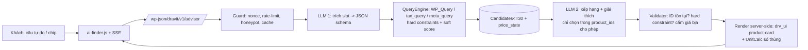
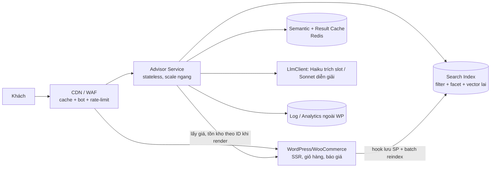

# 12. Phân tích tổng quan & Chiến lược AI Tư vấn Chọn gạch

> Phạm vi: tổng hợp `docs/00–11`, `tinhangai.md`, 12 prototype `docs/layout/*.html`. Mục tiêu: giúp **người mới** chọn đúng gạch (có giá hoặc chưa có giá) qua AI, và chốt hướng kỹ thuật tích hợp.
> Trạng thái: **đề xuất, chờ duyệt** (theo AGENTS.md §5.2). Cần ghi ADR D-20..D-23 vào `00` sau khi duyệt (§9).

---

## 1. Bài toán

| Vấn đề của khách | Hệ quả bán hàng |
|---|---|
| Người mới không biết R10/Porcelain/Rectified/Shade nghĩa là gì, không biết phòng X m² dùng khổ nào | Rời trang, hoặc gọi hỏi tốn công sale |
| Không biết mua bao nhiêu thùng (hao hụt, thùng nguyên) | Mua thiếu/thừa, lệch lô màu |
| Một phần SKU **chưa có giá niêm yết** (hàng đặt riêng, nhập khẩu, giá dự án) | Danh mục "cụt": khách không biết bấm gì tiếp |
| 14 bộ lọc quá nhiều với người mới | Bỏ bộ lọc |

**Giải pháp cốt lõi:** biến "chọn gạch" thành hội thoại 1-2 câu → ra 3-6 mẫu có lý do, **số thùng tính sẵn**, và 1 hành động tiếp theo rõ ràng tùy trạng thái giá (Mua / Báo giá). AI chỉ **tư vấn và diễn giải**; mọi con số (giá, tồn kho, thùng) do hệ thống tính.

---

## 2. Hiện trạng dự án (đã có / còn thiếu)

**Đã có (prototype HTML tĩnh, chưa có backend):**
- `01.1-ai-finder.html`: 3 chế độ (2 cột / chat đơn / widget nổi), chip gợi ý, toggle +5% hao hụt, banner giải thích + trade-off, feedback, "Báo giá tất cả", badge trên header. Logic là mock phía client (`ai-finder.js`).
- `04.1-quote-cart.html`: báo giá theo phòng, nhiều gạch mỗi phòng, vật tư phụ, bậc chiết khấu, PDF/Excel, form lead. Đã có **2 SKU `priceM2: 0`** (`DRV-6122B`, `DRV-6064W`) và dòng "N mẫu chưa có giá niêm yết, chưa tính vào tổng".
- `04/05/06`: giỏ → checkout (báo ship sau) → VietQR mở sau khi chốt đơn.
- `07` blog có khối "Hỏi Trợ lý AI" (`data-drv-action="ai-finder-open"` + prompt).
- `unit-calc.js`, `catalog-mock.js`: công thức m² ⇄ viên ⇄ thùng.

**Chưa có:** backend (REST `dravit/v1/*`), dữ liệu thật, LLM, nhóm model "trạng thái giá" thống nhất, log/feedback lưu trữ, rate-limit.

---

## 3. Mô hình sản phẩm "có giá / không giá" (nền tảng của toàn bộ luồng)

Hiện doc chỉ nói `drv_price_m2` bắt buộc (03 §5.1) nhưng prototype đã có SKU giá 0. Cần chuẩn hóa thành **`drv_price_state`** (1 meta, tự suy ra được):

| State | Điều kiện | Hiển thị card | CTA chính | Vào giỏ? | AI được nói gì |
|---|---|---|---|---|---|
| `priced` | `price_m2 > 0` | `385.000đ/m²` + `≈ 246.400đ/viên` | Thêm vào giỏ / Đặt mua | Có | Giá, tổng tạm tính |
| `sale` | có `sale_price_m2` | Giá cũ gạch + giá mới + `-%` | như trên | Có | Giá, mức giảm |
| `quote_only` | `price_m2 = 0`, hàng đặt riêng/nhập | Badge **"Báo giá riêng"**, không hiện "0đ" | **Thêm vào bảng báo giá** | **Không** (chỉ Quote) | Thông số + "Dravit báo giá riêng"; **cấm** ước lượng giá |
| `project_price` | `drv_price_band = gia-du-an` | "Giá dự án" | Nhận báo giá chiết khấu | Không | như trên |
| `out_of_stock` | tồn kho = 0 | Badge "Tạm hết" | Báo khi có hàng / mẫu thay thế | Không | Gợi ý mẫu tương tự còn hàng |

Quy tắc bất biến:
1. `quote_only` **không bao giờ** hiện `0đ`, không cộng vào "Tổng tạm tính" (đã đúng ở 04.1), nhưng **vẫn được tính số thùng/m²/kg** để khách và sale thấy khối lượng.
2. Tổng báo giá luôn tách 2 dòng: *"Tạm tính {n} mẫu có giá"* + *"{k} mẫu Dravit báo giá riêng"*.
3. Brand Voice "Chân thật / Không bịa" (10 §2.1): AI cấm đoán giá cho `quote_only`; thay bằng câu cố định.
4. Với `quote_only`, AI vẫn xếp hạng bình thường (vì khách mới muốn *đẹp và đúng* trước), nhưng giới hạn **tối đa 2 mẫu quote_only trong top 6** và luôn ghi rõ để không làm khách hụt hẫng; nếu khách nêu ngân sách → chỉ đưa quote_only khi không đủ mẫu `priced` và gắn nhãn.

Hành động tiếp theo theo state (một nút duy nhất, tránh phân vân): `priced → Tính thùng & thêm giỏ`, `quote_only → Thêm vào báo giá`, hỗn hợp → **"Báo giá tất cả"** (đã có ở 01.1).

---

## 4. Hành trình người mới (conversation design)

Nguyên tắc: **hỏi tối đa 2 điều còn thiếu, mỗi lượt 1 câu**, luôn kèm kết quả tạm thời để khách thấy giá trị ngay (không "thẩm vấn").

```
Khách: "nhà tắm 6m2 cho người già"
  → AI trích: space=nha-tam, area=6, need=chống trượt (suy ra R10+), user=người lớn tuổi
  → Trả ngay 4 mẫu (Matt/nhám R10-R11), 30x60 / 60x60, mỗi mẫu: số thùng cho 6m²+5%, tổng tạm tính
  → 1 câu làm rõ: "Bạn thích tông sáng hay đậm?" (chip bấm nhanh)
```

Slot cần thu thập (ưu tiên giảm dần): **không gian → diện tích → (an toàn/chống trượt) → màu/phong cách → ngân sách**. Thiếu diện tích: vẫn gợi ý, hiển thị số thùng "cho 1 m²" hoặc mời nhập.

Hành vi sản phẩm (UX):
- **Chip + câu tự do** song song; chip trả lời nhanh cho slot đang thiếu.
- **Mỗi thẻ có "Vì sao hợp"** (1 dòng, từ thuộc tính thật: "R11, hút nước ≤0,5%, hợp nhà tắm") và **cảnh báo trách nhiệm** khi cần (bóng kiếng R9 không dùng nhà tắm).
- **Giải nghĩa thuật ngữ khi di chuột/chạm** (glossary 10 §5.2), không bắt khách học.
- **Trade-off minh bạch** (có sẵn `aiTradeoffNote`): "Vượt ngân sách 5% nhưng chống trượt cao hơn".
- **Lối thoát**: luôn có "Bộ lọc 14 tiêu chí", "Gọi/Zalo tư vấn" (đã có), và nút "Chuyên viên giúp tôi" khi AI 2 lần không khớp.
- **Chuyển giao lead**: kết quả → "Báo giá tất cả" → `drv_lead`/Quote (không cần tài khoản).
- Mobile: tab "Trợ lý / Đề xuất" (đã có), widget nổi ở danh mục/blog (đã có).

---

## 5. Kiến trúc kỹ thuật đề xuất

### 5.1 Nguyên tắc: "LLM chỉ hiểu & diễn giải, SQL/PHP quyết định số liệu"



- **Hard constraints** (lọc cứng, không cho LLM phá): không gian ↔ chống trượt (nhà tắm/bếp ≥ R10; ngoài trời ≥ R11), độ dày/chịu lực sân vườn-gara, tồn kho > 0 (hoặc nhãn), `price_max` nếu khách nêu rõ.
- **Soft score** (xếp hạng): phong cách, màu, bề mặt, khổ phù hợp diện tích (bảng gợi ý 07 §3 Section 5: <15m² → 60x60; >20m² → 80x80/60x120), vân, showroom.
- **Số liệu do server tính**: giá, `≈ giá/viên`, số viên/thùng/m²/kg (`AreaPack` + công thức 04 §2-3); LLM nhận kết quả để diễn đạt, **không tự tính**.
- **HTML card** dùng cùng `drv_ui('product-card')` như SSR (D-17) → không lệch giao diện.

### 5.2 Hai đường triển khai (cần quyết định)

`tinhangai.md` đề xuất FastAPI + PostgreSQL/pgvector + Redis ngoài WordPress; `docs/11` đề xuất chạy trong theme (`Dravit\AiTileFinder`). Với **~420 SKU, 30-50 user/ngày**, đánh giá:

| Tiêu chí | **A. Trong theme (REST + LLM client)** | **B. AI Backend tách (FastAPI)** |
|---|---|---|
| Phù hợp ADR D-07 (không plugin, không bảng DB riêng) | ✅ | ❌ cần ADR ngoại lệ, thêm Postgres/Redis/VPS |
| Chi phí vận hành | ~API LLM + 0 hạ tầng thêm | +300-800k/tháng VPS + bảo trì |
| Độ phức tạp | Thấp | Cao (đồng bộ catalog 2 chiều) |
| Tốc độ phản hồi / streaming | Cần PHP-FPM giữ kết nối SSE (LiteSpeed hosting chia sẻ **có rủi ro timeout/buffer**) | Tốt, kiểm soát được |
| Dùng chung nhiều website sau này | Khó | Tốt |
| Bảo mật khóa API | Tốt nếu trong env/`wp-config` | Tốt |

**Khuyến nghị:** **Phương án A cho Phase 3 (MVP)**, thiết kế `LlmClient` trừu tượng + endpoint `advisor` có contract ổn định để **dời sang B nếu** (a) SSE bị LiteSpeed/AZDIGI chặn, (b) cần Vision/đa site, (c) traffic vượt ~500 lượt/ngày. Lý do: catalogue nhỏ, không cần vector DB; ranh giới "chỉ chọn trong ID cho phép" đã đủ chống bịa. Ghi ADR để B không bị coi là phá D-07. Kịch bản mở rộng lên hàng trăm nghìn SKU / chục nghìn người dùng mỗi ngày: xem **§11**.

### 5.3 Có cần Vector DB / RAG không?

- **Tìm sản phẩm:** không cần ở MVP. Thuộc tính đã có cấu trúc (28 collection + 14 facet). Lọc SQL + chấm điểm là đủ; tránh thêm embedding đắt/khó bảo trì.
- **Kiến thức tư vấn (R-rating, Porcelain, hao hụt...)**: không RAG; nhồi **bộ tri thức ngắn (~2-4k token)** vào system prompt, **bật prompt caching** (giảm chi phí và độ trễ lặp lại). Mở rộng RAG chỉ khi kho FAQ/blog > vài chục nghìn token.
- Khi catalogue >2.000 SKU hoặc muốn "tìm theo ảnh/phong cách mơ hồ" → mới thêm embedding (pgvector hoặc bảng vector trong B).

### 5.4 Mô hình & chi phí (cập nhật theo thực tế hiện tại)

Docs 11 ghi `claude-3-5-sonnet-20241022` và `tinhangai.md` ghi GPT-6.x → **đã lỗi thời/không thống nhất**; phải xác minh bảng giá thời điểm triển khai. Gợi ý cấu hình:

| Bước | Model gợi ý | Ghi chú |
|---|---|---|
| Trích slot (JSON schema, ngắn) | Haiku 5.5 (`claude-haiku-5-5`) | rẻ, nhanh, structured output |
| Xếp hạng + giải thích | Sonnet 5.5 (`claude-sonnet-5-5`) | chất lượng văn phong tiếng Việt |
| Vision (Phase 4: ảnh phòng) | Sonnet 5.5 đa phương thức | chỉ khi đã chốt |

Ước tính thô (kiểm lại bằng bảng giá thật): ~7.500 lượt/tháng × (≈2k token in + 0,5k out) → đơn vị chục USD/tháng ≈ **vài trăm nghìn đến ~1 triệu đồng/tháng**, thấp hơn nhiều so với con số ROI giả định ở docs 11 §6.3 (các tỷ lệ chuyển đổi 4-5% / +24,8% doanh thu là **giả định chưa kiểm chứng**, không nên dùng làm căn cứ ra quyết định; đo bằng A/B thật).

Mẹo giảm chi phí/độ trễ: prompt caching cho system prompt; cache kết quả trích slot theo hash câu (1h); 1 lần gọi LLM cho cả "trích slot + câu hỏi làm rõ" khi câu đơn giản; mô hình nhỏ cho chip bấm (không cần LLM, map trực tiếp slot).

### 5.5 Vận hành an toàn

- **Chống bịa:** LLM trả `{product_ids[], reasoning_by_id{}, clarification}`; validator loại ID không thuộc candidate, loại câu chứa số tiền không khớp dữ liệu, ép câu cố định cho `quote_only`.
- **Fallback khi LLM lỗi/timeout 8s:** chuyển sang xếp hạng thuần luật (soft score) + thông báo "Đang dùng gợi ý nhanh"; nút "Bộ lọc 14 tiêu chí".
- **Rate-limit:** 10 lượt/IP/10 phút, ngân sách API theo ngày/tháng, honeypot, nonce (public REST nhưng `permission_callback` kèm kiểm tra origin/nonce + transient limit).
- **Privacy:** không gửi SĐT/tên/email vào LLM; log lưu câu hỏi đã ẩn PII.
- **Lưu feedback/log:** không tạo bảng riêng (D-07) → CPT private `drv_ai_query` (hoặc gộp `drv_lead`) với meta: slot, id đề xuất, 👍/👎 + lý do, latency, token. Dọn sau 90 ngày.
- **Không index:** `X-Robots-Tag: noindex` cho `advisor` (đã là chuẩn REST `dravit/v1`), trang `/tro-ly-ai-tim-gach/` đã `index` trong prototype: giữ vì là landing, nhưng kết quả hội thoại **không** có URL riêng.
- **A11y:** `role="log"` + `aria-live` (đã có), điều khiển bàn phím, không phụ thuộc streaming để đọc.

### 5.6 Hợp đồng REST (đề xuất)

`POST /wp-json/dravit/v1/advisor`

```json
// request
{ "session": "uuid", "message": "nhà tắm 6m2 cho người già",
  "slots": { "space": "nha-tam", "area_m2": 6 }, "waste": 0.05, "stream": true }

// response (mỗi mục luôn có price_state)
{ "slots": { "space":"nha-tam","area_m2":6,"min_dcof":"r10" },
  "explanation": "…", "tradeoff": null, "clarification": "Bạn thích tông sáng hay đậm?",
  "items": [
    { "id": 123, "sku": "DRV-TRZ60", "price_state": "priced",
      "calc": { "pieces": 20, "boxes": 5, "m2": 7.2, "total_vnd": 2304000 },
      "why": "R11, hút nước ≤0,5%, hợp nhà tắm", "html": "<li>…</li>" },
    { "id": 456, "sku": "DRV-6122B", "price_state": "quote_only",
      "calc": { "pieces": 10, "boxes": 5, "m2": 7.2, "total_vnd": null },
      "why": "…", "html": "<li>…</li>" } ],
  "totals": { "priced_count": 1, "quote_only_count": 1, "priced_total_vnd": 2304000 },
  "request_id": 789 }
```
SSE: sự kiện `slots` → `explanation` (token stream) → `items` → `done`. Nếu SSE không khả dụng, trả JSON thường (progressive enhancement).

---

## 6. Dữ liệu cần chuẩn hóa để AI "đủ thông minh"

Chất lượng AI = chất lượng dữ liệu (đúng với `tinhangai.md` §4). Bổ sung/siết:

| Hạng mục | Việc cần làm |
|---|---|
| Meta bắt buộc cho **mọi** SKU kể cả `quote_only` | kích thước, dày, viên/thùng, kg/thùng, độ hút nước, bề mặt, DCOF/R, không gian, vân, màu, phong cách (thiếu → AI không xếp hạng được) |
| `drv_price_state` | suy ra tự động + cho phép admin ép `quote_only` |
| `drv_ai_blurb` (≤30 từ, tùy chọn) | mô tả ngắn thực tế cho phần "Vì sao hợp" |
| Bảng luật không gian → ràng buộc | `config/ai-rules.php`: nhà tắm≥R10, ngoài trời≥R11, ram dốc≥R12; khổ theo diện tích; thân thiện người già/trẻ nhỏ |
| Từ điển đồng nghĩa VN | "chống trơn"=chống trượt, "nhà vệ sinh/WC/toilet", "giả gỗ/vân gỗ", "m2/mét vuông" |
| Bộ test | 50-100 câu hỏi thật + đáp án mong đợi (đề xuất ở 11 §4.2) để đo độ chính xác trước go-live |

Chính xác kỹ thuật: ảnh hưởng nội dung AI nói ra. **R9–R13 là thang DIN 51130 (độ dốc trượt), còn DCOF là chỉ số ma sát ANSI khác thang.** Docs/ prototype đang gộp ("Chuẩn DCOF R9–R12", `pa_dcof` chứa `r9..r13`). Nên đổi nhãn hiển thị thành "Chỉ số chống trượt R" và, nếu có DCOF thật, tách facet riêng; nếu không, AI không được nói "DCOF 0,42" khi dữ liệu là R-rating.

---

## 7. Điểm không nhất quán trong tài liệu cần xử lý

| # | Phát hiện | Đề xuất |
|---|---|---|
| 1 | `11` dùng `shop_order` + status `drv-quote-draft` qua `post_type`/`add_filter('manage_edit-shop_order_columns')` | **Vi phạm HPOS** (AGENTS §3.5). Dùng `wc_get_order` CRUD + hook HPOS (`manage_woocommerce_page_wc-orders_columns`) hoặc dùng CPT `drv_lead` private (04 §10) cho báo giá |
| 2 | Tên trạng thái đơn khác nhau: `wc-cho-xac-nhan` (04) vs `drv-awaiting-quote` (AGENTS) | Chốt 1 slug, ghi ADR |
| 3 | `11` §2.2: lưu quote ở transient/`user_meta` và REST `quote/add-item` | Prototype 04.1 dùng client state theo phòng (multi-room) — `11` §4.3 xếp multi-room là Phase 4+. **Thực tế đã làm sớm**; cập nhật `11` + chốt schema quote có `room` |
| 4 | `11` đòi reCAPTCHA v3, Composer `guzzle`/`symfony/cache`, `marked` | Ngoài whitelist `02` §4, và server không dùng `vendor/`. Dùng `wp_remote_post` + transient/object cache; honeypot + rate-limit thay reCAPTCHA (hoặc ghi ADR) |
| 5 | `11` có emoji (🤖👍🔍➕) trong UI mẫu | Cấm (01 §7): dùng Phosphor |
| 6 | `11` dòng 1 có chữ "firecrawl" thừa; ID "D-XX/D-YY" chưa cấp số | Xóa; cấp D-20+ |
| 7 | `11` model `claude-3-5-sonnet-20241022`, ROI giả định | Cập nhật §5.4 |
| 8 | Phân kỳ: `11` xếp Quote Phase 2, AI Phase 3 nhưng **prototype AI đã dựng ở UI** và 04.1 đã có quote | Giữ UI prototype; backend vẫn theo phase; AI MVP chạy được **không cần LLM** (rule-based) ngay Phase 2 |
| 9 | `tinhangai.md` đề xuất FastAPI/Postgres/pgvector trái D-07 | Xem §5.2 |
| 10 | Mã tin nhắn UI: dòng "Chuẩn DCOF R9–R12" | Xem §6 |
| 11 | `02` thiếu `Quote\*`, `AiTileFinder\*` trong cây thư mục/module | Cập nhật `02` §3 khi duyệt |
| 12 | `docs/07` yêu cầu tránh em-dash trong UI nhưng một số prototype dùng `·`, `—` | Rà soát khi dựng PHP (kiểm `—` thật) |

---

## 8. Lộ trình đề xuất (điều chỉnh)

| Giai đoạn | Nội dung | Có LLM? | Nghiệm thu chính |
|---|---|---|---|
| **P2a** Quote Builder thật | `drv_price_state`, REST quote, `drv_lead`, multi-room (đã có UI), email, rate-limit | Không | Quote có cả SKU có giá/không giá; tổng không cộng sai |
| **P2b** Advisor "rule-based" | QueryEngine + soft score + `UnitCalc` server; chip/slot; 01.1 chạy dữ liệu thật; feedback lưu CPT | **Không** | 50 câu test ≥ 85% đúng ràng buộc cứng; độ trễ P95 < 800ms |
| **P3** Advisor LLM | `LlmClient` (Haiku trích slot, Sonnet giải thích), validator, SSE, fallback về rule-based, ngân sách API | Có | 90% bộ test; P95 < 5s; 0 ID/giá bịa; chi phí/lượt đo được |
| **P4** | Ảnh phòng (Vision), Zalo/Messenger dùng chung endpoint, chuyển Backend B nếu cần | Có | A/B đo chuyển đổi |

Lợi ích tách P2b: **giá trị đến sớm, rủi ro LLM thấp**, và chính bộ rule-based là lớp fallback + lớp kiểm chứng cho P3.

KPI đo (GA4 `calculator_use`, `generate_lead` đã có ở 06 §9; thêm): `advisor_query`, `advisor_result_click`, `advisor_add_quote`, `advisor_handoff`, tỉ lệ 👍, tỉ lệ `quote_only` được bấm, chi phí/lượt, lead/100 phiên so với lọc truyền thống.

---

## 9. Quyết định cần chủ dự án duyệt

| ID | Đề xuất | Lựa chọn |
|---|---|---|
| D-20 | Chuẩn hóa `drv_price_state` (priced / sale / quote_only / project_price / out_of_stock) và luật hiển thị §3 | Duyệt / chỉnh |
| D-21 | AI Advisor MVP chạy **trong theme** (REST `dravit/v1/advisor`), tách `LlmClient`; backend FastAPI chỉ khi chạm ngưỡng §5.2 | A (khuyến nghị) / B |
| D-22 | Không dùng vector DB/RAG ở MVP; tri thức ngành trong system prompt + prompt caching | Duyệt / chỉnh |
| D-23 | Dùng CPT private `drv_lead` / `drv_ai_query` thay WC Order cho báo giá & log (tránh HPOS/đơn hàng ảo) | Duyệt / chỉnh |
| — | Chọn nhà cung cấp LLM + ngân sách tháng trần | Anthropic (khuyến nghị theo `11`) / khác |
| — | Nhãn "R" vs "DCOF" trên UI & dữ liệu | Đổi sang "Chống trượt R" |

## 10. Rủi ro chính & giảm thiểu

| Rủi ro | Giảm thiểu |
|---|---|
| AI bịa giá/SKU | Validator + chỉ nhận ID trong candidate + câu cố định cho `quote_only` |
| Khách mới nản vì quá nhiều câu hỏi | Trả kết quả ngay, hỏi tối đa 1 câu/lượt |
| Danh mục thiếu thuộc tính → gợi ý sai | Báo cáo dữ liệu thiếu (03 §3.4) chặn publish SKU thiếu meta AI |
| SSE bị chặn trên hosting | JSON thường là mặc định; SSE là tăng cường |
| Chi phí API vượt dự tính | Cache, model nhỏ, trần ngân sách, rate-limit |
| Khách kỳ vọng AI = cam kết giá/tồn kho | Dòng cố định: "Gợi ý tham khảo; giá & tồn kho do Dravit xác nhận khi báo giá" |
| Phụ thuộc 1 nhà cung cấp LLM | Interface `LlmClient` + fallback rule-based |

---

## 11. Kịch bản mở rộng: hàng trăm nghìn SKU, hàng chục nghìn người dùng/ngày

> Giả định tính toán (cần chủ dự án xác nhận): 100.000 - 300.000 SKU; 10.000 - 50.000 phiên/ngày; ~3 lượt hỏi/phiên → **~100k lượt/ngày (~3 triệu/tháng)**, trung bình ~1,2 lượt/giây, đỉnh ~10-15 lượt/giây. Đây là **400 lần** quy mô MVP (§5.4: ~7.500 lượt/tháng).
> Cần làm rõ: 100k là **sản phẩm** hay **biến thể** (mỗi kích thước/bề mặt/lô là 1 SKU)? Với gạch, thường 1 mẫu thiết kế có 3-8 biến thể; nếu là biến thể thì số "mẫu" thực chỉ ~15-40k và nên mô hình hóa theo họ (family) như dưới đây.

### 11.1 Phần nào giữ nguyên, phần nào phải làm lại

**Giữ nguyên (đúng ở mọi quy mô):** nguyên tắc "LLM chỉ hiểu & diễn giải, server quyết định số liệu"; `drv_price_state`; hard constraint vs soft score; validator; fallback rule-based; hợp đồng REST `advisor`; luật hiển thị giá/`quote_only`.

**Hỏng khi lên quy mô:**

| # | Thành phần MVP | Vì sao hỏng | Thay bằng |
|---|---|---|---|
| 1 | `WP_Query` + `tax_query`/`meta_query` để lọc ứng viên | JOIN `postmeta` trên hàng trăm nghìn dòng + 14 facet + sắp xếp theo điểm: chậm, không đếm facet nhanh được, tranh chấp DB với giỏ hàng/checkout | **Search index riêng** (Typesense / Meilisearch / OpenSearch): filter cứng, facet count, sort, price band, `price_state` đều là field của index |
| 2 | Chạy trong PHP-FPM, 1 lượt giữ 1 worker 3-8s (LLM + SSE) | 12 lượt/s × 5s ≈ **60 worker bị treo** chỉ cho AI → khách mua hàng bị nghẽn | **Advisor Service tách rời** (phương án B của §5.2), stateless, scale ngang; WordPress chỉ còn là nguồn dữ liệu và UI |
| 3 | Gọi LLM cho mọi lượt | 3 triệu lượt/tháng nếu 100% qua LLM ≈ hàng trăm triệu đồng/tháng (ước tính thô = §5.4 × 400, phải tính lại bằng bảng giá thật) | Phân tầng gọi LLM (§11.3), mục tiêu thiết kế: **≤ 20-25% lượt gọi LLM** (chưa đo, phải kiểm chứng) |
| 4 | Gửi ≤30 ứng viên cho LLM 2 | Với 100k SKU, top 30 bị trùng lặp (cùng mẫu khác kích thước) và kém đa dạng | Truy hồi theo **family**, dedupe, top 8-12, mỗi family hiển thị biến thể phù hợp diện tích |
| 5 | Chuẩn hóa thuộc tính thủ công + `drv_ai_blurb` viết tay | Không khả thi với hàng trăm nghìn SKU | **Pipeline làm giàu dữ liệu tự động** (§11.4) |
| 6 | Log vào CPT `drv_ai_query` | 3 triệu bản ghi/tháng làm phình `wp_posts`/`postmeta`, phá D-07 về hiệu năng | Log ngoài WordPress (§11.5) |
| 7 | Rate-limit bằng transient | Transient nằm DB/không đồng bộ giữa node | Redis/edge (WAF) |
| 8 | Hosting chia sẻ AZDIGI | Không đáp ứng tải, SSE, Redis, search engine | VPS/Cloud riêng + CDN/WAF phía trước (doc `08` phải viết lại cho Tier 2) |

### 11.2 Kiến trúc mục tiêu (Tier 2)



- **WordPress vẫn là nguồn sự thật duy nhất** về sản phẩm, giá, tồn kho, đơn hàng. Index chỉ là bản sao đọc, đồng bộ một chiều qua hook `save_post_product` + job batch (Action Scheduler) + reindex đầy đủ hằng đêm.
- **Hai lớp giá:** index lưu giá để lọc/sắp xếp (cho phép trễ vài phút), nhưng khi render kết quả cuối, giá và tồn kho **lấy lại theo ID** từ WC (cache đối tượng ngắn). Validator so sánh với giá này, không tin index.
- **Giữ ranh giới giao diện:** thẻ sản phẩm vẫn sinh bằng `drv_ui('product-card')` (D-17) bên WP; Advisor Service trả `items[].id + calc + why`, WP/endpoint mỏng ghép HTML. Không viết hai bộ template.
- **Dùng chung index cho bộ lọc 14 facet (doc `05`) và trang danh mục.** Nếu chỉ AI dùng index còn catalog vẫn `WP_Query` thì catalog vẫn là điểm nghẽn.

### 11.3 Giảm số lần gọi LLM (đòn bẩy chi phí và độ trễ lớn nhất)

Phân tầng xử lý, mỗi tầng chỉ đi tiếp khi tầng trước không đủ:

| Tầng | Xử lý | Gọi LLM? | Ghi chú |
|---|---|---|---|
| 0 | Chip/bộ lọc (không gian, diện tích, ngân sách, phong cách) → slot trực tiếp | Không | Phần lớn người mới nên được dẫn vào đây |
| 1 | **Result cache** theo khóa chuẩn hóa `hash(slots đã bin hóa)`: diện tích làm tròn bậc, ngân sách theo dải, không gian, phong cách | Không | Không gian slot nhỏ nên tỉ lệ trúng cao; **chưa đo, cần đo thực tế** |
| 2 | Văn bản tự do → **semantic cache** (embedding câu hỏi, ngưỡng tương đồng) | Không nếu trúng | Cẩn thận cache sai: chỉ cache bước trích slot, không cache kết quả có giá/tồn kho |
| 3 | Văn bản tự do chưa có trong cache → Haiku trích slot | Có (nhỏ) | Structured output, ~vài trăm token |
| 4 | Giải thích: **mẫu câu ghép từ dữ kiện có cấu trúc** (R-rating, hút nước, khổ, vân) theo `(family, không_gian)` sinh sẵn offline | Không | Giá trị cao: "why" ổn định, rẻ, không bịa |
| 5 | Chỉ khi cần tóm tắt/so sánh/giải thích đánh đổi hoặc câu hỏi phức tạp → Sonnet | Có (đắt) | Giới hạn theo phiên và theo ngân sách ngày |

**Suy giảm có kiểm soát (circuit breaker):** vượt ngân sách ngày hoặc độ trễ LLM P95 > ngưỡng → tự hạ Tầng 5 → Tầng 4 → rule-based, hiển thị "Đang dùng gợi ý nhanh". Không bao giờ chặn khách mua hàng.

Bắt buộc có **bộ thử hồi quy tự động** (mở rộng 50-100 câu ở §6 lên vài trăm) chạy mỗi lần đổi prompt/model/index, vì cache + phân tầng làm sai lệch khó thấy.

### 11.4 Dữ liệu ở quy mô lớn

- **Làm giàu tự động (offline, theo lô):** trích thuộc tính còn thiếu từ tên/mô tả/bảng thông số nhà cung cấp, sinh `ai_blurb` và tag phong cách bằng LLM ở chế độ batch (rẻ hơn lượt thực thời), kèm **điểm tin cậy**. Mức tin cậy thấp → hàng đợi duyệt tay; chưa duyệt thì SKU **không vào tập AI** (vẫn bán bình thường).
- **Các thuộc tính an toàn (chống trượt R, hút nước, độ dày, khổ) không được để LLM suy đoán:** chỉ nhận từ nguồn có cấu trúc (file nhà cung cấp/nhập tay). Thiếu → SKU bị loại khỏi hard constraint tương ứng.
- **Embedding bây giờ mới có lý do:** vượt ngưỡng ~2.000 SKU đã nêu ở §5.3 và nhu cầu tìm theo phong cách/ảnh. Dùng **truy hồi lai**: lọc cứng bằng filter + xếp hạng bằng vector (văn bản, và ảnh nếu cần) trong cùng engine, thay vì vector DB tách riêng. Chỉ thêm khi đo được lợi ích so với tìm bằng từ khóa + thuộc tính.
- **Giá và `price_state` ở quy mô lớn:** `quote_only` có thể chiếm tỉ lệ lớn; giữ quy tắc "tối đa 2/6 kết quả" nhưng thực thi trong truy hồi (xen kẽ), không hậu kiểm.
- Chất lượng dữ liệu là điều kiện đi trước: đặt **cổng hoàn thiện dữ liệu** (completeness gate) trước khi SKU vào index AI.

### 11.5 Vận hành, bảo mật, quan sát

- **Log ngoài WordPress:** sự kiện `advisor_query/result/feedback` ghi vào kho phân tích (ClickHouse/BigQuery hoặc tệp log đẩy lên object storage), đã ẩn PII, giữ 90 ngày chi tiết + số liệu tổng hợp lâu hơn. Chỉ **lead thật** (có liên hệ) mới vào `drv_lead` trong WP (hoặc đẩy sang CRM nếu số lượng lớn).
- **Chống lạm dụng:** WAF/CDN, giới hạn theo IP + phiên + toàn cục, thách thức bot (Cloudflare Turnstile hoặc tương đương thay cho reCAPTCHA vốn đã ngoài whitelist, cần ADR). Prompt injection: dữ liệu sản phẩm/người dùng luôn là *dữ liệu*, validator lọc đầu ra.
- **Quan sát:** dashboard độ trễ P50/P95/P99 từng tầng, tỉ lệ trúng cache, tỉ lệ gọi LLM, **chi phí/lượt**, tỉ lệ fallback, tỉ lệ validator loại bỏ, tỉ lệ 👍/👎. Cảnh báo theo ngân sách.
- **Cô lập lỗi:** sập Advisor Service/LLM/index **không được** làm hỏng catalog, giỏ hàng, checkout (timeout ngắn, circuit breaker, bộ lọc 14 facet làm đường lui).
- **WooCommerce ở 100k+ SKU là vấn đề riêng:** Redis object cache, DB tuning, import/`CollectionSync` chạy nền theo lô (Action Scheduler), sitemap chia nhỏ, đồng bộ index. Cần rà lại các doc `02`, `03`, `05`, `08` cho quy mô này; AI chỉ là một phần của bài toán.

### 11.6 Làm gì ngay từ bây giờ (rẻ, tránh làm lại)

Không xây Tier 2 sớm. Nhưng viết MVP sao cho **đổi hạ tầng không đổi logic**:

1. `CatalogSearch` interface (`WpQuerySearch` hôm nay, `IndexSearch` sau này); QueryEngine không gọi `WP_Query` trực tiếp.
2. `LlmClient`, `AdvisorLog` (CPT hôm nay → log ngoài sau này), `ResultCache` (transient hôm nay → Redis sau này) đều là interface.
3. **Khóa cache chuẩn hóa theo slot** và mô hình **family/variant** ngay từ đầu.
4. Hợp đồng REST `advisor` (§5.6) giữ ổn định để Advisor Service thay thế mà không đổi frontend.
5. "why" ưu tiên sinh từ mẫu câu theo dữ kiện (Tầng 4), LLM chỉ làm lớp trên.
6. Ghi chi phí/lượt, tỉ lệ cache, độ trễ từ ngày đầu để có số liệu quyết định chuyển tầng.

### 11.7 Ngưỡng chuyển tầng

| Tầng | Quy mô | Kiến trúc | Điều kiện chuyển lên |
|---|---|---|---|
| **0 (MVP)** | < 2.000 SKU, < 500 lượt/ngày | In-theme REST, `WP_Query`, transient cache, CPT log | Chạm 1 trong: > 500 lượt/ngày, P95 truy hồi > 800ms, SKU > 2.000, SSE bị chặn |
| **1** | 2k - 20k SKU, 500 - 5k lượt/ngày | Thêm search index (cùng VPS), vẫn gọi từ theme; Redis cache; log ngoài | > 5k lượt/ngày hoặc PHP worker bị AI chiếm > ~20% hoặc SKU > 20k |
| **2** | 20k - 300k+ SKU, 5k - 100k+ lượt/ngày | Advisor Service tách rời, index lai (filter + vector), CDN/WAF, pipeline làm giàu, log kho phân tích | Trên 100k lượt/ngày hoặc đa site: cân nhắc cụm index, đa vùng |

Các ngưỡng là **đề xuất khởi điểm, chưa đo**; điều chỉnh theo số liệu thật từ Tier 0.

### 11.8 Quyết định bổ sung cần duyệt

| ID | Đề xuất | Lựa chọn |
|---|---|---|
| D-24 | Cho phép **search index ngoài WordPress** (Typesense/Meilisearch/OpenSearch) khi chạm ngưỡng Tier 1, như **ngoại lệ có điều kiện** của D-07 (không phải bảng DB trong WP, không phải plugin) | Duyệt / chỉnh |
| D-25 | Advisor Service tách rời ở Tier 2, WordPress vẫn là nguồn sự thật; viết bằng ngôn ngữ nào (PHP/Node/Python) quyết định sau | Duyệt / chỉnh |
| D-26 | Log hội thoại ngoài WP từ Tier 1; WP chỉ lưu lead thật | Duyệt / chỉnh |
| D-27 | Interface hóa `CatalogSearch`, `ResultCache`, `AdvisorLog` ngay trong MVP (§11.6) | Duyệt / chỉnh |
| — | Xác nhận quy mô (100k sản phẩm hay biến thể; phiên/ngày thực tế; ngân sách tháng trần cho Tier 2) | Cần số liệu |

Lưu ý: nếu mục tiêu 100k SKU là thật, các doc `02`, `03`, `05`, `08` (hosting, import, facet, ngân sách hiệu suất) cũng phải xem lại; không chỉ riêng AI.
