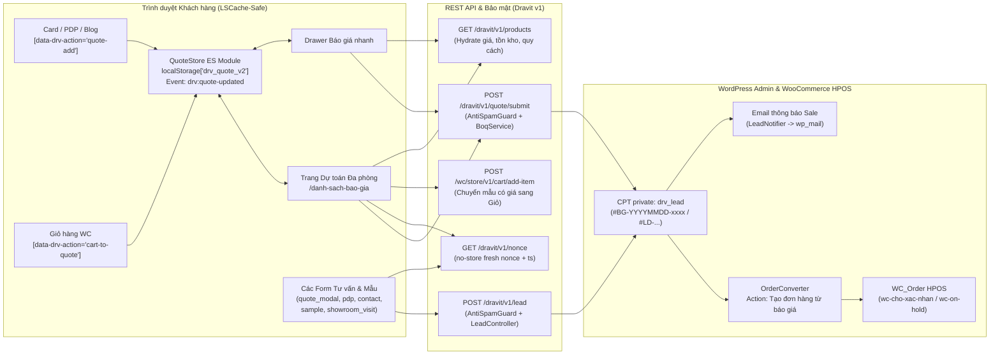

# 17. Đặc tả Hệ thống Báo giá Công trình (BOQ) & Quản trị Lead (`drv_lead`)

> **Vai trò tài liệu:** Đặc tả kỹ thuật toàn diện cho luồng lập Bảng dự toán khối lượng gạch đa phòng (BOQ - Bill of Quantities), ngăn kéo báo giá nhanh, 6 điểm thu thập Lead trên toàn website, cơ chế chống spam dưới LiteSpeed Cache và quy trình chuyển đổi Báo giá thành Đơn hàng WooCommerce HPOS.
> **Trạng thái hiệu lực:** **Thay thế hoàn toàn** `docs/11_AI_Quote_System_Spec.md` §2 (đã hủy bỏ theo `D-23`) và mở rộng chi tiết nghiệp vụ cho `docs/04_Pricing_Units_Commerce.md` §10 (`D-20`, `D-23`, `D-24`, `D-26`, `D-30`).
> **Tham chiếu chéo:** [00_Project_Brief_Decisions.md](00_Project_Brief_Decisions.md) · [04_Pricing_Units_Commerce.md](04_Pricing_Units_Commerce.md) · [14_Data_Dictionary_And_Settings.md](14_Data_Dictionary_And_Settings.md) · [16_Template_Component_Porting_Guide.md](16_Template_Component_Porting_Guide.md)

---

## 1. Tổng quan Kiến trúc & Phạm vi Phase 1 (`D-23`)

### 1.1 Ba Nguyên tắc Bất biến

Hệ thống Báo giá & Lead của `gachdravit.vn` giải quyết bài toán đặc thù ngành vật liệu xây dựng (khách hàng, kiến trúc sư và nhà thầu cần bóc tách khối lượng gạch theo từng phòng, trộn lẫn cả mẫu có giá bán lẻ niêm yết và mẫu hàng dự án chưa công bố giá, xuất bảng A4 trình duyệt trước khi chốt mua) trên nền tảng tuân thủ nghiêm ngặt 3 ràng buộc kiến trúc:

1. **Không dùng PHP Session hoặc Cookie giỏ báo giá phía Server:** Mọi thao tác thêm/sửa/xóa mẫu trong bảng dự toán diễn ra 100% ở trình duyệt qua `localStorage` (`drv_quote_v2`). Nhờ đó, toàn bộ trang Danh mục (`/gach`, 27 Smart Collections), Sản phẩm (`/san-pham/*`) và Cẩm nang (`/cam-nang/*`) giữ nguyên khả năng cache HTML tĩnh toàn trang trên **LiteSpeed Cache** (`TTFB < 200ms`), không bị phân mảnh cache theo phiên người dùng.
2. **Không tạo Custom Database Tables (`D-07`, `D-23`):** Khi khách gửi yêu cầu báo giá hoặc tư vấn, dữ liệu lưu hoàn toàn vào Custom Post Type riêng tư **`drv_lead`** (`wp_posts` + `wp_postmeta`), dễ sao lưu, phân quyền chuẩn `manage_woocommerce` và không phát sinh nợ bảo trì schema khi nâng cấp WordPress/WooCommerce.
3. **Không lưu bản nháp báo giá vào bảng Đơn hàng WooCommerce HPOS (`D-22`, `D-23`):** Khác với đề xuất cũ tạo đơn ảo `drv-quote-draft`, kiến trúc mới tách hẳn giai đoạn tư vấn/báo giá sang `drv_lead`. Bảng `wp_wc_orders` chỉ nhận đơn hàng thật khi khách tự đặt mua hoặc khi nhân viên kinh doanh bấm nút **"Tạo đơn hàng từ báo giá"** sau khi đã chốt giá và cọc, giúp:
   - Không làm lệch số liệu doanh thu, tỷ lệ chuyển đổi trong WooCommerce Analytics.
   - Không làm nhảy số thứ tự mã đơn `DRV-{order_id}` và không giữ tồn kho ảo.
   - Tuân thủ tuyệt đối giới hạn độ dài cột trạng thái `varchar(20)` của HPOS (`wc-cho-xac-nhan`, `wc-on-hold`, `wc-processing`).

### 1.2 Sơ đồ Luồng Dữ liệu Hợp nhất



### 1.3 Bản đồ Phân công Class PHP & Module JS

| Tầng | File nguồn trong Theme (`wp-content/themes/dravit/`) | Trách nhiệm chính |
|---|---|---|
| **PHP Units** | `inc/Units/Calc.php` (`Dravit\Units\Calc`) | Lõi tính toán quy đổi `m² ⇄ viên ⇄ thùng ⇄ kg`, bậc chiết khấu dự kiến BOQ và gợi ý tải trọng xe. |
| **PHP Quote** | `inc/Quote/BoqService.php` (`Dravit\Quote\BoqService`) | Validate cấu trúc phòng/hạng mục, truy vấn `WC_Product` thật, tính lại 100% khối lượng & thành tiền phía server. |
| **PHP Quote** | `inc/Quote/QuoteController.php` (`Dravit\Quote\QuoteController`) | Đăng ký `POST /wp-json/dravit/v1/quote/submit` và fallback `admin-post.php` cho phiếu BOQ. |
| **PHP Quote** | `inc/Quote/OrderConverter.php` (`Dravit\Quote\OrderConverter`) | Chuyển đổi bản ghi `drv_lead` đã chốt giá sang đơn hàng HPOS `WC_Order` qua WC CRUD. |
| **PHP Leads** | `inc/Leads/LeadPostType.php` (`Dravit\Leads\LeadPostType`) | Đăng ký CPT private `drv_lead`, phân quyền `manage_woocommerce`, metabox chi tiết & cron dọn dữ liệu quá hạn. |
| **PHP Leads** | `inc/Leads/AntiSpamGuard.php` (`Dravit\Leads\AntiSpamGuard`) | Endpoint `GET /dravit/v1/nonce` (`no-store`) + kiểm tra 5 lớp chống bot/spam không phụ thuộc CAPTCHA ngoài. |
| **PHP Leads** | `inc/Leads/LeadController.php` (`Dravit\Leads\LeadController`) | Xử lý `POST /wp-json/dravit/v1/lead` cho toàn bộ form tư vấn, nhận mẫu, đặt lịch showroom. |
| **PHP Leads** | `inc/Leads/LeadNotifier.php` (`Dravit\Leads\LeadNotifier`) | Gửi email HTML nội bộ tới `drv_settings.quote.notify_emails` ngay khi tiếp nhận Lead/BOQ mới. |
| **PHP Leads** | `inc/Leads/AdminColumns.php` (`Dravit\Leads\AdminColumns`) | Cột danh sách Admin, bubble đếm lead `new`, bộ lọc trạng thái/nguồn/vai trò và xuất CSV Admin. |
| **JS Core** | `assets/src/js/utils/calc.js` | Bản song sinh ES2022 của `Dravit\Units\Calc` dùng chung hằng số `EPSILON = 1e-9`. |
| **JS Store** | `assets/src/js/utils/quote-store.js` (`QuoteStore`) | Quản lý đọc/ghi `localStorage['drv_quote_v2']`, nén/giải mã `?quote=`, phát sự kiện `drv:quote-updated` & đồng bộ đa tab. |
| **JS Chunk** | `assets/src/js/chunks/quote-panel.js` | Custom Element `<drv-quote-panel>` (ngăn kéo xem nhanh danh sách báo giá ở mọi trang, nạp động khi mở). |
| **JS Entry** | `assets/src/js/quote.js` | Entry riêng cho trang `/danh-sach-bao-gia` (`template-quote.php`): quản lý phòng/slot, modal chọn gạch, in A4, CSV, Zalo, đẩy sang giỏ. |
| **JS Chunk** | `assets/src/js/chunks/lead-form.js` | Gắn kết lấy fresh nonce, validate tức thời và gửi AJAX cho mọi form `[data-drv-lead-form]`. |

> **Giới hạn phạm vi Phase 1 (`D-26`):** Khối gợi ý vật tư phụ đi kèm theo phòng (`.drv-pack-item`: keo dán gạch C2, ke cân bằng, keo chà ron trong bản mẫu `04.1-quote-cart.html`) **bị ẩn hoàn toàn ở Phase 1** do chưa mở bán ngành hàng phụ trợ. Cấu trúc phòng giữ nguyên tính mở rộng để kích hoạt ở Phase 2 mà không phải đổi schema `drv_quote_v2`.

---

## 2. Mô hình Dữ liệu Bản nháp Client-side (`drv_quote_v2`) & Đồng bộ Đa điểm

### 2.1 Khắc phục Chuỗi Đứt gãy của Bản Prototype

Trong bản giao diện HTML mẫu (`docs/layout/00_LAYOUT_AUDIT_REPORT.md` §3.7), tính năng báo giá bị chia cắt thành 3 mảnh không liên thông: `core.js` bấm `quote-add` chỉ hiện thông báo giả, `ai-finder.js` lưu mảng phẳng `drv_quote_items_v1` tự gán cứng `25 m²`, còn trang `04.1-quote-cart.html` lại bỏ qua `localStorage` và tự dựng sẵn 4 phòng mẫu cứng từ `<script id="qs-catalog">`.

Khi port sang WordPress, **mọi điểm chạm trên toàn site bắt buộc đọc và ghi qua duy nhất một Store `QuoteStore` với khóa `localStorage` là `drv_quote_v2`**.

### 2.2 JSON Schema Chuẩn của `localStorage['drv_quote_v2']`

Schema hỗ trợ đồng thời cả **thao tác thêm nhanh 1 chạm** từ thẻ sản phẩm/PDP (tự động đưa vào nhóm mặc định `room-general` - *"Hạng mục chung"* nếu khách chưa chia phòng) và **lập dự toán chi tiết nhiều phòng - nhiều hạng mục** trên `/danh-sach-bao-gia`:

```json
{
  "version": 2,
  "project_name": "Nhà phố 3 tầng Thủ Đức",
  "waste_pct": 5,
  "active_room_id": "rm_k9x2a1",
  "updated_at": "2026-11-11T09:45:12.000Z",
  "rooms": [
    {
      "id": "room-general",
      "name": "Hạng mục chung",
      "slots": [
        {
          "id": "sl_8f3d10",
          "product_id": 1042,
          "sku": "DRV-8801M",
          "role": "Lát nền chính",
          "input_mode": "m2",
          "target_m2": 32.5,
          "pieces": 54,
          "round_mode": "box",
          "added_at": 1762854000
        }
      ]
    },
    {
      "id": "rm_k9x2a1",
      "name": "Nhà tắm Master",
      "slots": [
        {
          "id": "sl_2b7c91",
          "product_id": 1089,
          "sku": "DRV-6012S",
          "role": "Lát nền chống trượt",
          "input_mode": "m2",
          "target_m2": 6.5,
          "pieces": 12,
          "round_mode": "box",
          "added_at": 1762854312
        },
        {
          "id": "sl_5e1a44",
          "product_id": 1104,
          "sku": "DRV-1224B",
          "role": "Ốp tường",
          "input_mode": "vien",
          "target_m2": 11.52,
          "pieces": 4,
          "round_mode": "piece",
          "added_at": 1762854390
        }
      ]
    }
  ]
}
```

**Quy tắc bất biến của các trường trong `drv_quote_v2`:**

| Trường | Kiểu | Ràng buộc & Ý nghĩa |
|---|---|---|
| `version` | `number` | Cố định `2`. Nếu gặp khóa cũ `drv_quote_items_v1`, `QuoteStore.init()` chuyển đổi các mục có `product_id` hợp lệ vào phòng `"Hạng mục chung"` một lần duy nhất rồi gọi `localStorage.removeItem('drv_quote_items_v1')`. |
| `project_name` | `string` | Tên công trình khách tự đặt trên trang BOQ (tối đa `120` ký tự, mặc định `""`). Tự động điền sang ô `project` khi gửi form. |
| `waste_pct` | `0 \| 5 \| 10` | Phần trăm hao hụt thi công áp dụng toàn phiếu (lưu số nguyên `%` khớp `drv_settings.order.waste_options`; mặc định lấy từ `drv_settings.order.waste_default = 5`). Khi truyền vào hàm tính toán, đổi sang hệ số `wasteRatio = waste_pct / 100` (`0`, `0.05`, `0.10`). |
| `rooms[].id` | `string` | Mã định danh nội bộ (`room-general` cho nhóm mặc định, hoặc `rm_` + 6 ký tự base36). Tối đa **12 phòng** trên 1 phiếu. |
| `rooms[].name` | `string` | Tên khu vực hiển thị (`"Hạng mục chung"`, `"Phòng khách"`, `"Nhà tắm Tầng 2"`...), `1 - 60` ký tự. |
| `slots[].id` | `string` | Mã định danh dòng (`sl_` + 6 ký tự base36). Tổng số slot trên toàn bộ các phòng không vượt quá **`30` mục** (`drv_settings.quote.max_items`). |
| `slots[].product_id` | `number` | ID sản phẩm WooCommerce nguyên dương (`> 0`). **Không lưu cứng giá bán vào `localStorage`** để tránh hiển thị giá cũ khi Admin điều chỉnh bảng giá. |
| `slots[].sku` | `string` | Mã SKU lưu kèm để hiển thị nhãn tạm thời trong lúc chờ API hydrate hoặc khi sản phẩm bị gỡ khỏi catalog. |
| `slots[].role` | `string` | Hạng mục sử dụng chuẩn thuộc `drv_settings.quote.roles` (mặc định `"Lát nền chính"`). |
| `slots[].input_mode` | `'m2' \| 'thung' \| 'vien'` | Chế độ đại lượng gốc khách nhập cho dòng này: nếu `'m2'`, khi đổi `waste_pct` toàn phiếu hệ thống tự tính lại `pieces`; nếu `'thung'` hoặc `'vien'`, giữ cố định số lượng `pieces` khách đã chỉ định. |
| `slots[].target_m2` | `number` | Diện tích mặt sàn/tường thuần cần ốp lát (chưa cộng hao hụt), làm tròn 2 chữ số thập phân (`0.1 .. 10000`). |
| `slots[].pieces` | `number` | Số nguyên viên/tấm sau quy đổi (`>= 1`). |
| `slots[].round_mode` | `'box' \| 'piece'` | Snapshot từ `drv_round_mode` của sản phẩm nhưng sẽ luôn được ghi đè lại theo cấu hình mới nhất của sản phẩm khi hydrate từ server. |

### 2.3 Từ điển Hạng mục Chuẩn (`quote.roles`) & Trạng thái Rỗng

1. **Danh sách hạng mục (`drv_settings.quote.roles`):** Khắc phục lỗi lệch chuỗi giữa state khởi tạo và thẻ `<select>` của bản mẫu `quote-sheet.js`, cả PHP và JS đều đọc chung danh sách từ cấu hình hệ thống:
   - `Lát nền chính`
   - `Ốp tường`
   - `Ốp vách Tivi`
   - `Trang trí / Điểm nhấn`
   - `Ốp tường bếp`
   - `Khu vực tắm đứng`
   - `Lát nền chống trượt`
   - `Lát ban công / sân phơi`
   - `Len chân tường`
2. **Trạng thái rỗng (Empty State) trên `/danh-sach-bao-gia`:**
   - Tuyệt đối **không khởi tạo sẵn 4 phòng mẫu giả** khi `rooms` đang trống.
   - Khi chưa có mẫu nào, hiển thị khung hướng dẫn ngắn gọn kèm:
     - Dải chip khởi tạo nhanh khu vực từ `drv_settings.quote.default_rooms`: `+ Phòng khách`, `+ Phòng bếp`, `+ Nhà tắm / WC`, `+ Phòng ngủ Master`, `+ Sân vườn / Ban công`.
     - Nút chính **"Chọn mẫu gạch từ danh mục"** (mở `#qs-picker-dialog`) và link phụ **"Khám phá 28 danh mục gạch"** (`/gach`).
   - Nếu khách thêm nhanh gạch từ Card/PDP vào `"Hạng mục chung"`, ngay đầu phòng `"Hạng mục chung"` có nút thao tác nhanh **"Đổi tên phòng"** và menu **"Chuyển sang phòng khác"** trên từng dòng gạch.

### 2.4 Hợp đồng Đồng bộ `QuoteStore` & LSCache-Safe Badge

Mọi tương tác thêm/cập nhật báo giá phát ra `CustomEvent` cấp `window`:

```js
window.dispatchEvent(new CustomEvent('drv:quote-updated', {
  detail: {
    totalSlots: state.totalSlots,   // Tổng số dòng hạng mục trong phiếu
    uniqueSkus: state.uniqueSkus,   // Số mã SKU khác nhau
    roomCount: state.rooms.length,
    source: 'card' | 'pdp' | 'cart' | 'boq' | 'panel' | 'storage'
  }
}));
```

**Hành vi chính xác tại 4 điểm chạm:**

| Điểm chạm | Thuộc tính DOM / Trigger | Quy tắc gộp & Ghi dữ liệu vào `QuoteStore` |
|---|---|---|
| **1. Thẻ sản phẩm (`.drv-card`)** | `[data-drv-action="quote-add"]` với `data-product-id`, `data-sku`, `data-m2-per-box`, `data-pieces-per-box`, `data-qty-min`, `data-round-mode` | Nếu `product_id` đã có sẵn trong phòng `"Hạng mục chung"` với `role = "Lát nền chính"`, mở `<drv-quote-panel>` cuộn tới đúng dòng đó để khách chỉnh m². Nếu chưa có, thêm mới vào `"Hạng mục chung"` với khối lượng khởi đầu bằng **1 thùng tiêu chuẩn** (hoặc `qty_min * area_piece` m² nếu mua lẻ tấm lớn), hiện toast xác nhận kèm nút *"Mở bảng dự toán"*. |
| **2. Trang chi tiết SP (PDP)** | Nút *"Thêm vào bảng dự toán"* cạnh/trong `<drv-unit-calc>` (`[data-drv-action="quote-add"]`) | Đọc trực tiếp trạng thái thực từ `<drv-unit-calc>` trên trang: `target_m2` (nếu khách đang ở tab `m²`), `pieces`, `input_mode` (`m2 \| thung \| vien`) và `waste_pct`. Nếu phiếu đang có `>= 2` phòng, hiện popover nhỏ chọn phòng đích + hạng mục (`role`) trước khi lưu; nếu chưa có phòng nào, lưu vào `"Hạng mục chung"` và mở `<drv-quote-panel>`. |
| **3. Giỏ hàng (`04-cart`)** | Nút *"Chuyển giỏ hàng sang Bảng báo giá công trình"* (`[data-drv-action="cart-to-quote"]`) | Đọc danh sách dòng hiện tại từ Store API `GET /wp-json/wc/store/v1/cart` (hoặc JSON cart snapshot trên trang giỏ), đẩy toàn bộ các mục vào phòng mới `"Từ giỏ hàng"` (giữ nguyên `pieces` và `drv_m2_input` nếu `> 0`), sau đó điều hướng `window.location.href = '/danh-sach-bao-gia'`. Giỏ hàng gốc vẫn giữ nguyên không tự xóa để khách không mất dữ liệu nếu đổi ý. |
| **4. Header Badge & Đa Tab** | `[data-quote-badge-count]` trên Header Tier 1 & thanh Mobile Bottom Bar | Trong HTML SSR do PHP xuất ra, `[data-quote-badge-count]` luôn có thuộc tính `hidden` và nội dung `"0"` để LiteSpeed Cache cache an toàn cho mọi khách. Ngay khi `main.js` khởi tạo và mỗi khi bắt được `drv:quote-updated` hoặc sự kiện `window.addEventListener('storage', ...)` từ tab trình duyệt khác, cập nhật `textContent = String(totalSlots)` và bật/tắt `hidden` (`totalSlots === 0`). |

### 2.5 Định dạng URL Chia sẻ `?quote=` (Compact, Validated, An toàn SEO)

Cho phép kiến trúc sư, nhà thầu hoặc nhân viên tư vấn gửi link bảng dự toán qua Zalo/Email cho chủ nhà mở xem trên thiết bị khác mà không cần tài khoản hay lưu nháp vào DB:

1. **Cấu trúc chuỗi trước khi mã hóa (`<= 30` dòng slot):**
   - Cú pháp văn bản compact: `v2|w={waste_pct}|p={uriEncodedProject}|r={uriEncodedRoomName}:{productId}.{roleIndex}.{modeCode}{value},...`
   - Trong đó:
     - `roleIndex`: chỉ số `0..8` trong mảng `drv_settings.quote.roles` (tiết kiệm dung lượng chuỗi).
     - `modeCode`: `m` cho `m2` (kèm `target_m2`, vd `m32.5`), `b` cho `thung` (kèm số thùng), `p` cho `vien` (kèm số `pieces`).
     - Các phòng phân cách bằng dấu chấm phẩy `;`.
   - Chuỗi UTF-8 được nén sang **Base64URL** (`+` -> `-`, `/` -> `_`, cắt bỏ `=` cuối):
     `https://gachdravit.vn/danh-sach-bao-gia?quote=djJ8dz01fHA9TmglQzMlQTAlMjBwaCVFMSVCQiU5MXxyPVBoJUMzJUIybmclMjBraCVDMyVBMGNoOjEwNDIuMC5tMzIuNQ`
2. **Ràng buộc an toàn khi giải mã `?quote=` (`QuoteStore.parseShareParam`):**
   - Từ chối ngay nếu chuỗi tham số dài **`> 1.800` ký tự** (ngăn lỗi `414 URI Too Long` và tấn công DoS chuỗi lớn).
   - Bọc `try/catch` khi giải mã Base64URL/UTF-8; chỉ nhận tiền tố `v2|`.
   - Ép kiểu nghiêm ngặt: `waste_pct` chỉ nhận `0`, `5`, `10` (sai về `5`); `productId` nguyên dương `1..99999999`; `target_m2` kẹp trong khoảng `[0.1, 10000]`; `pieces` nguyên trong `[1, 50000]`; tổng số slot cắt tối đa `30`; tên phòng và tên dự án lọc bỏ toàn bộ ký tự điều khiển và render độc quyền qua `element.textContent` (**cấm tuyệt đối `innerHTML`**).
   - Nếu trình duyệt người nhận đang có sẵn một bảng dự toán khác khác rỗng trong `localStorage`, hiện hộp thoại xác nhận (`<dialog>`): *"Bạn đang mở một bảng dự toán được chia sẻ ({n} mẫu). Bạn muốn thay thế bảng hiện tại hay gộp thêm vào?"* thay vì ghi đè âm thầm.
3. **Bảo vệ SEO cho `/danh-sach-bao-gia`:**
   - Trang `/danh-sach-bao-gia` (cả khi có hoặc không có `?quote=`) luôn xuất `<meta name="robots" content="noindex, follow">` và `<link rel="canonical" href="https://gachdravit.vn/danh-sach-bao-gia">` thông qua `Dravit\SEO\RobotsPolicy`.

### 2.6 Luồng Hydrate Dữ liệu Thực qua `GET /wp-json/dravit/v1/products`

Mỗi khi mở `<drv-quote-panel>` hoặc tải trang `/danh-sach-bao-gia`, client gom danh sách ID duy nhất từ `QuoteStore` và gọi:

`GET /wp-json/dravit/v1/products?include=1042,1089,1104`

**Cấu trúc phần tử sản phẩm trả về phục vụ tính toán BOQ:**

```json
{
  "id": 1042,
  "sku": "DRV-8801M",
  "name": "Gạch Lát Nền Dravit Vân Đá Marble Calacatta 80x80 Bóng Kiếng",
  "url": "https://gachdravit.vn/san-pham/gach-lat-nen-dravit-van-da-marble-calacatta-80x80-bong-kieng",
  "thumb_url": "https://gachdravit.vn/wp-content/uploads/2026/11/drv-8801m-300x300.webp",
  "size_label": "80x80 cm",
  "surface_label": "Bóng kiếng",
  "dcof_label": "R9",
  "color_name": "Trắng khói vân vàng",
  "price_state": "priced",
  "price_m2": 385000,
  "regular_price_m2": 385000,
  "price_piece": 246400,
  "area_piece": 0.64,
  "pieces_per_box": 3,
  "m2_per_box": 1.92,
  "kg_per_box": 42.0,
  "unit_label": "viên",
  "buy_units": ["m2", "thung"],
  "default_buy_unit": "m2",
  "round_mode": "box",
  "qty_min": 3,
  "qty_step": 3,
  "in_stock": true,
  "stock_qty": 144
}
```

**Xử lý 3 kịch bản biến động dữ liệu Catalog khi Hydrate:**
1. **Sản phẩm bị xóa hoặc chuyển về Nháp (`id` không có trong mảng phản hồi):** Hiển thị dòng cảnh báo màu hổ phách ngay tại slot đó: *"Mẫu {sku} hiện ngừng kinh doanh. Vui lòng chọn mẫu thay thế hoặc xóa dòng này"*; đặt khối lượng/thành tiền của dòng đó bằng `0` và yêu cầu khách xử lý trước khi gửi báo giá.
2. **Sản phẩm đổi chế độ giá (`priced` -> `quote_only` hoặc đổi giá KM):** Tự động tính lại theo `price_state` và `price_m2` mới nhất từ API; không bao giờ có hiện tượng lệch giá giữa trang sản phẩm và trang BOQ.
3. **Sản phẩm tạm hết hàng (`price_state === 'out_of_stock'`):** Vẫn cho phép giữ trong bảng dự toán BOQ để hỏi lịch nhập lô mới hoặc đặt sản xuất dự án (hiển thị nhãn `"Tạm hết kho - Báo lịch hàng về"`), nhưng tự động loại ra khi khách bấm nút *"Đặt mua các mẫu có giá"*.

**Modal Chọn Gạch Trực Tiếp (`#qs-picker-dialog`):**
- Thay thế hoàn toàn `<script id="qs-catalog">` nhúng tĩnh của bản mẫu bằng truy vấn động `GET /wp-json/dravit/v1/products?search={q}&kich-thuoc={size}&khong-gian={space}&per_page=24` (debounce `250ms`, hủy request cũ bằng `AbortController`).
- Hiển thị ảnh thật WebP `300x300`, mã SKU, khổ gạch, bề mặt, chỉ số `R`, trạng thái giá (`385.000đ/m²` hoặc `Liên hệ báo giá`) và nút chọn đưa thẳng vào slot/phòng đang mở.

---

## 3. Quy tắc Tính toán trong BOQ (`Dravit\Units\Calc` & `utils/calc.js`)

### 3.1 Công thức Quy đổi Chuẩn cho Từng Dòng Slot (`D-20`, `D-24`)

Cả PHP (`Dravit\Units\Calc::computeSlot()`) và JS (`computeSlot()` trong `assets/src/js/utils/calc.js`) thực thi cùng một thuật toán với hằng số khử sai số dấu phẩy động `EPSILON = 1e-9`:

1. **Bước 1 - Xác định số lượng giao dịch nguyên (`pieces`) theo `input_mode` và `drv_round_mode` của sản phẩm:**
   - Diện tích 1 đơn vị cơ sở: `area_piece = (w_mm * h_mm) / 1_000_000` (`m²`), `m2_per_box = round(area_piece * pieces_per_box, 4)`.
   - Hệ số hao hụt toàn phiếu: `waste_ratio = waste_pct / 100` (`0`, `0.05` hoặc `0.10`).
   - Nếu `input_mode === 'm2'`:
     - `needed_m2 = target_m2 * (1 + waste_ratio)`.
     - Khi `product.round_mode === 'box'` (bắt buộc chẵn thùng):
       `boxes = max(1, ceil((needed_m2 / m2_per_box) - EPSILON))`
       `pieces = max(product.qty_min, boxes * pieces_per_box)`
     - Khi `product.round_mode === 'piece'` (cho phép mua lẻ viên/tấm, `D-24`):
       `raw_pieces = max(product.qty_min, ceil((needed_m2 / area_piece) - EPSILON))`
       `pieces = raw_pieces`
   - Nếu `input_mode === 'thung'`:
     - `boxes_input = max(1, round(pieces / pieces_per_box))`
     - `pieces = max(product.qty_min, boxes_input * pieces_per_box)`
   - Nếu `input_mode === 'vien'`:
     - Nếu sản phẩm bắt buộc `round_mode === 'box'`, tự động làm tròn lên bội số của `pieces_per_box`:
       `pieces = max(product.qty_min, ceil((pieces / pieces_per_box) - EPSILON) * pieces_per_box)`
     - Nếu sản phẩm cho phép `round_mode === 'piece'`:
       `pieces = max(product.qty_min, round(pieces))`

2. **Bước 2 - Suy dẫn Quy cách Đóng gói, Diện tích Thực nhận & Khối lượng:**
   - `full_boxes = Math.floor(pieces / pieces_per_box)` (PHP: `intdiv($pieces, $pieces_per_box)`).
   - `loose_pieces = pieces % pieces_per_box`.
   - Chuỗi hiển thị quy cách xuất kho (tôn trọng `drv_unit_label` là `'viên'` hoặc `'tấm'`):
     - Khi `loose_pieces === 0`: `"{full_boxes} thùng ({pieces} {unit_label})"` (ví dụ: `"18 thùng (54 viên)"`).
     - Khi `loose_pieces > 0` và `full_boxes > 0`: `"{full_boxes} thùng + {loose_pieces} {unit_label} lẻ"` (ví dụ: `"3 thùng + 1 tấm lẻ"`).
     - Khi `full_boxes === 0`: `"{loose_pieces} {unit_label}"` (ví dụ đá nung kết khổ `120x240` đóng 1 tấm/kiện hoặc mua lẻ 2 tấm).
   - Diện tích thực nhận: `actual_m2 = round(pieces * area_piece, 2)` (`m²`).
   - Diện tích dư dự phòng (cắt góc + bảo trì): `surplus_m2 = max(0, round(actual_m2 - target_m2, 2))`.
   - Khối lượng dòng hàng: `line_kg = round(pieces * (kg_per_box / pieces_per_box), 1)` (`kg`).

3. **Bước 3 - Tính Thành tiền theo Trạng thái Giá (`price_state`, `D-20`):**
   - Nếu `price_state === 'priced'` hoặc `'sale'` hoặc `'out_of_stock'` (khi `price_m2 > 0`):
     - Đơn giá giao dịch 1 viên/tấm khớp tuyệt đối với WooCommerce `_price`: `price_piece = round(effective_price_m2 * area_piece)`.
     - `line_total = pieces * price_piece` (VND nguyên).
     - Lưu ý quan trọng: Đối với dòng `out_of_stock` có niêm yết giá tham khảo, `line_total` vẫn tính vào dự toán tham khảo để khách nắm ngân sách nhưng kèm ghi chú *"Cần xác nhận lịch hàng về"*.
   - Nếu `price_state === 'quote_only'` (`drv_price_m2 <= 0`):
     - `line_total = 0`, gắn cờ `is_quote_only = true`.
     - **Vẫn cộng đầy đủ** `actual_m2`, `full_boxes` và `line_kg` vào tổng diện tích, tổng thùng và tổng khối lượng toàn công trình.
     - Cột Đơn giá hiển thị **`Liên hệ báo giá`**, cột Thành tiền hiển thị **`Báo giá sau`**.

### 3.2 Quy tắc Tổng hợp Toàn Phiếu, Chiết khấu Dự kiến & Gợi ý Xe Tải

| Chỉ tiêu tổng hợp | Công thức chính xác | Quy tắc hiển thị trên UI Hộp Tổng hợp Dự toán |
|---|---|---|
| `total_m2` | `round(sum(slot.actual_m2), 2)` (tính cả SP có giá và SP `quote_only`) | `Tổng diện tích thực xuất: {total_m2} m²` (số thập phân dấu `,`, vd `114,56 m²`). |
| `total_boxes` & `total_loose` | Cộng dồn `full_boxes` và `loose_pieces` toàn phiếu | `Quy cách đóng gói: {total_boxes} thùng` (+ `{total_loose} viên/tấm lẻ` nếu `> 0`). |
| `total_kg` & `vehicle_hint` | `round(sum(slot.line_kg), 1)` -> đối chiếu `drv_settings.order.vehicle_thresholds` | Ví dụ `2.415 kg · Gợi ý điều phối: Xe tải 2,5 tấn` (`≤ 1.000 kg`: Xe tải nhẹ 1 tấn; `≤ 2.500 kg`: Xe tải 2,5 tấn; `≤ 5.000 kg`: Xe tải 5 tấn; `> 5.000 kg`: Xe tải 8 tấn / chia chuyến). |
| `subtotal_vnd` | `sum(slot.line_total)` của các dòng có `price_m2 > 0` | Nếu toàn bộ phiếu chỉ gồm các mẫu `quote_only` (`priced_count === 0`): hiện **`Báo giá theo khối lượng công trình`**, không hiện `"0đ"`. Nếu có mẫu có giá: hiện `{subtotal_vnd}đ` kèm nhãn `Tạm tính ({priced_count} mẫu có giá)`. |
| `discount_rate` (`D-23`) | Tra bậc cao nhất trong `drv_settings.quote.volume_tiers` thỏa `total_m2 >= tier.min_m2` (mặc định: `< 30 m² -> 0%`, `30 - 99,99 m² -> 5%`, `>= 100 m² -> 8%`) | Chỉ hiển thị khi `subtotal_vnd > 0`. Nhãn bắt buộc ghi rõ: **`Chiết khấu dự kiến ({rate}% - chuyên viên xác nhận theo lô)`**. Kèm thanh tiến độ gợi ý mốc kế tiếp (ví dụ: *"Thêm 12,4 m² gạch để đạt mốc chiết khấu dự kiến 8% cho công trình từ 100 m²"*). **Nghiêm cấm** tự động áp mức chiết khấu này vào `[woocommerce_cart]` (`D-23`). |
| `discount_est_vnd` | `round(subtotal_vnd * (discount_rate / 100))` | Hiển thị `- {discount_est_vnd}đ` (màu `--c-success` `#15803D`). |
| `grand_est_vnd` | `subtotal_vnd - discount_est_vnd` | Nhãn **`Tổng dự toán tạm tính`** (in đậm `tabular-nums`). Ngay bên dưới hiển thị rõ 2 dòng chú thích trạng thái:<br>1. Nếu `quote_only_count > 0`: *"Chưa bao gồm giá của {quote_only_count} mẫu hàng dự án (chuyên viên sẽ báo giá kèm mã lô)."*<br>2. Luôn hiển thị: *"Chưa bao gồm phí vận chuyển & hạ hàng tại công trình."* |

### 3.3 Chuyển Đổi Nhanh Từ BOQ Sang Giỏ Hàng Bán Lẻ (`boq-to-cart`)

Trên trang `/danh-sach-bao-gia`, ngoài nút chính **"Gửi yêu cầu báo giá công trình"**, khách có thể bấm nút phụ **"Đặt mua ngay các mẫu có giá"** (`[data-drv-action="boq-to-cart"]` - chỉ bật khi có ít nhất 1 dòng thuộc trạng thái `priced` hoặc `sale` còn tồn kho):

1. **Gom gộp theo `product_id`:** Nếu cùng một mã SKU (ví dụ `DRV-8801M`) được dùng ở cả Phòng khách (`54 viên`) và Phòng sinh hoạt chung (`30 viên`), hệ thống cộng dồn thành 1 yêu cầu thêm giỏ duy nhất với `quantity = 84` (viên), `drv_m2_input = round(sum(target_m2), 2)` và `drv_waste_pct = waste_pct`.
2. **Kiểm tra tồn kho trước khi đẩy:** Nếu tổng `pieces` của 1 SKU vượt quá `stock_qty` hiện có (khi sản phẩm bật quản lý kho), giữ SKU đó lại trong BOQ và thông báo rõ để khách gửi báo giá đặt lô sản xuất thay vì gây lỗi đỏ nửa chừng.
3. **Gọi WooCommerce Store API:** Thực thi tuần tự hoặc qua `/wp-json/wc/store/v1/batch` tới endpoint `/wp-json/wc/store/v1/cart/add-item` kèm header `Nonce` của Store API:
   ```json
   {
     "id": 1042,
     "quantity": 84,
     "drv_m2_input": 48.5,
     "drv_waste_pct": 5,
     "drv_input_unit": "m2"
   }
   ```
4. **Phản hồi minh bạch:**
   - Nếu toàn bộ dòng trong BOQ đều là hàng có giá và thêm giỏ thành công: điều hướng sang `/gio-hang`.
   - Nếu trong BOQ có trộn lẫn mẫu `quote_only` hoặc mẫu vượt tồn kho: mở ngăn kéo Mini-cart hoặc thông báo rõ: *"Đã thêm {k} mẫu có giá vào giỏ hàng. Còn {m} mẫu báo giá theo lô vẫn được giữ nguyên tại bảng dự toán này để bạn gửi yêu cầu riêng."*

---

## 4. Luồng Gửi Yêu cầu & Chống Spam 5 Lớp dưới LiteSpeed Cache (`D-30`)

### 4.1 Ma trận Trường Dữ liệu Hợp nhất Trên Toàn Bộ Các Điểm Thu Lead

Tất cả 6 luồng thu thập Lead ở Phase 1 (`boq`, `quote_modal`, `pdp`, `contact`, `sample`, `showroom_visit`) cùng form nhúng bài viết Cẩm nang (`blog_inline`) và handoff AI Phase 3 (`ai_handoff`) dùng chung một hợp đồng trường dữ liệu chuẩn:

| Tên trường (`name`) | Kiểu | Validate phía Server | `boq` (`04.1`) | `quote_modal` (Dialog) | `pdp` (Báo giá SP) | `contact` (`09`) | `sample` (Nhận mẫu) | `showroom_visit` (Hẹn lịch) |
|---|---|---|---|---|---|---|---|---|
| `lead_type` | `string` | Whitelist enum hợp lệ | `'boq'` | `'quote_modal'` | `'pdp'` | `'contact'` | `'sample'` | `'showroom_visit'` |
| `name` | `string` | **Bắt buộc**, `2 - 80` ký tự, không chỉ chứa số/ký tự đặc biệt | **Bắt buộc** | **Bắt buộc** | **Bắt buộc** | **Bắt buộc** | **Bắt buộc** | **Bắt buộc** |
| `phone` | `string` | **Bắt buộc**, bỏ khoảng trắng/dấu chấm, khớp `^(0\|\+84)(3\|5\|7\|8\|9)\d{8}$`, chuẩn hóa lưu `0xxxxxxxxx` | **Bắt buộc** | **Bắt buộc** | **Bắt buộc** | **Bắt buộc** | **Bắt buộc** | **Bắt buộc** |
| `email` | `string` | Tùy chọn; nếu nhập phải qua `is_email()` | Tùy chọn | Tùy chọn | Ẩn | Tùy chọn | Tùy chọn | Tùy chọn |
| `province` | `string` | Mã tỉnh thuộc 34 đơn vị trong `config/provinces-vn.php` | **Bắt buộc** | Tùy chọn | Tùy chọn | Tùy chọn | **Bắt buộc** | Tùy chọn |
| `ward` | `string` | `sanitize_text_field`, `<= 80` ký tự | Tùy chọn | Ẩn | Ẩn | Ẩn | **Bắt buộc** (địa chỉ nhận mẫu) | Ẩn |
| `role` | `string` | `'chu-nha' \| 'nha-thau' \| 'kts' \| 'dai-ly'` (mặc định `'chu-nha'`) | Hiện (Radio/Pills) | Hiện | Mặc định `'chu-nha'` | Hiện | Hiện | Hiện |
| `project` | `string` | Tên/loại công trình, `<= 120` ký tự | Hiện (đồng bộ `project_name`) | Tùy chọn | Ẩn | Tùy chọn | Hiện | Tùy chọn |
| `area_m2` | `float` | `0 <= val <= 50000` | Tự tính từ BOQ | Tùy chọn | Lấy từ `<drv-unit-calc>` | Tùy chọn | Tùy chọn | Tùy chọn |
| `product_id` | `int` | `absint` ID sản phẩm tồn tại | Nằm trong `rooms[]` | Điền tự động nếu mở từ SP | **Bắt buộc** | Tùy chọn | Điền tự động nếu mở từ SP | Tùy chọn (để soạn sẵn mã kệ) |
| `sample_box` | `bool` | `true` / `'1'` -> lưu `_drv_sample_box = '1'` | Checkbox tùy chọn | Checkbox tùy chọn | Checkbox tùy chọn | Checkbox tùy chọn | Mặc định `'1'` | `'0'` |
| `showroom_id` | `string` | Khớp `id` trong `drv_settings.showrooms` | Ẩn | Ẩn | Ẩn | Tùy chọn | Ẩn | **Bắt buộc** |
| `preferred_time` | `string` | Ngày/khung giờ hẹn xem mẫu (`<= 60` ký tự, ghép vào đầu ghi chú hoặc meta) | Ẩn | Ẩn | Ẩn | Ẩn | Ẩn | **Bắt buộc** |
| `message` | `string` | `sanitize_textarea_field`, `<= 1.000` ký tự | Ghi chú giao/tiến độ | Ghi chú yêu cầu | Ghi chú ngắn | Nội dung cần hỗ trợ | Địa chỉ nhận mẫu chi tiết | Mẫu/khổ muốn xem trước |
| `consent` | `bool` | **Bắt buộc `=== true`**. Checkbox **luôn bỏ trống mặc định** khi tải trang | **Bắt buộc** | **Bắt buộc** | **Bắt buộc** | **Bắt buộc** | **Bắt buộc** | **Bắt buộc** |
| `page_url` | `string` | `esc_url_raw`, thuộc cùng domain | Tự đính kèm | Tự đính kèm | Tự đính kèm | Tự đính kèm | Tự đính kèm | Tự đính kèm |
| `utm` | `object` | Đọc từ `sessionStorage['drv_utm']` (`utm_source`, `utm_medium`, `utm_campaign`, `utm_term`, `gclid`, `fbclid`) | Tự đính kèm | Tự đính kèm | Tự đính kèm | Tự đính kèm | Tự đính kèm | Tự đính kèm |

> **Chuẩn văn bản Checkbox Bảo vệ Dữ liệu Cá nhân (Nghị định 13/2023/NĐ-CP):**
> `"Tôi đồng ý để DRAVIT liên hệ tư vấn và xử lý thông tin theo Chính sách bảo mật dữ liệu cá nhân."` (trong đó cụm *Chính sách bảo mật dữ liệu cá nhân* gắn link mở tab mới tới `/chinh-sach-bao-mat`).

### 4.2 Kiến trúc Chống Spam 5 Lớp (`Dravit\Leads\AntiSpamGuard`)

Do toàn bộ HTML trang công khai được LiteSpeed Cache lưu dài hạn (`TTL >= 24 giờ`), việc in cứng `wp_nonce_field()` trực tiếp vào HTML sẽ khiến nonce hết hạn sau 12 - 24 giờ và làm gãy form của khách thật. Hệ thống sử dụng quy trình **5 lớp phòng vệ không cần CAPTCHA bên thứ ba** (giữ điểm hiệu suất Lighthouse Mobile ≥ 90 và không gây ma sát cho khách mua gạch):

```php
<?php
declare(strict_types=1);

namespace Dravit\Leads;

use WP_Error;
use WP_REST_Request;
use WP_REST_Response;

final class AntiSpamGuard {
    private const NONCE_ACTION = 'drv_public_submit';
    private const MIN_FILL_SECONDS = 3;
    private const MAX_TOKEN_AGE = 86400;

    /**
     * GET /wp-json/dravit/v1/nonce
     * Chỉ gọi lazy khi khách focus vào form đầu tiên hoặc mở dialog báo giá.
     */
    public static function issueToken(): WP_REST_Response {
        $ts  = time();
        $sig = hash_hmac('sha256', (string) $ts, wp_salt('nonce'));

        $response = new WP_REST_Response([
            'nonce' => wp_create_nonce(self::NONCE_ACTION),
            'ts'    => $ts,
            'sig'   => $sig,
            'ttl'   => 3600,
        ], 200);

        $response->header('Cache-Control', 'no-store, no-cache, must-revalidate, max-age=0');
        $response->header('Pragma', 'no-cache');
        $response->header('X-LiteSpeed-Cache-Control', 'no-cache');

        return $response;
    }

    /**
     * Kiểm tra 5 lớp trước khi xử lý dữ liệu Lead / BOQ.
     * Trả về chuỗi ip_hash nếu hợp lệ, hoặc WP_Error nếu vi phạm.
     */
    public static function verify(WP_REST_Request $request): string|WP_Error {
        // Lớp 1: Kiểm tra Origin / Referer cùng domain
        $homeHost = (string) wp_parse_url(home_url(), PHP_URL_HOST);
        $origin   = (string) $request->get_header('origin');
        $referer  = (string) $request->get_header('referer');
        $reqHost  = $origin !== ''
            ? (string) wp_parse_url($origin, PHP_URL_HOST)
            : (string) wp_parse_url($referer, PHP_URL_HOST);

        if ($reqHost === '' || strcasecmp($reqHost, $homeHost) !== 0) {
            return new WP_Error('drv_bad_origin', 'Yêu cầu không hợp lệ từ nguồn bên ngoài.', ['status' => 403]);
        }

        // Lớp 2: Honeypot vô hình (drv_website phải rỗng tuyệt đối)
        $honeypot = trim((string) $request->get_param('drv_website'));
        if ($honeypot !== '') {
            return new WP_Error('drv_spam_honeypot', 'Yêu cầu bị từ chối.', ['status' => 400]);
        }

        // Lớp 3: Fresh Nonce
        $nonce = (string) ($request->get_header('X-Dravit-Nonce') ?: $request->get_param('_drv_nonce'));
        if (!wp_verify_nonce($nonce, self::NONCE_ACTION)) {
            return new WP_Error(
                'drv_invalid_nonce',
                'Phiên biểu mẫu đã hết hạn. Vui lòng bấm gửi lại một lần nữa.',
                ['status' => 403, 'refresh_nonce' => true]
            );
        }

        // Lớp 4: Time-trap có chữ ký HMAC (chặn bot điền tức thời < 3 giây)
        $ts  = (int) $request->get_param('_drv_ts');
        $sig = (string) $request->get_param('_drv_sig');
        $expectedSig = hash_hmac('sha256', (string) $ts, wp_salt('nonce'));
        $elapsed = time() - $ts;

        if ($ts <= 0 || !hash_equals($expectedSig, $sig) || $elapsed < self::MIN_FILL_SECONDS || $elapsed > self::MAX_TOKEN_AGE) {
            return new WP_Error(
                'drv_too_fast',
                'Thao tác gửi quá nhanh. Vui lòng kiểm tra lại thông tin và thử lại sau vài giây.',
                ['status' => 422]
            );
        }

        // Lớp 5: Rate-limit theo IP băm (mặc định tối đa 5 lần / 15 phút)
        $ipHash = self::hashClientIp();
        $limit  = max(1, (int) drv_setting('quote.rate_limit_15m', 5));
        $rlKey  = 'drv_rl_lead_' . substr($ipHash, 0, 32);
        $count  = (int) get_transient($rlKey);

        if ($count >= $limit) {
            $hotline = (string) drv_setting('contact.hotline_display', '0909 000 000');
            return new WP_Error(
                'drv_rate_limited',
                sprintf('Bạn đã gửi tối đa %d yêu cầu trong 15 phút. Cần hỗ trợ gấp vui lòng gọi %s.', $limit, $hotline),
                ['status' => 429]
            );
        }

        set_transient($rlKey, $count + 1, 15 * MINUTE_IN_SECONDS);
        return $ipHash;
    }

    public static function hashClientIp(): string {
        $ip = isset($_SERVER['REMOTE_ADDR']) ? sanitize_text_field(wp_unslash((string) $_SERVER['REMOTE_ADDR'])) : '0.0.0.0';
        return hash_hmac('sha256', $ip, wp_salt('auth'));
    }
}
```

**Cơ chế tự phục hồi trên Client (`chunks/lead-form.js`):**
- Ngay khi người dùng đặt con trỏ (`focusin` hoặc `pointerdown`) vào bất kỳ form `[data-drv-lead-form]` nào, JS kiểm tra bộ nhớ đệm trong tab; nếu chưa có token hoặc token còn hiệu lực `< 5 phút`, gọi ngầm `GET /wp-json/dravit/v1/nonce` để nạp sẵn `nonce`, `ts`, `sig`.
- Nếu máy khách để treo tab qua đêm khiến server trả mã `drv_invalid_nonce` (`refresh_nonce: true`), client tự gọi lại `/dravit/v1/nonce` và thông báo nhẹ để người dùng bấm gửi lại mà không làm mất dữ liệu đã gõ.

### 4.3 Hợp đồng REST `POST /wp-json/dravit/v1/quote/submit` & Tính Lại 100% ở Server

Client **chỉ gửi định danh sản phẩm và khối lượng đầu vào**; mọi chuỗi giá tiền hay thành tiền hiển thị ở trình duyệt đều bị Server bỏ qua hoàn toàn:

**Request Payload mẫu (`POST /wp-json/dravit/v1/quote/submit`):**

```json
{
  "_drv_nonce": "a94f1c2e8b",
  "_drv_ts": 1762854610,
  "_drv_sig": "64a9b8e1...",
  "drv_website": "",
  "contact": {
    "name": "Nguyễn Thanh Tùng",
    "phone": "0909 385 880",
    "email": "tung.kts@studio.vn",
    "province": "HCM",
    "ward": "Phường Thủ Đức",
    "role": "kts",
    "project": "Nhà phố 3 tầng Hiệp Bình",
    "sample_box": true,
    "message": "Cần kiểm tra tồn kho cùng mã lô giao đầu tháng 12.",
    "consent": true,
    "page_url": "https://gachdravit.vn/danh-sach-bao-gia",
    "utm": {
      "utm_source": "google",
      "utm_medium": "organic"
    }
  },
  "boq": {
    "waste_pct": 5,
    "rooms": [
      {
        "name": "Phòng khách & Bếp",
        "slots": [
          {
            "role": "Lát nền chính",
            "product_id": 1042,
            "input_mode": "m2",
            "target_m2": 62.0,
            "pieces": 102
          }
        ]
      },
      {
        "name": "Sảnh mặt tiền",
        "slots": [
          {
            "role": "Ốp tường",
            "product_id": 1104,
            "input_mode": "vien",
            "target_m2": 11.52,
            "pieces": 4
          }
        ]
      }
    ]
  }
}
```

**Quy trình xử lý trong `Dravit\Quote\BoqService::processSubmission()`:**
1. Validate toàn bộ trường `contact.*`; nếu có bất kỳ lỗi trường nào, trả HTTP `422 Unprocessable Entity` kèm danh sách lỗi theo từng tên trường để UI đặt `aria-invalid="true"` và cuộn tới ô lỗi đầu tiên:
   ```json
   {
     "code": "drv_validation_failed",
     "message": "Vui lòng kiểm tra lại thông tin liên hệ.",
     "data": {
       "status": 422,
       "fields": {
         "phone": "Số điện thoại cần gồm 10 chữ số di động Việt Nam hợp lệ.",
         "consent": "Vui lòng xác nhận đồng ý để Dravit liên hệ tư vấn."
       }
     }
   }
   ```
2. Đếm tổng số `slots` trên toàn bộ `rooms`: phải nằm trong khoảng **`1 .. 30`** (`drv_settings.quote.max_items`).
3. Với mỗi slot, nạp `wc_get_product($product_id)` (chỉ chấp nhận `post_status === 'publish'` và `drv_line === 'gach'`):
   - Chạy `Dravit\Units\Calc::computeSlot($product, $slotInput, $wastePct)` để tính lại `pieces`, `boxes`, `loose_pieces`, `actual_m2`, `kg`, `price_state`, `price_m2`, `price_piece`, `line_total`.
   - Tính lại tổng phiếu: `total_m2`, `total_boxes`, `total_kg`, `subtotal_vnd`, `discount_rate`, `discount_est_vnd`, `grand_est_vnd`, `has_quote_items`.
4. Sinh mã phiếu duy nhất theo múi giờ `Asia/Ho_Chi_Minh`:
   - Báo giá BOQ: `BG-{YYYYMMDD}-{4 chữ số ngẫu nhiên không trùng}` (ví dụ: `BG-20261111-4821`).
   - Các form Lead khác (`POST /wp-json/dravit/v1/lead`): `LD-{YYYYMMDD}-{4 chữ số}` (ví dụ: `LD-20261111-7305`).
5. Tạo bản ghi `wp_insert_post(['post_type' => 'drv_lead', 'post_status' => 'private', 'post_title' => "[{$quoteCode}] {$name} - {$phone}"])` và ghi toàn bộ `_drv_*` meta chuẩn (xem `14_Data_Dictionary_And_Settings.md` §6.3 + `_drv_sample_box`).
6. Kích hoạt `LeadNotifier::send($leadId)` và trả phản hồi `201 Created`:
   ```json
   {
     "ok": true,
     "lead_id": 4912,
     "quote_code": "BG-20261111-4821",
     "summary": {
       "total_m2": 76.8,
       "total_boxes": 38,
       "total_kg": 1596.0,
       "grand_est_vnd": 26582400,
       "has_quote_items": true
     },
     "sla_message": "Chuyên viên Dravit sẽ kiểm tra mã lô tồn kho và phản hồi trong 30 phút (giờ làm việc 08:00 - 21:00)."
   }
   ```

> **Hành vi sau khi gửi BOQ thành công:** Giữ nguyên dữ liệu `drv_quote_v2` trong `localStorage` để khách vẫn có thể bấm *"In PDF A4"* hoặc *"Copy gửi Zalo"* ngay trên màn hình xác nhận thành công, đồng thời hiển thị nút phụ *"Xóa bảng nháp để lập công trình mới"*.

### 4.4 Progressive Enhancement Fallback Khi Tắt JavaScript (`admin-post.php`)

Đối với các form đơn (`contact`, `pdp`, `sample`, `showroom_visit`, `blog_inline`), thẻ `<form>` luôn có cấu hình hoạt động được cả khi JS bị chặn hoặc lỗi mạng script:
- `method="post" action="<?php echo esc_url(admin_url('admin-post.php')); ?>"` kèm `<input type="hidden" name="action" value="drv_submit_lead">`.
- Handler `admin_post_nopriv_drv_submit_lead` / `admin_post_drv_submit_lead` kiểm tra `Origin`/`Referer`, honeypot `drv_website`, rate-limit IP `drv_rl_lead_{ip_hash}` và validate trường dữ liệu tương tự REST.
- Lưu thành công -> `wp_safe_redirect(add_query_arg(['lead_sent' => '1', 'code' => $quoteCode], $returnUrl) . '#drv-lead-feedback', 303)`. Template PHP đọc query param (chỉ render hộp thông báo trạng thái, `RobotsPolicy` tự gắn `noindex` cho URL có tham số) để hiển thị mã xác nhận cho khách.

---

## 5. Quản trị Admin CPT `drv_lead` & Chuyển đổi Thành Đơn hàng HPOS

### 5.1 Danh sách Quản trị (`WooCommerce -> Báo giá & Lead`)

Đăng ký qua `Dravit\Leads\LeadPostType` và `Dravit\Leads\AdminColumns` (yêu cầu quyền `manage_woocommerce`):

1. **Menu & Thông báo số lượng mới:** Nằm ngay dưới menu **WooCommerce -> Báo giá & Lead**, hiển thị bubble đỏ đếm số lượng bản ghi đang ở trạng thái `_drv_status = 'new'` (cache 5 phút trong transient `drv_new_leads_count`, xóa ngay khi tạo mới hoặc đổi trạng thái).
2. **8 Cột hiển thị trên bảng danh sách Admin:**

| Cột | Key cột | Nội dung hiển thị |
|---|---|---|
| **Mã phiếu** | `drv_code` | In đậm `#BG-20261111-4821` hoặc `#LD-20261111-7305` (click mở chi tiết). Kèm icon hộp mẫu nếu `_drv_sample_box === '1'`. |
| **Nguồn** | `drv_type` | Badge phân loại: `BOQ Công trình`, `Báo giá nhanh`, `Từ SP (PDP)`, `Liên hệ`, `Nhận mẫu thật`, `Hẹn Showroom`, `Cẩm nang`. |
| **Khách hàng & SĐT** | `drv_customer` | Tên khách + SĐT `0909385880` kèm 2 link thao tác nhanh: `Gọi` (`tel:`) và `Zalo` (`https://zalo.me/0909385880` mở tab mới). |
| **Vai trò / Khu vực** | `drv_role` | Nhãn `Chủ nhà` / `Nhà thầu` / `Kiến trúc sư` / `Đại lý` + tên Tỉnh/TP (`TP.HCM`, `Đồng Nai`...). |
| **Khối lượng** | `drv_volume` | Với `boq`: `{_drv_total_m2} m² · {_drv_total_boxes} thùng · {_drv_total_kg} kg`. Với lead đơn: `{_drv_area_m2} m²` + mã SKU quan tâm (nếu có). |
| **Dự toán** | `drv_estimate` | `{_drv_grand_est_vnd}đ` (`tabular-nums`). Nếu `_drv_has_quote_items === '1'`, gắn thêm nhãn cam `+ Mẫu báo giá riêng`. |
| **Trạng thái** | `drv_status` | Pill màu theo 5 trạng thái: `Mới tiếp nhận` (`new`), `Đã liên hệ` (`contacted`), `Đã gửi báo giá` (`quoted`), `Đã chốt đơn` (`won` - kèm link `#DRV-{order_id}`), `Không chốt` (`lost`). |
| **Thời gian** | `drv_date` | Giờ & ngày gửi (`H:i d/m/Y`) + cảnh báo đỏ `Quá 30p chưa xử lý` nếu vẫn ở `new` sau 30 phút trong khung giờ làm việc `08:00 - 21:00`. |

3. **Thanh công cụ Lọc, Tìm kiếm & Xuất CSV Admin:**
   - Dropdown lọc theo `_drv_status`, `_drv_lead_type`, `_drv_role` và tháng gửi.
   - Mở rộng ô tìm kiếm Admin (`pre_get_posts`) để tìm xuyên suốt theo `_drv_quote_code`, `_drv_name`, `_drv_phone`, `_drv_project` và mã SKU bên trong `_drv_boq`.
   - Nút **"Xuất CSV theo bộ lọc hiện tại"** (`admin_post_drv_export_leads_csv`, kiểm tra nonce + `manage_woocommerce`, xuất UTF-8 BOM an toàn chống CSV Formula Injection).
4. **Dọn dẹp dữ liệu quá hạn (Data Retention - Nghị định 13/2023/NĐ-CP):**
   - Cron hàng ngày `drv_daily_lead_cleanup` kiểm tra khóa `drv_settings.quote.retention_days` (mặc định `365` ngày): tự động xóa vĩnh viễn (`wp_delete_post($id, true)`) các bản ghi `drv_lead` đã tạo quá số ngày quy định và có `_drv_converted_order_id == 0` (giữ lại các bản ghi `won` đang đối chiếu lịch sử đơn hàng, hoặc chỉ ẩn danh hóa thông tin cá nhân nếu khách yêu cầu xóa dữ liệu).

### 5.2 Màn hình Chi tiết Bản ghi `drv_lead` (3 Metabox Chuyên dụng)

Ẩn trình soạn thảo mặc định của WordPress và hộp Custom Fields thô; thay bằng 3 Metabox nghiệp vụ rõ ràng:

1. **Metabox A - Hồ sơ Khách hàng & Bối cảnh Yêu cầu (`normal`, `high`):**
   - Hiển thị/cho phép chỉnh sửa thông tin khách (`_drv_name`, `_drv_phone`, `_drv_email`, `_drv_province`, `_drv_ward`, `_drv_role`, `_drv_project`, `_drv_sample_box`, `_drv_message`).
   - Dòng truy vết chỉ đọc (`readonly`): Mã phiếu `_drv_quote_code`, Trang gửi `_drv_page_url`, Chiến dịch `_drv_utm`, Thời điểm khách tick đồng ý xử lý dữ liệu `_drv_consent_at`.
2. **Metabox B - Bảng Bóc tách Khối lượng BOQ & Chốt Giá Đơn hàng (`normal`, `high`):**
   - Với bản ghi `boq` (hoặc lead đơn có gắn `_drv_product_id`): render bảng chi tiết nhóm theo từng **Phòng / Khu vực**:
     - Cột: `Phòng / Hạng mục` | `SKU & Tên gạch` | `Tồn kho hiện tại` | `Diện tích (m²)` | `Quy cách xuất (Thùng / Viên)` | `Khối lượng (kg)` | `Giá niêm yết (đ/m²)` | **`Đơn giá chốt (đ/m²)`** | `Thành tiền chốt`.
     - Cột **Tồn kho hiện tại** đối chiếu trực tiếp `$product->get_stock_quantity()` ngay lúc mở trang: hiện tích xanh `Đủ kho (144 viên)` hoặc cảnh báo đỏ `Thiếu kho (Cần 54, còn 30 viên)`.
     - Cột **Đơn giá chốt (đ/m²)** (`name="drv_agreed_price_m2[{$roomIdx}][{$slotIdx}]"`):
       - Với sản phẩm có giá niêm yết: điền sẵn mặc định giá sau chiết khấu bậc dự kiến (`round($price_m2 * (1 - $discount_rate / 100))`), nhân viên có thể sửa lại theo mức giá thỏa thuận cuối cùng.
       - Với sản phẩm `quote_only`: ô nhập để trống có viền nổi bật kèm placeholder **`Nhập giá chốt / m² (*)`** - **bắt buộc nhập `> 0`** trước khi được phép chuyển thành đơn hàng.
   - Khối **Thông tin Vận chuyển & Thanh toán Chốt đơn** ngay chân bảng:
     - `Phí vận chuyển thỏa thuận (VND)`: để trống nếu vẫn muốn tạo đơn ở trạng thái `Chờ xác nhận` (`wc-cho-xac-nhan`), hoặc nhập số `>= 0` (nhập `0` nếu miễn phí vận chuyển đơn lớn) để chốt đơn ngay.
     - `Phương thức thanh toán`: `<select>` gồm `bacs` (*Chuyển khoản ngân hàng VietQR*) và `cod` (*Thanh toán khi nhận hàng COD*).
     - `Phương tiện điều phối` (`_drv_ship_vehicle`) & `Ghi chú giao nhận` (`_drv_ship_note`).
     - Hỗ trợ nhập thông tin xuất hóa đơn VAT (`_drv_vat_required`, `_drv_vat_company`, `_drv_vat_tax_id`, `_drv_vat_address`, `_drv_vat_email`) nếu nhà thầu/công ty yêu cầu.
3. **Metabox C - Xử lý Trạng thái, Ghi chú Nội bộ & Tạo Đơn (`side`, `high`):**
   - Chọn `_drv_status` (`new | contacted | quoted | won | lost`), ô nhập `_drv_admin_note` và nút **"Lưu cập nhật Lead"**.
   - Nếu chưa chuyển đổi thành đơn (hoặc đơn cũ đã hủy): hiển thị nút chính màu `--c-primary` **`Tạo đơn hàng từ báo giá`**.
   - Nếu đã chuyển đổi (`_drv_converted_order_id > 0`): hiển thị hộp trạng thái xanh gắn link trực tiếp tới đơn hàng HPOS **`#DRV-{order_id}`** kèm thời điểm tạo `_drv_converted_at` và khóa nút tạo lại để chống nhân đôi đơn hàng.

### 5.3 Thuật toán Chuyển đổi Thành Đơn hàng HPOS (`Dravit\Quote\OrderConverter`)

Thực thi qua `admin_post_drv_convert_lead_to_order`, tuân thủ 100% WooCommerce HPOS Order CRUD (`D-22`, `D-30`), **tuyệt đối không sửa giá gốc của sản phẩm trên Catalog** và ghi đầy đủ toàn bộ snapshot meta:

```php
<?php
declare(strict_types=1);

namespace Dravit\Quote;

use WC_Order;
use WC_Order_Item_Product;
use WC_Order_Item_Shipping;
use WP_Error;

final class OrderConverter {
    /**
     * Chuyển bản ghi CPT drv_lead thành đơn hàng WooCommerce HPOS.
     *
     * @param int   $leadId      ID bài viết drv_lead.
     * @param array $agreedRates Mảng đơn giá chốt (đ/m²) theo khoá "{$roomIdx}:{$slotIdx}".
     * @param array $opsInput    ['shipping_fee' => ?int, 'payment_method' => 'bacs'|'cod', 'ship_vehicle' => string, 'ship_note' => string, 'vat' => array]
     */
    public static function convert(int $leadId, array $agreedRates, array $opsInput): WC_Order|WP_Error {
        if (!current_user_can('manage_woocommerce')) {
            return new WP_Error('drv_forbidden', 'Bạn không có quyền tạo đơn hàng.');
        }

        $lead = get_post($leadId);
        if (!$lead || $lead->post_type !== 'drv_lead') {
            return new WP_Error('drv_not_found', 'Không tìm thấy phiếu báo giá.');
        }

        // Chống tạo trùng đơn hàng nếu đơn trước đó chưa bị hủy
        $existingOrderId = (int) get_post_meta($leadId, '_drv_converted_order_id', true);
        if ($existingOrderId > 0) {
            $existingOrder = wc_get_order($existingOrderId);
            if ($existingOrder && !in_array($existingOrder->get_status(), ['cancelled', 'trash'], true)) {
                return new WP_Error(
                    'drv_already_converted',
                    sprintf('Phiếu này đã được tạo thành đơn DRV-%d.', $existingOrderId)
                );
            }
        }

        $boqRaw = (string) get_post_meta($leadId, '_drv_boq', true);
        $boq    = json_decode($boqRaw, true);
        if (!is_array($boq) || empty($boq['rooms'])) {
            return new WP_Error('drv_empty_boq', 'Phiếu chưa có danh mục sản phẩm hợp lệ để tạo đơn.');
        }

        // Bước 1: Kiểm tra mọi dòng đều có sản phẩm hợp lệ & đã nhập đơn giá chốt > 0
        $preparedLines = [];
        foreach ($boq['rooms'] as $rIdx => $room) {
            $roomName = sanitize_text_field((string) ($room['name'] ?? 'Hạng mục chung'));
            foreach (($room['slots'] ?? []) as $sIdx => $slot) {
                $productId = (int) ($slot['product_id'] ?? 0);
                $pieces    = max(1, (int) ($slot['pieces'] ?? 0));
                $product   = wc_get_product($productId);

                if (!$product || $product->get_status() !== 'publish') {
                    return new WP_Error('drv_invalid_product', sprintf('Sản phẩm ID #%d không còn khả dụng.', $productId));
                }

                $rateKey       = "{$rIdx}:{$sIdx}";
                $agreedPriceM2 = isset($agreedRates[$rateKey]) ? (int) $agreedRates[$rateKey] : (int) ($slot['price_m2'] ?? 0);
                if ($agreedPriceM2 <= 0) {
                    return new WP_Error(
                        'drv_missing_agreed_price',
                        sprintf('Vui lòng nhập Đơn giá chốt (đ/m²) lớn hơn 0 cho mẫu %s.', $product->get_sku())
                    );
                }

                $wMm          = (int) $product->get_meta('drv_piece_w_mm', true);
                $hMm          = (int) $product->get_meta('drv_piece_h_mm', true);
                $areaPiece    = ($wMm * $hMm) / 1_000_000;
                $piecesPerBox = max(1, (int) $product->get_meta('drv_pieces_per_box', true));
                $kgPerBox     = (float) $product->get_meta('drv_kg_per_box', true);
                $unitLabel    = (string) ($product->get_meta('drv_unit_label', true) ?: 'viên');

                $listPriceM2     = max($agreedPriceM2, (int) $product->get_meta('drv_price_m2', true));
                $listPiecePrice  = (int) round($listPriceM2 * $areaPiece);
                $agreedPiecePrice = (int) round($agreedPriceM2 * $areaPiece);

                $preparedLines[] = [
                    'product'          => $product,
                    'pieces'           => $pieces,
                    'room_name'        => $roomName,
                    'role'             => sanitize_text_field((string) ($slot['role'] ?? '')),
                    'target_m2'        => (float) ($slot['target_m2'] ?? 0.0),
                    'waste_pct'        => (int) ($boq['waste_pct'] ?? 5),
                    'agreed_price_m2'  => $agreedPriceM2,
                    'area_piece'       => $areaPiece,
                    'pieces_per_box'   => $piecesPerBox,
                    'kg_per_box'       => $kgPerBox,
                    'unit_label'       => $unitLabel,
                    'line_subtotal'    => $listPiecePrice * $pieces,
                    'line_total'       => $agreedPiecePrice * $pieces,
                ];
            }
        }

        // Bước 2: Khởi tạo WC_Order qua HPOS CRUD
        $order = wc_create_order(['created_via' => 'drv_boq_lead']);
        if (is_wp_error($order)) {
            return $order;
        }

        $quoteCode = (string) get_post_meta($leadId, '_drv_quote_code', true);
        $name      = (string) get_post_meta($leadId, '_drv_name', true);
        $phone     = (string) get_post_meta($leadId, '_drv_phone', true);
        $email     = (string) get_post_meta($leadId, '_drv_email', true);
        $province  = (string) get_post_meta($leadId, '_drv_province', true);
        $ward      = (string) get_post_meta($leadId, '_drv_ward', true);

        $order->set_billing_first_name($name);
        $order->set_billing_phone($phone);
        $order->set_billing_email($email);
        $order->set_billing_country('VN');
        $order->set_billing_state($province);
        $order->set_billing_city($ward);
        $order->set_customer_note((string) get_post_meta($leadId, '_drv_message', true));

        $paymentMethod = ($opsInput['payment_method'] ?? 'bacs') === 'cod' ? 'cod' : 'bacs';
        $gateways      = WC()->payment_gateways()->payment_gateways();
        if (isset($gateways[$paymentMethod])) {
            $order->set_payment_method($gateways[$paymentMethod]);
        } else {
            $order->set_payment_method($paymentMethod);
        }

        // Bước 3: Thêm từng dòng sản phẩm kèm Snapshot Meta đầy đủ (không chạm giá gốc Catalog)
        $totalM2    = 0.0;
        $totalBoxes = 0;
        $totalKg    = 0.0;

        foreach ($preparedLines as $line) {
            $item = new WC_Order_Item_Product();
            $item->set_product($line['product']);
            $item->set_quantity($line['pieces']);
            $item->set_subtotal((string) $line['line_subtotal']);
            $item->set_total((string) $line['line_total']);

            $m2Qty       = round($line['pieces'] * $line['area_piece'], 4);
            $boxes       = intdiv($line['pieces'], $line['pieces_per_box']);
            $loosePieces = $line['pieces'] % $line['pieces_per_box'];
            $kg          = round($line['pieces'] * ($line['kg_per_box'] / $line['pieces_per_box']), 1);

            $item->add_meta_data('_drv_model', 'area_pack', true);
            $item->add_meta_data('_drv_unit', $line['unit_label'], true);
            $item->add_meta_data('_drv_price_m2', $line['agreed_price_m2'], true);
            $item->add_meta_data('_drv_area_piece', $line['area_piece'], true);
            $item->add_meta_data('_drv_pieces_per_box', $line['pieces_per_box'], true);
            $item->add_meta_data('_drv_kg_per_box', $line['kg_per_box'], true);
            $item->add_meta_data('_drv_m2_qty', $m2Qty, true);
            $item->add_meta_data('_drv_boxes', $boxes, true);
            $item->add_meta_data('_drv_loose_pieces', $loosePieces, true);
            $item->add_meta_data('_drv_kg', $kg, true);
            $item->add_meta_data('_drv_m2_input', $line['target_m2'], true);
            $item->add_meta_data('_drv_waste_pct', $line['waste_pct'], true);
            $item->add_meta_data('_drv_lot_code', '', true);
            $item->add_meta_data('_drv_boq_room', $line['room_name'], true);
            $item->add_meta_data('_drv_boq_role', $line['role'], true);

            $order->add_item($item);

            $totalM2    += $m2Qty;
            $totalBoxes += $boxes;
            $totalKg    += $kg;
        }

        // Bước 4: Phí vận chuyển & Xác định trạng thái khởi tạo
        $shippingFee = $opsInput['shipping_fee'] ?? null;
        $shipItem    = new WC_Order_Item_Shipping();
        $shipItem->set_method_id('drv_quote_later');

        if ($shippingFee !== null && $shippingFee >= 0) {
            $shipItem->set_method_title('Vận chuyển tận công trình');
            $shipItem->set_total((string) (int) $shippingFee);
            $targetStatus = ($paymentMethod === 'bacs') ? 'on-hold' : 'processing';
            $order->update_meta_data('_drv_confirmed_at', current_time('c'));
            $order->update_meta_data('_drv_confirmed_by', get_current_user_id());
        } else {
            $shipItem->set_method_title((string) drv_setting('order.shipping_label', 'Báo sau khi xác nhận đơn'));
            $shipItem->set_total('0');
            $targetStatus = 'cho-xac-nhan';
        }
        $order->add_item($shipItem);

        // Bước 5: Lưu Order Meta HPOS, tính tổng, trừ kho viên 1 lần và liên kết 2 chiều
        $order->save(); // Sinh order_id trước để tạo _drv_transfer_ref
        $orderId = $order->get_id();

        $order->update_meta_data('_drv_source_lead_id', $leadId);
        $order->update_meta_data('_drv_total_m2', round($totalM2, 2));
        $order->update_meta_data('_drv_total_boxes', $totalBoxes);
        $order->update_meta_data('_drv_total_kg', round($totalKg, 1));
        $order->update_meta_data('_drv_transfer_ref', 'DRV' . $orderId);
        $order->update_meta_data('_drv_ship_vehicle', sanitize_key((string) ($opsInput['ship_vehicle'] ?? '')));
        $order->update_meta_data('_drv_ship_note', sanitize_text_field((string) ($opsInput['ship_note'] ?? '')));

        if (!empty($opsInput['vat']['required'])) {
            $order->update_meta_data('_drv_vat_required', '1');
            $order->update_meta_data('_drv_vat_company', sanitize_text_field((string) ($opsInput['vat']['company'] ?? '')));
            $order->update_meta_data('_drv_vat_tax_id', sanitize_text_field((string) ($opsInput['vat']['tax_id'] ?? '')));
            $order->update_meta_data('_drv_vat_address', sanitize_text_field((string) ($opsInput['vat']['address'] ?? '')));
            $order->update_meta_data('_drv_vat_email', sanitize_email((string) ($opsInput['vat']['email'] ?? '')));
        } else {
            $order->update_meta_data('_drv_vat_required', '0');
        }

        $order->calculate_totals(false);
        $order->set_status(
            $targetStatus,
            sprintf('Khởi tạo từ phiếu báo giá #%s bởi nhân viên ID #%d.', $quoteCode, get_current_user_id())
        );
        $order->save();

        wc_maybe_reduce_stock_levels($orderId);

        update_post_meta($leadId, '_drv_status', 'won');
        update_post_meta($leadId, '_drv_converted_order_id', $orderId);
        update_post_meta($leadId, '_drv_converted_at', current_time('c'));

        return $order;
    }
}
```

> **Kết nối liền mạch với VietQR (`D-22`, `D-30`):** Nếu nhân viên kinh doanh đã nhập `shipping_fee >= 0` và chọn `bacs`, đơn hàng chuyển thẳng vào trạng thái `wc-on-hold` (*Chờ chuyển khoản*), tự động gửi email xác nhận cho khách kèm ảnh mã **VietQR** đã cộng đủ tiền gạch chốt + phí vận chuyển và nội dung chuyển khoản `DRV{order_id}`.

---

## 6. Xuất Bản in A4 PDF, CSV (UTF-8 BOM), Copy Zalo & Email Thông báo Sale

### 6.1 Bản in A4 / Lưu PDF Chuẩn Hồ sơ Trình duyệt (`@media print`)

Không cài thư viện sinh PDF nặng phía server hay client (`jspdf`, `dompdf`); sử dụng trình xuất PDF vector sắc nét sẵn có của trình duyệt (`window.print()`) kết hợp stylesheet chuyên biệt trong `assets/src/css/pages/quote.css`:

1. **Bố cục trang in:** `@page { size: A4 portrait; margin: 12mm 10mm; }`, bật `-webkit-print-color-adjust: exact; print-color-adjust: exact;` trên viền bảng và dải tiêu đề để giữ nét ron `1px` rõ ràng khi xuất PDF.
2. **Ẩn hoàn toàn phần tử tương tác:** Header/Footer toàn site, các nút `+ Thêm phòng`, `+ Thêm mẫu`, bộ chọn hao hụt, form liên hệ, ngăn kéo và thanh dock nổi đều đặt `display: none` trong `@media print`.
3. **Hiện Khung Tiêu đề Hồ sơ Dự toán (`.drv-boq-print-head` - ẩn trên màn hình thường, hiện khi in):**
   - Cột trái: Logo vector **DRAVIT**, tên pháp nhân (`drv_settings.company.legal_name`), địa chỉ Showroom, Hotline & Website `gachdravit.vn`.
   - Cột phải: Tiêu đề **`BẢNG DỰ TOÁN KHỐI LƯỢNG GẠCH ỐP LÁT`**, Tên công trình (`project_name`), Ngày lập (`dd/mm/yyyy`), Mức dự phòng hao hụt đã cộng (`0% / 5% / 10%`).
4. **Quy tắc ngắt trang:** Mỗi bảng khu vực `.drv-boq-room` có `break-inside: avoid-page` (nếu ngắn) và `thead { display: table-header-group; }` để tự lặp dòng tiêu đề cột khi bảng dài sang trang 2; cuối phiếu in rõ ghi chú hiệu lực: *"Bảng dự toán phục vụ bóc tách khối lượng tham khảo. Đơn giá thực tế, phí vận chuyển và mã lô xuất kho được xác nhận chính thức khi chốt đơn (hiệu lực báo giá: 07 ngày)."*

### 6.2 Xuất File CSV Chuẩn Excel Tiếng Việt (UTF-8 BOM & Chống Formula Injection)

Khi khách bấm **"Tải file CSV (Excel)"** trên `/danh-sach-bao-gia` hoặc Admin xuất danh sách Lead:

1. **Mã hóa UTF-8 BOM:** Luôn ghép ký tự `\uFEFF` (PHP: `"\xEF\xBB\xBF"`) ở byte đầu tiên để Microsoft Excel trên Windows mở trực tiếp tiếng Việt có dấu (`m²`, `Phòng khách`, `Viên`) không bị lỗi font.
2. **Chống CSV Formula Injection (bắt buộc ở cả JS & PHP):** Mọi ô văn bản do người dùng nhập (`project_name`, `room.name`, `name`, `phone`, `message`) trước khi bọc ngoặc kép phải chạy qua hàm làm sạch:
   ```js
   export function sanitizeCsvCell(raw) {
     const str = String(raw ?? '').replace(/\r?\n/g, ' ').trim();
     const safe = /^[=+\-@\t\r]/.test(str) ? `'${str}` : str;
     return `"${safe.replace(/"/g, '""')}"`;
   }
   ```
3. **Thứ tự cột CSV xuất cho khách hàng (`dravit-du-toan-{YYYYMMDD}.csv`):**
   `Khu vực / Phòng, Hạng mục, Mã SKU, Tên sản phẩm, Khổ gạch, Diện tích thuần (m²), Hao hụt (%), Số thùng, Viên/Tấm lẻ, Tổng số lượng (viên/tấm), Diện tích thực nhận (m²), Khối lượng (kg), Đơn giá (đ/m²), Thành tiền dự kiến (VND)`
   (với dòng `quote_only`, cột Đơn giá xuất `"Liên hệ báo giá"`, cột Thành tiền xuất `"Báo giá sau"`).

### 6.3 Mẫu Văn bản Copy Gửi Nhanh Qua Zalo (`boq-copy-zalo`)

Nút **"Sao chép gửi Zalo"** (`[data-drv-action="boq-copy-zalo"]`) ghi vào `navigator.clipboard.writeText()` bản tóm tắt thuần văn bản sạch gọn, **không dùng ký tự em-dash và không dùng emoji**, kèm link mở lại bảng dự toán:

```text
BANG DU TOAN GACH DRAVIT - Nha pho 3 tang Thu Duc
Muc hao hut tinh san: 5%

1. Phong khach & Bep:
- Lat nen chinh: DRV-8801M (80x80 cm) · 34 thung (102 vien = 65,28 m²) · 385.000d/m² -> 25.132.800d

2. Sanh mat tien:
- Op tuong: DRV-1224B (120x240 cm) · 4 tam (11,52 m²) · Lien he bao gia

TONG KHOI LUONG: 76,80 m² · 34 thung + 4 tam · 1.596 kg (Xe tai 2,5 tan)
Tam tinh cac mau co gia: 25.132.800d
Chiet khau du kien (5% - xac nhan theo lo): -1.256.640d
Du toan tam tinh: 23.876.160d (+ 1 mau bao gia rieng, chua gom phi van chuyen)

Xem & chinh sua truc tiep: https://gachdravit.vn/danh-sach-bao-gia?quote=...
```
*(Thực tế xuất tiếng Việt có dấu đầy đủ chuẩn UTF-8; bản minh họa trên thể hiện cấu trúc dấu `-`, `:` và `·` chuẩn quy ước thương hiệu).*

### 6.4 Email Thông báo Nội bộ Cho Bộ phận Kinh doanh (`Dravit\Leads\LeadNotifier`)

Gửi ngay qua `wp_mail()` tới mảng `drv_settings.quote.notify_emails` với `Content-Type: text/html; charset=UTF-8` và `Reply-To` trỏ về email khách (nếu khách có nhập):

- **Tiêu đề Email (`Subject`):**
  - Khi `_drv_lead_type === 'boq'`: `[DRAVIT BOQ #BG-20261111-4821] Nguyễn Thanh Tùng - 0909385880 (76,8 m²)`
  - Khi là Lead khác: `[DRAVIT LEAD - Nhận mẫu] Trần Minh Khôi - 0912345678 (TP.HCM)`
- **Nội dung Email:**
  - Khối thông tin liên hệ nổi bật đầu thư kèm cam kết SLA nội bộ (`Phản hồi trong 30 phút`).
  - Bảng HTML tóm tắt các dòng gạch theo phòng (SKU, khổ, số thùng/viên, m², trạng thái giá).
  - 2 nút CTA lớn ở cuối thư: **`Mở phiếu xử lý trong Admin`** (`admin_url("post.php?post={$leadId}&action=edit")`) và **`Nhắn Zalo cho khách`** (`https://zalo.me/{$phone}`).

---

## 7. Checklist Nghiệm thu Hệ thống BOQ & Lead (`QA Gate`)

Trước khi nghiệm thu Phase 1 (bổ sung cho `docs/09_Roadmap_QA_Testplan.md` §3), bắt buộc vượt qua toàn bộ 12 kịch bản kiểm thử sau:

| Mã Test | Kịch bản kiểm thử | Kết quả bắt buộc đạt |
|---|---|---|
| **Q-01** | Bấm `Thêm vào báo giá` trên Card ở `/gach-80x80`, sau đó sang PDP một mẫu khác nhập `32,5 m²` rồi bấm `Thêm vào bảng dự toán`, cuối cùng mở `/danh-sach-bao-gia`. | Cả 2 mẫu đều xuất hiện đầy đủ trong `/danh-sach-bao-gia` với đúng `32,5 m²` đã nhập trên PDP (không bị gán cứng `25 m²`); badge `[data-quote-badge-count]` trên Header cập nhật tức thời ở cả 2 tab trình duyệt. |
| **Q-02** | Kiểm tra HTML nguồn (`View Source`) của trang `/gach` và `/danh-sach-bao-gia` khi chưa chạy JS dưới LiteSpeed Cache. | Không có `Set-Cookie` phiên PHP do tính năng báo giá sinh ra; `[data-quote-badge-count]` xuất tĩnh `0` (`hidden`); trang `/danh-sach-bao-gia` có `noindex, follow` và canonical sạch `/danh-sach-bao-gia`. |
| **Q-03** | Trộn 1 SKU có giá (`priced`, `round_mode = box`) và 1 SKU không công bố giá (`quote_only`, `drv_price_m2 = 0`, `round_mode = piece`) trong cùng một phòng. | Dòng `quote_only` vẫn tính đúng số tấm/viên, m², kg và cộng vào Tổng diện tích + Gợi ý xe tải; cột giá hiện `"Liên hệ báo giá"` / `"Báo giá sau"`; tổng tiền không báo `0đ` sai lệch mà hiện rõ ghi chú chưa gồm 1 mẫu hàng dự án. |
| **Q-04** | Tăng tổng diện tích gạch trong BOQ vượt mốc `30 m²` và `100 m²`, sau đó bấm `Đặt mua ngay các mẫu có giá` sang `/gio-hang`. | Trên BOQ hiển thị đúng `Chiết khấu dự kiến (5% / 8% - chuyên viên xác nhận theo lô)`; khi sang `/gio-hang`, các mẫu có giá được thêm đúng tổng số nguyên viên nhưng **không tự động trừ chiết khấu bậc** vào giỏ bán lẻ (`D-23`). |
| **Q-05** | Bấm `Sao chép link chia sẻ` (`?quote=...`) mở trong cửa sổ Ẩn danh (Incognito); thử sửa tay tham số `?quote=` chèn `<script>alert(1)</script>` vào tên phòng hoặc vượt 50 dòng. | Cửa sổ Ẩn danh khôi phục đúng các phòng và số lượng gạch, giá được hydrate tươi từ API; chuỗi độc hại chỉ hiển thị dạng text vô hại hoặc bị từ chối gọn, không thực thi XSS. |
| **Q-06** | Sửa giá của một SKU trong Admin từ `385.000đ/m²` sang `410.000đ/m²` rồi tải lại trang `/danh-sach-bao-gia` đang lưu SKU đó trong `localStorage`. | Bảng BOQ tự động hiển thị và tính theo giá mới `410.000đ/m²`. |
| **Q-07** | Dùng `curl` hoặc DevTools sửa payload `POST /wp-json/dravit/v1/quote/submit` truyền giá ảo `1.000đ` hoặc bỏ trống checkbox `consent`. | Bỏ `consent` -> trả `422` từ chối lưu. Truyền giá ảo -> Server bỏ qua hoàn toàn và lưu `_drv_boq` / `_drv_grand_est_vnd` theo đúng giá thực trong DB. |
| **Q-08** | Kiểm thử `AntiSpamGuard`: (a) điền cột honeypot `drv_website`, (b) gửi ngay lập tức `< 3 giây` sau khi xin nonce, (c) gửi liên tiếp 6 lần trong 5 phút từ cùng IP. | (a) & (b) bị chặn sạch không tạo bản ghi `drv_lead`; (c) lần thứ 6 nhận HTTP `429` kèm thông báo tiếng Việt và số hotline. |
| **Q-09** | Để mở sẵn trang `/lien-he` (đã cache HTML tĩnh), gõ thông tin và bấm Gửi; sau đó tắt hẳn JavaScript trên trình duyệt và gửi lại form `/lien-he`. | Có JS: tự lấy fresh nonce từ `/dravit/v1/nonce` và gửi AJAX trả mã `#LD-...`. Tắt JS: submit qua `admin-post.php` thành công và redirect `303` hiện mã xác nhận. |
| **Q-10** | Trong Admin `WooCommerce -> Báo giá & Lead`, mở 1 phiếu `boq` có chứa 1 mẫu `quote_only`, thử bấm `Tạo đơn hàng từ báo giá` khi chưa điền giá chốt, sau đó điền giá chốt + phí ship `350.000đ` + chọn `BACS` rồi bấm lại. | Lần 1 báo lỗi nhắc nhập Đơn giá chốt cho mẫu `quote_only`. Lần 2 tạo thành công `WC_Order` HPOS ở trạng thái `wc-on-hold` (*Chờ chuyển khoản*), giá gốc sản phẩm ngoài website không bị đổi, tồn kho viên giảm đúng 1 lần, phiếu Lead chuyển sang `won` và khóa nút tạo trùng. |
| **Q-11** | Bấm `In PDF A4` và `Tải file CSV` trên một phiếu có tên công trình bắt đầu bằng `=CMD|' /C calc'!A0` và tên phòng tiếng Việt có dấu. | Bản in A4 ẩn sạch nút điều khiển, hiện đầy đủ pháp nhân Dravit trên khổ dọc A4; file CSV mở trực tiếp bằng Excel hiển thị đúng tiếng Việt có dấu và chuỗi bắt đầu bằng `=` bị vô hiệu hóa thành `'=CMD...`. |
| **Q-12** | Kiểm tra toàn bộ nhãn nút, thông báo lỗi, văn bản mẫu Zalo và tiêu đề email của hệ thống Báo giá & Lead. | 100% tiếng Việt chuẩn mực, **không xuất hiện bất kỳ ký tự em-dash nào** và không lộ sản phẩm phụ kiện `.drv-pack-item` của Phase 2. |
