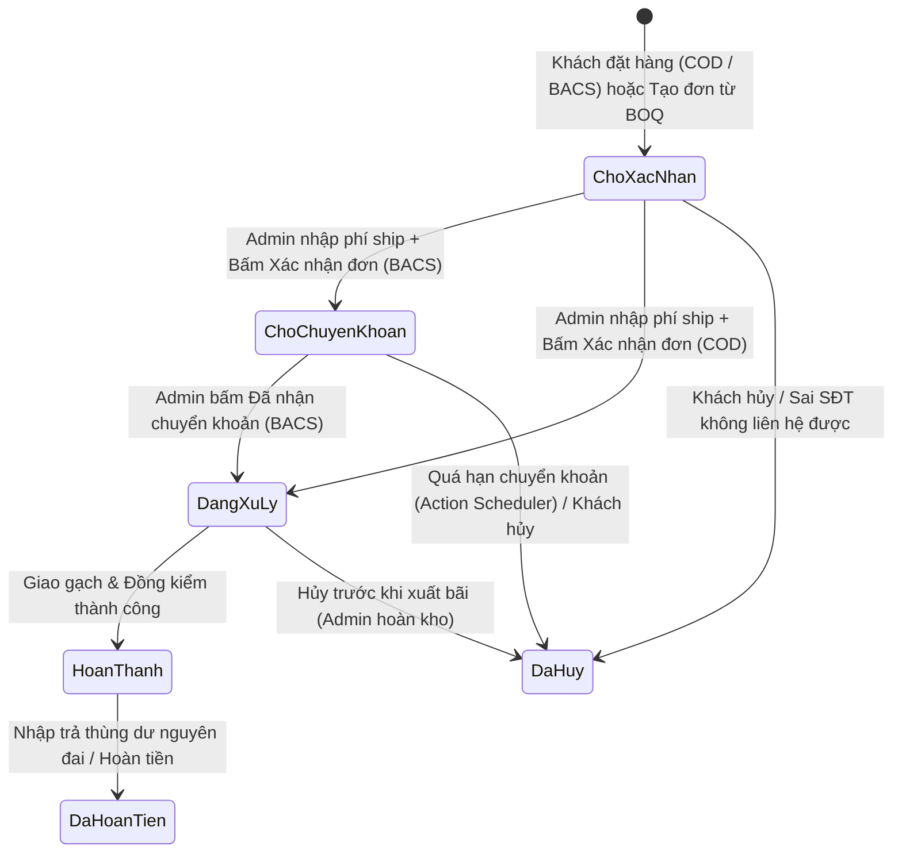

# 18. Đặc tả Vận hành Đơn hàng HPOS, VietQR & Hệ thống Email

> **Quyết định tham chiếu:** `D-05`, `D-07`, `D-09`, `D-10`, `D-15`, `D-16`, `D-20`, `D-22`, `D-23`, `D-30` ([00_Project_Brief_Decisions.md](00_Project_Brief_Decisions.md)).
> **Liên kết tài liệu:** [04_Pricing_Units_Commerce.md](04_Pricing_Units_Commerce.md) · [14_Data_Dictionary_And_Settings.md](14_Data_Dictionary_And_Settings.md) · [17_Quote_BOQ_And_Lead_Spec.md](17_Quote_BOQ_And_Lead_Spec.md).
> **Module phụ trách:** `Dravit\Woo\OrderFlow`, `Dravit\Woo\OrderMeta`, `Dravit\Woo\BankQR`, `Dravit\Woo\Emails\*`, `Dravit\Admin\OrderMetabox`, `Dravit\Core\MailSmtp`.

---

## 1. State Machine Đơn hàng HPOS & Quy tắc Slug ≤ 20 ký tự (`D-22`)

### 1.1 Quy chuẩn Slug Trạng thái Đơn hàng (`varchar(20)` Guard)

Cột `status` trong bảng HPOS `wp_wc_orders` và `post_status` trong `wp_posts` có giới hạn cứng `varchar(20)`. Mọi trạng thái đơn hàng (tính cả tiền tố `wc-`) **bắt buộc dài ≤ 20 ký tự**. Nghiêm cấm tạo các trạng thái kiểu `wc-drv-awaiting-transfer` (24 ký tự, gây cắt chuỗi SQL ngầm).

| Slug đầy đủ | Độ dài | Loại | Nhãn hiển thị Admin & Frontend | Ý nghĩa nghiệp vụ tại DRAVIT |
|---|---|---|---|---|
| `wc-cho-xac-nhan` | 15 | Custom | **Chờ xác nhận** | Trạng thái khởi tạo bắt buộc cho **mọi** đơn đặt trên web (cả `cod` và `bacs`) và đơn chuyển đổi từ BOQ chưa chốt cước. Đã trừ tồn kho giữ hàng, chờ điều vận kiểm tra cùng mã lô xuất kho và báo phí vận chuyển. |
| `wc-on-hold` | 10 | Native (đổi nhãn) | **Chờ chuyển khoản** | **Chỉ dùng cho đơn `bacs`** sau khi nhân viên đã cập nhật phí vận chuyển và bấm xác nhận đơn. Mở hiển thị mã VietQR và bắt đầu đếm hạn giữ lô chuyển khoản. |
| `wc-processing` | 13 | Native | **Đang xử lý** | Đơn `cod` đã chốt phí vận chuyển, hoặc đơn `bacs` đã được kế toán xác nhận nhận đủ tiền chuyển khoản. Kho tiến hành soạn gạch, đóng đai và xếp xe giao công trình. |
| `wc-completed` | 12 | Native | **Hoàn thành** | Đã giao gạch tận chân công trình, khách/chỉ huy công trình đã đồng kiểm số thùng, mã lô và ký nhận hoàn tất. |
| `wc-cancelled` | 12 | Native | **Đã hủy** | Khách báo hủy, không liên lạc được ở `cho-xac-nhan`, hoặc quá thời hạn chuyển khoản ở `on-hold`. Hệ thống tự động hoàn trả tồn kho. |
| `wc-refunded` | 11 | Native | **Đã hoàn tiền** | Đã hoàn tiền toàn phần hoặc một phần (trả thùng gạch dư nguyên đai theo chính sách đổi trả). |
| `wc-failed` | 9 | Native | **Thất bại** | Lỗi kỹ thuật trong quá trình khởi tạo thanh toán. |

### 1.2 Sơ đồ Chuyển Trạng thái (State Machine)



**Ma trận chuyển trạng thái hợp lệ & Guard bảo vệ (`Woo\OrderFlow`):**

| Từ trạng thái | Đích hợp lệ | Điều kiện bắt buộc (Guard) |
|---|---|---|
| `pending` / `draft` | `cho-xac-nhan` | Filter `woocommerce_cod_process_payment_order_status` và `woocommerce_bacs_process_payment_order_status` luôn trả về `'cho-xac-nhan'`. |
| `cho-xac-nhan` | `on-hold` | Chỉ hợp lệ khi `$order->get_payment_method() === 'bacs'` VÀ đã có dòng `WC_Order_Item_Shipping`. Nếu chọn `on-hold` cho đơn `cod` bằng dropdown thủ công: chặn hoặc tự nắn sang `processing` kèm admin notice. |
| `cho-xac-nhan` | `processing` | Hợp lệ cho đơn `cod` khi đã chốt phí ship. Nếu đơn `bacs` chuyển thẳng từ `cho-xac-nhan` sang `processing` (khách thanh toán tại quầy Showroom): cho phép nhưng bắt buộc ghi Order Note người duyệt. |
| `on-hold` | `processing` | Ghi `_drv_paid_at` + gọi `$order->payment_complete()`. |
| `cho-xac-nhan` / `on-hold` / `processing` | `cancelled` | Cho phép từ Admin hoặc job tự động; chặn khách tự bấm nút hủy trên `/tai-khoan/orders` khi đơn đã ở `processing` hoặc `completed` (`woocommerce_valid_order_statuses_for_cancel` chỉ trả về `['pending', 'cho-xac-nhan']`). |

### 1.3 Đăng ký Trạng thái, Quy tắc Giữ/Hoàn Tồn kho & Báo cáo WC Analytics

Toàn bộ tồn kho giao dịch dưới lõi WooCommerce tính theo **số nguyên viên** (`D-05`, `D-24`).

```php
<?php
declare(strict_types=1);

namespace Dravit\Woo;

defined('ABSPATH') || exit;

final class OrderFlow {
    public const STATUS_AWAITING_CONFIRM = 'cho-xac-nhan'; // wc-cho-xac-nhan = 15 chars (<= 20)

    public function register(): void {
        add_action('init', [$this, 'register_order_status']);
        add_filter('wc_order_statuses', [$this, 'inject_and_relabel_statuses']);

        // Ép trạng thái khởi tạo của cả COD và BACS về cho-xac-nhan
        add_filter('woocommerce_cod_process_payment_order_status', fn(): string => self::STATUS_AWAITING_CONFIRM, 20);
        add_filter('woocommerce_bacs_process_payment_order_status', fn(): string => self::STATUS_AWAITING_CONFIRM, 20);

        // Giữ tồn kho ngay khi vào cho-xac-nhan & Hoàn kho khi hủy
        add_action('woocommerce_order_status_cho-xac-nhan', 'wc_maybe_reduce_stock_levels', 10, 1);
        add_action('woocommerce_order_status_cho-xac-nhan_to_cancelled', 'wc_maybe_increase_stock_levels', 10, 1);

        // Quyền xem đơn của khách & chặn tự hủy khi đã xử lý
        add_filter('woocommerce_valid_order_statuses_for_cancel', fn(): array => ['pending', self::STATUS_AWAITING_CONFIRM]);

        // Báo cáo doanh thu WooCommerce Analytics: không tính đơn chưa chốt/chưa thu tiền
        add_filter('woocommerce_analytics_excluded_order_statuses', [$this, 'exclude_unconfirmed_from_analytics']);

        // Mã đơn hiển thị DRV-{id}
        add_filter('woocommerce_order_number', [$this, 'format_order_number'], 10, 2);
    }

    public function register_order_status(): void {
        register_post_status('wc-' . self::STATUS_AWAITING_CONFIRM, [
            'label'                     => 'Chờ xác nhận',
            'public'                    => true,
            'exclude_from_search'       => false,
            'show_in_admin_all_list'    => true,
            'show_in_admin_status_list' => true,
            'label_count'               => _n_noop(
                'Chờ xác nhận <span class="count">(%s)</span>',
                'Chờ xác nhận <span class="count">(%s)</span>',
                'dravit'
            ),
        ]);
    }

    public function inject_and_relabel_statuses(array $statuses): array {
        $ordered = [];
        foreach ($statuses as $key => $label) {
            if ($key === 'wc-processing') {
                $ordered['wc-' . self::STATUS_AWAITING_CONFIRM] = 'Chờ xác nhận';
            }
            if ($key === 'wc-on-hold') {
                $ordered[$key] = 'Chờ chuyển khoản';
                continue;
            }
            $ordered[$key] = $label;
        }
        return $ordered;
    }

    public function exclude_unconfirmed_from_analytics(array $excluded): array {
        return array_values(array_unique(array_merge($excluded, [
            self::STATUS_AWAITING_CONFIRM,
            'on-hold',
        ])));
    }

    public function format_order_number(string $order_number, \WC_Order $order): string {
        return 'DRV-' . $order->get_id();
    }
}
```

- **Chống trừ kho kép (Idempotency):** Hàm chuẩn `wc_maybe_reduce_stock_levels($order_id)` kiểm tra cờ nội bộ `$order->get_data_store()->get_stock_reduced($order_id)` (`_order_stock_reduced`). Khi đơn đã trừ kho ở `cho-xac-nhan`, lúc chuyển tiếp sang `on-hold` hoặc `processing` WooCommerce sẽ tự bỏ qua, đảm bảo mỗi đơn chỉ trừ kho đúng 1 lần.
- **Quy tắc Báo cáo Analytics / Reports:**
  - `cho-xac-nhan` và `on-hold` bị loại khỏi bảng doanh thu thực nhận (`woocommerce_analytics_excluded_order_statuses`) để số liệu kế toán không bị cộng ảo bởi các đơn chưa báo phí ship hoặc khách chưa chuyển khoản.
  - Đơn chỉ được ghi nhận vào Doanh thu ròng khi đạt `processing` hoặc `completed` (`wc_get_is_paid_statuses()` giữ mặc định `['processing', 'completed']`).

### 1.4 Quy chuẩn Định dạng Mã Đơn hàng vs. Mã Chuyển khoản (`D-22`)

| Ngữ cảnh sử dụng | Định dạng | Ví dụ (`id = 202688`) | Nguồn / Meta key |
|---|---|---|---|
| ID lưu trữ gốc dưới CSDL (`wc_orders.id`) | Số nguyên dương `{id}` | `202688` | `$order->get_id()` |
| Mã hiển thị trên Web, Email, Hóa đơn, Admin | `DRV-{id}` (có gạch nối `-`) | `DRV-202688` | `$order->get_order_number()` |
| Nội dung chuyển khoản ngân hàng & VietQR | `DRV{id}` (**chỉ chữ hoa ASCII và số**, không dấu gạch nối, không dấu `#`, không khoảng trắng) | `DRV202688` | Meta `_drv_transfer_ref` |
| Số phiếu xuất kho in A4 | `PXK-DRV-{id}` | `PXK-DRV-202688` | Sinh khi render bản in |

- **Tìm kiếm đơn trong HPOS Admin:** Hook `woocommerce_order_table_search_query_meta_keys` đăng ký thêm `['_drv_transfer_ref', '_drv_vat_tax_id', '_drv_vat_company']`; đồng thời gắn filter chuẩn hóa từ khóa tìm kiếm trên màn `wc-orders`: nếu Admin gõ `DRV-202688`, `#DRV-202688` hoặc `DRV202688`, tự trích số `202688` để khớp trực tiếp `order_id`.

---

## 2. Giao diện & Nghiệp vụ Xử lý Đơn trong Admin (`Admin\OrderMetabox`, `Woo\OrderFlow` - 100% HPOS)

> **Quy tắc bất biến:** Toàn bộ code Admin bắt buộc dùng API HPOS (`wc_get_order()`, `$order->get_meta()`, `$order->update_meta_data()`, `$order->save()`, `wc_get_page_screen_id('shop-order')`). **Nghiêm cấm** gọi `get_post_meta()`, `update_post_meta()` hoặc gắn cứng screen `'shop_order'`.

### 2.1 Cột Tùy biến & Bộ lọc Nhanh trên Danh sách Đơn HPOS (`woocommerce_page_wc-orders`)

Sử dụng bộ hook chuẩn HPOS:
- `manage_woocommerce_page_wc-orders_columns`
- `manage_woocommerce_page_wc-orders_custom_column` (nhận tham số `(string $column, \WC_Order $order)`)
- `manage_woocommerce_page_wc-orders_sortable_columns`
- `woocommerce_order_list_table_restrict_manage_orders` & `woocommerce_order_list_table_prepare_items_query_args`

**Cấu trúc 7 cột hiển thị chuẩn:**

| Cột key | Tiêu đề cột | Dữ liệu hiển thị & Tương tác nhanh |
|---|---|---|
| `cb` | Checkbox | Native HPOS bulk actions. |
| `drv_code` | **Mã đơn** | Link đậm `#DRV-{id}` + thời gian tạo (`d/m/Y H:i` theo `Asia/Ho_Chi_Minh`). Nếu có `_drv_source_lead_id`: gắn badge nhỏ `BOQ`. |
| `drv_customer` | **Khách hàng & SĐT** | Tên người nhận (`billing_first_name`) + SĐT `billing_phone` kèm nút copy 1-click. Nếu `empty($order->get_billing_email())`: hiện icon cảnh báo màu cam `Không có Email - Gửi Zalo`. |
| `drv_region` | **Tỉnh/TP & Điều vận** | `{billing_city}, {billing_state}`. Dòng phụ: nhãn phương tiện `_drv_ship_vehicle` (nếu đã gán). |
| `drv_volume` | **Khối lượng gạch** | **`{_drv_total_m2} m²`** · **`{_drv_total_kg} kg`** (`tabular-nums`, tính và lưu vào order meta ngay khi tạo đơn để không phải lặp line items trên trang danh sách). |
| `drv_vat` | **VAT** | Nếu `_drv_vat_required === '1'`: hiện badge `Xuất VAT` + MST `_drv_vat_tax_id`. Ngược lại hiện `-`. |
| `drv_payment` | **Thanh toán & Tổng** | Phương thức (`VietQR` / `COD`) + Tổng tiền `$order->get_formatted_order_total()`. Nếu đơn còn ở `cho-xac-nhan`: ghi chú nhỏ `Chưa gồm phí ship`. |
| `order_status` | **Trạng thái** | Badge trạng thái có màu phân biệt riêng trong Admin CSS (`admin-orders.css`):<br>- `status-cho-xac-nhan`: nền `#FEF3C7`, chữ `#92400E`, viền `1px solid #F59E0B`<br>- `status-on-hold`: nền `#E0F2FE`, chữ `#075985`, viền `1px solid #38BDF8`<br>- `status-processing`: nền `#CCFBF1`, chữ `#115E59`, viền `1px solid #2DD4BF`<br>- `status-completed`: nền `#ECFDF5`, chữ `#065F46`<br>- `status-cancelled`: nền `#FFE4E6`, chữ `#9F1239` |

**Bộ lọc nhanh trên thanh công cụ danh sách đơn:**
1. Dropdown lọc `Tỉnh/Thành phố` (34 tỉnh/thành từ `config/provinces-vn.php` → query `billing_state`).
2. Dropdown lọc `Hóa đơn VAT` (`Tất cả` | `Cần xuất hóa đơn VAT` → `meta_query: _drv_vat_required = '1'`).
3. Dropdown lọc `Phương thức TT` (`Tất cả` | `Chuyển khoản VietQR (bacs)` | `COD (cod)`).

### 2.2 Custom Metabox "Điều vận & Xác nhận Đơn DRAVIT" (`Admin\OrderMetabox`)

Đăng ký qua `add_meta_boxes`:

```php
add_meta_box(
    'drv-order-dispatch-box',
    'Điều vận & Xác nhận Đơn DRAVIT',
    [$this, 'render_metabox'],
    wc_get_page_screen_id('shop-order'),
    'normal',
    'high'
);
```

#### Wireframe bố cục Metabox trên màn sửa đơn HPOS

```text
┌─ ĐIỀU VẬN & XÁC NHẬN ĐƠN DRAVIT (#DRV-202688 · Trạng thái: Chờ xác nhận · TT: VietQR) ─────────┐
│ Tải trọng đơn: 11,52 m² · 258 kg (2 mã) │ Gợi ý xe tự động: Xe ba gác / Tải nhỏ 1 tấn          │
├─────────────────────────────────────────┴──────────────────────────────────────────────────────┤
│ 1. CƯỚC VẬN CHUYỂN & PHƯƠNG TIỆN GIAO HÀNG                                                     │
│ Phí vận chuyển (VND): [ 350000          ] đ  (Nhập 0 nếu miễn phí vận chuyển)                  │
│ Phương tiện giao:     [ Xe tải 1 tấn                          ▾ ]                              │
│ Ghi chú giao hàng:    [ Giao sáng T7 trước 10h, hẻm 3,5m hạ gạch tại sân trước               ] │
├────────────────────────────────────────────────────────────────────────────────────────────────┤
│ 2. MÃ LÔ XUẤT KHO THỰC TẾ (_drv_lot_code - Tách biệt với độ biến thiên Shade V1-V4)            │
│ • DRV-8801M (18 viên = 6 thùng · Shade TK: V2):  Mã lô/Caliber xuất: [ SX2610-L04 / C01     ]  │
├────────────────────────────────────────────────────────────────────────────────────────────────┤
│ 3. THÔNG TIN XUẤT HÓA ĐƠN VAT ([✓] Khách yêu cầu xuất VAT)          [Sao chép trọn bộ VAT]     │
│ Công ty: Công ty TNHH Thiết Kế & Xây Dựng An Phát                                              │
│ MST:     0316889988 [Copy MST]  │  Email nhận HĐĐT: ketoan@anphat.vn                           │
│ Địa chỉ: 120 Điện Biên Phủ, Phường Sài Gòn, TP. Hồ Chí Minh                                    │
├────────────────────────────────────────────────────────────────────────────────────────────────┤
│ [ ] Giữ lô công trình - Miễn tự động hủy quá hạn chuyển khoản (_drv_hold_keep_lot)             │
│                                                                                                │
│ [ Lưu thông tin điều vận ]   [ XÁC NHẬN ĐƠN & GỬI THÔNG BÁO (Chuyển Chờ CK + Mở VietQR) ]      │
│ [ In Phiếu Xuất Kho / Giao Hàng (A4) ]                                                         │
└────────────────────────────────────────────────────────────────────────────────────────────────┘
```

*(Khi đơn `bacs` đã ở trạng thái `wc-on-hold`, nút chính đổi thành **`[ XÁC NHẬN ĐÃ NHẬN CHUYỂN KHOẢN (Chuyển Đang xử lý) ]`** và nút phụ **`[ Cập nhật lại phí ship & Gửi lại VietQR ]`**).*

#### Chi tiết xử lý từng phân khu trong Metabox

1. **Danh mục Phương tiện giao hàng (`_drv_ship_vehicle`):**
   - Khai báo enum/mảng chuẩn:
     - `ba_gac`: `Ba gác / Bán tải nhỏ (< 400 kg)`
     - `tai_1t`: `Xe tải 1 tấn (400 - 1.000 kg)`
     - `tai_2_5t`: `Xe tải 2,5 tấn (1.000 - 2.500 kg)`
     - `xe_cau`: `Xe tải gắn cẩu hạ kiện (> 2.500 kg / Khổ lớn)`
     - `chanh_xe`: `Gửi chành xe liên tỉnh`
     - `khach_tu_lay`: `Khách tự nhận tại kho DRAVIT`
   - Ngưỡng gợi ý tự động đọc từ `drv_settings.order.vehicle_thresholds` dựa trên `_drv_total_kg` và cờ sản phẩm khổ lớn `large_format` (`> 1200mm`).

2. **Cập nhật Phí vận chuyển vào `WC_Order_Item_Shipping` & Tính lại tổng đơn:**
   - Khi lưu phí vận chuyển `$shipping_fee = max(0, (int) preg_replace('/\D/', '', $_POST['drv_shipping_fee']))`:
     ```php
     $shipping_items = $order->get_items('shipping');
     /** @var \WC_Order_Item_Shipping $ship_item */
     $ship_item = !empty($shipping_items) ? reset($shipping_items) : new \WC_Order_Item_Shipping();
     $vehicle_label = self::VEHICLE_LABELS[$vehicle_slug] ?? 'Tiêu chuẩn';

     $ship_item->set_method_id('drv_quote_later');
     $ship_item->set_method_title(
         $shipping_fee > 0
             ? sprintf('Phí vận chuyển (%s)', $vehicle_label)
             : sprintf('Miễn phí vận chuyển (%s)', $vehicle_label)
     );
     $ship_item->set_total((string) $shipping_fee);
     $ship_item->save();

     if (empty($shipping_items)) {
         $order->add_item($ship_item);
     }

     $order->update_meta_data('_drv_ship_vehicle', $vehicle_slug);
     $order->update_meta_data('_drv_ship_note', sanitize_textarea_field(wp_unslash($_POST['drv_ship_note'] ?? '')));
     $order->update_meta_data('_drv_shipping_confirmed', '1');
     $order->calculate_totals(false); // Giá niêm yết đã gồm VAT (00 §6), không tính chồng thuế
     $order->save();
     ```

3. **Quản lý Mã lô xuất kho thực tế (`_drv_lot_code`, `D-30`):**
   - **Tách bạch khái niệm:** `drv_shade` (`V1`–`V4`) là độ biến thiên sắc độ thiết kế cố định của mẫu gạch (lưu trên `WC_Product`); `_drv_lot_code` là mã lô sản xuất & cỡ kích thước thực tế in trên vỏ thùng trong kho (ví dụ: `L2611A-C02`) do thủ kho/điều vận gán cho từng dòng sản phẩm của đơn hàng.
   - Hiển thị đồng thời ở 2 vị trí: bảng nhập nhanh trong Metabox Điều vận và ngay dưới mỗi dòng sản phẩm trong bảng Order Items gốc của WC (qua hook `woocommerce_after_order_itemmeta` chỉ cho `WC_Order_Item_Product`).
   - Lưu qua `$item->update_meta_data('_drv_lot_code', sanitize_text_field($lot_code)); $item->save();`.
   - Qua filter `woocommerce_order_item_display_meta_key`, đổi nhãn hiển thị `_drv_lot_code` thành `Mã lô xuất kho`.

4. **Khối Thông tin Xuất hóa đơn VAT (`_drv_vat_*`):**
   - Đọc 5 order meta: `_drv_vat_required` (`'1'|'0'`), `_drv_vat_company`, `_drv_vat_tax_id`, `_drv_vat_address`, `_drv_vat_email`.
   - Cung cấp nút copy nhanh MST và nút copy chuỗi định dạng sẵn cho bộ phận kế toán:
     `Đơn #DRV-{id} | Công ty: {company} | MST: {tax_id} | ĐC: {address} | Email HĐĐT: {email} | Tổng TT: {total}đ`.
   - Cho phép Admin chỉnh sửa lại các trường `_drv_vat_*` (validate regex MST `^\d{10}(-\d{3})?$` khi `_drv_vat_required === '1'`).

5. **Các Nút Thao tác 1-Click & Kiểm tra Bảo mật (`admin-post.php`):**
   - Endpoint: `admin-post.php?action=drv_order_ops_action`.
   - **Hard Security Check:**
     ```php
     if (!current_user_can('manage_woocommerce')) {
         wp_die('Bạn không có quyền thực hiện thao tác vận hành đơn hàng.', 403);
     }
     $order_id = absint($_POST['order_id'] ?? 0);
     check_admin_referer('drv_order_ops_' . $order_id, '_drv_ops_nonce');
     ```
   - **Action `confirm_order` (*"Xác nhận đơn & Gửi thông báo"*):**
     1. Kiểm tra bắt buộc đã nhập `drv_shipping_fee` (cho phép số `0`) và đã chọn `_drv_ship_vehicle`.
     2. Lưu phí vận chuyển, `_drv_ship_vehicle`, `_drv_ship_note`, các `_drv_lot_code` và `calculate_totals(false)`.
     3. Ghi audit meta:
        - `_drv_confirmed_at` = `gmdate('Y-m-d H:i:s')`
        - `_drv_confirmed_by` = `get_current_user_id()`
        - `_drv_transfer_ref` = `'DRV' . $order->get_id()`
     4. Ghi Order Note nội bộ kèm tên nhân viên xác nhận và mức phí ship.
     5. Rẽ nhánh theo phương thức thanh toán:
        - Nếu `$order->get_payment_method() === 'bacs'`: gọi `$order->update_status('on-hold', 'Đã xác nhận tồn kho cùng lô và chốt phí vận chuyển. Mở VietQR chờ khách chuyển khoản.')`, sau đó phát sự kiện `do_action('drv/order/confirmed', $order->get_id(), 'bacs')` để gửi Email **E3 (Bản BACS kèm VietQR)**.
        - Nếu `$order->get_payment_method() === 'cod'`: gọi `$order->update_status('processing', 'Đã xác nhận tồn kho cùng lô và chốt phí vận chuyển COD.')`, sau đó phát sự kiện `do_action('drv/order/confirmed', $order->get_id(), 'cod')` để gửi Email **E3 (Bản COD)**.
   - **Action `confirm_payment` (*"Xác nhận đã nhận chuyển khoản"*):**
     1. Chỉ chấp nhận khi `$order->get_payment_method() === 'bacs'` và `$order->has_status('on-hold')`.
     2. Ghi `_drv_paid_at` = `gmdate('Y-m-d H:i:s')`, `_drv_paid_confirmed_by` = `get_current_user_id()`.
     3. Gọi `$order->payment_complete()` (tự chuyển trạng thái sang `wc-processing` và ghi mốc thanh toán chuẩn WC).
     4. Ghi Order Note nội bộ: *"Kế toán {user_display_name} đã xác nhận nhận đủ {total}đ qua chuyển khoản (Ref: DRV{id})."*
     5. Phát sự kiện `do_action('drv/order/payment_confirmed', $order->get_id())` để gửi Email **E4**.

### 2.3 Bản in Phiếu Xuất Kho / Biên bản Giao Nhận Hàng A4

- **Route:** `GET /wp-admin/admin-post.php?action=drv_print_delivery_note&order_id={id}&_wpnonce={nonce}` (bắt buộc `current_user_can('manage_woocommerce')` + `wp_verify_nonce`).
- **Quy chuẩn trình bày A4:**
  - Khổ giấy `@page { size: A4 portrait; margin: 12mm; }`, nền trắng tuyệt đối, chữ đen `#000000`, đường kẻ bảng `1px solid #334155`, dùng logo bản đen `assets/images/logo-black.png` (`DRAVIT-07.png`, `01 §6`).
  - **Phần 1 - Tiêu đề & Định danh:** Tên pháp nhân, MST, Địa chỉ kho xuất, Hotline điều vận (`drv_settings.company`); Số phiếu `PXK-DRV-{id}`; Mã đơn `DRV-{id}`; Ngày giờ in.
  - **Phần 2 - Thông tin Giao nhận Công trình:** Họ tên người nhận, SĐT, Địa chỉ 2 cấp (`{address_1}, {billing_city}, {billing_state}`), Phương tiện vận chuyển (`_drv_ship_vehicle`), Ghi chú hạ hàng (`_drv_ship_note`).
  - **Phần 3 - Bảng Kê Hàng hóa Xuất kho (Đơn vị kép + Mã lô):**
    - Các cột: `STT` | `Mã SKU` | `Tên sản phẩm & Quy cách` | **`Mã lô / Caliber (_drv_lot_code)`** | `SL Viên` | `Quy đổi Thùng + Lẻ` | `Diện tích (m²)` | `Tải trọng (kg)` | `Đơn giá (đ/viên · đ/m²)` | `Thành tiền`.
    - Hàng tổng kết chân bảng: **Tổng số kiện đóng gói**, **Tổng diện tích (`m²`)**, **Tổng khối lượng (`kg`)**, Tiền vật tư, Phí vận chuyển, **Tổng thanh toán**, và ô đậm **Số tiền tài xế cần thu hộ (COD)**:
      - Nếu đơn `bacs` đã thanh toán (`_drv_paid_at` khác rỗng): in đậm **`0đ (ĐÃ THANH TOÁN CHUYỂN KHOẢN)`**.
      - Nếu đơn `cod`: in đậm **`{total_formatted} (THU TIỀN MẶT / QUÉT QR KHI GIAO)`**.
  - **Phần 4 - Checklist Đồng kiểm & Chữ ký 3 bên:**
    - 3 ô tick kiểm tra tại chân công trình: `[ ] Đủ số thùng và số viên theo phiếu` · `[ ] Đúng mã SKU và đồng nhất 100% mã lô trên vỏ thùng` · `[ ] Thùng gạch nguyên đai, góc cạnh không nứt vỡ`.
    - Lưu ý ngắn: *"Mọi chênh lệch số lượng hoặc nứt vỡ do vận chuyển được DRAVIT bù mới 1 đổi 1 ngay khi ghi nhận trên biên bản đồng kiểm này."*
    - 3 cột ký và ghi rõ họ tên: **Thủ kho xuất hàng** · **Đơn vị vận chuyển / Tài xế** · **Người nhận hàng / Chỉ huy công trình**.

### 2.4 Quy trình Xử lý Đơn Khách Không Nhập Email (`billing_email` rỗng)

Do trường `billing_email` không bắt buộc ở Checkout để tối ưu tỷ lệ hoàn tất đơn cho chủ nhà và thợ thầu (`04 §5.1`), hệ thống xử lý an toàn 100% khi đơn không có email:

1. **Chặn lỗi gửi mail ngầm:** Trong mọi lớp `WC_Email` dành cho khách, kiểm tra `if (!is_email($this->get_recipient())) { return; }` trước khi gọi `$this->send()`, đồng thời ghi 1 Order Note tự động: *"Khách không cung cấp email - Vui lòng gửi thông báo và link đơn hàng qua Zalo."*
2. **Hộp "Tin nhắn Zalo 1-Click" ngay trong Metabox Điều vận:**
   - Tự động lấy URL xem đơn có khóa xác thực riêng của đơn đó: `$tracking_url = untrailingslashit($order->get_checkout_order_received_url());` (dạng `https://gachdravit.vn/thanh-toan/dat-hang-thanh-cong/202688?key=wc_order_xxxxx`). Khách mở link này trên Zalo sẽ thấy ngay trạng thái mới nhất của đơn (bao gồm mã VietQR chính thức khi đơn đã chuyển sang `on-hold`).
   - Sinh sẵn nội dung tin nhắn chuẩn theo trạng thái hiện tại để nhân viên bấm **`[Sao chép tin nhắn Zalo]`** + **`[Mở Zalo {phone}]`** (`https://zalo.me/{phone_digits}`):
     - *Mẫu khi vừa chốt đơn Chuyển khoản (`on-hold`):*
       ```text
       DRAVIT xin xác nhận đơn hàng #DRV-202688 của Anh/Chị {name}:
       - Khối lượng: {boxes_summary} ({total_m2} m² · {total_kg} kg) - Cùng lô {lot_summary}
       - Tiền vật tư: {subtotal}đ
       - Phí vận chuyển ({vehicle}): {ship_fee}đ
       - Tổng thanh toán: {total}đ
       Anh/Chị xem chi tiết đơn và quét mã VietQR chính thức tại: {tracking_url}
       Hotline điều vận hỗ trợ: {hotline}
       ```
     - *Mẫu khi vừa chốt đơn COD (`processing`):*
       ```text
       DRAVIT xin xác nhận đơn hàng #DRV-202688 của Anh/Chị {name}:
       - Khối lượng: {boxes_summary} ({total_m2} m² · {total_kg} kg) - Cùng lô {lot_summary}
       - Tổng thu khi nhận hàng (gồm phí giao {vehicle}): {total}đ
       - Thời gian/ghi chú giao: {ship_note}
       Xem chi tiết phiếu đơn tại: {tracking_url}
       ```

---

## 3. Tự động hóa bằng Action Scheduler (`Woo\OrderFlow`)

Hệ thống sử dụng **Action Scheduler** tích hợp sẵn trong WooCommerce (nhóm `'dravit_orders'`), kết hợp cron hệ thống thật 5 phút/lần trên hosting AZDIGI (`DISABLE_WP_CRON = true`, `08 §6`).

### 3.1 Tự động Nhắc & Hủy Đơn `wc-on-hold` Quá hạn Chuyển khoản

- **Cấu hình:** `drv_settings.order.transfer_due_days` (`int`, mặc định `3` ngày, khoảng hợp lệ `1..14`; đặt `0` nếu tạm tắt tự hủy).
- **Lập lịch khi đơn vào `on-hold`** (`woocommerce_order_status_on-hold`):
  1. Hủy mọi lịch cũ của cùng `order_id` (chống trùng lịch khi Admin cập nhật lại đơn).
  2. Nếu `$order->get_payment_method() === 'bacs'` và `$due_days > 0`:
     - Lịch nhắc nội bộ trước khi hết hạn 24 giờ (`$remind_ts = time() + max(12, ($due_days * 24) - 24) * HOUR_IN_SECONDS`):
       `as_schedule_single_action($remind_ts, 'drv/order/transfer_reminder', ['order_id' => $order_id], 'dravit_orders');`
     - Lịch tự động hủy khi hết hạn (`$cancel_ts = time() + ($due_days * DAY_IN_SECONDS)`):
       `as_schedule_single_action($cancel_ts, 'drv/order/auto_cancel_unpaid', ['order_id' => $order_id], 'dravit_orders');`
     - Lưu mốc hết hạn `_drv_transfer_due_at = gmdate('Y-m-d H:i:s', $cancel_ts)` vào order meta để hiển thị rõ trên trang đơn hàng và trong Email E3.
- **Dọn lịch khi đơn rời `on-hold`** (`woocommerce_order_status_changed`):
  - Khi `$from === 'on-hold'` và `$to !== 'on-hold'`: gọi `as_unschedule_all_actions('drv/order/transfer_reminder', ['order_id' => $order_id], 'dravit_orders')` và `as_unschedule_all_actions('drv/order/auto_cancel_unpaid', ['order_id' => $order_id], 'dravit_orders')`.
- **Xử lý callback `drv/order/auto_cancel_unpaid(int $order_id)`:**
  1. Nạp `$order = wc_get_order($order_id)`. Nếu `!$order || !$order->has_status('on-hold') || $order->get_payment_method() !== 'bacs'` → return.
  2. Kiểm tra cờ miễn trừ công trình: nếu `$order->get_meta('_drv_hold_keep_lot') === '1'` → ghi Order Note *"Đơn đã đến hạn chuyển khoản nhưng đang bật cờ Giữ lô công trình - không tự động hủy."* và return.
  3. Kiểm tra lại thời gian thực tế so với `_drv_transfer_due_at` (nếu Admin vừa gia hạn thì lập lịch lại theo mốc mới và return).
  4. Thực thi hủy đơn:
     ```php
     $order->update_status(
         'cancelled',
         sprintf('Hệ thống tự động hủy đơn và giải phóng kho do quá thời hạn chuyển khoản (%d ngày).', $due_days)
     );
     ```
     WooCommerce tự chạy `wc_maybe_increase_stock_levels($order_id)` hoàn trả đúng số viên gạch về tồn kho và kích hoạt Email **E6**.

### 3.2 Cảnh báo Nội bộ cho Đơn `wc-cho-xac-nhan` Quá SLA chưa gọi xác nhận

- **Cấu hình:** `drv_settings.order.sla_minutes` (mặc định `30` phút) và khung giờ làm việc `drv_settings.contact.working_hours` (mặc định `08:00` - `21:00`, múi giờ `Asia/Ho_Chi_Minh`).
- **Lập lịch:** Recurring action `drv/order/sla_watchdog` chạy mỗi `900` giây (15 phút).
- **Quy tắc vận hành thông minh theo giờ làm việc:**
  - Nếu thời điểm hiện tại theo `Asia/Ho_Chi_Minh` nằm ngoài khung `08:30 - 20:30`: bỏ qua kiểm tra (đơn khách đặt lúc 23:00 đêm chỉ bắt đầu tính SLA từ `08:00` sáng hôm sau, tránh bắn cảnh báo giả vào ban đêm).
  - Truy vấn HPOS tối đa 20 đơn `wc-cho-xac-nhan` có thời gian chờ hiệu dụng vượt `$sla_minutes` và chưa có meta `_drv_sla_alerted`.
  - Với mỗi đơn vi phạm SLA: gửi email cảnh báo nội bộ tới `drv_settings.quote.notify_emails` (`[CẢNH BÁO SLA] Đơn #DRV-{id} chờ gọi xác nhận quá {sla} phút`) và ghi `$order->update_meta_data('_drv_sla_alerted', gmdate('Y-m-d H:i:s')); $order->save();` để chỉ cảnh báo đúng 1 lần.

---

## 4. Chuẩn Sinh Mã VietQR (`Woo\BankQR`, `D-22`, `D-30`)

### 4.1 Nguồn Cấu hình & Công thức URL (`img.vietqr.io`)

`img.vietqr.io` là dịch vụ ngoài duy nhất được cấp phép trong Whitelist cho thanh toán (`D-30`). Thông tin tài khoản đọc từ `drv_settings.bank` (`O-02`):

| Key trong `drv_settings.bank` | Kiểu | Ví dụ | Quy tắc validate khi lưu Settings |
|---|---|---|---|
| `bank_bin` | string | `970422` | 6 chữ số mã BIN NAPAS (`^\d{6}$`) |
| `bank_short_name` | string | `MBBank` | Tên viết tắt ngân hàng |
| `bank_full_name` | string | `Ngân hàng TMCP Quân Đội` | Tên đầy đủ hiển thị bảng text |
| `account_no` | string | `0938258668` | Chữ/số viết liền `^[A-Za-z0-9]{6,25}$` |
| `account_name` | string | `CONG TY TNHH DRAVIT` | Chữ IN HOA ASCII không dấu (`^[A-Z0-9 ]+$`) |
| `qr_template` | enum | `compact2` | `compact2` \| `compact` \| `qr_only` |

**Công thức sinh URL ảnh VietQR chuẩn NAPAS 24/7:**

```text
https://img.vietqr.io/image/{BIN}-{ACCOUNT}-{TEMPLATE}.png?amount={AMOUNT}&addInfo={ADD_INFO}&accountName={ENCODED_ACCOUNT_NAME}
```

- `{AMOUNT}`: Số nguyên VND làm tròn của tổng thanh toán cuối cùng đã gồm phí vận chuyển (`(int) round((float) $order->get_total())`).
- `{ADD_INFO}`: `'DRV' . $order->get_id()` (ví dụ `DRV202688`). Bắt buộc lọc qua `preg_replace('/[^A-Z0-9]/', '', ...)` để đảm bảo 100% chỉ chứa chữ in hoa và chữ số.
- `{ENCODED_ACCOUNT_NAME}`: `rawurlencode($account_name)`.

### 4.2 Hard Guard Bất biến (`Dravit\Woo\BankQR`)

```php
<?php
declare(strict_types=1);

namespace Dravit\Woo;

defined('ABSPATH') || exit;

final class BankQR {
    /**
     * Hard guard D-22: CHỈ cho phép sinh và hiển thị VietQR khi đơn chọn BACS
     * VÀ đang ở đúng trạng thái 'on-hold' (Chờ chuyển khoản, đã có phí vận chuyển).
     */
    public static function can_render(\WC_Order $order): bool {
        if ($order->get_payment_method() !== 'bacs') {
            return false;
        }
        if (!$order->has_status('on-hold')) {
            return false;
        }
        $amount = (int) round((float) $order->get_total());
        if ($amount <= 0) {
            return false;
        }
        $bank = drv_setting('bank', []);
        return !empty($bank['bank_bin'])
            && !empty($bank['account_no'])
            && !empty($bank['account_name']);
    }

    public static function transfer_ref(\WC_Order $order): string {
        $saved = (string) $order->get_meta('_drv_transfer_ref');
        $clean = preg_replace('/[^A-Z0-9]/', '', strtoupper($saved));
        return $clean !== '' ? $clean : ('DRV' . $order->get_id());
    }

    public static function build_qr_url(\WC_Order $order): ?string {
        if (!self::can_render($order)) {
            return null;
        }
        $bank     = drv_setting('bank', []);
        $bin      = preg_replace('/\D/', '', (string) $bank['bank_bin']);
        $acc_no   = preg_replace('/[^A-Za-z0-9]/', '', (string) $bank['account_no']);
        $acc_name = trim(preg_replace('/[^A-Z0-9 ]/', '', strtoupper(remove_accents((string) $bank['account_name']))));
        $tpl      = in_array($bank['qr_template'] ?? '', ['compact2', 'compact', 'qr_only'], true)
            ? $bank['qr_template']
            : 'compact2';
        $amount   = (int) round((float) $order->get_total());
        $ref      = self::transfer_ref($order);

        return add_query_arg(
            [
                'amount'      => $amount,
                'addInfo'     => $ref,
                'accountName' => $acc_name,
            ],
            sprintf('https://img.vietqr.io/image/%s-%s-%s.png', $bin, $acc_no, $tpl)
        );
    }
}
```

### 4.3 Quy tắc Hiển thị trên Web, Fallback khi Ảnh lỗi & Sửa lỗi Prototype

1. **Ma trận 4 Trạng thái trên trang `thankyou.php` (`/thanh-toan/dat-hang-thanh-cong/{id}`) và `/tai-khoan/view-order/{id}`:**
   - **Trạng thái A (`cho-xac-nhan`, cả BACS và COD):** **Tuyệt đối không xuất thẻ `` VietQR và không xuất số tài khoản lên DOM** (loại bỏ hoàn toàn kiểu che watermark trên ảnh QR thật của prototype `06-order-received.html` để tránh khách tự quét chuyển tiền thiếu phí vận chuyển). Hiển thị hộp thông báo nền `--c-champagne`: *"Đơn hàng #DRV-{id} đã được giữ tồn kho. Nhân viên điều vận DRAVIT sẽ gọi số {phone} trong giờ làm việc để xác nhận lô gạch và báo phí vận chuyển tốt nhất. Mã VietQR thanh toán sẽ mở tại trang này và gửi qua Email/Zalo ngay sau khi chốt phí giao."*
   - **Trạng thái B (`on-hold` + `bacs`):** `BankQR::can_render($order) === true` → Render đầy đủ khối `.drv-vietqr-card` gồm ảnh QR `240×240` + Bảng thông tin tài khoản text + Nút sao chép 1-click.
   - **Trạng thái C (`processing` / `completed`):** Ẩn hoàn toàn mã VietQR. Nếu là `bacs`, hiển thị hộp xác nhận xanh `--c-success-bg`: *"Đã nhận thanh toán chuyển khoản {total_formatted}"*. Hiển thị phương tiện giao `_drv_ship_vehicle`, ghi chú giao `_drv_ship_note` và mã lô xuất kho `_drv_lot_code`.
   - **Trạng thái D (`cancelled` / `refunded`):** Ẩn hoàn toàn mã VietQR, hiển thị thông báo đơn đã hủy kèm nút liên hệ Hotline/Zalo.
2. **Cấm hứa hẹn đối soát tự động (`D-22`):** Xóa bỏ câu *"Hệ thống tự động đối soát trong 3 phút"* của prototype. Thay bằng microcopy chuẩn: *"Sau khi chuyển khoản, kế toán DRAVIT sẽ kiểm tra và cập nhật trạng thái xuất kho trong giờ làm việc (8:00 - 21:00). Quý khách có thể gửi ảnh biên lai qua Zalo để được ưu tiên xếp xe nhanh hơn."*
3. **Dự phòng khi `img.vietqr.io` chậm hoặc lỗi mạng:**
   - Thẻ `` có `width="240" height="240" loading="lazy" decoding="async" referrerpolicy="no-referrer"`.
   - Bảng thông tin dạng text (`.drv-bank-rows`) luôn hiển thị song song cạnh ảnh QR gồm 5 dòng: **Ngân hàng**, **Số tài khoản** (`data-drv-action="copy-text"`), **Chủ tài khoản** (`data-drv-action="copy-text"`), **Số tiền** (`data-drv-action="copy-text"` gắn `data-drv-value="{raw_integer_amount}"` không dấu chấm để dán thẳng vào app ngân hàng), **Nội dung CK** (`DRV{id}`, `data-drv-action="copy-text"`). Khi ảnh QR lỗi tải (`error` event trong `order.js`), ẩn khung ảnh và hiện ghi chú *"Không tải được ảnh QR tự động - Quý khách vui lòng sao chép Số tài khoản và Nội dung CK bên cạnh"*.

---

## 5. Đặc tả Chi tiết Bộ Email Giao dịch (`Woo\Emails\*`)

### 5.1 Gỡ Mặc định BACS & Đăng ký Custom Email Triggers

Trong `Dravit\Woo\Emails\EmailManager::register()`:

1. **Gỡ toàn bộ hướng dẫn chuyển khoản mặc định của `WC_Gateway_BACS`** (vì WC mặc định chèn số tài khoản ngay khi vừa đặt đơn lúc chưa có phí vận chuyển):
   ```php
   add_action('init', static function (): void {
       if (!function_exists('WC')) {
           return;
       }
       $gateways = WC()->payment_gateways()->payment_gateways();
       if (isset($gateways['bacs'])) {
           remove_action('woocommerce_thankyou_bacs', [$gateways['bacs'], 'thankyou_page']);
           remove_action('woocommerce_email_before_order_table', [$gateways['bacs'], 'email_instructions'], 10);
       }
   }, 20);
   ```
2. **Đăng ký custom status transitions vào `woocommerce_email_actions`:**
   - `woocommerce_order_status_pending_to_cho-xac-nhan`
   - `woocommerce_order_status_failed_to_cho-xac-nhan`
   - `woocommerce_order_status_cho-xac-nhan_to_on-hold`
   - `woocommerce_order_status_cho-xac-nhan_to_processing`
   - `woocommerce_order_status_cho-xac-nhan_to_cancelled`
3. **Điều phối Email Classes (`woocommerce_email_classes`):**
   - Gắn thêm trigger `woocommerce_order_status_pending_to_cho-xac-nhan_notification` vào `WC_Email_New_Order` (E1).
   - Tắt auto-trigger mặc định của `WC_Email_Customer_On_Hold_Order` và `WC_Email_Customer_Processing_Order` để tránh gửi trùng 2 email cùng lúc khi Admin bấm nút xác nhận; thay bằng các lớp chuyên biệt `Dravit\Woo\Emails\*` bên dưới.

### 5.2 Danh mục Tổng thể 7 Email Giao dịch (`E1` - `E7`)

*(Quy tắc văn bản: 100% Tiếng Việt có dấu, định dạng tiền `385.000đ`, diện tích `11,52 m²`, **không dùng em-dash** trong tiêu đề và nội dung).*

| Mã | ID / Class PHP (`Dravit\Woo\Emails\*`) | Người nhận | Sự kiện kích hoạt (Trigger) | Tiêu đề Email (Subject) |
|---|---|---|---|---|
| **E1** | `new_order` (`WC_Email_New_Order` mở rộng) | Admin / Điều vận | Đơn mới vào `cho-xac-nhan` (Web hoặc tạo từ BOQ) | `[DRAVIT] Đơn mới #DRV-{id} - {customer_name} ({total_m2} m² · {total_kg} kg)` |
| **E2** | `drv_customer_order_received` (`CustomerOrderReceived`) | Khách hàng | Đơn mới vào `cho-xac-nhan` | `[DRAVIT] Đã tiếp nhận đơn hàng #DRV-{id} - Chờ báo phí vận chuyển` |
| **E3** | `drv_customer_order_confirmed` (`CustomerOrderConfirmed`) | Khách hàng | Admin bấm *"Xác nhận đơn & Gửi thông báo"* (`drv/order/confirmed`) | **BACS (`on-hold`):** `[DRAVIT] Xác nhận đơn #DRV-{id} & Mã VietQR thanh toán ({total})`<br>**COD (`processing`):** `[DRAVIT] Đã xác nhận đơn #DRV-{id} - Tổng thu khi giao {total}` |
| **E4** | `drv_customer_payment_received` (`CustomerPaymentReceived`) | Khách hàng | Admin bấm *"Xác nhận đã nhận chuyển khoản"* (`drv/order/payment_confirmed`) | `[DRAVIT] Đã nhận thanh toán đơn #DRV-{id} - Kho đang chuẩn bị giao gạch` |
| **E5** | `customer_completed_order` (override template) | Khách hàng | Đơn chuyển sang `completed` | `[DRAVIT] Đơn hàng #DRV-{id} đã bàn giao hoàn tất - Lưu ý bảo quản & thi công` |
| **E6** | `drv_customer_cancelled_order` (`CustomerCancelledOrder`) | Khách hàng (+ Admin `cancelled_order`) | Đơn chuyển sang `cancelled` (từ `cho-xac-nhan`, `on-hold`, `processing`) | `[DRAVIT] Thông báo hủy đơn hàng #DRV-{id}` |
| **E7** | `drv_admin_new_lead` (`AdminNewLead`) | Admin / Sale (`quote.notify_emails`) | `drv/leads/created` (BOQ `/quote/submit` hoặc Form `/lead`) | **BOQ:** `[BÁO GIÁ BOQ #{quote_code}] {name} - {phone} ({total_m2} m²)`<br>**Lead:** `[YÊU CẦU TƯ VẤN] {type_label} - {name} ({phone})` |

### 5.3 Đặc tả Wireframe & Nội dung Chi tiết Từng Email

#### (E1) Admin - Đơn hàng mới (`new_order`)
- **Preheader:** `Khách {customer_name} ({phone}) vừa đặt {item_count} mã gạch ({total_m2} m² · {total_kg} kg). Cần gọi xác nhận trong 30 phút.`
- **Cấu trúc nội dung:**
  1. **Hộp cảnh báo SLA đầu thư (nền `#FEF3C7`, viền `#F59E0B`):** Mã `#DRV-{id}` · Thời gian đặt · Hình thức thanh toán (`Chuyển khoản VietQR` / `COD`) · Nguồn đơn (`Đặt trực tiếp trên Web` hoặc `Chuyển đổi từ Báo giá #{quote_code}`).
  2. **Khối Liên hệ & Giao nhận công trình:** Họ tên, SĐT (link `tel:` + nút `Mở Zalo khách`), Địa chỉ 2 cấp (`{address_1}, {city}, {state}`), Ghi chú hạ hàng của khách (`customer_note`), Gợi ý xe giao tự động theo `{total_kg} kg`.
  3. **Khối Hóa đơn VAT** (chỉ hiện nếu `_drv_vat_required === '1'`): Tên công ty, MST, Địa chỉ, Email nhận HĐĐT.
  4. **Bảng sản phẩm đối soát kho:** SKU (kèm kệ showroom `drv_showroom_shelf`), Tên SP, Độ biến thiên `Shade`, Số lượng **viên**, Quy đổi **`thùng + viên lẻ · m² · kg`**, Đơn giá `đ/m²`, Thành tiền, và **Tồn kho còn lại sau khi trừ đơn**.
  5. **Nút CTA chính (nền `#083A4F`):** `Mở đơn #DRV-{id} để nhập phí vận chuyển & xác nhận` (`admin.php?page=wc-orders&action=edit&id={id}`).

#### (E2) Khách - Đã tiếp nhận đơn hàng (`drv_customer_order_received` - Trạng thái `cho-xac-nhan`)
- **Preheader:** `DRAVIT đã giữ tồn kho cho đơn #DRV-{id}. Nhân viên điều vận sẽ gọi báo phí vận chuyển trước khi giao.`
- **Cấu trúc nội dung:**
  1. **Thanh tiến trình 4 bước (HTML Table):** **[1. Đã tiếp nhận - Active `#0D9488`]** → [2. Chốt lô & cước] → [3. Thanh toán] → [4. Giao gạch].
  2. **Lời mở đầu (Tone Thấu hiểu):** *"Chào {customer_name}, DRAVIT đã tiếp nhận đơn hàng **#DRV-{id}** và tạm giữ tồn kho cùng lô màu cho công trình của bạn. Vì gạch ốp lát có tải trọng lớn (**{total_kg} kg**), chuyên viên điều vận sẽ gọi số **{phone}** trong giờ làm việc (08:00 - 21:00) để xác nhận mã lô xuất kho và báo mức phí vận chuyển tối ưu nhất."*
  3. **Hộp lưu ý thanh toán:**
     - Nếu khách chọn `bacs`: *"Quý khách **chưa cần chuyển khoản lúc này**. Mã QR chuyển khoản chính thức gồm phí vận chuyển sẽ được gửi ngay sau cuộc gọi xác nhận."* (**Không có ảnh QR, không có số tài khoản**).
     - Nếu khách chọn `cod`: *"Đơn hàng thanh toán khi nhận gạch (COD). Tổng tiền thu hộ cuối cùng sẽ được xác nhận qua điện thoại trước khi xuất xe."*
  4. **Bảng chi tiết sản phẩm** (định dạng chuẩn §5.4) + Tổng khối lượng (`{total_m2} m² · {total_kg} kg`) + Dòng Phí vận chuyển: **`Báo sau khi xác nhận đơn`** + Tổng tạm tính vật tư.
  5. **Thông tin nhận hàng & VAT** + Nút CTA: `Xem chi tiết đơn hàng #DRV-{id}` (`$order->get_checkout_order_received_url()`).

#### (E3) Khách - Đã xác nhận đơn & Phí vận chuyển (`drv_customer_order_confirmed`)
- **Nhánh 3A - Đơn Chuyển khoản (`bacs`, trạng thái `on-hold`):**
  1. **Thanh tiến trình:** [1. Đã tiếp nhận ✓] → [2. Đã chốt cước ✓] → **[3. Chờ chuyển khoản - Active `#0D9488`]** → [4. Giao gạch].
  2. **Hộp Tóm tắt Chốt đơn:** Tiền vật tư `{subtotal}` + Phí vận chuyển (`{_drv_ship_vehicle}`): **`{ship_fee}`** = **Tổng thanh toán cuối cùng: `{total}`** (đã gồm VAT). Ghi chú giao hàng: `{_drv_ship_note}`. Thời hạn giữ lô gạch chờ chuyển khoản: đến hết ngày **`{due_date}`** (`transfer_due_days` ngày).
  3. **Khối Thanh toán VietQR (chỉ render khi `BankQR::can_render($order) === true`):**
     - Cột trên/trái: Ảnh ``.
     - Cột dưới/phải (bảng chữ dự phòng bắt buộc): Ngân hàng `{bank_full_name}` · Số tài khoản **`{account_no}`** · Chủ tài khoản **`{account_name}`** · Số tiền **`{total}`** · Nội dung chuyển khoản **`DRV{id}`**.
     - Ghi chú: *"Vui lòng giữ nguyên nội dung chuyển khoản **DRV{id}** để kế toán xác nhận nhanh trong giờ làm việc."*
  4. **Nút CTA chính:** `Mở trang đơn hàng & Sao chép nhanh số tài khoản` + Bảng chi tiết sản phẩm (có cột `Mã lô xuất kho` nếu kho đã điền).
- **Nhánh 3B - Đơn COD (`cod`, trạng thái `processing`):**
  1. **Thanh tiến trình:** [1. Đã tiếp nhận ✓] → [2. Đã chốt cước ✓] → **[3. Đang xếp xe giao - Active `#0D9488`]** → [4. Hoàn tất].
  2. **Hộp Xác nhận Giao COD:** Phương tiện giao `{_drv_ship_vehicle}`, Ghi chú điều vận `{_drv_ship_note}`, Phí vận chuyển `{ship_fee}`, **Tổng số tiền cần chuẩn bị khi nhận gạch tại công trình: `{total}`**.
  3. **Bảng chi tiết sản phẩm kèm Mã lô `_drv_lot_code`** + Hướng dẫn đồng kiểm số thùng và mã lô trên vỏ hộp cùng tài xế trước khi thanh toán.

#### (E4) Khách - Đã nhận chuyển khoản & Đang chuẩn bị hàng (`drv_customer_payment_received`)
- **Preheader:** `DRAVIT đã nhận đủ {total} cho đơn #DRV-{id}. Kho đang đóng đai gạch cùng lô để xuất giao.`
- **Cấu trúc nội dung:**
  1. **Hộp Biên nhận Thanh toán (nền `#ECFDF5`, viền `#059669`):** Xác nhận đã nhận đủ **`{total}`** cho đơn **#DRV-{id}** vào lúc `{paid_at_vn}` (Tham chiếu `DRV{id}`). **Ẩn hoàn toàn mã VietQR** để khách không quét nhầm lần 2.
  2. **Thông tin Điều vận & Xuất kho:** Phương tiện giao `{_drv_ship_vehicle}`, lịch giao dự kiến `{_drv_ship_note}`, tài xế sẽ gọi trước khi xe vào công trình.
  3. **Bảng sản phẩm kèm Mã lô xuất kho (`_drv_lot_code`)** + Thông báo lộ trình gửi hóa đơn điện tử VAT qua `{_drv_vat_email}` (nếu khách đăng ký VAT).

#### (E5) Khách - Giao hàng thành công & Hướng dẫn bảo quản (`customer_completed_order`)
- **Preheader:** `Cảm ơn bạn đã tin chọn DRAVIT cho công trình. Lưu lại mã lô gạch trong email này để tra cứu khi cần.`
- **Cấu trúc nội dung:**
  1. **Xác nhận bàn giao hoàn tất đơn `#DRV-{id}`** + Bảng lưu hồ sơ công trình gồm **Mã SKU, Quy cách và Mã lô xuất kho thực tế (`_drv_lot_code`)** (giúp gia chủ/thợ thầu tra cứu đúng lô nếu phát sinh mua thêm hoặc bảo hành).
  2. **Hộp 4 Lưu ý Kỹ thuật Trước khi Ốp lát (Chuẩn Chuyên gia DRAVIT):**
     - *Bảo quản tại công trình:* Kê thùng gạch trên mặt phẳng khô ráo, không xếp chồng quá 5 thùng đối với khổ `80x80` / `60x120`.
     - *Kiểm tra vỏ thùng trước khi bóc:* Đối chiếu mã `Shade` / `Mã lô` và chiều mũi tên dưới lưng gạch đồng nhất trên cùng một mặt sàn.
     - *Vật liệu kết dính:* Gạch xương đá Porcelain (hút nước `≤ 0,5%`) khuyến nghị dùng keo dán gạch polymer cấp C2 kết hợp bay răng cưa, không lát bằng hồ dầu xi măng thuần.
     - *Đường ron tiêu chuẩn:* Sử dụng ke cân bằng đi mạch ron `1,5 - 2 mm` để triệt tiêu co giãn nhiệt.
  3. **Liên kết Chính sách đổi trả thùng gạch dư nguyên đai** + Nút Chat Zalo Kỹ thuật.

#### (E6) Khách - Đơn hàng đã hủy (`drv_customer_cancelled_order`)
- **Preheader:** `Đơn hàng #DRV-{id} tại DRAVIT đã được hủy theo ghi nhận hệ thống.`
- **Cấu trúc nội dung:**
  1. Thông báo đơn **#DRV-{id}** đã chuyển sang trạng thái **Đã hủy** vào `{cancelled_at_vn}`.
  2. Nêu rõ nguyên nhân minh bạch: theo yêu cầu hủy của khách / chưa liên hệ xác nhận được qua SĐT `{phone}` / quá thời hạn giữ lô chờ chuyển khoản (`{due_days}` ngày).
  3. Ghi chú an tâm: *"Nếu Quý khách vừa thực hiện chuyển khoản sát thời điểm hệ thống hủy tự động, vui lòng gửi biên lai qua Zalo **{zalo}** hoặc gọi **{hotline}** để kế toán kiểm tra và kích hoạt lại đơn ngay lập tức."*
  4. Tóm tắt các mẫu gạch trong đơn + Nút CTA `Xem lại danh mục gạch tại DRAVIT` (`https://gachdravit.vn/gach`).

#### (E7) Admin/Sale - Yêu cầu Báo giá BOQ / Lead mới (`drv_admin_new_lead`)
- **Preheader:** `{name} ({phone} - {role_label}) vừa gửi yêu cầu {type_label} từ {page_url}.`
- **Cấu trúc nội dung:**
  1. **Thông tin Khách hàng & Bối cảnh:** Mã phiếu `_drv_quote_code` (ví dụ `BG-261111-482`), Loại yêu cầu (`Bảng dự toán BOQ` / `Nhận mẫu gạch thực tế` / `Báo giá nhanh` / `Đặt lịch Showroom`), Họ tên, Vai trò (`Chủ nhà` / `Nhà thầu` / `Kiến trúc sư` / `Đại lý`), SĐT (nút Gọi + Mở Zalo), Tỉnh/TP, Tên công trình, Ghi chú, URL trang gửi (hoặc tiêu đề bài Cẩm nang `_drv_post_id`).
  2. **Nếu là BOQ (`_drv_lead_type === 'boq'`):** Render bảng bóc tách theo từng phòng/hạng mục từ JSON `_drv_boq` đã được server tính lại 100%:
     - Các cột: `Hạng mục phòng` | `Mã SKU & Tên` | `Diện tích nhập (Hao hụt)` | `Quy đổi Thùng / Viên` | `Khối lượng (kg)` | `Đơn giá (đ/m²)` | `Thành tiền tạm tính`.
     - Tổng kết cuối bảng: Tổng diện tích `{_drv_total_m2} m²`, Tổng tải trọng `{_drv_total_kg} kg`, Tạm tính vật tư, Mức chiết khấu dự kiến theo bậc khối lượng (nếu đạt ngưỡng `drv_settings.quote.volume_tiers`), Tổng dự toán tạm tính (ghi chú rõ nếu có dòng sản phẩm thuộc diện `Liên hệ báo giá`).
  3. **Nút CTA Admin:** `Mở Lead #{lead_id} & Tạo đơn hàng từ báo giá` (`post.php?post={lead_id}&action=edit`).

### 5.4 Quy chuẩn HTML Email Brand Tokens & Hạ tầng SMTP/DNS trên AZDIGI

#### Bố cục & Token HTML Email (`woocommerce/emails/email-header.php`, `email-footer.php`, `email-styles.php`, `email-order-items.php`)
- **Khung Layout:** Bảng `<table>` lồng chuẩn email client (`role="presentation" cellpadding="0" cellspacing="0" width="100%"`), container giữa rộng tối đa `600px`, nền bao ngoài `#F8FAFC`, nền thân thư `#FFFFFF`, viền khung `1px solid #E2E8F0` (đường ron 1px), bo góc `4px`.
- **Bảng màu inline:** Tiêu đề & Nút chính `#083A4F` (chữ `#FFFFFF`), Chữ nội dung `#0B192C` (`15px`, `line-height: 1.55`), Chữ phụ `#1E3A5F` (`13px`), Điểm nhấn trạng thái `#0D9488`, Tổng tiền `#E11D48`.
- **Font chữ Email:** `'Segoe UI', -apple-system, BlinkMacSystemFont, Roboto, Helvetica, Arial, sans-serif` (tuyệt đối không nhúng `@font-face` để tránh lỗi hiển thị trên Outlook/Gmail).
- **Logo Header:** Dùng ảnh PNG đường dẫn tuyệt đối HTTPS `DRV_URI . '/assets/images/DRAVIT-02.png'` (`width="140" height="41" alt="DRAVIT"` - **cấm dùng SVG hoặc WebP trong email**).
- **Định dạng Dòng Sản phẩm (`email-order-items.php`):** Đọc hoàn toàn từ **Order Item Meta Snapshot** (`04 §4`) để đơn cũ không bị lệch số liệu nếu sau này sửa sản phẩm:
  ```html
  <tr>
    <td style="padding:12px;border-bottom:1px solid #E2E8F0;color:#0B192C;">
      <strong style="color:#083A4F;">Gạch Lát Nền Dravit Marble Calacatta 80x80 Bóng Kiếng</strong><br>
      <span style="font-size:12px;color:#1E3A5F;">
        SKU: DRV-8801M · Quy đổi: <strong>6 thùng</strong> (18 viên · 11,52 m² · 252 kg)
        <!-- Nếu đã có _drv_lot_code: --> · Mã lô: <strong>SX2610-L04</strong>
      </span>
    </td>
    <td align="right" style="padding:12px;border-bottom:1px solid #E2E8F0;white-space:nowrap;color:#0B192C;">
      <strong>385.000đ/m²</strong><br>
      <span style="font-size:12px;color:#1E3A5F;">246.400đ/viên × 18</span>
    </td>
    <td align="right" style="padding:12px;border-bottom:1px solid #E2E8F0;white-space:nowrap;font-weight:700;color:#083A4F;">
      4.435.200đ
    </td>
  </tr>
  ```
- **Footer Pháp lý:** Render động từ `drv_settings.company` và `drv_settings.contact`: Tên pháp nhân Công ty TNHH Dravit, Mã số thuế, Địa chỉ Showroom theo đơn vị hành chính 2 cấp mới, Hotline, Zalo OA, cùng 3 liên kết tĩnh: `Chính sách vận chuyển` · `Đổi trả & Bảo hành lô màu` · `Điều khoản sử dụng`.

#### Cấu hình Gửi Mail Không dùng Plugin Phụ & Checklist DNS trên AZDIGI (`Core\MailSmtp`)
- Tuân thủ `D-07` (không cài thêm plugin WP Mail SMTP nặng), class `Dravit\Core\MailSmtp` móc vào hook `phpmailer_init` khi phát hiện các hằng số khai báo trong `wp-config.php`:
  - `DRV_SMTP_HOST`, `DRV_SMTP_PORT` (`465` SSL hoặc `587` TLS), `DRV_SMTP_USER`, `DRV_SMTP_PASS`, `DRV_SMTP_SECURE` (`'ssl'|'tls'`), `DRV_MAIL_FROM` (ví dụ `donhang@gachdravit.vn`), `DRV_MAIL_FROM_NAME` (`'DRAVIT Gạch Ốp Lát'`).
  - Lọc `wp_mail_from` và `wp_mail_from_name` khớp tuyệt đối với tên miền `DRV_MAIL_FROM` để không bị đánh cờ giả mạo.
- **Checklist xác thực DNS bắt buộc trước Go-live (`09 §4`):**
  1. **SPF (`TXT @`):** `v=spf1 a mx include:_spf.azdigi.com ~all` (hoặc theo mail relay chính thức của gói AZDIGI).
  2. **DKIM (`TXT default._domainkey`):** Bật DKIM 2048-bit trong cPanel/DirectAdmin AZDIGI, kiểm tra chữ ký `dkim=pass`.
  3. **DMARC (`TXT _dmarc`):** `v=DMARC1; p=quarantine; rua=mailto:postmaster@gachdravit.vn; adkim=r; aspf=r;`.
  4. **Kiểm thử hộp thư thật:** Đặt thử 1 đơn `COD` và 1 đơn `BACS` trên staging, kiểm tra điểm `mail-tester.com >= 9/10`, thư vào thẳng Inbox Gmail (không rơi vào Spam), ảnh VietQR tải sắc nét trên cả Gmail iOS/Android và Web.
