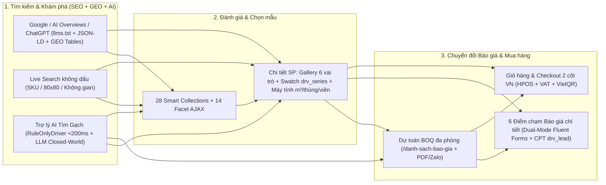

# 21. Roadmap Thực Thi Xây Dựng WordPress Theme DRAVIT (`wp-content/themes/dravit/`)

> **Nguồn chuẩn (Single Source of Truth):** Bộ tài liệu [docs/00..20](README.md), [AGENTS.md](../AGENTS.md), 12 bản mẫu giao diện tại `docs/layout/` và báo cáo kiểm toán [00_LAYOUT_AUDIT_REPORT.md](layout/00_LAYOUT_AUDIT_REPORT.md).
> **Trạng thái:** **ĐÃ PHÊ DUYỆT CHÍNH THỨC (`D-31`..`D-34` — 2026-11-11)** · Sẵn sàng triển khai tuần tự từ `Step 0` → `Step 11`.

> [!NOTE]
> **4 Quyết định kiến trúc thực thi đã khóa (`D-31` → `D-34` trong [00_Project_Brief_Decisions.md](00_Project_Brief_Decisions.md)):**
> - **`D-31` (Phương án 1A — Fluent Forms & Plugin Hybrid Adapter):** Giữ lõi tính native cho dự toán đa phòng `/danh-sach-bao-gia` (`BoqService` + chuyển đơn HPOS 1-click) đồng thời bắn hook sang Fluent Forms; 5 điểm form báo giá còn lại hỗ trợ **Dual-Mode** (`[fluentform]` hoặc Native Form) qua `Core\Integrations\FluentFormsBridge` + tầng CSS `@layer plugins`.
> - **`D-32` (Phương án 2A — Mở sẵn Full Pipeline Trợ lý AI & Bật ngay `RuleOnlyDriver`):** Dựng đầy đủ 100% Interfaces `Dravit\Advisor\*`, REST `/dravit/v1/advisor`, cắt hoàn chỉnh `01.1-ai-finder.html` và kích hoạt chạy thật ngay bằng `RuleOnlyDriver` (`< 200ms`, `0đ` phí API, lọc cứng chống trượt `R10/R11/R12`, nối thẳng BOQ); cắm API Key (`Claude` / `Gemini`) trong `drv_settings.ai` là tự nâng cấp lên LLM Closed-World.
> - **`D-33` (Phương án 3A — Unit Test Tự động Mỗi Step):** Thiết lập **PHPUnit 10 + Vitest + Shared JSON Vectors (`tests/fixtures/calc-vectors.json`) + PHPStan + WP-CLI Verify** chạy dev-only ở cuối mỗi Step (loại khỏi file `.zip` deploy production).
> - **`D-34` (Phương án S-3 — Cắt Layout Bottom-Up 4 Tầng & Mở Rộng Section Thuần Code Config-Driven):** Tách toàn bộ phần tử lặp thành `22` primitives `drv_ui()` + `16` khối lớn `drv_section()` (`template-parts/sections/*.php`). Mọi trang/section mở rộng về sau ghép bằng mảng config PHP sạch tuyệt đối (`0` Page Builder, `0` SCF/ACF; Gutenberg Block Patterns & Shortcodes chỉ dùng trong bài viết Cẩm nang).

---

## 1. Kiến trúc Hành trình Người dùng (User-Centric Flow: Tìm Gạch → AI/GEO → Báo Giá BOQ → Mua Hàng)



---

## 2. Nguyên tắc Cắt Layout Bottom-Up 4 Tầng & Mở Rộng Trang/Section Mới (`Phương án S-3` — `D-17`, `D-34`)

### 2.1. Quy tắc Cắt Layout từ Dưới Lên (Chống Trùng Lặp 100% giữa 12 File HTML)

Tuyệt đối **không cắt từng trang độc lập từ trên xuống**. Toàn bộ 12 file [01-home.html](layout/01-home.html) → [10-404.html](layout/10-404.html) được bóc tách từ hạt nhân nhỏ nhất lên thành 4 tầng độc lập:

| Tầng | Nơi chứa trong `wp-content/themes/dravit/` | Quy tắc Bất biến giúp Tái Sử Dụng Vô Hạn |
|---|---|---|
| **Tầng 1: Khung Bố cục (`.l-*`) & Design Tokens** | `assets/src/tokens/tokens.json` → `layers/{tokens,layout}.css` | **Tách hoàn toàn vị trí khỏi phần tử:** `.l-container` (`1380px`), `.l-section`, `.l-grout-grid` (lưới đường ron `1px`), `.l-split`, `.l-stack`, `.l-cluster`. Component con **cấm tự đặt `margin` ngoài hoặc `width` cứng** → thả vào lưới 4 cột Catalog, cột 3/12 Sidebar hay Drawer AJAX đều tự động vừa khít. |
| **Tầng 2: 22 Nguyên tử & Phân tử `drv_ui($name, $args)`** | `template-parts/ui/{name}.php` + `layers/components/*.css` | **1 Phần tử = 1 File PHP duy nhất toàn site:** Hợp nhất 3 bản `.drv-card` rời rạc (`01`, `01.1`, `02`), 4 hộp `.drv-summary-box` (`04`, `04.1`, `05`), 2 bảng `.drv-geo-table` (`02`, `08`), 2 lightbox (`03`, `08`), 3 form báo giá (`09`, modal, blog) về đúng 1 file nguồn ([16_Template_Component_Porting_Guide.md](16_Template_Component_Porting_Guide.md) §3.2). |
| **Tầng 3: Scoped CSS (`--_*`) & JS Tự Sống (`<drv-*>`)** | `assets/src/js/components/*.js` + `core.js` | • **CSS:** Mọi biến thể chỉ đổi biến nội bộ `--_bg`, `--_fg`, `--_pad`, `--_cols` trong `@layer components` (`.drv-card--quote`, `.drv-btn--moss`); **cấm** viết selector đè theo trang (`.blog .drv-card`, `.home .drv-btn`).<br>• **JS:** Mọi tương tác đóng gói trong **Light DOM Custom Elements** (`<drv-unit-calc>`, `<drv-qty-input>`, `<drv-filter-form>`, `<drv-size-guide>`, `<drv-showroom>`, `<drv-quote-panel>`, `<drv-ai-finder>`, `<drv-toc>`) và **Event Delegation `data-drv-action`** trên `document` → chèn vào trang mới hay trả về qua REST AJAX đều **tự kích hoạt với `0` dòng JS nối thêm**. |
| **Tầng 4: 16 Module Section Độc lập `drv_section($name, $props)`** | `template-parts/sections/{name}.php` + `config/sections.php` | Thay vì gắn chết section vào `template-parts/home/*`, mọi khối lớn được trừu tượng hóa thành **Section nhận mảng `$props` chuẩn hóa (`ViewModel`)** kèm cơ chế tự nạp CSS/JS chunk theo nhu cầu (`SectionRegistry`). |

### 2.2. Hợp đồng PHP `drv_section()` & Cơ chế Lắp ghép Trang Thuần Code (`Phương án S-3`)

Không dùng Page Builder hay SCF/ACF gây nặng DB. Mọi trang hiện tại và trang/landing page phát sinh về sau đều được định nghĩa bằng **mảng cấu hình PHP sạch, kiểm soát kiểu chặt chẽ (`strict_types=1`)**:

```php
<?php
declare(strict_types=1);

namespace Dravit\Core;

final class SectionRegistry {
    /**
     * Render 1 section chuẩn hóa: merge default props -> enqueue CSS/JS chunk riêng (nếu có) -> render view.
     *
     * @param string               $name  Tên file trong template-parts/sections/{name}.php.
     * @param array<string, mixed> $props Dữ liệu đầu vào (đã chuẩn hóa hoặc callback resolver).
     */
    public static function render(string $name, array $props = []): void {
        $definitions = require get_theme_file_path('config/sections.php');
        $meta        = $definitions[$name] ?? [];

        if (!empty($props['enabled']) || !array_key_exists('enabled', $props)) {
            if (!empty($meta['style'])) {
                Assets::enqueue_section_style((string) $meta['style']);
            }
            if (!empty($meta['script'])) {
                Assets::enqueue_section_script((string) $meta['script']);
            }
            $resolved = array_replace_recursive($meta['defaults'] ?? [], $props);
            Template::render_part('template-parts/sections/' . sanitize_file_name($name), $resolved);
        }
    }

    /**
     * Lắp ghép nguyên 1 trang từ danh sách cấu hình sections (Phương án S-3).
     *
     * @param array<int, array{section: string, props?: array<string, mixed>}> $layout
     */
    public static function render_stack(array $layout): void {
        foreach ($layout as $block) {
            self::render($block['section'], $block['props'] ?? []);
        }
    }
}

// Helper toàn cục trong inc/Core/Helpers.php:
function drv_section(string $name, array $props = []): void {
    \Dravit\Core\SectionRegistry::render($name, $props);
}
```

**Ví dụ tạo nhanh 1 trang chiến dịch / trang B2B mới về sau (`config/pages/b2b-architects.php`) chỉ trong vài dòng mà tái sử dụng 100% module gốc:**

```php
<?php
// Tạo trang mới cho Kiến trúc sư / Nhà thầu từ 100% module gốc, 0 dòng HTML/CSS viết lặp:
\Dravit\Core\SectionRegistry::render_stack([
    [
        'section' => 'hero-advisor',
        'props'   => [
            'eyebrow'     => 'Dành cho Kiến trúc sư & Tổng thầu',
            'title'       => 'Thư viện Gạch Khổ Lớn & Map 4K CAD Chuẩn Thông Số',
            'show_search' => true,
            'primary_cta' => ['label' => 'Lập bảng dự toán BOQ ngay', 'href' => home_url('/danh-sach-bao-gia')],
        ],
    ],
    ['section' => 'trust-strip', 'props' => ['variant' => 'b2b']],
    ['section' => 'product-grid-block', 'props' => ['collection' => 'da-nung-ket', 'limit' => 8, 'columns' => 4]],
    ['section' => 'geo-spec-section', 'props' => ['title' => 'Tiêu chuẩn cơ lý đá nung kết khổ lớn', 'rows' => $slab_specs]],
    ['section' => 'showroom-showcase', 'props' => ['show_booking_cta' => true]],
    ['section' => 'lead-capture-section', 'props' => ['lead_type' => 'b2b_partner', 'form_slot' => 'contact']],
]);
```

### 2.3. Danh mục 16 Module `drv_section()` Gốc Cắt từ 12 File Prototype

| Mã `drv_section()` | Cắt từ Prototype | Kết hợp các `drv_ui()` bên trong | Tái sử dụng ở các trang hiện tại & tương lai |
|---|---|---|---|
| `hero-advisor` | `01-home` S1 | `btn`, `chip`, `icon`, `badge` | Trang chủ `/`, Landing Page chiến dịch, Trang B2B |
| `trust-strip` | `07` Spec + `04` Cam kết | `icon` | Trang chủ `/`, Giỏ hàng (`04`), Trang Giới thiệu `/gioi-thieu`, Landing Page |
| `space-bento` | `01-home` S2 | `section-head`, `badge`, `icon` | Trang chủ `/`, Trang Tổng quan `/gach`, Empty Search/404 mở rộng |
| `silo-tiles-bar` | `02-catalog` S2 | `sub-silo-tile` | 28 Trang Collection, Trang Kết quả Tìm kiếm `search.php`, `404.php` |
| `product-explorer-tabs` | `01-home` S4 | `section-head`, `chip`, `product-card`, `btn` | Trang chủ `/`, Trang Bộ sưu tập mới, Landing Page theo phong cách |
| `product-grid-block` | `01` S6, `03` Related/Viewed, `04` Empty | `section-head`, `product-card`, `load-more` | Deals Trang chủ, Mẫu tương tự & Đã xem trên PDP, Giỏ rỗng, Trang chiến dịch |
| `size-r-guide` | `01-home` S5 + `07-blog` R-table | `section-head`, `chip`, `btn` + `<drv-size-guide>` | Trang chủ `/`, Chuyên mục Cẩm nang (`07`), Landing Page tư vấn chọn gạch |
| `showroom-showcase` | `01-home` S7 + `09-contact` | `section-head`, `badge`, `btn` + `<drv-showroom>` | Trang chủ `/`, Trang Giới thiệu `/gioi-thieu`, Trang Liên hệ `/lien-he` |
| `geo-spec-section` | `02-catalog` GEO + `08-blog` | `section-head`, `geo-table` | 28 Trang Collection, Bài Cẩm nang, Landing Page dòng gạch kỹ thuật |
| `faq-section` | `02-catalog` FAQ + `08-blog` | `section-head`, `faq` (tự nối `SchemaGraph`) | 28 Trang Collection, Trang Liên hệ, Trang Chính sách, Landing Page |
| `lead-capture-section` | `09-contact`, `#drv-quote-modal`, `08` Lead | `field`, `btn`, `icon` (hoặc `FluentFormsBridge`) | Trang `/lien-he`, Modal Báo giá toàn site, Banner chốt báo giá cuối trang |
| `editorial-guides` | `01-home` S8 + `07-blog` | `section-head`, `badge`, `btn` | Trang chủ `/`, Cuối trang Collection, Bài viết liên quan trên `single.php` |
| `ai-finder-workspace` | `01.1-ai-finder` | `chip`, `field`, `product-card`, `btn` + `<drv-ai-finder>` | Trang `/tro-ly-ai-tim-gach`, Drawer AI tư vấn nhanh |
| `boq-workspace` | `04.1-quote-cart` | `qty-input`, `price`, `summary-box`, `dialog`, `btn` | Trang `/danh-sach-bao-gia` |
| `contact-hub` | `09-contact` | `breadcrumb`, `copy-inline`, `lead-capture-section` | Trang `/lien-he` |
| `error-404-recovery` | `10-404` | `field` (search), `sub-silo-tile`, `btn` | Trang `404.php` & Empty State `search.php` |

---

## 3. Ma trận Tổng hợp 12 Steps × Layout Cắt × Rules × Skills × Unit Test

| Step | Tên hạng mục trọng tâm | Nguồn cắt `docs/layout/` | Docs tham chiếu | Rules (`.agents/rules/`) | Skills bắt buộc (`.agents/skills/`) | Bộ Unit Test / Check (`D-33`) |
|---|---|---|---|---|---|---|
| **Step 0** | Môi trường WP, Cấu hình Plugin (Woo/RM/FF/LSC), Khung PSR-4, Vite 6 & Test Harness | — | `00`, `02`, `06 §1-2`, `09` | `dravit-architecture`, `dravit-coding-standards`, `dravit-security-testing` | `wordpress-router`, `wp-project-triage`, `wp-wpcli-and-ops`, `wp-phpstan`, `architecture` | `composer test` (smoke), `npm test` (smoke), `npm run build` |
| **Step 1** | Design Tokens, CSS `@layer` (`+ plugins`), 22 `drv_ui()`, `SectionRegistry` (`S-3`) & Global Shell | `00-ui-kit.html`, `partials/header.html`, `partials/footer.html`, `assets/css/*` | `01`, `02 §8B`, `08`, `16 §2-4`, `19` | `dravit-frontend-ui`, `dravit-architecture`, `dravit-coding-standards` | `wordpress-theme-development`, `frontend-design`, `design-taste-frontend`, `baseline-ui`, `fixing-accessibility`, `web-performance-optimization` | `Vitest`: `core.test.js` · `PHPUnit`: `TemplateTest`, `SectionRegistryTest`, `MenuBuilderTest` |
| **Step 2** | Catalog Engine: 14 `pa_*`, 28 Smart Collections, Lõi tính `Units\Calc` & Đơn vị mua từng SP (`D-24`) | — *(Data & Admin Tab)* | `03`, `04 §1-3`, `14 §2-4`, `15 §4` | `dravit-catalog-commerce`, `dravit-coding-standards`, `dravit-architecture` | `php-pro`, `clean-code`, `wp-plugin-development`, `javascript-pro` | `PHPUnit` ⇄ `Vitest` parity (`calc-vectors.json`), `CollectionSyncTest` (8 SKU seed) |
| **Step 3** | Nền tảng GEO-SEO, Rank Math `@graph`, `/llms.txt`, Internal Links `IL-01..06` & Live Search không dấu | Search UI trong `partials/header.html` | `05 §3,6`, `06`, `15 §2.2`, `19 §4` | `dravit-filter-seo-geo`, `dravit-security-testing` | `seo-fundamentals`, `fixing-metadata`, `schema-markup`, `seo-structure-architect`, `programmatic-seo`, `wp-rest-api` | `PHPUnit`: `RobotsMatrixTest`, `CanonicalTest`, `SchemaGraphTest`, `SearchNormalizerTest` |
| **Step 4** | Mở sẵn Full Pipeline Trợ lý AI (`Dravit\Advisor\*` + Bật ngay `RuleOnlyDriver` `D-32`) & Trang AI | `01.1-ai-finder.html`, `assets/js/ai-finder.js` | `11 §3`, `12`, `13`, `15 §2.8` | `dravit-architecture`, `dravit-catalog-commerce`, `dravit-security-testing`, `dravit-frontend-ui` | `software-architecture`, `gemini-api-integration`, `prompt-engineering-patterns`, `llm-prompt-optimizer`, `backend-security-coder` | `PHPUnit`: `SlotNormalizerTest`, `SafetyRuleEngineTest`, `ValidatorTest` + `cases.yaml` |
| **Step 5** | Cắt Trang Chủ bằng `drv_section()` (`S-3`): Hero AI-First, 8 Không gian, `<drv-size-guide>` & `<drv-showroom>` | `01-home.html`, `hero-ai.js`, `size-guide.js`, `showroom.js` | `07 §3`, `08`, `10 §4.1`, `16 §1` | `dravit-frontend-ui`, `dravit-filter-seo-geo`, `dravit-catalog-commerce` | `design-taste-frontend`, `frontend-design`, `page-cro`, `fixing-motion-performance`, `animejs-animation`, `copywriting`, `avoid-ai-writing` | `Vitest`: `size-guide.test.js`, `showroom.test.js` · `PHPUnit`: `ShowroomHoursTest` |
| **Step 6** | Cắt Danh mục Silo, Bộ lọc AJAX 14 tiêu chí (1 `<form>` duy nhất), Bảng GEO & FAQ động | `02-catalog-collection.html`, `catalog-mock.js` | `05`, `06 §4,7`, `07 §4`, `15 §2.1,5.3`, `16` | `dravit-filter-seo-geo`, `dravit-frontend-ui`, `dravit-security-testing` | `wp-rest-api`, `modern-javascript-patterns`, `page-cro`, `fixing-accessibility`, `wp-performance` | `PHPUnit`: `UrlStateTest`, `QueryBuilderTest`, `FacetCounterTest` · `Vitest`: `filter-form.test.js` |
| **Step 7** | Cắt Chi tiết Sản phẩm (PDP): Gallery PhotoSwipe, Swatch `drv_series`, `<drv-unit-calc>` & Nút Báo giá/Mua | `03-product-single.html`, `unit-calc.js`, `calc-core.js` | `03 §5.3-5.4`, `04 §3`, `07 §5`, `15 §5.1`, `16` | `dravit-catalog-commerce`, `dravit-frontend-ui`, `dravit-filter-seo-geo` | `page-cro`, `frontend-developer`, `javascript-pro`, `schema-markup`, `fixing-accessibility` | `Vitest`: `unit-calc.test.js` (`U-1..U-16`) · `PHPUnit`: `SeriesSwatchTest`, `BuyNowTest` |
| **Step 8** | **Trọng tâm Báo giá:** Dự toán BOQ đa phòng, 6 Điểm chạm Lead Dual-Mode (`FluentFormsBridge` `D-31`) & `OrderConverter` | `04.1-quote-cart.html`, `09-contact.html`, `quote-sheet.js`, `#drv-quote-modal` | `14 §6`, `15 §2.5-2.6`, `17`, `16` | `dravit-catalog-commerce`, `dravit-security-testing`, `dravit-frontend-ui` | `form-cro`, `page-cro`, `backend-security-coder`, `frontend-security-coder`, `wp-rest-api`, `clean-code` | `Vitest`: `quote-store.test.js` · `PHPUnit`: `BoqServiceTest`, `AntiSpamGuardTest`, `FluentFormsBridgeTest`, `OrderConverterTest` |
| **Step 9** | Cắt Giỏ hàng, Mini-Cart Store API, Checkout 2 cột VN (VAT), Vận hành HPOS & VietQR + Emails | `04-cart.html`, `05-checkout.html`, `06-order-received.html` | `04 §4-9`, `14 §7`, `15 §3`, `18` | `dravit-catalog-commerce`, `dravit-architecture`, `dravit-security-testing` | `wordpress`, `form-cro`, `php-pro`, `backend-security-coder`, `wcag-audit-patterns` | `PHPUnit`: `CartQuantityRulesTest`, `VatValidatorTest`, `OrderFlowHposTest`, `BankQrTest` |
| **Step 10** | Cắt Cẩm nang (GEO Hub), 6 Patterns, 6 Shortcodes thương mại, `<drv-toc>`, Trang Chính sách & 404 | `07-blog-archive.html`, `08-blog-single.html`, `10-404.html` | `06 §4-7`, `07 §7-8`, `10`, `16`, `20` | `dravit-filter-seo-geo`, `dravit-frontend-ui`, `dravit-coding-standards` | `wp-block-development`, `seo-content-writer`, `avoid-ai-writing`, `schema-markup`, `fixing-accessibility` | `PHPUnit`: `TocGeneratorTest`, `BlogShortcodesTest` · `Vitest`: `toc.test.js` |
| **Step 11** | Tối ưu LiteSpeed Cache/ESI, Ngân sách Hiệu năng, Pentest OWASP, Full QA Gate & Đóng gói Release | Toàn bộ 12 templates | `08`, `09 §3-4`, `16 §5-6` | Toàn bộ 6 files `.agents/rules/dravit-*.md` | `wp-performance`, `seo-audit`, `wcag-audit-patterns`, `007`, `wordpress-penetration-testing`, `code-review-checklist` | Full Suite: PHPUnit + Vitest + PHPStan + Lighthouse CI (`≥ 90` Mobile) + `STRIP-01..26` |

---

## 4. Chi tiết Thực thi Từng Bước (Step-by-Step Execution Plan)

### STEP 0: Khởi tạo Môi trường, Hệ sinh thái Plugin, Khung Theme PSR-4 & Bộ khung Unit Test (`D-31`, `D-33`)
- **Mục tiêu:** Thiết lập môi trường WordPress `7.1.x` chuẩn xác ngay từ đầu (URL không `/` cuối, HPOS 100%, Rank Math, Fluent Forms, LiteSpeed), dựng bộ khung PSR-4 `Dravit\`, Vite 6 và hệ thống chạy Unit Test tự động cho cả PHP & JS.
- **Rules & Skills:**
  - Rules: [dravit-architecture.md](../.agents/rules/dravit-architecture.md), [dravit-coding-standards.md](../.agents/rules/dravit-coding-standards.md), [dravit-security-testing.md](../.agents/rules/dravit-security-testing.md).
  - Skills: [wordpress-router](../.agents/skills/wordpress-router/SKILL.md), [wp-project-triage](../.agents/skills/wp-project-triage/SKILL.md), [wp-wpcli-and-ops](../.agents/skills/wp-wpcli-and-ops/SKILL.md), [wp-phpstan](../.agents/skills/wp-phpstan/SKILL.md), [architecture](../.agents/skills/19_architecture/SKILL.md).
- **Tài liệu đối chiếu:** [00_Project_Brief_Decisions.md](00_Project_Brief_Decisions.md), [02_Technical_Architecture.md](02_Technical_Architecture.md) (§1–§6), [06_SEO_GEO_Spec.md](06_SEO_GEO_Spec.md) (§1–§2).
- **Hạng mục thực thi:**
  1. **WP & Plugins qua WP-CLI:** Bật `WP_DEBUG = true`, `WP_DEBUG_LOG = true`, `WP_ENVIRONMENT_TYPE = 'local'`. Cấu hình Permalink không dấu `/` cuối (`/%postname%`, Category base `chu-de`, Tag base `the`, Product permalink `/san-pham/%postname%`). Kích hoạt HPOS 100% (`woocommerce_custom_orders_table_enabled = yes`), tiền tệ `VND` (`0` số lẻ, dấu `.` phân cách nghìn, `,` thập phân), quốc gia bán duy nhất `VN`, cài đặt **Fluent Forms** (`fluentform`) và **LiteSpeed Cache** (tắt cache khi dev local), tạo các trang hệ thống với `[woocommerce_cart]` (`/gio-hang`), `[woocommerce_checkout]` (`/thanh-toan`), `/danh-sach-bao-gia`, `/tro-ly-ai-tim-gach`, `/cam-nang`, `/lien-he`, `/gioi-thieu`. Cấu hình Rank Math Free (`Remove Category Base` cho `product_cat`).
  2. **Scaffold `wp-content/themes/dravit/`:** Tạo `style.css`, `index.php`, `functions.php` (PSR-4 autoloader cho `Dravit\` → `inc/`), `inc/Core/ServiceProviderInterface.php`, `inc/Theme.php` (Container đăng ký tuần tự các module, kiểm tra an toàn `class_exists('WooCommerce')`, `defined('RANK_MATH_VERSION')`, `defined('FLUENTFORM')` để không bao giờ gây Fatal Error khi tắt/bật plugin).
  3. **Build & Unit Test Harness (`D-33`):** Cấu hình `package.json` (`vite`, `vitest`, `jsdom`, `eslint`, `stylelint`), `vite.config.js` (Lightning CSS, manifest `.vite/manifest.json`, tách entry theo template + section chunks + dynamic chunks), `composer.json` *(chỉ dùng `require-dev`: `phpunit/phpunit` ^10, `brain/monkey`, `szepeviktor/phpstan-wordpress`, `wp-coding-standards/wpcs` — loại trừ hoàn toàn `vendor/`, `tests/`, `tools/` khi đóng gói production)*.
- **Unit Tests (`Step 0`):**
  - `tests/php/BootstrapTest.php`: Kiểm tra PSR-4 autoloader, `Theme::boot()` không lỗi khi thiếu plugin bất kỳ (graceful degradation).
  - `tests/js/setup.test.js`: Kiểm tra Vitest + JSDOM nạp ES2022 modules thành công.
- **Check hoàn thành (`Gate 0` — ĐÃ HOÀN THÀNH 2026-11-12):**
  - [x] Kích hoạt theme `dravit` thành công, `debug.log` `0` warning/notice.
  - [x] `npm run build` xuất `assets/dist/.vite/manifest.json` sạch; `npm test` và `composer test` chạy xanh 100%.
  - [x] WooCommerce xác nhận HPOS đang active; Permalink không dấu `/` cuối hoạt động đúng.

---

### STEP 1: Design Tokens, CSS `@layer` (`+ plugins`), 22 `drv_ui()`, `SectionRegistry` (`S-3`) & Global Shell
- **Mục tiêu:** Xây dựng toàn bộ Tầng 1–2–3–4 của kiến trúc cắt Layout Bottom-Up (`D-17`, `D-34`): 22 UI primitives `drv_ui()`, bộ đăng ký `drv_section()` thuần code PHP (`S-3`), tầng CSS `@layer plugins` cho Fluent Forms/Rank Math, và cắt hoàn chỉnh Global Header 2 tầng + Mega Menu 4+1 + Footer.
- **Nguồn cắt Layout:** `docs/layout/00-ui-kit.html`, `docs/layout/partials/header.html`, `docs/layout/partials/footer.html`, `docs/layout/assets/css/{tokens,fonts,main,pages}.css`, `docs/layout/assets/js/core.js`.
- **Rules & Skills:**
  - Rules: [dravit-frontend-ui.md](../.agents/rules/dravit-frontend-ui.md), [dravit-coding-standards.md](../.agents/rules/dravit-coding-standards.md).
  - Skills: [wordpress-theme-development](../.agents/skills/35_wordpress-theme-development/SKILL.md), [frontend-design](../.agents/skills/39_frontend-design/SKILL.md), [design-taste-frontend](../.agents/skills/design-taste-frontend/SKILL.md), [baseline-ui](../.agents/skills/baseline-ui/SKILL.md), [fixing-accessibility](../.agents/skills/16_fixing-accessibility/SKILL.md), [web-performance-optimization](../.agents/skills/11_web-performance-optimization/SKILL.md).
- **Tài liệu đối chiếu:** [01_Brand_Design_System.md](01_Brand_Design_System.md), [08_Performance_Hosting.md](08_Performance_Hosting.md), [14_Data_Dictionary_And_Settings.md](14_Data_Dictionary_And_Settings.md) (§8), [16_Template_Component_Porting_Guide.md](16_Template_Component_Porting_Guide.md) (§2–§4), [19_Navigation_Header_Search_Spec.md](19_Navigation_Header_Search_Spec.md).
- **Hạng mục thực thi:**
  1. **Tokens & Fonts tự host (`D-28`):** Tạo nguồn `assets/src/tokens/tokens.json` sinh ra `layers/tokens.css` (container `1380px`, đủ thang màu Navy/Teal/Amber, `--bw`, z-index `20..70`) và `theme.json` cho trình soạn thảo bài viết Cẩm nang. Nạp 1 subset `.woff2` mỗi họ font (`anton-vi.woff2`, `quicksand-vf-vi.woff2`), `phosphor-subset.woff2` (~140 icon) và nén Logo sang WebP `1x/2x` (`~5KB`).
  2. **Kiến trúc CSS `@layer` & Tương thích Plugin (`D-31`):** Thiết lập thứ tự `@layer reset, tokens, base, layout, components, woo, plugins, utilities;`.
     - Trong `layers/plugins.css` (`@layer plugins`): Viết bộ skin chuẩn hóa cho **Fluent Forms** (`.fluentform .ff-el-form-control`, `.ff-btn-submit`, `.ff-el-is-error`, trạng thái thông báo), Rank Math và widget bên thứ 3 đồng bộ lưới ron `1px`, bo góc `4px–8px`, font `Quicksand` mà không dùng `!important`.
     - Quét sạch `197` mã HEX cứng (bật Stylelint `color-no-hex: true`) và khử sạch `29` dòng `!important` từ prototype (`STRIP-08`, `STRIP-09`).
  3. **Core JS & Motion Chunk:** Port `core.js` sang ES2022 module (`≤ 8KB gzip`): `Dravit.registerAction(name, handler)`, `<dialog>` focus-trap + `Esc`, Drawer/Tabs/Accordion, Toast/Copy, và dynamic `import('./motion.js')` bọc Anime.js v3.2.2 tự host (`staggerReveal`, `animateNumber`, `bounceCartBadge`). **Xóa sổ** `shell-partials.js`, `.drv-proto-bar`, và lệnh tự tiêm `ai-finder.js` toàn cục (`STRIP-01`, `STRIP-02`, `STRIP-04`).
  4. **22 UI Primitives `drv_ui()` & Khung `SectionRegistry` (`drv_section()`, `D-34`):**
     - Cắt toàn bộ 22 nguyên tử/phân tử từ `00-ui-kit.html` sang `template-parts/ui/{name}.php` (`inc/Core/Template.php`).
     - Xây dựng `inc/Core/SectionRegistry.php` + `config/sections.php` hỗ trợ `drv_section($name, $props)` và `SectionRegistry::render_stack($layout)` theo đúng **Phương án `S-3`**.
  5. **Settings API (`inc/Admin/SettingsPage.php`):** Xây dựng trang cấu hình `drv_settings` (9 tabs: Công ty, Liên hệ & Showroom, Ngân hàng VietQR, Đơn hàng & Vận chuyển, Báo giá BOQ, Trang chủ, SEO/GEO, Form & Fluent Forms Slots, Trợ lý AI) kèm helper `drv_setting($path, $default)`.
  6. **Cắt Global Shell (`header.php`, `header-minimal.php`, `footer.php`):**
     - Đảm bảo đủ 100% hook chuẩn WP (`wp_head()`, `wp_body_open()`, `wp_footer()`).
     - Tier 1 hiển thị kép **[DS Báo giá `(n)`]** + **[Giỏ hàng `(n)`]** + nút **Trợ lý AI** (`drv_setting('features.ai_enabled', true)` theo `D-32`).
     - Tier 2 + **Mega Menu 4+1 (`CollectionMenuBuilder`)** + Mobile Accordion sinh tự động từ `config/collections.php`, lưu cache `drv_mega_html`, cam kết **`0` đường link chứa `?param`**.
     - Footer 2 tầng (`.drv-footer-dock` 3 ô + 4 cột menu) & Mobile Bottom Bar 5 ô (`safe-area-inset-bottom`).
- **Unit Tests (`Step 1`):**
  - `PHPUnit`: `SettingsHelperTest`, `TemplateRenderTest` (escape attributes, biến thể `drv_ui('btn')`), `SectionRegistryTest` (merge default props, enqueue đúng CSS/JS chunk của section, skip khi `enabled => false`), `CollectionMenuBuilderTest` (`0` link chứa `?`, `0` dấu `/` cuối).
  - `Vitest`: `action-registry.test.js` (event delegation `data-drv-action`, dialog open/close/Esc, copy-inline).
- **Check hoàn thành (`Gate 1` — ĐÃ HOÀN THÀNH 2026-11-12):**
  - [x] Trang `/ui-kit` (local) render đầy đủ 22 primitives `drv_ui()`, Header 2 tầng, Mega Menu 4+1, Mobile Drawer, Footer, Fluent Forms skin đúng 100% visual của `00-ui-kit.html`; toàn bộ 6 vị trí menu (`mega_menu`, `primary_silo_nav`, `primary_utility`, `footer_col_2..4`) chỉnh sửa kéo-thả trực tiếp trong `Giao diện -> Menu` kèm Custom Fields theo `D-35`.
  - [x] `core.js` sau build gzip `6.01KB` (`≤ 8KB`); `0` request ra Google Fonts hoặc jsDelivr CDN; `0` HEX ngoài `tokens.css`; `0` `!important`; tương phản màu & ARIA đạt WCAG 2.2 AA; `PHPStan Level 6`, `PHPCS`, `PHPUnit` (`19/19`), `Vitest` (`7/7`), `ESLint`, `Stylelint` và `debug.log` sạch 100%.

---

### STEP 2: Catalog Data Engine — 14 Thuộc tính, 28 Smart Collections, `Units\Calc` & Đơn vị mua từng SP (`D-24`)
- **Mục tiêu:** Xây dựng nền móng dữ liệu ngành gạch chính xác tuyệt đối để khách tìm theo bất kỳ tiêu chí nào (kích thước, vân, bề mặt, chống trượt `R`, không gian) cũng ra đúng mẫu, và tính toán `m² ⇄ thùng ⇄ viên ⇄ kg` khớp 100% giữa Frontend và Backend.
- **Rules & Skills:**
  - Rules: [dravit-catalog-commerce.md](../.agents/rules/dravit-catalog-commerce.md), [dravit-coding-standards.md](../.agents/rules/dravit-coding-standards.md).
  - Skills: [php-pro](../.agents/skills/02_php-pro/SKILL.md), [clean-code](../.agents/skills/05_clean-code/SKILL.md), [wp-plugin-development](../.agents/skills/wp-plugin-development/SKILL.md), [javascript-pro](../.agents/skills/03_javascript-pro/SKILL.md).
- **Tài liệu đối chiếu:** [03_Catalog_Data_Model.md](03_Catalog_Data_Model.md), [04_Pricing_Units_Commerce.md](04_Pricing_Units_Commerce.md) (§1–§3), [14_Data_Dictionary_And_Settings.md](14_Data_Dictionary_And_Settings.md) (§2–§4, §9), [15_REST_API_And_JS_Contract.md](15_REST_API_And_JS_Contract.md) (§4).
- **Hạng mục thực thi:**
  1. **Seeder Taxonomies (`Catalog\Seeder` + WP-CLI `wp dravit seed-catalog`):** Khởi tạo 14 thuộc tính `pa_*` (`public => false` trừ `pa_bo-suu-tap` `/bo-suu-tap/*` và `pa_xuat-xu` `/xuat-xu/*`), nạp từ điển term chuẩn (`14 §4`: `drv_filter_label`, `drv_short_label`, `drv_swatch_hex`, `drv_icon`), taxonomy nội bộ `drv_price_band` + `drv_flag`, và 28 `product_cat` Smart Collections (`config/collections.php` với bảng `priority` chuẩn `D-27`).
  2. **Tự gán danh mục & Bảo vệ URL:** Cài đặt `Catalog\CollectionSync`, `Catalog\PrimaryCategory` (đồng bộ `rank_math_primary_product_cat`), `Catalog\SlugGuard` (chặn trùng slug 28 collections + trang hệ thống), `Catalog\SaleSync` (cron đồng bộ `gach-uu-dai` & purge LiteSpeed tag `drv_catalog`).
  3. **Lõi tính toán duy nhất (`Dravit\Units\Calc` ⇄ `assets/src/js/utils/calc.js`) & `PriceState` (`D-20`, `D-24`):**
     - Hàm thuần với `EPSILON = 1e-9`: `pieceAreaM2`, `pricePerPiece`, `calcFromM2`, `calcFromBoxes`, `calcFromPieces`, `calcCartLine`, `calcBoqSlot`, `calcVolumeDiscount`, `resolveVehicleHint`.
     - `Units\PriceState::resolve($product)`: Phân nhánh `priced | sale | quote_only | out_of_stock` + hoàn thiện `template-parts/ui/product-card.php` (xóa sạch 3 bản card lặp của prototype).
  4. **Admin Product Data Tab *"Đơn vị & Thông số"* (`Admin\ProductFields`) & Term/Attachment Fields:**
     - Cấu hình đơn vị mua trên từng SP (`D-24`): `drv_buy_units` (`m²`, `thùng`, `viên`), `drv_default_buy_unit`, `drv_round_mode` (`box` chẵn thùng vs `piece` lẻ viên), `drv_qty_min`, `drv_unit_label` (`viên` / `tấm`).
     - Kích thước/đóng gói, thông số kỹ thuật (`drv_shade`, `drv_grout_min_mm`..`drv_ai_blurb`), kệ `drv_showroom_shelf`, biến thể `drv_series`, vai trò ảnh Gallery (`drv_img_role`, `drv_img_tag`), và Term Meta SEO/GEO (`drv_h1`, `drv_intro`, `drv_geo_table`, `drv_faq`, `drv_seo_footer`).
  5. **CSV Importer Hooks & Seed 8 SKU chuẩn (`09 §3.1`):** Ánh xạ toàn bộ cột CSV WooCommerce Importer và nạp 8 SKU mẫu chuẩn + 2 SKU `quote_only`.
- **Unit Tests (`Step 2`):**
  - **Shared Parity Test (`PHPUnit` + `Vitest` cùng đọc `tests/fixtures/calc-vectors.json`):** Kiểm chứng 100% đầu ra giống hệt nhau giữa PHP và JS trên toàn bộ ca test `U-1`..`U-16` (`1,92 m² / 0,64 m² = đúng 3 viên`, làm tròn `box` vs `piece`, trạng thái `quote_only`).
  - `PHPUnit`: `CollectionSyncTest` & `PrimaryCategoryTest` (kiểm tra 8/8 SKU seed tự gán đúng 100% tập danh mục và đúng Primary Category theo `09 §3.1`, test `S-1..S-9`).
- **Check hoàn thành (`Gate 2`):**
  - [x] `composer test` & `npm test`: `CalcParityTest` và `CollectionSyncTest` (8/8 SKU) pass 100%.
  - [x] Lưu thử SKU trong WP Admin tự động tính đúng `_regular_price` (theo viên), `drv_m2_per_box`, gán đúng collections và cập nhật `rank_math_primary_product_cat` không vòng lặp.

---

### STEP 3: Kiến trúc GEO-SEO, Rank Math `@graph`, `/llms.txt` & Tìm kiếm Thông minh Không dấu
- **Mục tiêu:** Đảm bảo người mua gạch tìm trên Google, Google AI Overviews, ChatGPT/Perplexity hay gõ trực tiếp vào thanh tìm kiếm trên web (kể cả gõ không dấu, gõ mã SKU hay gõ `"gach nha tam chong tron 30 60"`) đều thấy ngay đúng sản phẩm & bảng dữ kiện kỹ thuật chuẩn.
- **Nguồn cắt Layout:** Instant Search 2 cột trong `docs/layout/partials/header.html` + trang kết quả `search.php`.
- **Rules & Skills:**
  - Rules: [dravit-filter-seo-geo.md](../.agents/rules/dravit-filter-seo-geo.md), [dravit-security-testing.md](../.agents/rules/dravit-security-testing.md).
  - Skills: [seo-fundamentals](../.agents/skills/13_seo-fundamentals/SKILL.md), [fixing-metadata](../.agents/skills/14_fixing-metadata/SKILL.md), [schema-markup](../.agents/skills/15_schema-markup/SKILL.md), [seo-structure-architect](../.agents/skills/44_seo-structure-architect/SKILL.md), [programmatic-seo](../.agents/skills/45_programmatic-seo/SKILL.md), [wp-rest-api](../.agents/skills/wp-rest-api/SKILL.md).
- **Tài liệu đối chiếu:** [05_Faceted_Filter_AJAX.md](05_Faceted_Filter_AJAX.md) (§3, §6), [06_SEO_GEO_Spec.md](06_SEO_GEO_Spec.md), [15_REST_API_And_JS_Contract.md](15_REST_API_And_JS_Contract.md) (§2.2), [19_Navigation_Header_Search_Spec.md](19_Navigation_Header_Search_Spec.md) (§4).
- **Hạng mục thực thi:**
  1. **Tích hợp sâu Rank Math SEO (`Core\Integrations\RankMathCompat` + `Seo\*`):**
     - `Seo\TrailingSlashRedirect` & `Seo\Canonical` (`D-21`): Ép 100% URL và thẻ `<link rel="canonical">` không có dấu `/` cuối; redirect `301` cho `/san-pham` → `/gach`, `/showroom` → `/lien-he`, `/product-category/...` → `/{slug}`, và `/gach?{1-param-co-collection}` → `/{slug}`.
     - `Seo\RobotsMatrix`: Hook `rank_math/frontend/robots` thực thi đúng ma trận `M-1..M-16`.
     - `Seo\SchemaGraph`: Hook `rank_math/json_ld` làm giàu `@graph` duy nhất:
       - **PDP (`Product`):** `brand = DRAVIT`, `sku`, `mpn` (không chứa mã lô), `width`/`height`/`depth` (`MMT`), `weight` (`KGM`), `additionalProperty` (Bề mặt, Chống trượt `R`, Độ hút nước, Quy cách thùng — tối ưu cho **GEO AI trích dẫn**), `Offer` (giá/viên) + `UnitPriceSpecification` (`MTK` giá/m²); **tự gỡ `Offer` khi SP ở trạng thái `quote_only`**.
       - **Collection (`CollectionPage`):** `ItemList` 24 SP trên URL sạch trang 1 + `FAQPage` sinh **chỉ từ `drv_faq` hiển thị thực tế**.
       - **Home & `/lien-he`:** `HomeAndConstructionBusiness` + `ContactPage` đọc từ `drv_settings.showrooms`.
  2. **GEO Engine (`/llms.txt` & Reusable GEO Sections):** Xây dựng `Seo\LlmsTxt` phục vụ động `/llms.txt` + hoàn thiện `drv_section('geo-spec-section')` và `drv_section('faq-section')`.
  3. **Live Search Không dấu (`Catalog\SearchIndex`, `Catalog\SearchController`, `assets/src/js/search.js`, `search.php`):**
     - Tự tạo `_drv_search_index` không dấu khi lưu SP (Tên SP, SKU, Bộ sưu tập, Kích thước `80x80`/`800x800`, Không gian, Vân gạch, Chỉ số `R`).
     - Endpoint `GET /wp-json/dravit/v1/search?q=...` (transient cache 10 phút, rate-limit IP) trả 2 cột *Danh mục Silo & Sản phẩm khớp nhất*; lazy `import('./search.js')` khi focus ô tìm kiếm.
- **Unit Tests (`Step 3`):**
  - `PHPUnit`: `RobotsMatrixTest` (`M-1..M-13`), `UrlRedirectTest` (`R-1..R-10`), `ProductSchemaTest` (`priced` vs `quote_only`), `SearchNormalizerTest` (`"Gạch lát nền Đá mờ 800x800"` → `"gach lat nen da mo 80x80"`).
  - `Vitest`: `search-combobox.test.js` (debounce, abort request cũ, keyboard navigation, chống XSS DOM rendering).
- **Check hoàn thành (`Gate 3`):**
  - [x] Toàn bộ ca test `R-1..R-10` và `M-1..M-16` pass 100%; Rich Results hợp lệ `0` lỗi, `0` trùng lặp `BreadcrumbList`.
  - [x] `/llms.txt` trả về Markdown sạch UTF-8; gõ `"da mo 800x800"` hoặc `"8801"` trả kết quả `< 150ms`.

---

### STEP 4: Mở Sẵn Full Pipeline Trợ Lý AI Tìm Gạch (`Dravit\Advisor\*`) & Bật Ngay `RuleOnlyDriver` (`D-32`)
- **Mục tiêu:** Mở sẵn 100% Interfaces, REST API, Kho tri thức ngành gạch, cắt hoàn chỉnh `01.1-ai-finder.html` thành `drv_section('ai-finder-workspace')` và **kích hoạt chạy thật ngay bằng `RuleOnlyDriver` (`< 200ms`, `0đ` phí API)** theo [13_AI_Advisor_MVP_Spec.md](13_AI_Advisor_MVP_Spec.md); sẵn sàng nâng cấp lên LLM Closed-World chỉ bằng việc điền API Key trong `drv_settings.ai`.
- **Nguồn cắt Layout:** `docs/layout/01.1-ai-finder.html`, `docs/layout/assets/js/ai-finder.js` (gỡ bỏ demo mode bar & backdrop giả theo `STRIP-05`).
- **Rules & Skills:**
  - Rules: [dravit-architecture.md](../.agents/rules/dravit-architecture.md), [dravit-catalog-commerce.md](../.agents/rules/dravit-catalog-commerce.md), [dravit-security-testing.md](../.agents/rules/dravit-security-testing.md), [dravit-frontend-ui.md](../.agents/rules/dravit-frontend-ui.md).
  - Skills: [software-architecture](../.agents/skills/18_software-architecture/SKILL.md), [gemini-api-integration](../.agents/skills/gemini-api-integration/SKILL.md), [prompt-engineering-patterns](../.agents/skills/prompt-engineering-patterns/SKILL.md), [llm-prompt-optimizer](../.agents/skills/llm-prompt-optimizer/SKILL.md), [backend-security-coder](../.agents/skills/10_backend-security-coder/SKILL.md).
- **Tài liệu đối chiếu:** [13_AI_Advisor_MVP_Spec.md](13_AI_Advisor_MVP_Spec.md) (§1–§13), [12_AI_Advisor_Strategy_Analysis.md](12_AI_Advisor_Strategy_Analysis.md), [15_REST_API_And_JS_Contract.md](15_REST_API_And_JS_Contract.md).
- **Hạng mục thực thi:**
  1. **Hệ thống Interfaces mở sẵn (`inc/Advisor/Contracts/*` — `D-32`, `D-47`):**
     - `CatalogSearchInterface` → `SnapshotSearch` + `SnapshotBuilder` (`wp-content/uploads/dravit-cache/catalog-snapshot.json`, tự dựng lại khi lưu/đổi giá/tồn kho SP, lọc `< 5ms` không tốn `WP_Query`).
     - `LlmClientInterface` → Mở sẵn 3 driver chọn trong `drv_settings.ai.provider`:
       1. **`RuleOnlyDriver` *(mặc định kích hoạt sẵn, `0đ` phí API, độ trễ `< 200ms`)*;**
       2. **`AnthropicDriver`** *(Claude Haiku/Sonnet + Prompt Caching)*;
       3. **`GeminiDriver`** *(Google Gemini Flash/Pro Structured JSON)*;
       kèm filter `drv/advisor/llm_client` để mở rộng không sửa core.
     - `ResultCacheInterface` (`TransientResultCache`) & `AdvisorLogInterface` (`CptAdvisorLogger` → CPT private `drv_ai_query`, tự xóa sau 90 ngày, ẩn PII SĐT/Email).
  2. **Closed-World Engine & Ràng buộc An toàn Cứng (`D-48`, `D-49`):**
     - Khởi tạo `config/ai-rules.php`, `config/knowledge/*.md|yaml` (`kb-quy-trinh-tu-van.yaml`, `kb-an-toan-chong-truot.md`, `kb-kich-thuoc-dien-tich.md`, `kb-hao-hut-thung.md`, `kb-tu-dien-dong-nghia.yaml`...) và `config/prompts/*.md`.
     - `SlotNormalizer`: Bóc tách tiếng Việt tự nhiên về đúng slug chuẩn `03 §2`.
     - `QueryEngine`: **Lọc cứng không bao giờ nới lỏng** cho chỉ số chống trượt `R` (`nha-tam ≥ r10`, `phong-bep ≥ r10`, `ngoai-troi / san-vuon ≥ r11`, `ho-boi ≥ r12`); chấm điểm mềm theo diện tích/ngân sách; gom nhóm `drv_series`; trộn tối đa `2/6` mẫu `quote_only`; tính sẵn số thùng/viên/`m²` qua `Dravit\Units\Calc`.
     - `ScopeGate` + `Validator` + `Fallback`: Kiểm tra mọi ID sản phẩm, con số giá/`m²`/`R` và `kb_refs[]`; tự động fallback về `RuleOnlyDriver` khi API timeout/hết hạn mức.
  3. **REST API & Cắt Giao diện `01.1-ai-finder.html` (`drv_section('ai-finder-workspace')`):**
     - Đăng ký `POST /wp-json/dravit/v1/advisor` và `POST /wp-json/dravit/v1/advisor/feedback` (fresh nonce + rate-limit `10 lượt / 10 phút / IP` + honeypot).
     - Cắt `page-templates/template-ai-finder.php` (`/tro-ly-ai-tim-gach`) gọi `drv_section('ai-finder-workspace')` + lazy chunk `assets/src/js/ai-finder.js` (`<drv-ai-finder>`, chỉ tải khi vào trang AI hoặc bấm mở Drawer AI).
     - Mỗi gợi ý render bằng chính `drv_ui('product-card')` kèm nút **[+ Đưa vào dự toán BOQ (kèm m² đã khai)]**, **[Mở trong Bộ lọc 14 tiêu chí (`context_facets.filter_url`)]** và **[Nhận báo giá chi tiết]**.
- **Unit Tests (`Step 4`):**
  - `PHPUnit`: `SlotNormalizerTest` (30 câu tiếng Việt đời thường), `SafetyRuleEngineTest` (`nha-tam`/`phong-bep`/`nguoi-gia` loại sạch `R9`), `AdvisorValidatorTest` (bắt lỗi bịa ID/giá/SĐT/prompt injection trên bộ `tests/advisor/cases.yaml`).
  - `Vitest`: `ai-finder-element.test.js` (context chips, đẩy diện tích + sản phẩm sang `QuoteStore` `drv_quote_v2`).
- **Check hoàn thành (`Gate 4`):**
  - [x] Truy cập `/tro-ly-ai-tim-gach` ở chế độ mặc định `RuleOnlyDriver`, nhập *"Tìm gạch lát nhà tắm 6m2 chống trơn cho người già dưới 400k"* trả về ngay các mẫu `≥ R10` kèm số thùng cho `6m² (+5% hao hụt)` trong `< 200ms`.
  - [x] Cắm API key LLM vào `drv_settings.ai` nâng cấp lên hội thoại LLM Closed-World mượt mà không cần sửa code.

---

### STEP 5: Cắt Trang Chủ (`01-home.html`) bằng Chuỗi `drv_section()` (`Phương án S-3`)
- **Mục tiêu:** Cắt toàn bộ 8 khối của `01-home.html` thành các `drv_section()` độc lập (`hero-advisor`, `trust-strip`, `space-bento`, `product-explorer-tabs`, `size-r-guide`, `product-grid-block`, `showroom-showcase`, `editorial-guides`) và ghép lại trong `front-page.php` qua `SectionRegistry::render_stack()`, vừa đạt chuẩn tốc độ LCP vừa sẵn sàng tái sử dụng cho mọi trang chiến dịch về sau.
- **Nguồn cắt Layout:** `docs/layout/01-home.html`, `docs/layout/assets/js/{hero-ai,size-guide,showroom}.js`.
- **Rules & Skills:**
  - Rules: [dravit-frontend-ui.md](../.agents/rules/dravit-frontend-ui.md), [dravit-filter-seo-geo.md](../.agents/rules/dravit-filter-seo-geo.md), [dravit-catalog-commerce.md](../.agents/rules/dravit-catalog-commerce.md).
  - Skills: [design-taste-frontend](../.agents/skills/design-taste-frontend/SKILL.md), [frontend-design](../.agents/skills/39_frontend-design/SKILL.md), [page-cro](../.agents/skills/46_page-cro/SKILL.md), [fixing-motion-performance](../.agents/skills/12_fixing-motion-performance/SKILL.md), [animejs-animation](../.agents/skills/37_animejs-animation/SKILL.md), [copywriting](../.agents/skills/28_copywriting/SKILL.md), [avoid-ai-writing](../.agents/skills/avoid-ai-writing/SKILL.md).
- **Tài liệu đối chiếu:** [07_UI_UX_Page_Specs.md](07_UI_UX_Page_Specs.md) (§3), [08_Performance_Hosting.md](08_Performance_Hosting.md), [10_Brand_Voice_And_Content_Guide.md](10_Brand_Voice_And_Content_Guide.md) (§4.1), [16_Template_Component_Porting_Guide.md](16_Template_Component_Porting_Guide.md).
- **Hạng mục thực thi:**
  1. Xây dựng 8 module trong `template-parts/sections/` và khai báo cấu hình tại `config/pages/home.php` (`S-3`):
     - `hero-advisor.php`: Ảnh phối cảnh `<picture>` WebP/AVIF thật làm phần tử LCP duy nhất (`fetchpriority="high"`) + Khung nhập nhu cầu/diện tích & Prompt Chips nối thẳng sang `Dravit\Advisor` (`/tro-ly-ai-tim-gach`) + CTA mở nhanh **Nhận báo giá công trình** + hiệu ứng `<canvas>` chỉ chạy desktop `≥ 1024px` sau LCP.
     - `trust-strip.php`: Dải 4 bảo chứng kỹ thuật & thương mại.
     - `space-bento.php`: Đủ **8 ô Không gian** (`pa_khong-gian`) liên kết 100% về 8 URL tĩnh (`/gach-phong-khach`... — sửa sạch link `?khong-gian=` sai của prototype).
     - `product-explorer-tabs.php`: 4 Tab Công năng + thẻ Lookbook `<dl>` thông số + sản phẩm thật qua `drv_ui('product-card')`.
     - `size-r-guide.php`: `<drv-size-guide>` (`config/size-guide.php`) ướm mật độ ron theo diện tích phòng & lọc vùng khô/ẩm (`R9–R13`).
     - `product-grid-block.php` (chế độ Deals): Lưới SP `on_sale`, tồn kho quy đổi thùng/`m²`.
     - `showroom-showcase.php`: `<drv-showroom>` đọc từ `drv_settings.showrooms`, tính trạng thái *"Đang mở cửa"* bằng PHP theo `Asia/Ho_Chi_Minh`, nút **Đặt lịch xem mẫu thật tại Showroom**.
     - `editorial-guides.php`: Bố cục `8/4` lấy bài viết Pillar thực tế từ Cẩm nang.
- **Unit Tests (`Step 5`):**
  - `PHPUnit`: `ShowroomStatusTest` (múi giờ `Asia/Ho_Chi_Minh`), `HomeSectionsConfigTest` (đảm bảo 100% URL xuất ra từ 8 sections là URL tĩnh chuẩn `03`).
  - `Vitest`: `size-guide.test.js`, `hero-prompt.test.js`.
- **Check hoàn thành (`Gate 5`):**
  - [x] Thứ tự heading chuẩn `h1 → h2 → h3`; chỉ có đúng **1** ảnh `fetchpriority="high"`; `0` ảnh Unsplash hotlink.
  - [x] Lighthouse Mobile trên `/` đạt `≥ 90`, `CLS < 0.05`.

---

### STEP 6: Cắt Danh mục Silo & Bộ lọc AJAX 14 Tiêu chí + Bảng GEO (`02-catalog-collection.html`)
- **Mục tiêu:** Giúp người mua lọc hàng trăm mẫu gạch theo 14 chiều kỹ thuật & thẩm mỹ mượt tức thì (không tải lại trang, giữ Back/Forward, chia sẻ được URL), kết hợp tái sử dụng `drv_section('silo-tiles-bar')`, `drv_section('geo-spec-section')`, `drv_section('faq-section')`.
- **Nguồn cắt Layout:** `docs/layout/02-catalog-collection.html`, `docs/layout/assets/js/catalog-mock.js`.
- **Rules & Skills:**
  - Rules: [dravit-filter-seo-geo.md](../.agents/rules/dravit-filter-seo-geo.md), [dravit-frontend-ui.md](../.agents/rules/dravit-frontend-ui.md), [dravit-security-testing.md](../.agents/rules/dravit-security-testing.md).
  - Skills: [wp-rest-api](../.agents/skills/wp-rest-api/SKILL.md), [modern-javascript-patterns](../.agents/skills/04_modern-javascript-patterns/SKILL.md), [page-cro](../.agents/skills/46_page-cro/SKILL.md), [fixing-accessibility](../.agents/skills/16_fixing-accessibility/SKILL.md), [wp-performance](../.agents/skills/wp-performance/SKILL.md).
- **Tài liệu đối chiếu:** [05_Faceted_Filter_AJAX.md](05_Faceted_Filter_AJAX.md), [07_UI_UX_Page_Specs.md](07_UI_UX_Page_Specs.md) (§4), [15_REST_API_And_JS_Contract.md](15_REST_API_And_JS_Contract.md) (§2.1, §5.3), [16_Template_Component_Porting_Guide.md](16_Template_Component_Porting_Guide.md).
- **Hạng mục thực thi:**
  1. **Backend Bộ lọc (`inc/Filters/*` + `config/facets.php`):**
     - `FacetRegistry` (14 facets chuẩn, tự ẩn giá trị trùng chiều 1 của collection hiện tại), `UrlState` (sắp xếp thứ tự chuẩn, không ghi `sort=moi-ve` mặc định), `QueryBuilder` & `FacetCounter` (transient `drv_facets_*`), `CatalogController` (`GET /wp-json/dravit/v1/catalog` hỗ trợ `fragment=grid|items|count`, trả HTML từ `drv_ui('product-card')`).
  2. **Cắt `woocommerce/archive-product.php` & `assets/src/js/catalog.js` (`≤ 15KB gzip`):**
     - Hero gọn + nút mở Trợ lý AI / Nhận báo giá theo bản vẽ; gọi `drv_section('silo-tiles-bar')` (`IL-01/02` ưu tiên URL tĩnh).
     - Sticky Toolbar (`3 ⇄ 4` cột) + **1 thẻ `<form>` `<drv-filter-form>` duy nhất trên DOM** (tự dời node vào `<dialog>` Mobile Sheet khi `< 1024px`, không nhân đôi `name`).
     - Load More `drv_ui('load-more')` kèm `<a rel="next">` + khôi phục vị trí cuộn `drv_catalog_scroll`.
     - Cuối trang gọi lại `drv_section('geo-spec-section')`, `drv_section('faq-section')`, `drv_seo_footer` và Empty State có nút **Gửi yêu cầu tìm mẫu tương tự (mở Modal Báo giá kèm tiêu chí đang lọc)**.
- **Unit Tests (`Step 6`):**
  - `PHPUnit`: `UrlStateTest` (`R-3..R-8`), `QueryBuilderTest`, `FacetCounterTest`.
  - `Vitest`: `filter-form.test.js` (`pushState`/`popstate`, `AbortController` `F-5`, 1 `<form>` duy nhất `F-13`, `aria-live`).
- **Check hoàn thành (`Gate 6`):**
  - [ ] Toàn bộ test cases `F-1`..`F-15` trong `09 §3.5` pass 100% (chạy tốt cả khi tắt JS); PSI Mobile đạt `≥ 90`.

---

### STEP 7: Cắt Trang Chi Tiết Sản Phẩm — Máy Tính Đa Đơn Vị `D-24`, Swatch SSR & Chốt Báo Giá / Mua (`03-product-single.html`)
- **Mục tiêu:** Giúp khách xem rõ từng đường vân/phối cảnh, chuyển đổi mượt giữa các kích thước/bề mặt cùng dòng gạch, nhập diện tích `m²` (hoặc số thùng/viên) để biết chính xác số thùng, khối lượng `kg`, thành tiền, và bấm 1 chạm để **Thêm vào DS Báo giá** hoặc **Mua ngay**.
- **Nguồn cắt Layout:** `docs/layout/03-product-single.html`, `docs/layout/assets/js/{unit-calc,calc-core}.js`.
- **Rules & Skills:**
  - Rules: [dravit-catalog-commerce.md](../.agents/rules/dravit-catalog-commerce.md), [dravit-frontend-ui.md](../.agents/rules/dravit-frontend-ui.md), [dravit-filter-seo-geo.md](../.agents/rules/dravit-filter-seo-geo.md).
  - Skills: [page-cro](../.agents/skills/46_page-cro/SKILL.md), [frontend-developer](../.agents/skills/38_frontend-developer/SKILL.md), [javascript-pro](../.agents/skills/03_javascript-pro/SKILL.md), [schema-markup](../.agents/skills/15_schema-markup/SKILL.md), [fixing-accessibility](../.agents/skills/16_fixing-accessibility/SKILL.md).
- **Tài liệu đối chiếu:** [04_Pricing_Units_Commerce.md](04_Pricing_Units_Commerce.md) (§3), [07_UI_UX_Page_Specs.md](07_UI_UX_Page_Specs.md) (§5), [15_REST_API_And_JS_Contract.md](15_REST_API_And_JS_Contract.md) (§5.1), [16_Template_Component_Porting_Guide.md](16_Template_Component_Porting_Guide.md).
- **Hạng mục thực thi:**
  1. Cắt `woocommerce/single-product.php`, `content-single-product.php` kết hợp `drv_ui()` & `drv_section('product-grid-block')`:
     - Gallery 6 ảnh theo `drv_img_role` + tải Map 4K/CAD + lazy `import('./lightbox.js')` dùng **PhotoSwipe 5** (`D-28`).
     - Buy-box 2 chế độ `priced` / `quote_only` (`D-20`), nút copy SKU `drv_ui('copy-inline')` nằm **ngoài** `<h1>` (`P-9`), Swatches `drv_ui('swatch')` `<a href>` SSR qua `drv_series` (`D-26`).
     - **Máy tính `drv_ui('unit-calc')` (`<drv-unit-calc>`, `D-24`):** Hiển thị các tab theo `drv_buy_units` (`m² | Thùng | Viên`), áp dụng `drv_round_mode` (`box` | `piece`) + `drv_qty_min` + hao hụt `0% / 5% / 10%` + tổng `kg` (`0` fallback dữ liệu giả `DRV-8801M`).
     - **Cụm CTA Chuyển đổi Kép (Mua lẻ + Báo giá chi tiết):**
       - SP `priced`: Form `POST` gửi số nguyên `viên` (AJAX Add-to-cart + **Mua ngay** `drv_buy_now=1` → `/thanh-toan`) + nút **[+ Thêm vào DS Báo giá]** + link **[Mua ≥ 30m²? Nhận báo giá chiết khấu công trình]** (truyền đúng `m²` vừa tính vào form báo giá).
       - SP `quote_only`: CTA chính **[Nhận báo giá chi tiết mẫu này]** + **[+ Thêm vào DS Báo giá công trình]**.
     - Bảng thông số `drv_ui('spec-table')` (`IL-03`), lưới 6 mặt vân, lưu ý thi công động, Sticky Bar 2 chế độ, và gọi lại `drv_section('product-grid-block')` cho cả *Mẫu tương tự (`IL-06`)* lẫn *Đã xem gần đây (`drv_viewed`)*.
- **Unit Tests (`Step 7`):**
  - `Vitest`: `unit-calc-dom.test.js` (`U-4..U-7`, `U-11..U-16`, `input[name="quantity"]` là số nguyên `viên`, truyền đúng `target_m2` sang `QuoteStore`, không fallback `DRV-8801M`).
  - `PHPUnit`: `SeriesSwatchResolverTest`, `BuyNowRedirectTest`, `SpecInternalLinkTest`.
- **Check hoàn thành (`Gate 7`):**
  - [ ] Toàn bộ test cases `P-1`..`P-9` trong `09 §3.6` pass 100%; tắt JS vẫn bấm *Thêm vào giỏ* và *Mua ngay* thành công.

---

### STEP 8: Trọng tâm Báo Giá & Lead — Dự toán BOQ Đa Phòng, 6 Điểm Chạm Dual-Mode (`FluentFormsBridge` `D-31`) & `OrderConverter` (`04.1` + `09`)
- **Mục tiêu:** Hoàn thiện trái tim chuyển đổi Báo giá của DRAVIT: khách lập dự toán nhiều phòng trên `/danh-sach-bao-gia`, xuất PDF/Zalo hoặc điền thông tin nhận báo giá chi tiết tại 6 điểm chạm (hỗ trợ song song Native Form siêu nhẹ và **Fluent Forms** qua `D-31`), đồng bộ 100% về Admin `drv_lead` để chuyển thành đơn HPOS trong 1 click.
- **Nguồn cắt Layout:** `docs/layout/04.1-quote-cart.html`, `docs/layout/09-contact.html`, `docs/layout/partials/footer.html` (`#drv-quote-modal`), `docs/layout/assets/js/quote-sheet.js`.
- **Rules & Skills:**
  - Rules: [dravit-catalog-commerce.md](../.agents/rules/dravit-catalog-commerce.md), [dravit-security-testing.md](../.agents/rules/dravit-security-testing.md), [dravit-frontend-ui.md](../.agents/rules/dravit-frontend-ui.md).
  - Skills: [form-cro](../.agents/skills/47_form-cro/SKILL.md), [page-cro](../.agents/skills/46_page-cro/SKILL.md), [backend-security-coder](../.agents/skills/10_backend-security-coder/SKILL.md), [frontend-security-coder](../.agents/skills/09_frontend-security-coder/SKILL.md), [wp-rest-api](../.agents/skills/wp-rest-api/SKILL.md), [clean-code](../.agents/skills/05_clean-code/SKILL.md).
- **Tài liệu đối chiếu:** [17_Quote_BOQ_And_Lead_Spec.md](17_Quote_BOQ_And_Lead_Spec.md), [14_Data_Dictionary_And_Settings.md](14_Data_Dictionary_And_Settings.md) (§6), [15_REST_API_And_JS_Contract.md](15_REST_API_And_JS_Contract.md) (§2.3–§2.6).
- **Hạng mục thực thi:**
  1. **Đồng bộ `QuoteStore` (`drv_quote_v2`) & Endpoint Hydrate `GET /dravit/v1/products`:** Dùng chung 1 module `utils/quote-store.js` cho Card, PDP, AI Finder, Giỏ hàng, Drawer `<drv-quote-panel>` và trang `/danh-sach-bao-gia`.
  2. **Cắt Trang Dự Toán BOQ Đa Phòng (`page-templates/template-quote.php` → `drv_section('boq-workspace')`):**
     - Quản lý theo Phòng/Khu vực → Vai trò ốp lát → diện tích `m²` → hao hụt `0/5/10%`; trộn mượt SP `priced` + `quote_only`; hiển thị **Chiết khấu khối lượng dự kiến (`≥ 30m²: 5%`, `≥ 100m²: 8%`)**; chia sẻ link `?quote=` Base64URL, In PDF A4 (`@media print`), Xuất CSV UTF-8 BOM, Copy Zalo, và nút `boq-to-cart`.
     - Khi gửi dự toán (`POST /dravit/v1/quote/submit`): `BoqService` tính lại 100% phía server → lưu `drv_lead` (`_drv_lead_type = boq`) → bắn `do_action('drv/lead/created', $lead_id, $payload)` đồng bộ sang Fluent Forms Entries (nếu cấu hình) để kích hoạt Webhook/Zalo/Sheets.
  3. **6 Điểm Chạm Báo Giá Chi Tiết & Cầu nối Dual-Mode `FluentFormsBridge` (`D-31`):**
     - Cắt `drv_section('lead-capture-section')` & `drv_section('contact-hub')` (`page-templates/template-contact.php` `/lien-he` từ `09-contact.html`).
     - Hỗ trợ **Dual-Mode** cho 5 slot (`quote_modal`, `pdp_consult`, `contact_page`, `showroom_booking`, `blog_inline`) trong `drv_settings.forms`:
       - Nếu Admin nhập Fluent Form ID → render `[fluentform id="X"]` với CSS `@layer plugins`, tự động bơm ngữ cảnh gạch (`drv_sku`, `drv_product_name`, `drv_area_m2`, `drv_boq_summary`, `drv_page_url`, `utm_*`) vào hidden fields và bắt hook `fluentform/submission_inserted` ghi ngược về CPT `drv_lead`.
       - Nếu để trống → render Native Form chuẩn `drv_ui('field')` gửi qua `POST /dravit/v1/lead`.
  4. **Chống Spam 5 lớp (`AntiSpamGuard`, `D-30`) & Admin `OrderConverter` HPOS:**
     - `GET /wp-json/dravit/v1/nonce` (`Cache-Control: no-store`) + Honeypot + HMAC Time-trap `≥ 3s` + Rate-limit IP (`429`) + `Origin` check.
     - Màn hình Admin `drv_lead` + Metabox chốt đơn giá dự án từng dòng + nút 1-click **"Tạo đơn hàng HPOS từ báo giá"** (`OrderConverter::convert()`).
- **Unit Tests (`Step 8`):**
  - `Vitest`: `quote-store.test.js` (đa phòng, migrate v1 → v2, Base64URL XSS guard, trộn `priced` + `quote_only`).
  - `PHPUnit`: `BoqServiceTest` (server recompute 100%), `AntiSpamGuardTest`, `FluentFormsBridgeTest` (inject hidden context + sync submission → `drv_lead`), `OrderConverterTest` (tạo `WC_Order` HPOS chuẩn xác).
- **Check hoàn thành (`Gate 8`):**
  - [ ] Toàn bộ kịch bản `Q-1`..`Q-6` (`09 §3.7B`) và luồng Dual-Mode Fluent Forms ↔ `drv_lead` ↔ `OrderConverter` HPOS hoạt động trơn tru 100%.

---

### STEP 9: Cắt Giỏ hàng, Mini-Cart Store API, Checkout 2 Cột VN (VAT), Vận hành HPOS & VietQR (`04`, `05`, `06`)
- **Mục tiêu:** Hoàn thiện luồng đặt mua trực tuyến chuẩn thị trường gạch Việt Nam: quy đổi thùng/`kg` minh bạch, gợi ý làm tròn thùng, địa chỉ 2 cấp mới, xuất hóa đơn VAT, báo cước ship sau khi xác nhận và VietQR chỉ hiển thị đúng trạng thái `on-hold`.
- **Nguồn cắt Layout:** `docs/layout/04-cart.html`, `docs/layout/05-checkout.html`, `docs/layout/06-order-received.html`.
- **Rules & Skills:**
  - Rules: [dravit-catalog-commerce.md](../.agents/rules/dravit-catalog-commerce.md), [dravit-architecture.md](../.agents/rules/dravit-architecture.md), [dravit-security-testing.md](../.agents/rules/dravit-security-testing.md).
  - Skills: [wordpress](../.agents/skills/34_wordpress/SKILL.md), [form-cro](../.agents/skills/47_form-cro/SKILL.md), [php-pro](../.agents/skills/02_php-pro/SKILL.md), [backend-security-coder](../.agents/skills/10_backend-security-coder/SKILL.md), [wcag-audit-patterns](../.agents/skills/17_wcag-audit-patterns/SKILL.md).
- **Tài liệu đối chiếu:** [04_Pricing_Units_Commerce.md](04_Pricing_Units_Commerce.md) (§4–§9), [14_Data_Dictionary_And_Settings.md](14_Data_Dictionary_And_Settings.md) (§7), [15_REST_API_And_JS_Contract.md](15_REST_API_And_JS_Contract.md) (§3), [18_Order_Ops_And_Email_Spec.md](18_Order_Ops_And_Email_Spec.md).
- **Hạng mục thực thi:**
  1. **Giỏ hàng & Mini-Cart Drawer (`Woo\StoreApiExtend`, `04-cart.html`):** Mở rộng `/wc/store/v1/cart` (0 `wc-cart-fragments`), cắt `woocommerce/cart/{cart,cart-empty}.php` (`@layer woo`) dùng chung `drv_ui('qty-input')`, `drv_ui('summary-box')`, `drv_section('trust-strip')` + nút chuyển giỏ `≥ 30m²` sang Phiếu báo giá BOQ.
  2. **Checkout 2 Cột VN + VAT (`Woo\CheckoutVN`, `05-checkout.html`):** `header-minimal.php` + `form-checkout.php` + tách riêng `review-order.php`; 34 Tỉnh/TP → Phường/Xã (`assets/data/wards/{code}.json`); SĐT VN `^0\d{9}$`; khối VAT `_drv_vat_*` (regex MST `^\d{10}(-\d{3})?$`); `QuoteShippingMethod` (*"Báo sau khi xác nhận đơn"*).
  3. **Order Received, HPOS Ops & VietQR (`06-order-received.html`, `18`):** Trạng thái `wc-cho-xac-nhan` (`15` ký tự `≤ 20`) → Admin Metabox nhập phí ship/xe/`_drv_lot_code` → xác nhận sang `wc-on-hold` (*Chờ chuyển khoản* + `BankQR` `img.vietqr.io` `DRV{id}`) hoặc `wc-processing` (COD); Action Scheduler auto-cancel đơn quá hạn; 7 mẫu Email `E1..E7`.
- **Unit Tests (`Step 9`):**
  - `PHPUnit`: `CartQuantityStepTest`, `CheckoutValidatorTest`, `OrderStatusSlugLengthTest` (`C-15`), `BankQrGuardTest` (`C-5`, `C-6`, `C-13`), `OrderSnapshotImmutabilityTest` (`U-8`).
- **Check hoàn thành (`Gate 9`):**
  - [ ] Toàn bộ ca test `C-1`..`C-15` trong `09 §3.7` pass 100% trên HPOS (`0` lệnh `get_post_meta` trên đơn hàng).

---

### STEP 10: Cắt Cẩm Nang Chọn Gạch (GEO Content Hub), Patterns/Shortcodes Bài Viết, Chính sách & 404 (`07`, `08`, `10`)
- **Mục tiêu:** Hoàn thiện chuyên mục Cẩm nang (`home.php`, `category.php`, `single.php`) với 6 Block Patterns & 6 Shortcodes thương mại dành riêng cho biên tập bài viết (`D-34`), cùng trang Chính sách `3/9`, `/gioi-thieu` (dựng bằng `drv_section()` config `S-3`) và `404.php`.
- **Nguồn cắt Layout:** `docs/layout/07-blog-archive.html`, `docs/layout/08-blog-single.html`, `docs/layout/10-404.html`.
- **Rules & Skills:**
  - Rules: [dravit-filter-seo-geo.md](../.agents/rules/dravit-filter-seo-geo.md), [dravit-frontend-ui.md](../.agents/rules/dravit-frontend-ui.md), [dravit-coding-standards.md](../.agents/rules/dravit-coding-standards.md).
  - Skills: [wp-block-development](../.agents/skills/wp-block-development/SKILL.md), [seo-content-writer](../.agents/skills/25_seo-content-writer/SKILL.md), [avoid-ai-writing](../.agents/skills/avoid-ai-writing/SKILL.md), [schema-markup](../.agents/skills/15_schema-markup/SKILL.md), [fixing-accessibility](../.agents/skills/16_fixing-accessibility/SKILL.md).
- **Tài liệu đối chiếu:** [20_Blog_Editorial_And_Content_Model.md](20_Blog_Editorial_And_Content_Model.md), [06_SEO_GEO_Spec.md](06_SEO_GEO_Spec.md) (§4–§7), [07_UI_UX_Page_Specs.md](07_UI_UX_Page_Specs.md) (§7–§8), [16_Template_Component_Porting_Guide.md](16_Template_Component_Porting_Guide.md).
- **Hạng mục thực thi:**
  1. **Cắt `home.php` (`/cam-nang`) & `category.php` (`/chu-de/{slug}`):** Bento Pillar `5/4/3`, Topic Clusters, gọi lại `drv_section('size-r-guide')` cho bảng tra cứu `R9–R13`, tìm kiếm GET server-side và phân trang `/page/{n}`.
  2. **Cắt `single.php` (`/cam-nang/{slug}`), E-E-A-T & `<drv-toc>` (`core.js + blog.js ≤ 10KB gzip`):**
     - Xóa sạch JSON-LD viết tay, microdata trùng, poll giả và ~277 dòng inline script của prototype (`STRIP-14..18`).
     - Post Meta (`Admin\PostFields`) + User Meta E-E-A-T (`Admin\UserFields` cho `BlogPosting.reviewedBy`) + `Content\Toc` (`<drv-toc>`).
  3. **6 Gutenberg Block Patterns & 6 Shortcodes Thương mại Động (dành riêng cho bài viết Cẩm nang theo `D-34`):**
     - Block Patterns cho nội dung bài viết: *Key Takeaways GEO*, *Bảng thông số GEO*, *Callout kỹ thuật*, *Pros/Cons*, *Hộp công thức tính gạch*, *FAQ bài viết*.
     - Shortcodes gọi trực tiếp `drv_ui()` từ dữ liệu sống WC: `[drv_products]`, `[drv_shop_the_look]` (`drv_ui('shop-the-look')`), `[drv_price_table]`, `[drv_lead_form]` (kết nối Dual-Mode `FluentFormsBridge`), `[drv_related_posts]`, `[drv_ai_card]`.
  4. **Cắt `404.php` (`drv_section('error-404-recovery')`), `page-templates/template-policy.php` & Trang `/gioi-thieu` (`page-templates/template-about.php` ghép từ `config/pages/about.php` qua `SectionRegistry::render_stack()` theo đúng `S-3`).**
- **Unit Tests (`Step 10`):**
  - `PHPUnit`: `TocGeneratorTest`, `ReadingTimeCalculatorTest`, `BlogShortcodeRenderTest`.
  - `Vitest`: `toc-scrollspy.test.js`.
- **Check hoàn thành (`Gate 10`):**
  - [ ] Bài viết Cẩm nang chỉ xuất duy nhất 1 `BreadcrumbList` (`/chu-de/{slug}`), dùng `BlogPosting` (`M-15`); tổng JS trên bài viết `≤ 10KB gzip`.

---

### STEP 11: Tối ưu LiteSpeed Cache/ESI, Ngân sách Hiệu năng, Bảo mật OWASP & Đóng gói Go-Live
- **Mục tiêu:** Khóa chặt hiệu năng Core Web Vitals (`Lighthouse Mobile ≥ 90`), kiểm toán bảo mật toàn diện, đối chiếu sạch danh sách gỡ bỏ `STRIP-01..26` và đóng gói bản phát hành sạch sẵn sàng đưa lên AZDIGI LiteSpeed.
- **Rules & Skills:**
  - Rules: Toàn bộ 6 files trong `.agents/rules/dravit-*.md`.
  - Skills: [wp-performance](../.agents/skills/wp-performance/SKILL.md), [seo-audit](../.agents/skills/41_seo-audit/SKILL.md), [wcag-audit-patterns](../.agents/skills/17_wcag-audit-patterns/SKILL.md), [007](../.agents/skills/08_security-007/SKILL.md), [wordpress-penetration-testing](../.agents/skills/56_wordpress-penetration-testing/SKILL.md), [code-review-checklist](../.agents/skills/21_code-review-checklist/SKILL.md).
- **Tài liệu đối chiếu:** [08_Performance_Hosting.md](08_Performance_Hosting.md), [09_Roadmap_QA_Testplan.md](09_Roadmap_QA_Testplan.md) (§3–§4), [16_Template_Component_Porting_Guide.md](16_Template_Component_Porting_Guide.md) (§5–§6).
- **Hạng mục thực thi:**
  1. **LiteSpeed Cache Orchestration (`Core\Integrations\LiteSpeedCompat`):** Gắn `X-LiteSpeed-Tag` (`drv_catalog`, `drv_prod_{id}`, `drv_global_shell`), exclude `/gio-hang`, `/thanh-toan`, `/tai-khoan`, `/wp-json/dravit/v1/nonce` (`no-store`); auto-purge khi lưu SP, lưu `drv_settings`, hoặc khi cron bắt đầu/kết thúc khuyến mãi.
  2. **Critical CSS (`≤ 14KB`) & Kiểm toán Ngân sách Bundle (`tools/check-budgets.mjs`):** Đảm bảo gzip từng entry (`core.js ≤ 8KB`, `blog ≤ 10KB`, `home ≤ 12KB`, `catalog ≤ 15KB`, `product ≤ 18KB`).
  3. **Kiểm toán Bảo mật & Tương thích Plugin:** Rà soát PHPCS `WordPress.Security` + PHPStan Level 6; kiểm thử tích hợp đồng thời **WooCommerce HPOS + Rank Math SEO + Fluent Forms + LiteSpeed Cache**.
  4. **Script Đóng gói Release (`tools/build-release.ps1`):** Chạy `composer test && npm test && npm run lint && npm run build`, xuất `dravit-theme.zip` sạch (loại bỏ `node_modules/`, `vendor/`, `assets/src/`, `tests/`, `tools/`).
- **Check hoàn thành Tổng thể (`Final Go-Live Gate`):**
  - [ ] 100% test cases trong `09_Roadmap_QA_Testplan.md` (§3.1 → §3.8) + `STRIP-01..26` đều PASS.
  - [ ] WooCommerce → Status → Templates báo **`0` outdated templates**; `debug.log` sạch 100%.
  - [ ] Lighthouse Mobile đạt **`≥ 90`** và `CLS < 0.05` trên 5 trang đại diện.

---

## 5. Kiến trúc Tương thích Hệ sinh thái Plugin (`inc/Core/Integrations/`)

| Plugin / Hệ sinh thái | Class Tích hợp trong Theme | Cơ chế Thân thiện & Không Xung đột |
|---|---|---|
| **WooCommerce (11.2+ HPOS)** | `Woo\Setup`, `Woo\Hooks`, `Woo\StoreApiExtend` | Chỉ override tối thiểu 10 templates chuẩn `@version`; giữ nguyên action hooks chuẩn (`woocommerce_before_single_product`, `woocommerce_after_add_to_cart_button`, `woocommerce_review_order_before_submit`...) cho mọi plugin mở rộng. |
| **Rank Math SEO** | `Core\Integrations\RankMathCompat`, `Seo\*` | Tương tác hoàn toàn qua filters chính thức (`rank_math/frontend/robots`, `canonical`, `json_ld`, `breadcrumb/items`) + `rank_math_primary_product_cat`; có fallback an toàn nếu tạm tắt plugin. |
| **Fluent Forms (`D-31`)** | `Core\Integrations\FluentFormsBridge` + `layers/plugins.css` | Giữ nguyên script/style của Fluent Forms trên trang có form; đồng bộ giao diện qua `@layer plugins`; tự bơm ngữ cảnh gạch (`SKU`, `m²`, `BOQ`, `UTM`) vào hidden fields và đồng bộ `fluentform/submission_inserted` về CPT `drv_lead`. |
| **LiteSpeed Cache** | `Core\Integrations\LiteSpeedCompat` | Quản lý tag purge tự động; tách trạng thái cá nhân hóa (badge giỏ, badge BOQ, SP đã xem, fresh nonce `/dravit/v1/nonce`) sang client/Store API để trang HTML cache tĩnh 100%. |
| **Plugin khác (SMTP, Pixel, Zalo...)** | `Core\Cleanup`, `Core\Assets` | `Core\Cleanup` tuyệt đối không gỡ wildcard script/style của plugin lạ; bảo toàn 100% `the_content`, `wp_head`, `wp_body_open`, `wp_footer`. |

---

## 6. Tổng kết Các Quyết Định Thực Thi Đã Chốt (`D-31` → `D-34`)

| Mã ADR | Hạng mục | Phương án đã chốt |
|---|---|---|
| **`D-31`** | Tích hợp Fluent Forms & Plugin mở rộng | **Phương án 1A:** Hybrid Adapter (`FluentFormsBridge` + `@layer plugins`) — BOQ giữ lõi tính native + đồng bộ Fluent Forms; 5 điểm form báo giá còn lại hỗ trợ Dual-Mode (`[fluentform]` hoặc Native Form). |
| **`D-32`** | Kiến trúc Trợ lý AI Tìm Gạch (`Dravit\Advisor\*`) | **Phương án 2A:** Mở sẵn 100% Interfaces + REST API + cắt hoàn chỉnh `/tro-ly-ai-tim-gach` và kích hoạt chạy thật ngay bằng `RuleOnlyDriver` (`< 200ms`, `0đ` phí API); cắm API Key (`Claude` / `Gemini`) nâng cấp tức thì lên LLM Closed-World. |
| **`D-33`** | Khung Unit Test tự động mỗi Step | **Phương án 3A:** PHPUnit 10 + Vitest + Shared JSON Vectors (`tests/fixtures/calc-vectors.json`) + PHPStan + WP-CLI Verify (dev-only, loại khỏi file `.zip` deploy). |
| **`D-34`** | Nguyên tắc cắt Layout & Mở rộng Trang/Section mới | **Phương án S-3:** Cắt Bottom-Up 4 tầng (`Tokens/.l-*` → 22 `drv_ui()` → Scoped CSS `--_*` & `<drv-*>` → 16 `drv_section()`). Mọi trang/section mới định nghĩa thuần code qua mảng config PHP (`SectionRegistry::render_stack()`), không dùng Page Builder/ACF. |
