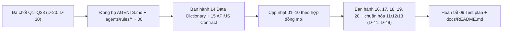

# BÁO CÁO TỔNG: Audit 12 layout prototype → Cập nhật bộ docs trước khi dev WP

> Ngày audit: 2026-11-11 · Phạm vi: `docs/layout/01…10` (12 trang) + `partials/` + `assets/{css,js}` · Đối chiếu: `docs/00…20`, `AGENTS.md`, `.agents/rules/*`
> Phương pháp: 6 luồng phân tích song song (Home/AI, Catalog, PDP, Cart→Order, Blog/Contact/Shell, Design System/Assets). Các xung đột mức High về số liệu đã được kiểm tra lại trực tiếp trong docs.

> [!NOTE]
> **TRẠNG THÁI: ĐÃ CHỐT TOÀN BỘ & ĐỒNG BỘ HOÀN TẤT (2026-11-11)**
> - Toàn bộ xung đột `X-1`..`X-7` (§1), 12 quyết định chặn code `Q1`–`Q12` (§2A) và 16 khuyến nghị mặc định `Q13`–`Q28` (§2B) đã được chủ dự án phê duyệt và ban hành thành các Quyết định kiến trúc **`D-20` → `D-30`** trong [00_Project_Brief_Decisions.md](../00_Project_Brief_Decisions.md) (dải **`D-41` → `D-49`** quy hoạch riêng cho đề xuất AI Phase 3).
> - **Quyết định riêng của chủ dự án tại `Q10` (`D-24`):** *Cấu hình đơn vị mua `m² / thùng / viên` (`drv_buy_units`, `drv_default_buy_unit`) + chế độ lẻ viên/chẵn thùng (`drv_round_mode = box | piece`, `drv_qty_min`) trực tiếp trong cài đặt từng sản phẩm* (giao dịch lõi WC giữ nguyên số nguyên `viên`, dùng chung 1 lõi tính toán `Dravit\Units\Calc` + `utils/calc.js`).
> - Bộ tài liệu `docs/00..20`, `docs/README.md`, `AGENTS.md` và toàn bộ `.agents/rules/*` đã được đồng bộ 100%.

---

## 0. Kết luận nhanh

1. Prototype đã **vượt** docs ở nhiều điểm UX (BOQ theo phòng, VAT checkout, sticky toolbar, bảng GEO, size guide, showroom, timeline đơn hàng). Docs đã được cập nhật theo prototype ở những điểm này.
2. Prototype cũng **sai** docs ở những điểm hệ thống: slug facet, URL tĩnh, robots, cách gửi số lượng vào giỏ, biến thể SKU, JSON-LD viết tay, ngân sách hiệu năng. Khi port sang WP phải giữ docs làm chuẩn ở những điểm này.
3. Có **7 xung đột nằm ngay trong docs** (giữa `AGENTS.md`, các file `03/04/05/09/11/12/13`), không phải lỗi prototype → **Đã giải quyết dứt điểm (`D-20`..`D-30`, `D-41`..`D-49`)**.
4. Hợp đồng dữ liệu tập trung (meta, `drv_settings`, REST, JS events, order meta) đã được gom vào 7 tài liệu chuyên đề mới **`14` → `20`** (§7).
5. Toàn bộ **28 quyết định (`Q1`–`Q28`)** đã được chủ dự án chốt ngày **2026-11-11** (§2A, §2B).

---

## 1. Xung đột nội bộ docs (ĐÃ XỬ LÝ — 2026-11-11)

| # | Xung đột | Bằng chứng | Giải pháp đã chốt |
|---|---|---|---|
| X-1 | **Robots khi lọc 1 tham số** | `AGENTS.md §4.3`: "1 chiều lọc → `/gach/?kich-thuoc=80x80` cho Google INDEX". `05 §6` L94: mọi param nhóm seo → `noindex, follow`; có param tech → `noindex, nofollow` | **Đã chốt (`D-21`):** Theo **05 §6** (mọi `?param` đều `noindex`). Đã sửa `AGENTS.md` §4.3 và `dravit-filter-seo-geo.md` |
| X-2 | **Slug trạng thái đơn** | AGENTS §4.4: `drv-awaiting-quote` / `drv-awaiting-transfer`. `04 §7` L187-188: `wc-cho-xac-nhan` + `on-hold` (đổi nhãn). `11`: `drv-quote-draft`. **`wc-drv-awaiting-transfer` dài 24 ký tự, vượt `varchar(20)`** của `wp_posts.post_status` và `wc_orders.status` | **Đã chốt (`D-22`):** `wc-cho-xac-nhan` (15 ký tự) + `wc-on-hold` (*Chờ chuyển khoản*). Quy tắc bất biến: mọi custom status `≤ 20` ký tự tính cả tiền tố `wc-` |
| X-3 | **Thứ tự ưu tiên Primary category** | AGENTS §4.1: "Kích thước > Công năng > Họa tiết > Không gian". `03 §3.2`: priority dạng số (vân-đá 50 > lát-nền 40). `09 §3.1`: 8801M → `gach-lat-nen`, 3605S → `gach-op-tuong`, 61209 → `gach-60x120`, SV40 → `gach-san-vuon`. **Bảng số trong 03 cho kết quả sai 4/8 SKU so với test 09** | **Đã chốt (`D-27`):** Giữ cơ chế `priority` số, cập nhật `S04 gach-san-vuon=55`, `C03 gach-op-tuong=42`, `M04 gach-van-xi-mang=42`, `M02 gach-van-da=30` (khớp 8/8 SKU) |
| X-4 | **Số ADR bị trùng** | `00` đã dùng D-20 (priced/quote). `12 §9` và `13` đề xuất D-20…D-30 với nghĩa khác (D-20 = `drv_price_state`) | **Đã chốt:** Gộp `drv_price_state` vào **`D-20`**; các quyết định Phase 1 từ đợt audit này nhận số **`D-21`..`D-30`**; các đề xuất AI Phase 3 đánh số lại thành **`D-41`..`D-49`** |
| X-5 | **Nơi lưu báo giá** | `11 §2`: PHP session/transient + WC order `drv-quote-draft` (code non-HPOS, reCAPTCHA). `04 §10` + `12/13`: CPT `drv_lead`. `00 §3`/D-20: BOQ nằm trong Phase 1, còn `11` xếp Phase 2 | **Đã chốt (`D-23`):** Lưu vào CPT private `drv_lead` (`_drv_lead_type = boq`), đặc tả tại `17_Quote_BOQ_And_Lead_Spec.md`. Đã đánh dấu `11 §2` là **DEPRECATED** |
| X-6 | **Dấu `/` cuối URL** | AGENTS ví dụ `/gach-lat-nen/`; prototype canonical có `/`; `05 §3`, `06 §1`, Silo và test R-1 (`09`): **không** có `/` | **Đã chốt (`D-21`):** Toàn site **không** có dấu `/` cuối URL (biến thể có `/` redirect `301`) |
| X-7 | **Nhóm collection** | AGENTS §4.1 ghi 6/7/6/8. `03 §3` và mega menu prototype ghi Công năng 7 / Không gian 8 / Vật liệu 7 / Kích thước 5 | **Đã chốt:** Theo **03** (7 / 8 / 7 / 5). Đã sửa `AGENTS.md` |

Lỗi docs phụ (đã sửa): `11` L1 bỏ chữ rác `firecrawl`; `02 §7` đồng bộ checkout 2 cột (`D-30`); `01` chuẩn hóa bảng token thực tế.

---

## 2. Quyết định của chủ dự án (ĐÃ CHỐT — 2026-11-11)

### 2A. Nhóm quyết định cốt lõi (12/12 ĐÃ CHỐT)

| Q | Chủ đề | Phương án đã xét | Quyết định đã chốt (2026-11-11) & ADR |
|---|---|---|---|
| Q1 | **Hero trang chủ** | A. Giữ AI-first + canvas như prototype. B. Bento 8/4 ảnh thật như `07`. C. Lai: giữ bố cục AI-first, thêm ảnh LCP `<picture>` thật; canvas chỉ chạy trên desktop, sau LCP, tắt khi bật reduced-motion | **ĐÃ CHỐT — Phương án C (`D-25`):** Hero lai AI-First + ảnh phối cảnh `<picture>` thật làm LCP (`fetchpriority="high"`); `<canvas>` chỉ chạy desktop `≥ 1024px` sau LCP, tắt khi `prefers-reduced-motion` |
| Q2 | **Phạm vi AI ở Phase 1** | A. Ẩn mọi CTA AI (`features.ai_enabled=false`), trang AI để noindex cho tới Phase 3. B. Phase 1 có finder chạy theo luật, không dùng LLM | **ĐÃ CHỐT — Phương án A (`D-25`):** Mặc định `drv_settings.features.ai_enabled = false` ở Phase 1; `/tro-ly-ai-tim-gach` để `noindex` chờ Phase 3 (`D-41`..`D-49`); BOQ vẫn chạy đầy đủ ở Phase 1 |
| Q3 | **Lưu yêu cầu báo giá/BOQ** | A. CPT private `drv_lead` (`type=boq`), có admin action "Tạo đơn từ báo giá". B. WC order status riêng | **ĐÃ CHỐT — Phương án A (`D-23`):** Lưu bản nháp tại `localStorage` (`drv_quote_v2`), khi gửi lưu vào CPT private `drv_lead` (`_drv_lead_type = boq`), server tính lại 100%, có Admin Action *"Tạo đơn hàng từ báo giá"* |
| Q4 | **Trạng thái đơn** | Chốt theo `04` (X-2) | **ĐÃ CHỐT (`D-22`):** `wc-cho-xac-nhan` (*Chờ xác nhận*, ≤ 20 ký tự) → `wc-on-hold` (*Chờ chuyển khoản*) hoặc `wc-processing` (*Đang xử lý*, COD) |
| Q5 | **Robots khi lọc 1 tham số** (X-1) | A. Theo 05: mọi param đều noindex. B. Index URL 1-param nhóm seo | **ĐÃ CHỐT — Phương án A (`D-21`):** Mọi URL có `?param` đều `noindex` (`seo` → `noindex, follow`; `tech` → `noindex, nofollow`) |
| Q6 | **Dấu `/` cuối** (X-6) | Không / Có | **ĐÃ CHỐT — Không (`D-21`):** Toàn bộ URL không dùng dấu `/` cuối; biến thể có `/` redirect `301` |
| Q7 | **Primary priority** (X-3) | Duyệt bảng số mới | **ĐÃ CHỐT (`D-27`):** `S04 gach-san-vuon=55`, `C03 gach-op-tuong=42`, `M04 gach-van-xi-mang=42`, `M02 gach-van-da=30` (khớp 8/8 SKU seed) |
| Q8 | **Wishlist** (prototype có 52 nút) | A. Bỏ ở Phase 1 (đúng `00 §3`). B. Chỉ lưu localStorage, không đếm | **ĐÃ CHỐT — Phương án A (`D-26`):** Loại bỏ hoàn toàn nút Wishlist trên toàn UI Phase 1 |
| Q9 | **Chiết khấu khối lượng 5% (≥30 m²) / 8% (≥100 m²)** | A. Chỉ hiển thị "chiết khấu dự kiến" trong BOQ, sale xác nhận sau. B. Áp vào giỏ qua `woocommerce_cart_calculate_fees`. C. Bỏ | **ĐÃ CHỐT — Phương án A (`D-23`):** Chỉ hiển thị *"Chiết khấu dự kiến"* trên BOQ (`drv_settings.quote.volume_tiers`), không tự trừ vào Giỏ hàng bán lẻ |
| Q10 | **Đơn vị mua & mua lẻ viên** | Đề xuất cũ: chỉ cấu hình `drv_qty_step`. Chủ dự án yêu cầu linh hoạt đầy đủ đơn vị mua trên từng SP | **ĐÃ CHỐT THEO QUYẾT ĐỊNH CHỦ DỰ ÁN (`D-24`):** **Cấu hình đơn vị mua `m² / thùng / viên` + chế độ lẻ viên/chẵn thùng trực tiếp trong cài đặt từng sản phẩm** (`drv_buy_units`, `drv_default_buy_unit`, `drv_round_mode = box \| piece`, `drv_qty_min`); lõi WC giữ số nguyên `viên`, dùng chung 1 lõi tính toán `Dravit\Units\Calc` + `utils/calc.js` |
| Q11 | **Biến thể màu/size/bề mặt** | A. Swatch = `<a>` tới SP anh em cùng `drv_series` (1 SKU = 1 URL, SSR). B. Đổi giá tại chỗ như prototype (SKU tự chế) | **ĐÃ CHỐT — Phương án A (`D-26`):** Swatch là thẻ `<a href>` SSR nối qua `drv_series` (cấm đổi giá/SKU giả phía client) |
| Q12 | **Phụ kiện `pack` (keo, ke ron) ở Phase 1** | A. Ẩn FBT và vật tư (D-13). B. Cho phép SKU `pack` tối thiểu | **ĐÃ CHỐT — Phương án A (`D-26`):** Ẩn khối mua kèm vật tư phụ / FBT keo-ron ở Phase 1 |

### 2B. Nhóm khuyến nghị kỹ thuật (16/16 ĐÃ CHỐT)

| Q | Chủ đề | Giải pháp đã chốt | ADR / Doc |
|---|---|---|---|
| Q13 | Icon Phosphor (3 weight, ~36KB CSS chặn render, prototype chỉ dùng 137 icon) | Tự host 1 font subset (`assets/fonts/phosphor-subset.woff2`, ~140 icon thực dùng) | **ĐÃ CHỐT (`D-28`)** |
| Q14 | Lightbox (prototype có 2 bản `<dialog>` tự viết) | PhotoSwipe 5 `import()` động dùng chung cho cả PDP và Blog | **ĐÃ CHỐT (`D-28`)** |
| Q15 | Header Tier 1 | Hiển thị cả **Giỏ hàng** (mở Mini-cart Drawer) lẫn **DS Báo giá** (badge đọc `localStorage`) | **ĐÃ CHỐT (`D-29`)** |
| Q16 | Nguồn mega menu / mobile drawer | Sinh từ `config/collections.php` + term meta (cache `drv_mega_html`, chỉ URL tĩnh) | **ĐÃ CHỐT (`D-29`)** |
| Q17 | Slug trang | `/lien-he` (`301` từ `/showroom`); chuyên mục blog `/chu-de/{slug}`; thêm `/tro-ly-ai-tim-gach`, `/danh-sach-bao-gia` vào `SlugGuard` | **ĐÃ CHỐT (`D-29`)** |
| Q18 | Facet `do-day` | Lọc theo khoảng (`mong / tieu-chuan / day`), nhãn ghi kèm mm; term mới chỉ thêm khi có SP thật | **ĐÃ CHỐT (`03`, `05`)** |
| Q19 | Tile sub-silo trên collection | Thẻ `<a>` trỏ tới URL tĩnh collection nếu có, không chứa `?param` trong shell | **ĐÃ CHỐT (`D-29`)** |
| Q20 | Nonce dưới LiteSpeed cache | `GET /wp-json/dravit/v1/nonce` (`no-store`) ngay trước khi submit + honeypot + time-trap (`≥ 3s`) + rate-limit + `Origin` | **ĐÃ CHỐT (`D-30`)** |
| Q21 | Hiển thị tồn kho trên card ("46 thùng") | Hiển thị `Còn X thùng` khi có quản lý kho; dưới ngưỡng `low_stock` hiện `"Sắp hết"` | **ĐÃ CHỐT (`04`, `07`)** |
| Q22 | VietQR | Dịch vụ ngoài duy nhất `img.vietqr.io`; **chỉ render khi đơn BACS ở trạng thái `on-hold`**; mã đơn `DRV-{id}`, nội dung QR `DRV{id}` | **ĐÃ CHỐT (`D-22`, `D-30`)** |
| Q23 | Lô/Shade | Tách bạch `drv_shade` (biến thiên màu V1–V4 trên SP) và `_drv_lot_code` (mã lô xuất kho trên dòng đơn) | **ĐÃ CHỐT (`D-30`)** |
| Q24 | Checkout | 2 cột desktop / 1 cột mobile, topbar tối giản + nhóm trường xuất hóa đơn VAT (`_drv_vat_*`) | **ĐÃ CHỐT (`D-30`)** |
| Q25 | Container | `1380px` thống nhất toàn site | **ĐÃ CHỐT (`D-28`)** |
| Q26 | Máy tính PDP | `<drv-unit-calc>` đa đơn vị theo `D-24` (`m² \| Thùng \| Viên`) + tùy chọn hao hụt `0/5/10%` + hiển thị kg | **ĐÃ CHỐT (`D-24`, `04`)** |
| Q27 | Ngân sách JS blog | Nâng từ 6KB lên `≤ 10KB gzip` | **ĐÃ CHỐT (`D-28`)** |
| Q28 | Nút "Mua ngay" | `<form method="post">` add-to-cart + `drv_buy_now=1` → chuyển thẳng `/thanh-toan` (chạy được cả khi tắt JS) | **ĐÃ CHỐT (`D-30`)** |

### 2C. Dữ liệu cần chủ dự án cung cấp (bổ sung vào `00 §7`)

| Mã | Hạng mục |
|---|---|
| O-09 | Tên pháp nhân, MST, domain email (prototype đang dùng @dravit.vn, khác gachdravit.vn), địa chỉ showroom/kho theo **đơn vị hành chính mới** (prototype vẫn ghi TP. Thủ Đức, TP. Dĩ An) |
| O-10 | Ảnh showroom thật, bao gồm cặp 3000K/6500K (slider prototype đang dùng cùng 1 ảnh cho cả 2 phía, nên nội dung so sánh là sai) |
| O-11 | SLA phản hồi thống nhất (prototype ghi lẫn 15 phút / 30 phút / 24h) |
| O-12 | Các cam kết thương mại: giữ lô 15 ngày, 1 đổi 1, đổi trả thùng dư, gửi mẫu miễn phí, Map CAD, cọc đơn liên tỉnh/>30 m², hạn chuyển khoản N ngày |
| O-13 | Tác giả và người thẩm định thật (tên, ảnh, bio) cho E-E-A-T. Không dùng tên hư cấu |
| O-14 | Link mạng xã hội, link thông báo Bộ Công Thương, danh sách từ khóa tìm kiếm phổ biến |
| O-15 | Mã vị trí kệ showroom theo SKU; bảng R tối thiểu theo không gian (bếp, nhà tắm, ban công, gara, hồ bơi) có người phụ trách kỹ thuật ký duyệt |
| O-16 | Danh sách mã tỉnh/phường chính thức (mock hiện tại sai, ví dụ `BDG` = Tây Ninh), bổ sung cho O-06 |

---

## 3. Tổng hợp theo trang (điểm chính để port)

| Trang | Template WP | Điểm giữ theo prototype | Điểm phải sửa khi port |
|---|---|---|---|
| 01 Home | `front-page.php` + `template-parts/home/*` | 8 ô không gian (đủ 8 giá trị `pa_khong-gian`), Explorer 4 tab + lookbook, `<drv-size-guide>` (chế độ mật độ ron, lọc theo vùng ẩm), `<drv-showroom>`, Guides 8/4 | Hero (Q1). Thiếu Trust Strip. Slug link sai (`mo-matt`, `nham-san`, `van-gach=da-nung-ket`, `khuyen-mai=uu-dai`). Badge mở cửa phải tính bằng PHP theo `Asia/Ho_Chi_Minh`. Ảnh hotlink Unsplash. Heading h1 nhảy thẳng xuống h3 |
| 01.1 AI Finder | `page-templates/template-ai-finder.php` | Layout split 5/7, tab mobile, context strip, refine, feedback | Phase 3 (Q2). Slot phải dùng đúng slug `pa_*`. Luật an toàn R lệch nhau giữa 2 hàm (thiếu `phong-bep`). Mặc định 25 m² tự bịa số thùng. Mode switcher và backdrop demo chỉ dùng cho prototype |
| 02 Catalog | `woocommerce/archive-product.php` + `template-parts/catalog/*` | Hero pills, tile sub-silo, toolbar sticky + nút ẩn/hiện sidebar, badge đếm mỗi nhóm, bảng GEO + FAQ, empty state có CTA Zalo, progress load more | **JS mock không ghi URL** (không có pushState). Load more là `<button>`, không có `<a rel=next>` / form no-JS. Facet bị nhân đôi (sidebar + dialog) gây trùng `name` → dùng 1 form rồi dời DOM. 8 nhóm slug sai. FAQPage JSON-LD ≠ FAQ đang hiển thị. Facet `khong-gian` vẫn hiện trên chính `/gach-phong-khach` |
| 03 PDP | `woocommerce/single-product.php` + `template-parts/product/*` | Gallery 6 ảnh có vai trò, máy tính 1 dòng, spec 8 dòng + phần mở rộng, 6 mặt vân, lưu ý `
`, sticky bar, mẫu tương tự 4×2, đã xem | Add-to-cart/Mua ngay **không gửi gì** (qty đang là chuỗi "18 viên (…)"). `quick-quote` lấy diện tích AI 25 m² thay vì m² của máy tính. Handler biến thể chạy 2 lần. JS dùng mặc định là dữ liệu DRV-8801M nếu thiếu attr (nguy hiểm). Thiếu kg, hao hụt, skip link. JSON-LD: brand sai, mpn chứa lô |
| 04 Cart | `woocommerce/cart/cart.php` + `mini-cart` | Ledger, cảnh báo lẻ viên + "Làm tròn chẵn thùng", "+1 thùng", tổng m²/thùng/kg, gợi ý xe, cam kết, empty state silo | Quy đổi và giá/viên đang ẩn trong drawer, phải luôn hiện. `cart-to-quote-panel` không có handler. Không có coupon (cần tắt chủ động). Demo bar |
| 04.1 BOQ | `page-templates/template-quote.php` | Phòng → slot → role → m², waste 0/5/10% toàn phiếu, SP quote vẫn cộng m²/kg, in A4/CSV/Zalo | **Chuỗi PDP → BOQ bị đứt** (04.1 không đọc `drv_quote_items_v1`, dùng JSON inline). Payload gửi đi là chuỗi đã format. Form thiếu honeypot/consent. Role seed không có trong `ROLE_OPTIONS` |
| 05 Checkout | `woocommerce/checkout/form-checkout.php` + `review-order.php` | Topbar tối giản, 4 block, **VAT (MST regex)**, chip ghi chú, gợi ý tuyến theo tỉnh, mobile summary + sticky CTA | Terms đang tick sẵn → bỏ. Phường tự chọn giá trị đầu → bỏ. Mã tỉnh giả. Summary custom phải nằm trong `review-order.php` (WC re-render bằng AJAX) |
| 06 Order received | `woocommerce/checkout/thankyou.php` | Timeline 4 bước, state A/B, khối VietQR, copy số tiền | QR đang render ở state A (trái test C-5). Câu "đối soát tự động 3 phút" là claim không có trong scope. Thiếu biến thể COD/cancelled. Endpoint slug `dat-hang-thanh-cong` |
| 07 Blog archive | `home.php` + `category.php` | Bento pillar 5/4/3, ranked list, topic cluster, bảng R, thanh CRO | Không có phân trang / template chuyên mục. Tìm kiếm chạy phía client. `role=tablist` đặt trên anchor |
| 08 Blog single | `single.php` + `template-parts/blog/*` + patterns/shortcodes | Key takeaways, TOC + tiến độ đọc, callout, pros/cons, GEO table, product embed, inline lead, author + reviewer | JSON-LD viết tay + microdata trùng (2 BreadcrumbList, HowTo, Article thay vì BlogPosting). Giá/tồn kho viết cứng trong bài. ~277 dòng inline script. Poll dùng số giả. Thiếu Shop the Look |
| 09 Contact | `page-templates/template-contact.php` (`/lien-he`) | 2 cột: thông tin + showroom/kho, form 5 trường | Không có backend, honeypot, consent, schema. 3 form dùng 3 schema khác nhau → gom về 1 lead schema |
| 10 404 | `404.php` | Card tối giản | Thiếu searchform + 4 thẻ silo (`07 §8`). Chưa có chính sách SP ngừng bán |
| Shell | `header.php`, `footer.php`, `template-parts/{header,footer}/*` | Tier 1/2, dropdown 3 cấp + flyout, mega 4+1 có preview, dải tiện ích, live search 2 cột, mobile drawer accordion, mobile bar 5 ô, dock 3 ô | Link menu dùng param ngoài whitelist (`?nhom=`, `?loai=`, `?van=`, `?chong-truot=`). Mega ≠ 28 collection. Số lượng SP viết cứng và lệch nhau. Desktop không có Giỏ |

---

## 4. Hợp đồng dữ liệu tổng hợp (nguồn cho docs mới 14/15)

### 4.1 Product meta mới (WC CRUD, tab "DRAVIT")
| Key | Kiểu | Dùng ở |
|---|---|---|
| `drv_color_name` | string | PDP, trục swatch `drv_series` |
| `drv_showroom_shelf` | string (vd `A-08`) | Card, PDP; khác rỗng → tự gán `drv_flag=showroom` |
| `drv_card_label` | string ≤ 20 ký tự | Chip card ("Bán chạy", "Mới 2026"); fallback tự động |
| `drv_unit_label` | enum `viên\|tấm` | Big slab |
| `drv_face_image_ids` | int[] | Lưới mặt vân |
| `drv_map_file_id` | attachment ID | Tải Map/CAD |
| `drv_bending_strength` | int N/mm² | Spec (khác `drv_breaking_strength` tính bằng N) |
| `drv_grout_min_mm`, `drv_grout_max_mm` | float | Spec, lưu ý thi công |
| `drv_stain_class` | 1–5 | Spec |
| `drv_lighting_note` | string | Spec mở rộng |
| `drv_waste_rate` | float (ghi đè) | Máy tính |
| `drv_coverage_m2_per_unit` | float | SKU `pack` (nếu Q12 = B) |
| `drv_ai_blurb` | string | Phase 3 |

Ảnh hover trên card = `gallery[0]` (theo quy ước, không thêm meta). Attachment meta: `drv_img_role` (`room\|face\|light\|grout\|showroom\|edge`), `drv_img_tag`.

### 4.2 Term meta
- `product_cat` mới: `drv_thumb_id`, `drv_geo_table` (JSON rows), `drv_tile_items`, `drv_menu_badge`, `drv_menu_desc`, `drv_home_spec`, `drv_lookbook`, `drv_quick_chips`. Giá trị tính sẵn (transient, purge khi `drv/catalog/synced`): `price_min_m2`, `count`, `has_showroom`.
- `pa_*`: `drv_filter_label` (vd "R10: Bếp, nhà tắm…"), `drv_short_label` (tag trên card), `drv_swatch_hex` (`pa_mau-sac`), `drv_icon` (`pa_hinh-dang`).

### 4.3 Blog / User meta
- Post: `drv_reading_time`, `drv_key_takeaways`, `drv_toc_enabled`, `drv_related_collections` (term_id[]), `drv_related_posts`, `drv_reviewer_id`, `drv_reviewed_at`, `drv_ai_prompts`, `drv_is_pillar`.
- User: `drv_job_title`, `drv_credentials`, `drv_avatar_id`, `drv_same_as[]`.

### 4.4 CPT `drv_lead` (private, đúng D-07 vì không tạo bảng riêng, nhưng phải ghi ADR)
- `type`: `contact | quote_modal | boq | sample | showroom_visit | pdp | catalog | ai`.
- Meta: `_drv_name, _drv_phone, _drv_email, _drv_province, _drv_area_m2, _drv_role (chu-nha/nha-thau/kts/dai-ly), _drv_project, _drv_message, _drv_product_id, _drv_boq (JSON snapshot do server tính lại), _drv_quote_code, _drv_total_m2, _drv_total_kg, _drv_grand_estimate, _drv_post_id, _drv_page_url, _drv_utm, _drv_ip_hash, _drv_consent_at, _drv_status (new/contacted/quoted/won/lost), _drv_converted_order_id`.

### 4.5 Đơn hàng (HPOS CRUD)
- Order meta: `_drv_ward_code`, `_drv_vat_required/_company/_tax_id/_address/_email`, `_drv_total_m2`, `_drv_total_kg`, `_drv_transfer_ref` (`DRV{id}`, chỉ gồm chữ số), `_drv_confirmed_at/_by`, `_drv_ship_vehicle`, `_drv_ship_note`, `_drv_paid_at`, `_drv_source_lead_id`. Hiển thị số đơn `DRV-{id}` qua filter `woocommerce_order_number`.
- Order item: 6 key snapshot hiện có + `_drv_boxes`, `_drv_loose_pieces`, `_drv_kg`, `_drv_kg_per_box`, `_drv_m2_input`, `_drv_waste_pct`, `_drv_lot_code`.
- Cart item data: `drv_m2_input`, `drv_waste_pct`.

### 4.6 `drv_settings` (mở rộng `02 §11`)
`contact` · `company` · `social` · `showrooms[]` (type showroom/warehouse, giờ mở cửa có cấu trúc, lat/lng, maps_url, zones, parking, cover, features) · `bank` · `order` (waste_default, waste_options, transfer_due_days, vehicle_thresholds, shipping_zone_hints, sla_text) · `quote` (notify_emails, max_items, volume_tiers) · `home` (hero, spaces, explorer, deals, guides) · `catalog` (per_page=24, new_badge_days, bestseller_threshold) · `pdp` (perks[4], note_templates có token `{shade}` `{grout}`) · `blog` (popular_ids) · `search` (popular_keywords) · `404_collections` · `features` (ai_enabled) · `seo` (llms_intro, sameAs).

### 4.7 Endpoint
| Method | Path | Ghi chú |
|---|---|---|
| GET | `/dravit/v1/catalog` | Bổ sung theo prototype: `fragment=count`, `active[]`, `facets.*.values[].{swatch,disabled,href}`, `items[]` JSON (tùy chọn, dùng cho GA4/quote) |
| GET | `/dravit/v1/search` | `{silos[], products[], total, view_all}`, q ≥ 2 ký tự, transient 10 phút |
| GET | `/dravit/v1/products?include=&search=&size=` | Hydrate dữ liệu cho BOQ picker, quote panel, sản phẩm đã xem (thay cho `DRAVIT_PRODUCTS` và `#qs-catalog`) |
| POST | `/dravit/v1/quote/submit` | Server tính lại toàn bộ, max items, honeypot, rate-limit |
| POST | `/dravit/v1/lead` | Lead hợp nhất, trả `201 / 422 {fields} / 429` |
| GET | `/dravit/v1/nonce` | no-cache (Q20) |
| — | WC Store API `cart`, `add-item`, `update-item`, `remove-item` + ExtendSchema `drv` | Mini-cart, badge (không dùng `wc-cart-fragments`) |
| — | `assets/data/wards/{code}.json` | Tĩnh |
| POST | `/dravit/v1/advisor`, `/advisor/feedback` | Phase 3 |

### 4.8 Hợp đồng JS
- Custom elements: `drv-unit-calc`, `drv-qty-input`, `drv-filter-form`, `drv-size-guide`, `drv-showroom`, `drv-quote-panel`, `drv-ai-finder` (Phase 3), `drv-toc` (mới). Bỏ `drv-site-header/footer` vì chỉ dùng cho dev.
- Events: `drv:error`, `drv:calc-change`, `drv:quote-updated`, `drv:cart-updated` (mới).
- Storage: gom thành `drv_quote_v2` (`[{product_id, sku, pieces, target_m2, waste, room?, role?}]`, có migrate từ v1), `drv_ai_context_v1`, `drv_viewed` (tối đa 8 ID).
- 35 `data-drv-action`: chuyển sang registry `Dravit.registerAction(name, fn)`. Gom `quote-add` / `quote-add-item` / `data-quick-quote` / `data-add-quote` thành **một action duy nhất**.
- Số lượng gửi server luôn là **số nguyên viên** (`data-drv-qty-pieces`) kèm `data-product-id`.
- Chỉ giữ **một** lõi tính toán `calc-core` (JS) + mirror PHP `Dravit\Units\Calc` chạy chung bộ test. Hiện đang có 3 bản trôi nhau (`calc-core`, `ai-finder.calculateTileUnits`, `quote-sheet`) và 2 bộ ngưỡng gợi ý xe khác nhau.

---

## 5. Hiệu năng: baseline đo trên prototype (gzip, chưa minify)

| Trang | JS hiện tại | Ngân sách `08` | CSS hiện tại | Ngân sách |
|---|---|---|---|---|
| Home | **101KB** | 12 | 63 + Phosphor ~36 | 34 |
| Catalog | 88 | 15 | 63 + 36 | 36 |
| PDP | 75 | 18 | 63 + 36 | 36 |
| Blog | 77 | 6 | 63 + 36 | 29 |
| Cart/Checkout | ~75 + jQuery của WC | ≤10 | 63 + 36 | 30 |

Nguyên nhân chính:
- `core.js` tự chèn `ai-finder.js` (23.5KB) vào mọi trang.
- `pages.css` 298KB raw nạp toàn site.
- Phosphor nạp đủ 3 weight.
- Font tải 6 subset (~122KB), không có preload.
- Google Fonts JetBrains Mono (vi phạm `08 §5`).
- Logo PNG 220KB hiển thị ở kích thước 150×44.
- Có 12 ảnh `fetchpriority=high`.
- 29 `!important`, 197 HEX cứng; layer `woo` khai báo nhưng rỗng.

Phân chia entry Vite đề xuất:
- CSS: `critical-{tpl}` inline ≤14KB · `global` · `home` · `catalog` · `product` · `cart` + `checkout` (`@layer woo`) · `quote` · `blog` · `ai` (lazy).
- JS (ES module): `core` ≤8KB · `home` · `catalog` · `search` (lazy) · `product` · `cart` · `checkout-vn` · `order` · `quote` (lazy) · `blog` · `ai-finder` (lazy) · `motion` + anime (lazy).

---

## 6. Kế hoạch cập nhật từng doc hiện có

| Doc | Nội dung cập nhật chính |
|---|---|
| **AGENTS.md** + `.agents/rules/*` | Sửa X-1, X-2, X-3, X-6, X-7. Thêm CPT `drv_lead` vào §3.4. Thêm quy tắc slug status ≤ 20 ký tự. Thêm quy tắc qty = số nguyên viên. Rule frontend: `--r-pill` cho chip. Rule security: guard cho `/lead`, `/quote/submit` |
| **00** | Xử lý X-4 (đánh số lại). ADR D-30+ cho các quyết định §2A/2B đã chốt. Sửa D-19 (liệt kê hiệu ứng được phép; bỏ glass-shine). Bổ sung O-09…O-16. Mở rộng thuật ngữ (BOQ, Lead, Shade ≠ Lô) |
| **01** | Container 1380. Bảng màu thực tế (navy 950→300, teal 50→800, amber 600, `*-bg`, backdrop). Đánh dấu alias legacy `--c-moss-*`, `--c-brand-sale` là deprecated. Spacing nửa bậc. Thang z-index + token header (68/44, compact). Radius `xs/lg`, `--focus-ring`. Spec component mới: stepper, summary-box, steps, copy-inline, swatch, geo-box, callout, key-takeaways, footer-dock, r-badge. Quy định canvas/hero tối (nếu Q1 = A/C) |
| **02** | Cây thư mục mới: `inc/{Quote,Leads,Content,Home,Core/Menu}`, `Woo/{OrderMeta,StoreApiExtend}`, `Units/Calc`. `template-parts/{home,cart,checkout,order,quote,blog,ai}`. Whitelist có cột Nguồn (`img.vietqr.io`, Phosphor subset, Anime tự host). Checkout 2 cột. Entry Vite mới + quy tắc dynamic import. Cấm classic script/inline script. Registry action, events, storage. `drv_settings` trỏ sang doc 14 |
| **03** | §2: bảng term đầy đủ có `filter_label` / `short_label` / `hex` (hoặc tách sang doc 14). Sửa priority (X-3). §5.1 thêm meta mới (§4.1). §5.3 Gallery (vai trò, thứ tự, ảnh LCP). §5.4 `drv_series` (các trục, ma trận thưa). Công thức tên SP. §6 term meta mới. `drv_shade` ≠ lô. Reserved slug thêm `tro-ly-ai-tim-gach`, `lien-he`, `danh-sach-bao-gia` |
| **04** | §2.2 card: công thức tồn kho theo thùng/m², % giảm; SP quote không có chip %. §3 máy tính theo Q26 + DOM contract `<drv-unit-calc>` + bỏ fallback. §4 cart line theo prototype, gợi ý xe, tắt coupon, cart item data, snapshot mới. §4.1 Add-to-cart / Buy now / Store API. §5.1 VAT, `_drv_ward_code`, bỏ autoselect, bỏ prechecked, override `review-order.php`. §7 bảng order meta, auto-cancel đơn chờ CK (Action Scheduler), trigger email cho custom status. §8 điều kiện render QR. §9 thank-you state A/B/COD. §10 chuyển sang doc 17. §12 chiết khấu khối lượng (Q9) |
| **05** | Sửa toàn bộ slug ví dụ theo 03. Thứ tự UI 13 nhóm + showroom đặt đầu, 3 nhóm mở sẵn. Sort chốt `moi-ve`, mặc định không ghi vào URL. `showroom=1`. Tách R12/R13. REST bổ sung (§4.7). 1 form chung desktop/mobile. Bảng DOM hooks. Ẩn facet trùng chiều 1 (ví dụ cụ thể) |
| **06** | Title ≤ 60 ký tự (collection, PDP). FAQPage chỉ lấy từ FAQ đang hiển thị. ItemList 24 SP. Product: brand=DRAVIT, không đưa lô vào mpn, thêm width/height/depth/weight/priceValidUntil. Blog = BlogPosting + reviewedBy, không HowTo, cấm microdata. ContactPage + LocalBusiness từ `showrooms`. IL-02/IL-03/IL-05 định nghĩa lại đích link (chỉ URL tĩnh). Trang AI, `?quote=` và `?ai_query=` để noindex. Breadcrumb blog qua `/chu-de/`. Bổ sung sự kiện GA4 |
| **07** | Viết lại §2.1 header (Tier 1/2, Giỏ + DS Báo giá, search 2 cột), §2.2 footer + dock, §3 home theo Q1 (S5/S7 tương tác mới, S6 copy). §3A trang AI Finder. §4 catalog wireframe mới + card anatomy (`drv_card_label`, kệ, ảnh hover, `--priced/--quote`, Tạm hết, h3) + drawer + empty. §5 PDP theo prototype + swatch link + sticky quote. §6 tách 6.1 Cart / 6.2 Mini-cart / 6.3 BOQ / 6.4 Checkout / 6.5 Thank-you. §7 blog 8 section + catalog block. §8 contact + 404 đầy đủ. Ghi rõ phần chỉ có trong prototype (demo bar, mode switch) |
| **08** | Bảng baseline §5. Font: 1 subset vi+latin mỗi họ + preload. Phosphor subset. Logo WebP. Chỉ 1 ảnh LCP. Cache fragment mega `drv_mega_html`. Cache search. Chiến lược nonce + ESI. Purge khi KM bắt đầu/kết thúc. Ma trận asset có thêm cột home/quote/ai |
| **09** | Phase 1 bổ sung: port checklist + bảng loại bỏ (doc 16). Test mới: PDP qty là số nguyên; quote chain PDP → BOQ → submit; Q-1…Q-6 BOQ; C-12 VAT, C-13 QR, C-14 auto-cancel; R an toàn theo không gian; crawl 0 link `?param` trong shell; 1 BreadcrumbList; FAQPage = FAQ hiển thị; lead spam (honeypot, 429, submit sau 24h vẫn được); search không dấu + SKU; calc PHP = JS cho 8 SKU; slug status ≤ 20 |
| **10** | Mở rộng từ cấm: "tuyệt đối", "vĩnh viễn", "quốc dân", "nguy nga", "100%", "đỉnh cao". SLA ghi "trong giờ làm việc". Dấu thập phân phẩy. Không em-dash. Giải nghĩa thuật ngữ Anh. Cấm số liệu tự đặt. Bảng microcopy shell/form/404/CTA thống nhất ("Thêm vào giỏ", "Liên hệ báo giá") |
| **11** | Xóa `firecrawl`. Đánh dấu §2 là deprecated (chuyển sang doc 17). Sửa code sang HPOS. Bỏ reCAPTCHA và PHP session. Chỉ giữ phần AI |
| **12 / 13** | Đánh số lại ADR (X-4). Slot list chuẩn theo `pa_*`. `phong-bep` ≥ R10. REST bổ sung `context_facets`, `match_score`, `stock_label`, feedback. Thay chữ "DCOF" bằng "Chống trượt R" |
| **README** | Thêm 11–13 (đang thiếu) và 14–20. Cập nhật thứ tự ưu tiên tài liệu |

---

## 7. Danh mục 7 tài liệu hợp đồng mới (ĐÃ BAN HÀNH)

| File chính thức | Mục đích | Nội dung cốt lõi |
|---|---|---|
| [14_Data_Dictionary_And_Settings.md](../14_Data_Dictionary_And_Settings.md) | **Nguồn duy nhất** cho mọi key dữ liệu | Product / attachment / term (`product_cat`, `pa_*`) / post / user meta · CPT `drv_lead` · order + order item + cart item meta · schema `drv_settings` · từ điển term facet · CSV mapping · `drv_db_version` migrate |
| [15_REST_API_And_JS_Contract.md](../15_REST_API_And_JS_Contract.md) | Hợp đồng server ↔ client | Toàn bộ REST `dravit/v1/*` · Store API + ExtendSchema · chiến lược `/nonce` · custom elements `<drv-*>` · registry `data-drv-action` · `data-*` contract card/calc/catalog · events `drv:*` · storage keys (`drv_quote_v2`) · GA4 events |
| [16_Template_Component_Porting_Guide.md](../16_Template_Component_Porting_Guide.md) | Hướng dẫn port prototype → WP | Map 12 trang → template WP/WC · map partials → `header.php` / `footer.php` / `template-parts/*` · catalog `drv_ui()` · **danh sách loại bỏ** (proto-bar, demo bars, mock, inline script, glass-shine, Google Fonts) · checklist a11y/perf |
| [17_Quote_BOQ_And_Lead_Spec.md](../17_Quote_BOQ_And_Lead_Spec.md) | Thay `11 §2` và `04 §10` | Scope Phase 1 · data model `localStorage` `drv_quote_v2` · luật tính (waste, `drv_round_mode`, SP `quote`, chiết khấu dự kiến) · entry points · `/danh-sach-bao-gia` + `<drv-quote-panel>` · lead schema hợp nhất · chống spam · Admin *"Tạo đơn hàng từ báo giá"* |
| [18_Order_Ops_And_Email_Spec.md](../18_Order_Ops_And_Email_Spec.md) | Vận hành đơn HPOS | State machine (`wc-cho-xac-nhan` ≤ 20 ký tự → `on-hold` / `processing`) · màn admin HPOS · Action Scheduler (auto-cancel đơn chờ CK) · hủy/hoàn kho · email templates + khối VietQR chỉ ở `on-hold` |
| [19_Navigation_Header_Search_Spec.md](../19_Navigation_Header_Search_Spec.md) | Shell & Tìm kiếm | Header 2 tầng (Giỏ + DS Báo giá) · Mega Menu 4+1 từ `config/collections.php` (`drv_mega_html`) · walkers · live search không dấu · mobile drawer/bar/dock · a11y bàn phím/Esc |
| [20_Blog_Editorial_And_Content_Model.md](../20_Blog_Editorial_And_Content_Model.md) | Cẩm nang | Taxonomy `/chu-de/{slug}` · post/user meta · block styles + patterns + shortcodes (`[drv_products]`, `[drv_price_table]`, `[drv_lead_form]`, `[drv_related_posts]`, `[drv_shop_the_look]`, `[drv_ai_card]`) · TOC / reading time · checklist E-E-A-T |

---

## 8. Trạng thái thực thi đồng bộ tài liệu

> [!IMPORTANT]
> **Hoàn tất ngày 2026-11-11:** Toàn bộ quyết định §2A–§2B (bao gồm quyết định `Q10` của chủ dự án tại `D-24` về cấu hình đơn vị mua `m² / thùng / viên` + chế độ lẻ viên/chẵn thùng trên từng sản phẩm) đã được đồng bộ xuyên suốt vào `docs/00..20`, `docs/README.md`, `AGENTS.md` và `.agents/rules/*`. Hệ thống tài liệu đã sẵn sàng 100% để triển khai code Phase 1.
