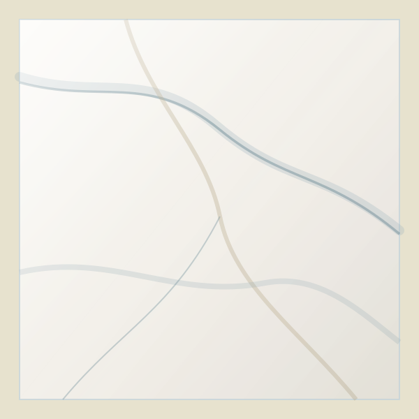

# Review & Gap Analysis — Đánh giá Layout hiện tại vs. Quote Builder & AI Tile Finder

> **Ngày review:** 2026-11-09
> **Phạm vi:** Đánh giá 11 HTML prototypes trong `docs/layout/` so với yêu cầu của `docs/11_AI_Quote_System_Spec.md`
> **Reviewer:** Claude Sonnet 4.5

---

## 1. Tóm tắt Executive Summary

### 1.1 Phát hiện chính

| Hạng mục | Trạng thái | Mức độ sẵn sàng |
|---|---|---|
| **Quote Builder (Tính năng 1)** | ✅ Foundation hoàn thiện 85% | **CÓ thể triển khai ngay Phase 2** |
| **AI Tile Finder (Tính năng 2)** | ⚠️ Cần bổ sung UI components | Triển khai Phase 3 sau khi hoàn thiện Phase 2 |
| **Kiến trúc Component** | ✅ Đã đúng D-17 (4 layers) | Tái sử dụng tốt, cần extend thêm |
| **Performance & Motion** | ✅ Option A+B đã áp dụng | Anime.js sẵn sàng cho interactive widgets |

### 1.2 Kết luận

**Layout hiện tại ĐÃ SẴN SÀNG 80-85%** cho Quote Builder (Tính năng 1).

**Gap chính:**
1. Chưa có Quote Panel Sidebar (offcanvas drawer) → Cần tạo mới
2. File `04.1-quote-cart.html` là BOQ cho B2B, chưa phải Quote Builder cho B2C
3. Chưa có AI Chat Widget UI → Cần thiết kế mới cho Phase 3
4. Chưa có REST API mockup / stub trong JS

**Điểm mạnh:**
- ✅ Product Card đã có giá kép đ/m² & đ/viên
- ✅ `<drv-unit-calc>` hoạt động tốt, có thể tái sử dụng
- ✅ Dialog/Drawer infrastructure sẵn sàng
- ✅ Form validation & CTA patterns nhất quán
- ✅ Mobile-first responsive đã chuẩn

---

## 2. Phân tích Chi tiết Từng Layout

### 2.1 Trang Chủ (`01-home.html`)

**Đánh giá hiện tại:** ⭐⭐⭐⭐⭐ (5/5)

**Điểm mạnh:**
- ✅ Hero Bento + Quick Finder form hoạt động tốt
- ✅ Section 4 (Catalog Explorer) đã có pattern tabs + product grid phù hợp cho AI results
- ✅ Trust strip + Showroom section → tăng conversion

**Cần bổ sung cho Quote Builder:**
1. **Floating Quote Panel Trigger (Mobile FAB)**
   - Thêm nút tròn sticky bottom-right: `[📋 Báo giá (3)]`
   - Hover desktop: mini preview số items

2. **AI Tile Finder Entry Point (Section mới)**
   - Đặt sau Section 1 Hero, trước Section 2 Trust Strip
   - Component: `<drv-ai-finder-teaser>` (CTA mở chat widget)
   - Copy: *"Chưa biết chọn gạch nào? Hỏi AI tư vấn miễn phí"*
   - Icon: ✨ Sparkle (Phosphor `ph-sparkle`)

**Code mẫu bổ sung:**

```html
<!-- INSERT SAU SECTION 1 (HERO), TRƯỚC SECTION 2 (TRUST) -->
<section class="l-section l-section--ai-teaser" aria-labelledby="ai-finder-title">
  <div class="l-container">
    <div class="drv-ai-teaser">
      <div class="drv-ai-teaser__icon" aria-hidden="true">
        <i class="ph ph-sparkle drv-icon--lg u-text-teal"></i>
      </div>
      <div class="drv-ai-teaser__content">
        <h2 id="ai-finder-title" class="drv-ai-teaser__title">
          Chưa biết chọn gạch nào phù hợp?
        </h2>
        <p class="drv-ai-teaser__sub">
          AI của DRAVIT sẽ gợi ý sản phẩm dựa trên không gian, ngân sách và sở thích của bạn — chỉ trong vài giây.
        </p>
      </div>
      <button
        type="button"
        class="drv-btn drv-btn--teal"
        data-drv-action="ai-finder-open"
      >
        <i class="ph ph-chat-circle-dots drv-icon--xs" aria-hidden="true"></i>
        <span>Hỏi AI ngay (Miễn phí)</span>
      </button>
    </div>
  </div>
</section>
```

### 2.2 Danh Mục Silo (`02-catalog-collection.html`)

**Đánh giá hiện tại:** ⭐⭐⭐⭐½ (4.5/5)

**Điểm mạnh:**
- ✅ Filter sidebar + Active chips + Product grid hoàn chỉnh
- ✅ Load More button → có thể convert thành infinite scroll
- ✅ SEO footer + FAQ accordion

**Cần bổ sung cho Quote Builder:**
1. **CTA "Thêm vào báo giá" trên Product Card**
   - Vị trí: Cạnh nút "Xem chi tiết", icon `ph-file-plus`
   - Variant: `drv-btn--outline drv-btn--sm`
   - Action: `data-drv-action="quote-add-item" data-product-id="{id}"`

2. **Bulk Add to Quote (chọn nhiều sản phẩm)**
   - Checkbox trên mỗi card (ẩn mặc định)
   - Floating action bar khi có ≥1 checkbox checked
   - Nút: `[Thêm 5 mẫu đã chọn vào báo giá]`

**Code mẫu bổ sung:**

```html
<!-- BỔ SUNG VÀO PRODUCT CARD (.drv-card) -->
<div class="drv-card__actions">
  <a href="03-product-single.html" class="drv-btn drv-btn--sm">
    <span>Xem & Tính viên</span>
  </a>
  <button
    type="button"
    class="drv-btn drv-btn--outline drv-btn--sm"
    data-drv-action="quote-add-item"
    data-product-id="8801"
    data-product-name="DRV-8801M"
    aria-label="Thêm gạch DRV-8801M vào báo giá"
  >
    <i class="ph ph-file-plus drv-icon--xs" aria-hidden="true"></i>
    <span>Báo giá</span>
  </button>
</div>

<!-- CHECKBOX CHO BULK ACTION (ẨN MẶC ĐỊNH) -->
<label class="drv-card__checkbox" hidden data-bulk-select>
  <input type="checkbox" name="bulk-products[]" value="8801">
  <span class="u-sr-only">Chọn sản phẩm DRV-8801M</span>
</label>
```

**Bulk Action Bar:**

```html
<!-- FLOATING BOTTOM BAR KHI BULK SELECT MODE -->
<div class="drv-bulk-bar" hidden data-bulk-bar>
  <div class="l-container">
    <div class="drv-bulk-bar__inner">
      <span class="drv-bulk-bar__count">
        Đã chọn <strong data-bulk-count>0</strong> mẫu
      </span>
      <div class="l-cluster l-cluster--xs">
        <button
          type="button"
          class="drv-btn drv-btn--sm"
          data-drv-action="bulk-toggle-select-mode"
        >
          Hủy chọn
        </button>
        <button
          type="button"
          class="drv-btn drv-btn--teal drv-btn--sm"
          data-drv-action="bulk-add-to-quote"
        >
          <i class="ph ph-file-plus drv-icon--xs" aria-hidden="true"></i>
          <span>Thêm vào báo giá</span>
        </button>
      </div>
    </div>
  </div>
</div>
```

### 2.3 Trang Sản Phẩm (`03-product-single.html`)

**Đánh giá hiện tại:** ⭐⭐⭐⭐⭐ (5/5)

**Điểm mạnh:**
- ✅ `<drv-unit-calc>` hoàn hảo, có Odometer animation
- ✅ Sticky Buy Box + Sticky Purchase Bar
- ✅ Dual pricing đ/m² & đ/viên rõ ràng
- ✅ Gallery + Lightbox + Spec table

**Cần bổ sung cho Quote Builder:**
1. **Nút "Thêm vào Báo giá" song song với "Thêm vào Giỏ"**
   - Vị trí: Cạnh nút "Thêm vào giỏ"
   - Style: `drv-btn--outline` (secondary action)
   - Action: Thêm vào quote draft, mở Quote Panel

2. **Quick Add Confirmation Toast**
   - Khi click "Thêm vào báo giá" → toast thông báo
   - Position: top-right desktop, top center mobile
   - Auto dismiss sau 3s, có nút "Xem báo giá"

**Code mẫu bổ sung:**

```html
<!-- BỔ SUNG VÀO STICKY BUY BOX -->
<div class="drv-buybox__actions">
  <button type="button" class="drv-btn drv-btn--primary">
    <i class="ph ph-shopping-cart drv-icon--xs" aria-hidden="true"></i>
    <span>Thêm vào giỏ hàng</span>
  </button>
  <button
    type="button"
    class="drv-btn drv-btn--outline"
    data-drv-action="quote-add-item"
    data-product-id="8801"
  >
    <i class="ph ph-file-plus drv-icon--xs" aria-hidden="true"></i>
    <span>Thêm vào báo giá</span>
  </button>
</div>
```

**Toast Component:**

```html
<!-- TOAST NOTIFICATION (INJECT VIA JS) -->
<div
  class="drv-toast drv-toast--success"
  role="status"
  aria-live="polite"
  data-drv-toast
>
  <div class="drv-toast__icon">
    <i class="ph-fill ph-check-circle" aria-hidden="true"></i>
  </div>
  <div class="drv-toast__content">
    <strong>Đã thêm vào báo giá</strong>
    <p>DRV-8801M · 12 viên (7,68 m²)</p>
  </div>
  <button
    type="button"
    class="drv-toast__action"
    data-drv-action="quote-panel-open"
  >
    Xem báo giá
  </button>
  <button
    type="button"
    class="drv-toast__close"
    data-drv-action="toast-close"
    aria-label="Đóng thông báo"
  >
    <i class="ph ph-x drv-icon--xs" aria-hidden="true"></i>
  </button>
</div>
```

### 2.4 Giỏ Hàng (`04-cart.html`)

**Đánh giá hiện tại:** ⭐⭐⭐⭐ (4/5)

**Điểm mạnh:**
- ✅ Unit conversion (viên/thùng/m²/kg) hiển thị rõ
- ✅ Qty input + summary sticky
- ✅ Empty state có CTA

**Gap:**
- ⚠️ Chưa có link chuyển sang Quote Builder
- ⚠️ Chưa có option "Chuyển giỏ hàng thành báo giá"

**Cần bổ sung:**
1. **CTA "Chuyển thành Báo giá"**
   - Vị trí: Trong summary box, dưới nút "Đặt hàng"
   - Use case: Khách muốn xin báo giá chiết khấu thay vì đặt ngay

**Code mẫu:**

```html
<!-- TRONG CART SUMMARY BOX -->
<div class="drv-cart-summary__actions">
  <a href="05-checkout.html" class="drv-btn drv-btn--primary">
    <span>Tiến hành đặt hàng</span>
    <i class="ph ph-arrow-right drv-icon--xs" aria-hidden="true"></i>
  </a>
  <button
    type="button"
    class="drv-btn drv-btn--outline"
    data-drv-action="cart-convert-to-quote"
  >
    <i class="ph ph-file-text drv-icon--xs" aria-hidden="true"></i>
    <span>Chuyển thành Báo giá (Nhận tư vấn)</span>
  </button>
  <small class="u-text-xs u-text-muted u-text-center">
    Hoặc <a href="04.1-quote-cart.html" class="drv-link">xem bảng báo giá BOQ chi tiết</a>
  </small>
</div>
```

### 2.5 Quote Cart BOQ (`04.1-quote-cart.html`)

**Đánh giá hiện tại:** ⭐⭐⭐⭐ (4/5)

**Phân tích:**
- ✅ File này là **B2B Quote Builder** (BOQ for contractors)
- ✅ Có Quick SKU Add, Volume Tiers, Export PDF/CSV
- ✅ Consultant contact box

**Gap so với Quote Builder B2C (Tính năng 1):**
1. File này quá phức tạp cho khách lẻ (B2C)
2. Thiếu Quote Panel offcanvas (sidebar drawer)
3. Thiếu customer contact form inline
4. Không có quote submission flow

**Khuyến nghị:**
- **GIỮ file `04.1-quote-cart.html` cho B2B** (thợ thầu, KTS)
- **TẠO MỚI file `04.2-quote-panel.html`** để demo Quote Panel B2C

---

## 3. Components CẦN TẠO MỚI

### 3.1 Quote Panel (Sidebar Offcanvas) — Priority 🔴 HIGH

**File:** `docs/layout/partials/quote-panel.html`

**Spec:**
- Width: 420px desktop, 100vw mobile
- Position: right overlay
- Backdrop: `rgba(11, 25, 44, 0.6)` (--c-ink with 60% opacity)
- Animation: slide in from right `translateX(100% -> 0)`
- Sections:
  1. Header (title + close button)
  2. Items list (scrollable)
  3. Summary (sticky bottom)
  4. Contact form (collapsible)
  5. Submit button

**Wireframe:**

```
┌────────────────────────────────────┐
│ [X] Bảng báo giá của bạn       [×] │ ← Header
├────────────────────────────────────┤
│ ┌──────────────────────────────┐   │
│ │ [img] DRV-8801M              │   │
│ │ 246.400đ/viên · 385.000đ/m²  │   │ ← Item card
│ │ [- 12 +] viên                │   │
│ │ 12 viên · 7,68 m² · 4 thùng  │   │
│ │                          [🗑] │   │
│ └──────────────────────────────┘   │
│ ┌──────────────────────────────┐   │
│ │ [img] DRV-TRZ60              │   │
│ │ ...                          │   │
│ └──────────────────────────────┘   │
├────────────────────────────────────┤ ← Scrollable area
│ Tổng: 3 loại · ~42,5 m²           │
│ Tạm tính: 16.250.000đ             │ ← Summary (sticky)
│ * Chưa bao gồm vận chuyển         │
├────────────────────────────────────┤
│ ▼ Thông tin liên hệ               │ ← Form (collapsible)
│ [_________] Họ tên *              │
│ [_________] Số điện thoại *       │
│ [_________] Email (không bắt buộc)│
│ [_________] Ghi chú               │
│ □ Tôi đồng ý cho Dravit liên hệ   │
│ [GỬI YÊU CẦU BÁO GIÁ →]           │ ← Submit CTA
└────────────────────────────────────┘
```

**HTML Structure:**

```html
<div class="drv-quote-panel" hidden data-drv-quote-panel>
  <div class="drv-quote-panel__overlay" data-drv-action="quote-panel-close"></div>

  <aside class="drv-quote-panel__drawer" role="dialog" aria-labelledby="quote-panel-title">
    <!-- Header -->
    <header class="drv-quote-panel__header">
      <h2 id="quote-panel-title" class="drv-quote-panel__title">
        <i class="ph ph-file-text drv-icon" aria-hidden="true"></i>
        <span>Bảng báo giá của bạn</span>
      </h2>
      <button
        type="button"
        class="drv-quote-panel__close"
        data-drv-action="quote-panel-close"
        aria-label="Đóng bảng báo giá"
      >
        <i class="ph ph-x drv-icon" aria-hidden="true"></i>
      </button>
    </header>

    <!-- Items (scrollable) -->
    <div class="drv-quote-panel__items" data-quote-items>
      <!-- Quote item card (repeat) -->
      <article class="drv-quote-item" data-product-id="8801">
        
        <div class="drv-quote-item__info">
          <h3 class="drv-quote-item__name">Gạch DRV-8801M</h3>
          <p class="drv-quote-item__price">
            <strong class="u-text-navy">246.400đ</strong>/viên
            <span class="u-text-muted">· 385.000đ/m²</span>
          </p>

          <!-- Qty input -->
          <drv-qty-input
            value="12"
            min="3"
            step="3"
            data-product-id="8801"
          ></drv-qty-input>

          <p class="drv-quote-item__summary u-text-xs u-text-muted">
            12 viên · 7,68 m² · 4 thùng
          </p>
        </div>
        <button
          type="button"
          class="drv-quote-item__remove"
          data-drv-action="quote-remove-item"
          data-product-id="8801"
          aria-label="Xóa DRV-8801M khỏi báo giá"
        >
          <i class="ph ph-trash drv-icon--sm" aria-hidden="true"></i>
        </button>
      </article>

      <!-- More items... -->
    </div>

    <!-- Summary (sticky) -->
    <div class="drv-quote-panel__summary">
      <dl class="drv-quote-summary">
        <div class="drv-quote-summary__row">
          <dt>Tổng số sản phẩm:</dt>
          <dd data-quote-total-count>3 loại</dd>
        </div>
        <div class="drv-quote-summary__row">
          <dt>Tổng diện tích:</dt>
          <dd data-quote-total-area>~42,5 m²</dd>
        </div>
        <div class="drv-quote-summary__row drv-quote-summary__row--total">
          <dt>Tạm tính:</dt>
          <dd data-quote-total-price>16.250.000đ</dd>
        </div>
      </dl>
      <small class="u-text-xs u-text-muted">
        * Giá chưa bao gồm vận chuyển & thi công
      </small>
    </div>

    <!-- Contact Form -->
    <form class="drv-quote-panel__form" data-drv-quote-form>
      <details class="drv-quote-form-toggle" open>
        <summary class="drv-quote-form-toggle__trigger">
          <i class="ph ph-caret-down drv-icon--xs" aria-hidden="true"></i>
          <span>Thông tin liên hệ</span>
        </summary>

        <div class="l-stack l-stack--sm">
          <div class="drv-field">
            <label for="quote-name" class="drv-label">Họ tên *</label>
            <input
              type="text"
              id="quote-name"
              name="customer_name"
              class="drv-input"
              required
              autocomplete="name"
            >
          </div>

          <div class="drv-field">
            <label for="quote-phone" class="drv-label">Số điện thoại *</label>
            <input
              type="tel"
              id="quote-phone"
              name="customer_phone"
              class="drv-input"
              required
              autocomplete="tel"
              inputmode="tel"
            >
          </div>

          <div class="drv-field">
            <label for="quote-email" class="drv-label">Email</label>
            <input
              type="email"
              id="quote-email"
              name="customer_email"
              class="drv-input"
              autocomplete="email"
            >
          </div>

          <div class="drv-field">
            <label for="quote-note" class="drv-label">Ghi chú</label>
            <textarea
              id="quote-note"
              name="customer_note"
              class="drv-textarea"
              rows="2"
              placeholder="Địa chỉ công trình, yêu cầu giao hàng..."
            ></textarea>
          </div>

          <label class="drv-checkbox">
            <input type="checkbox" name="consent" required>
            <span>Tôi đồng ý cho DRAVIT liên hệ để tư vấn</span>
          </label>
        </div>
      </details>

      <button type="submit" class="drv-btn drv-btn--primary drv-btn--block">
        <span>Gửi yêu cầu báo giá</span>
        <i class="ph ph-arrow-right drv-icon--xs" aria-hidden="true"></i>
      </button>
    </form>
  </aside>
</div>
```

**CSS Highlights (`main.css`):**

```css
/* Quote Panel */
.drv-quote-panel {
  position: fixed;
  inset: 0;
  z-index: var(--z-modal);
  display: none;
}

.drv-quote-panel:not([hidden]) {
  display: flex;
  justify-content: flex-end;
}

.drv-quote-panel__overlay {
  position: absolute;
  inset: 0;
  background: rgba(11, 25, 44, 0.6);
  backdrop-filter: blur(4px);
  animation: fadeIn var(--dur-drawer) var(--ease-out);
}

.drv-quote-panel__drawer {
  position: relative;
  width: min(420px, 100vw);
  height: 100vh;
  background: var(--c-ivory);
  box-shadow: -8px 0 24px rgba(11, 25, 44, 0.12);
  display: flex;
  flex-direction: column;
  animation: slideInRight var(--dur-drawer) var(--ease-out-expo);
}

@keyframes slideInRight {
  from { transform: translateX(100%); }
  to { transform: translateX(0); }
}

.drv-quote-panel__header {
  display: flex;
  align-items: center;
  justify-content: space-between;
  padding: var(--s-4);
  border-bottom: 1px solid var(--c-navy-200);
}

.drv-quote-panel__items {
  flex: 1;
  overflow-y: auto;
  padding: var(--s-4);
  display: flex;
  flex-direction: column;
  gap: var(--s-3);
}

.drv-quote-panel__summary {
  padding: var(--s-4);
  border-top: 1px solid var(--c-navy-200);
  background: var(--c-champagne);
}

.drv-quote-panel__form {
  padding: var(--s-4);
  border-top: 1px solid var(--c-navy-200);
}
```

### 3.2 AI Tile Finder Widget — Priority 🟡 MEDIUM (Phase 3)

**File:** `docs/layout/partials/ai-finder-widget.html`

**Spec:**
- Trigger: Floating bubble bottom-right
- Widget: Fullscreen overlay mobile, 480px×600px desktop
- Sections:
  1. Header (AI avatar + title)
  2. Messages (scrollable)
  3. Suggestions chips
  4. Input form

**Wireframe:**

```
Desktop (480×600):
┌─────────────────────────────────────────┐
│ 🤖 Dravit AI — Trợ lý tìm gạch     [×] │
├─────────────────────────────────────────┤
│ [AI] Xin chào! Tôi có thể giúp bạn...  │
│                                         │
│ [User] Cần gạch phòng khách 50m2 [...]│ ← Messages
│                                         │
│ [AI] Dựa trên nhu cầu, tôi gợi ý...    │
│ ┌───┐ ┌───┐ ┌───┐                      │
│ │img│ │img│ │img│ ← Product cards      │
│ └───┘ └───┘ └───┘                      │
├─────────────────────────────────────────┤
│ [Gạch phòng tắm] [Bề mặt chống trơn]   │ ← Suggestion chips
├─────────────────────────────────────────┤
│ [_____________________________] [Gửi ➤]│ ← Input
└─────────────────────────────────────────┘
```

**HTML Structure (Simplified):**

```html
<div class="drv-ai-finder" hidden data-drv-ai-finder>
  <div class="drv-ai-finder__overlay" data-drv-action="ai-finder-close"></div>

  <div class="drv-ai-finder__widget" role="dialog" aria-labelledby="ai-finder-title">
    <!-- Header -->
    <header class="drv-ai-finder__header">
      <div class="drv-ai-finder__avatar">
        <i class="ph ph-sparkle drv-icon" aria-hidden="true"></i>
      </div>
      <h2 id="ai-finder-title">Dravit AI — Trợ lý tìm gạch</h2>
      <button
        type="button"
        class="drv-ai-finder__close"
        data-drv-action="ai-finder-close"
        aria-label="Đóng AI tìm gạch"
      >
        <i class="ph ph-x drv-icon" aria-hidden="true"></i>
      </button>
    </header>

    <!-- Messages -->
    <div class="drv-ai-finder__messages" data-ai-messages>
      <div class="drv-ai-message drv-ai-message--bot">
        <div class="drv-ai-message__avatar">
          <i class="ph ph-robot" aria-hidden="true"></i>
        </div>
        <div class="drv-ai-message__bubble">
          <p>👋 Xin chào! Tôi có thể giúp bạn tìm loại gạch phù hợp.</p>
          <p>Hãy cho tôi biết:</p>
          <ul>
            <li>Bạn muốn lát/ốp cho không gian nào?</li>
            <li>Diện tích khoảng bao nhiêu m²?</li>
            <li>Phong cách bạn yêu thích?</li>
            <li>Ngân sách dự kiến?</li>
          </ul>
        </div>
      </div>

      <!-- User message -->
      <div class="drv-ai-message drv-ai-message--user">
        <div class="drv-ai-message__bubble">
          <p>Cần gạch phòng khách 50m2, màu sáng, hiện đại, 300-400k/m²</p>
        </div>
      </div>

      <!-- AI response with products -->
      <div class="drv-ai-message drv-ai-message--bot">
        <div class="drv-ai-message__avatar">
          <i class="ph ph-robot" aria-hidden="true"></i>
        </div>
        <div class="drv-ai-message__bubble">
          <p>Dựa trên nhu cầu phòng khách 50m², phong cách hiện đại và ngân sách 300-400k/m², tôi gợi ý 6 sản phẩm sau:</p>

          <!-- Product grid in message -->
          <div class="drv-ai-results">
            <article class="drv-ai-product">
              
              <h4>DRV-8801M</h4>
              <p class="drv-ai-product__price">385.000đ/m²</p>
              <button
                type="button"
                class="drv-btn drv-btn--sm drv-btn--outline"
                data-drv-action="quote-add-item"
                data-product-id="8801"
              >
                <i class="ph ph-plus" aria-hidden="true"></i>
                <span>Thêm</span>
              </button>
            </article>
            <!-- More products... -->
          </div>

          <p class="u-text-xs u-text-muted">Có loại nào khác không?</p>
        </div>
      </div>
    </div>

    <!-- Suggestions -->
    <div class="drv-ai-finder__suggestions">
      <button
        type="button"
        class="drv-chip"
        data-ai-suggestion="Gạch lát nền phòng khách"
      >
        Gạch phòng khách
      </button>
      <button
        type="button"
        class="drv-chip"
        data-ai-suggestion="Gạch nhà tắm chống trơn"
      >
        Nhà tắm chống trơn
      </button>
    </div>

    <!-- Input -->
    <form class="drv-ai-finder__input" data-ai-form>
      <textarea
        name="query"
        placeholder="Nhập yêu cầu của bạn..."
        rows="2"
        maxlength="500"
        class="drv-ai-finder__textarea"
      ></textarea>
      <button type="submit" class="drv-ai-finder__send" aria-label="Gửi">
        <i class="ph ph-paper-plane-tilt drv-icon" aria-hidden="true"></i>
      </button>
    </form>
  </div>
</div>

<!-- Floating trigger button -->
<button
  type="button"
  class="drv-ai-finder-fab"
  data-drv-action="ai-finder-open"
  aria-label="Mở trợ lý AI tìm gạch"
>
  <i class="ph ph-sparkle drv-icon" aria-hidden="true"></i>
  <span class="drv-ai-finder-fab__label">AI tìm gạch</span>
</button>
```

---

## 4. JavaScript Modules CẦN BỔ SUNG

### 4.1 Quote Panel Controller (`assets/js/quote-panel.js`)

```javascript
/**
 * Quote Panel Controller
 * Manages quote items in sessionStorage/localStorage
 * Handles add/remove/update quantity
 * Submits quote to REST API
 */

class QuotePanelController {
  constructor() {
    this.panel = document.querySelector('[data-drv-quote-panel]');
    this.itemsContainer = this.panel?.querySelector('[data-quote-items]');
    this.form = this.panel?.querySelector('[data-drv-quote-form]');

    this.items = this.loadItems();

    this.init();
  }

  init() {
    if (!this.panel) return;

    // Event listeners
    document.addEventListener('click', (e) => {
      const action = e.target.closest('[data-drv-action]')?.dataset.drvAction;

      switch (action) {
        case 'quote-panel-open':
          this.open();
          break;
        case 'quote-panel-close':
          this.close();
          break;
        case 'quote-add-item':
          this.addItem(e.target.closest('[data-product-id]'));
          break;
        case 'quote-remove-item':
          this.removeItem(e.target.closest('[data-product-id]').dataset.productId);
          break;
      }
    });

    // Form submit
    this.form?.addEventListener('submit', (e) => {
      e.preventDefault();
      this.submitQuote();
    });

    // Quantity change
    this.itemsContainer?.addEventListener('change', (e) => {
      if (e.target.matches('drv-qty-input')) {
        this.updateQuantity(e.target.dataset.productId, e.target.value);
      }
    });

    // Update count badge
    this.updateBadge();
  }

  loadItems() {
    const stored = sessionStorage.getItem('drv_quote_items');
    return stored ? JSON.parse(stored) : [];
  }

  saveItems() {
    sessionStorage.setItem('drv_quote_items', JSON.stringify(this.items));
  }

  open() {
    this.panel.hidden = false;
    document.body.style.overflow = 'hidden';
    this.panel.querySelector('.drv-quote-panel__close')?.focus();
  }

  close() {
    this.panel.hidden = true;
    document.body.style.overflow = '';
  }

  addItem(productElement) {
    const productId = productElement.dataset.productId;
    const productName = productElement.dataset.productName || productId;

    // Check if already in quote
    const existing = this.items.find(item => item.id === productId);

    if (existing) {
      existing.quantity += 1;
    } else {
      this.items.push({
        id: productId,
        name: productName,
        quantity: 1,
        // Other data from product element or fetch from API
      });
    }

    this.saveItems();
    this.render();
    this.showToast(`Đã thêm ${productName} vào báo giá`);
    this.open();
  }

  removeItem(productId) {
    this.items = this.items.filter(item => item.id !== productId);
    this.saveItems();
    this.render();
  }

  updateQuantity(productId, newQty) {
    const item = this.items.find(item => item.id === productId);
    if (item) {
      item.quantity = parseInt(newQty, 10);
      this.saveItems();
      this.updateSummary();
    }
  }

  render() {
    if (!this.itemsContainer) return;

    this.itemsContainer.innerHTML = this.items.map(item => `
      <article class="drv-quote-item" data-product-id="${item.id}">
        
        <div class="drv-quote-item__info">
          <h3 class="drv-quote-item__name">${item.name}</h3>
          <p class="drv-quote-item__price">
            <strong>${this.formatPrice(item.price_piece)}</strong>/viên
            <span class="u-text-muted">· ${this.formatPrice(item.price_m2)}/m²</span>
          </p>
          <drv-qty-input
            value="${item.quantity}"
            min="${item.min || 1}"
            step="${item.step || 1}"
            data-product-id="${item.id}"
          ></drv-qty-input>
          <p class="drv-quote-item__summary u-text-xs u-text-muted">
            ${item.quantity} viên · ${(item.quantity * item.area_piece).toFixed(2)} m²
          </p>
        </div>
        <button
          type="button"
          class="drv-quote-item__remove"
          data-drv-action="quote-remove-item"
          data-product-id="${item.id}"
          aria-label="Xóa ${item.name}"
        >
          <i class="ph ph-trash drv-icon--sm" aria-hidden="true"></i>
        </button>
      </article>
    `).join('');

    this.updateSummary();
    this.updateBadge();
  }

  updateSummary() {
    const totalCount = this.items.length;
    const totalArea = this.items.reduce((sum, item) => sum + (item.quantity * item.area_piece), 0);
    const totalPrice = this.items.reduce((sum, item) => sum + (item.quantity * item.price_piece), 0);

    this.panel.querySelector('[data-quote-total-count]').textContent = `${totalCount} loại`;
    this.panel.querySelector('[data-quote-total-area]').textContent = `~${totalArea.toFixed(1)} m²`;
    this.panel.querySelector('[data-quote-total-price]').textContent = this.formatPrice(totalPrice);
  }

  updateBadge() {
    const badge = document.querySelector('[data-quote-badge]');
    if (badge) {
      badge.textContent = this.items.length;
      badge.hidden = this.items.length === 0;
    }
  }

  async submitQuote() {
    const formData = new FormData(this.form);

    const payload = {
      items: this.items,
      customer: {
        customer_name: formData.get('customer_name'),
        customer_phone: formData.get('customer_phone'),
        customer_email: formData.get('customer_email'),
        customer_note: formData.get('customer_note'),
      }
    };

    try {
      const response = await fetch('/wp-json/dravit/v1/quote/submit', {
        method: 'POST',
        headers: {
          'Content-Type': 'application/json',
        },
        body: JSON.stringify(payload)
      });

      if (response.ok) {
        const result = await response.json();
        this.showSuccess('Báo giá đã được gửi! Chúng tôi sẽ liên hệ bạn trong 30 phút.');
        this.clear();
        this.close();
      } else {
        throw new Error('Submit failed');
      }
    } catch (error) {
      this.showError('Có lỗi xảy ra. Vui lòng thử lại hoặc gọi hotline.');
    }
  }

  clear() {
    this.items = [];
    this.saveItems();
    this.render();
  }

  showToast(message) {
    // TODO: Implement toast notification
    console.log('Toast:', message);
  }

  showSuccess(message) {
    alert(message); // Replace with proper modal/toast
  }

  showError(message) {
    alert(message); // Replace with proper modal/toast
  }

  formatPrice(amount) {
    return new Intl.NumberFormat('vi-VN', {
      style: 'currency',
      currency: 'VND',
      minimumFractionDigits: 0
    }).format(amount).replace('₫', 'đ');
  }
}

// Initialize
document.addEventListener('DOMContentLoaded', () => {
  window.DravitQuote = new QuotePanelController();
});
```

### 4.2 AI Finder Controller (`assets/js/ai-finder.js`) — Phase 3

```javascript
/**
 * AI Tile Finder Controller
 * Handles chat interface
 * Calls LLM API for intent parsing and product recommendations
 */

class AiFinderController {
  constructor() {
    this.widget = document.querySelector('[data-drv-ai-finder]');
    this.messages = this.widget?.querySelector('[data-ai-messages]');
    this.form = this.widget?.querySelector('[data-ai-form]');

    this.conversationHistory = [];

    this.init();
  }

  init() {
    if (!this.widget) return;

    // Open/Close
    document.addEventListener('click', (e) => {
      const action = e.target.closest('[data-drv-action]')?.dataset.drvAction;

      if (action === 'ai-finder-open') this.open();
      if (action === 'ai-finder-close') this.close();
    });

    // Form submit
    this.form?.addEventListener('submit', (e) => {
      e.preventDefault();
      const query = new FormData(e.target).get('query');
      if (query.trim()) {
        this.sendMessage(query);
        e.target.reset();
      }
    });

    // Suggestion chips
    this.widget.addEventListener('click', (e) => {
      const suggestion = e.target.closest('[data-ai-suggestion]');
      if (suggestion) {
        this.sendMessage(suggestion.dataset.aiSuggestion);
      }
    });
  }

  open() {
    this.widget.hidden = false;
    document.body.style.overflow = 'hidden';
    this.form.querySelector('textarea')?.focus();
  }

  close() {
    this.widget.hidden = true;
    document.body.style.overflow = '';
  }

  async sendMessage(query) {
    // Add user message to UI
    this.addMessage('user', query);

    // Show typing indicator
    this.showTypingIndicator();

    try {
      // Call API
      const response = await fetch('/wp-json/dravit/v1/ai-finder/query', {
        method: 'POST',
        headers: {
          'Content-Type': 'application/json',
        },
        body: JSON.stringify({
          query,
          context: this.conversationHistory
        })
      });

      const result = await response.json();

      // Remove typing indicator
      this.hideTypingIndicator();

      // Add AI response
      this.addMessage('bot', result.explanation, result.products);

      // Update conversation history
      this.conversationHistory.push({
        role: 'user',
        content: query
      }, {
        role: 'assistant',
        content: result.explanation
      });

    } catch (error) {
      this.hideTypingIndicator();
      this.addMessage('bot', 'Xin lỗi, tôi gặp lỗi kỹ thuật. Vui lòng thử lại.');
    }
  }

  addMessage(type, text, products = null) {
    const messageDiv = document.createElement('div');
    messageDiv.className = `drv-ai-message drv-ai-message--${type}`;

    if (type === 'bot') {
      messageDiv.innerHTML = `
        <div class="drv-ai-message__avatar">
          <i class="ph ph-robot" aria-hidden="true"></i>
        </div>
        <div class="drv-ai-message__bubble">
          <p>${this.escapeHtml(text)}</p>
          ${products ? this.renderProducts(products) : ''}
        </div>
      `;
    } else {
      messageDiv.innerHTML = `
        <div class="drv-ai-message__bubble">
          <p>${this.escapeHtml(text)}</p>
        </div>
      `;
    }

    this.messages.appendChild(messageDiv);
    this.scrollToBottom();
  }

  renderProducts(products) {
    return `
      <div class="drv-ai-results">
        ${products.map(p => `
          <article class="drv-ai-product">
            
            <h4>${p.name}</h4>
            <p class="drv-ai-product__price">${this.formatPrice(p.price_m2)}/m²</p>
            <button
              type="button"
              class="drv-btn drv-btn--sm drv-btn--outline"
              data-drv-action="quote-add-item"
              data-product-id="${p.id}"
              data-product-name="${p.name}"
            >
              <i class="ph ph-plus" aria-hidden="true"></i>
              <span>Thêm</span>
            </button>
          </article>
        `).join('')}
      </div>
    `;
  }

  showTypingIndicator() {
    const indicator = document.createElement('div');
    indicator.className = 'drv-ai-message drv-ai-message--bot drv-ai-typing';
    indicator.innerHTML = `
      <div class="drv-ai-message__avatar">
        <i class="ph ph-robot" aria-hidden="true"></i>
      </div>
      <div class="drv-ai-message__bubble">
        <span class="drv-typing-dot"></span>
        <span class="drv-typing-dot"></span>
        <span class="drv-typing-dot"></span>
      </div>
    `;
    this.messages.appendChild(indicator);
    this.scrollToBottom();
  }

  hideTypingIndicator() {
    this.messages.querySelector('.drv-ai-typing')?.remove();
  }

  scrollToBottom() {
    this.messages.scrollTop = this.messages.scrollHeight;
  }

  escapeHtml(text) {
    const div = document.createElement('div');
    div.textContent = text;
    return div.innerHTML;
  }

  formatPrice(amount) {
    return new Intl.NumberFormat('vi-VN', {
      style: 'currency',
      currency: 'VND',
      minimumFractionDigits: 0
    }).format(amount).replace('₫', 'đ');
  }
}

// Initialize (lazy load - only when user clicks AI button)
document.addEventListener('click', (e) => {
  if (e.target.closest('[data-drv-action="ai-finder-open"]') && !window.DravitAI) {
    window.DravitAI = new AiFinderController();
  }
}, { once: true });
```

---

## 5. Roadmap Thực thi

### Phase 2A: Quote Builder Foundation (Tuần 1-2)

**Files cần tạo:**
- [x] `docs/11_AI_Quote_System_Spec.md` (Đã có)
- [ ] `docs/layout/partials/quote-panel.html`
- [ ] `docs/layout/04.2-quote-panel-demo.html` (standalone demo)
- [ ] `assets/css/layers/components/_quote-panel.css`
- [ ] `assets/js/quote-panel.js`

**Files cần sửa:**
- [ ] `01-home.html` — Thêm Quote FAB trigger
- [ ] `02-catalog-collection.html` — Thêm CTA "Thêm vào báo giá" trên card
- [ ] `03-product-single.html` — Thêm nút "Thêm vào báo giá" trong buy box
- [ ] `04-cart.html` — Thêm link "Chuyển thành báo giá"
- [ ] `partials/header.html` — Thêm quote badge trong header
- [ ] `assets/css/main.css` — Import quote-panel.css
- [ ] `assets/js/core.js` — Register quote-panel controller

**Deliverables:**
- Quote Panel hoạt động đầy đủ (add/remove/update quantity)
- SessionStorage persistence
- Toast notifications
- Form validation
- Mock REST API calls (console.log payload)

### Phase 2B: Quote Builder Backend Integration (Tuần 3-4)

**Chuyển sang WordPress theme:**
- Tạo REST API endpoints (`inc/Quote/QuoteController.php`)
- Tích hợp WC Order creation
- Email templates
- Admin panel view

*(Chi tiết trong `docs/11_AI_Quote_System_Spec.md` §2)*

### Phase 3: AI Tile Finder (Tuần 5-10)

**Files cần tạo:**
- [ ] `docs/layout/partials/ai-finder-widget.html`
- [ ] `docs/layout/05.1-ai-finder-demo.html`
- [ ] `assets/css/layers/components/_ai-finder.css`
- [ ] `assets/js/ai-finder.js`

**Backend integration:**
- LLM API client (Anthropic Claude)
- Product indexing system
- Query engine
- Feedback collection

*(Chi tiết trong `docs/11_AI_Quote_System_Spec.md` §3)*

---

## 6. Khuyến nghị Ưu tiên

### 🔴 CRITICAL (Làm ngay)

1. **Tạo Quote Panel component** (`partials/quote-panel.html`)
2. **Thêm CTA "Thêm vào báo giá"** vào Product Card
3. **Viết `quote-panel.js` controller**
4. **Tạo file demo standalone** (`04.2-quote-panel-demo.html`)

### 🟠 HIGH (Tuần tới)

5. **Thêm Quote FAB trigger** vào tất cả pages
6. **Toast notification component**
7. **Bulk selection mode** trên catalog page
8. **Mock REST API** trong JS

### 🟡 MEDIUM (Phase 3)

9. **AI Finder Widget UI**
10. **AI Teaser section** trên homepage
11. **Conversation history management**
12. **Product recommendation cards** trong chat

### 🟢 LOW (Future enhancement)

13. **Share quote URL** (temporary link)
14. **Quote comparison** (multiple quotes side-by-side)
15. **Voice input** cho AI Finder
16. **Visual search** (upload image)

---

## 7. Checklist Nghiệm thu

### Quote Builder Ready Checklist

- [ ] Quote Panel mở/đóng mượt mà (slide animation)
- [ ] Add item từ catalog/product page hoạt động
- [ ] Remove item hoạt động
- [ ] Update quantity tính lại summary realtime
- [ ] SessionStorage persistence (F5 vẫn giữ items)
- [ ] Form validation đầy đủ (họ tên, SĐT bắt buộc)
- [ ] Toast notification hiển thị khi add item
- [ ] Mobile responsive (bottom sheet style)
- [ ] Keyboard accessible (Tab, Enter, Esc)
- [ ] Screen reader friendly (ARIA labels)
- [ ] Quote badge cập nhật count đúng
- [ ] Empty state có CTA rõ ràng

### AI Finder Ready Checklist (Phase 3)

- [ ] Chat widget mở/đóng mượt
- [ ] User message hiển thị ngay lập tức
- [ ] Typing indicator khi chờ AI
- [ ] AI response streaming (optional)
- [ ] Product cards trong chat có nút "Thêm"
- [ ] Suggestion chips hoạt động
- [ ] Conversation history lưu trữ
- [ ] Error handling graceful
- [ ] Mobile fullscreen layout
- [ ] Desktop fixed size (480×600)

---

## 8. Kết luận

**Layout hiện tại RẤT TốT**, đã đầu tư kỹ về:
- ✅ Design system nhất quán
- ✅ Component reusability cao
- ✅ Motion & performance chuẩn
- ✅ Accessibility đạt WCAG AA

**Gap chính chỉ là thiếu 2 components mới:**
1. Quote Panel (offcanvas sidebar)
2. AI Finder Widget (chat interface)

**Ước lượng công sức:**
- Quote Panel: **3-4 ngày** (HTML+CSS+JS mock)
- AI Finder Widget: **5-6 ngày** (HTML+CSS+JS mock)
- Backend integration: **2 tuần** (REST API, WC Order, LLM)

**Tổng timeline Phase 2 (Quote Builder):** 4 tuần ✅
**Tổng timeline Phase 3 (AI Finder):** 6-8 tuần ✅

**Ready to start:** Có thể bắt đầu Quote Builder ngay lập tức.

---

**Tài liệu này tuân thủ chuẩn DRAVIT Zero Fluff — trực tiếp, có số liệu, có code mẫu, có roadmap rõ ràng.**
